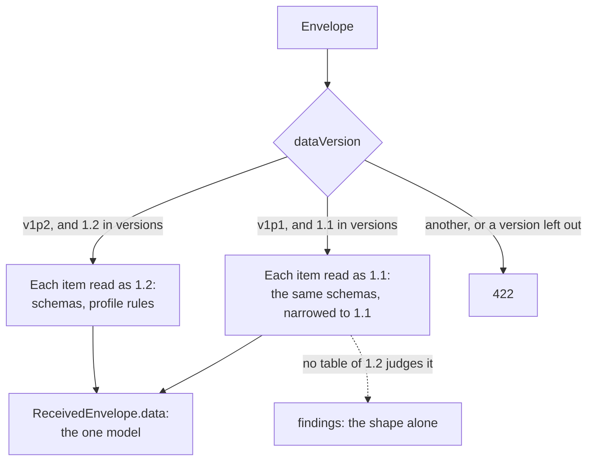

# Caliper 1.1

The package writes Caliper 1.2 and reads Caliper 1.1. An endpoint that old sensors still send to takes their envelopes, and the
readers take their events and entities into the same model as 1.2, so that a host handles one set of types. Nothing writes 1.1:
`buildEvent` and `sendCaliper` produce 1.2.



## Quick start

```ts
import { readEvent, validateEvent } from "@interopkit/learning-analytics";

const document = {
  "@context": "http://purl.imsglobal.org/ctx/caliper/v1p1",
  id: "urn:uuid:3a648e68-f00d-4c08-aa59-8738e1884f2c",
  type: "ToolUseEvent",
  actor: { id: "https://example.edu/users/554433", type: "Person" },
  action: "Used",
  object: { id: "https://example.edu", type: "SoftwareApplication" },
  eventTime: "2018-11-15T10:15:00.000Z",
};
readEvent(document, { version: "1.1" }).type; // => "ToolUseEvent"
validateEvent({ ...document, profile: "ToolUseProfile" }, { version: "1.1" }).map(({ path, rule }) => `${path} ${rule}`); // => ["profile invalid-value"]
```

An endpoint reads both versions unless the host names the ones it reads:

```ts
import { handleCaliperRequest } from "@interopkit/learning-analytics/endpoint";

const received = [];
const options = {
  authorize: async () => ({ principal: "exam-app" }),
  accept: async (envelope) => {
    received.push(envelope);
  },
};
const body = JSON.stringify({
  sensor: "https://exam.example/sensors/1",
  sendTime: "2018-11-15T11:05:01.000Z",
  dataVersion: "http://purl.imsglobal.org/ctx/caliper/v1p1",
  data: [{ "@context": "http://purl.imsglobal.org/ctx/caliper/v1p1", id: "https://example.edu/users/554433", type: "Person" }],
});
const request = {
  method: "POST",
  url: "https://lrs.example/caliper",
  headers: { "content-type": "application/json", authorization: "Bearer secret-1" },
  body: new TextEncoder().encode(body),
};
const response = await handleCaliperRequest(request, options);
response.status; // => 200
received[0].dataVersion; // => "http://purl.imsglobal.org/ctx/caliper/v1p1"
const only12 = await handleCaliperRequest(request, { ...options, versions: ["1.2"] });
only12.status; // => 422
```

## What is read as 1.1

| Part                  | Read                                                                                                                                                                              |
| --------------------- | --------------------------------------------------------------------------------------------------------------------------------------------------------------------------------- |
| `@context`            | The context of 1.1, one of the six contexts of its extension profiles, or a list that ends with one of them. The contexts of 1.2 and of the Library Use Profile are refused       |
| Events                | 13 of the 15 of Appendix B, the generic `Event`, and the events of the Feedback, Resource Management, Search, Survey and Tool Launch profiles                                      |
| Entities              | 43 of the 48 of Appendix C, the `TextPositionSelector`, the generic `Entity`, and the entities of the extension profiles                                                          |
| Actions               | Those of the table of each event; an action that 1.1 deprecated for an event is refused for it, and the generic `Event` still takes it                                             |
| Ranges                | The classes that the tables of 1.1 name, which are those of 1.2 but for the target of a `NavigationEvent` and of a `ViewEvent`, a `Frame` alone                                   |
| Judging               | `validateEvent` and `validateEntity` list the findings of the shape. The tables of the profiles and the recommendations are those of 1.2, so they judge no event of 1.1             |

The result is a value of the model of 1.2. The `@context` of each item stays as the sender wrote it.

## What is refused as 1.1

| What                                                                                     | Finding                                                                                          |
| ---------------------------------------------------------------------------------------- | ------------------------------------------------------------------------------------------------ |
| A class that only 1.2 defines: the four classes of the Library Use Profile, `SystemIdentifier`, and its three events | `expected an entity of type ...` or `expected an event of any class`                            |
| A class that 1.1 deprecated: `OutcomeEvent`, `ReadingEvent`, `Reading`, `EpubChapter`, `EpubPart`, `EpubSubChapter`, `EpubVolume` | The same, with `which Caliper 1.1 deprecated and the reader does not take`        |
| A property that 1.2 added: `profile`, `otherIdentifiers`, `storageName`, `client`, `host`, `ipAddress`, `userAgent` | `Caliper 1.1 does not define the property ..., which Caliper 1.2 added`                          |
| A property that 1.1 deprecated: `navigatedFrom`, `objectType`, `alignedLearningObjective`, the `actor` of an attempt and the scores of a result | `unexpected property`: the model does not have them, and a custom attribute belongs in `extensions` |
| An action or a role that 1.2 added: `Accessed`, `Attended`, `Manager#Manager`             | `expected an action of Caliper 1.1, found ..., which Caliper 1.2 added`                          |
| The keywords `@id` and `@type`, which 1.1 deprecated for `id` and `type`                 | `unexpected property`                                                                            |

An item that does not read is left out of `ReceivedEnvelope.data` and named in `findings`, as for 1.2. With `strict` it refuses
the envelope.

## Options

| Option                          | Meaning                                                                                                              | Default        |
| ------------------------------- | -------------------------------------------------------------------------------------------------------------------- | -------------- |
| `version` of `readEvent`, `readEntity`, `validateEvent` and `validateEntity` | The version of Caliper that governs the document: `"1.2"` or `"1.1"`                                          | `"1.2"`        |
| `versions` of `handleCaliperRequest` and `readEnvelope` | The versions the endpoint reads, in the order it announces them as `caliperSupportedVersions`. An envelope of another version is answered 422 | `["1.2", "1.1"]` |

`CALIPER_VERSIONS` lists the two, and `CALIPER_1_1_CONTEXT` is the context of 1.1 that an envelope names in `dataVersion`.

## Errors

| Error                       | When                                                                                          | What to do                                       |
| --------------------------- | --------------------------------------------------------------------------------------------- | ------------------------------------------------ |
| `DataError`                 | `version` is not `"1.2"` or `"1.1"`, `versions` is empty, repeats a version or holds another  | Fix the call                                     |
| `DataError`                 | A document does not read as the version: the `DataError` names the path                       | Ask the sender for 1.2, or change what it sends  |
| 422 from the endpoint       | The `dataVersion` names a version that `versions` leaves out, or none that the package knows  | Add the version to `versions`, or ask the sender |

## Limits

The limits of [receiving events](./endpoint.md) hold for both versions: 1,048,576 bytes, 64 levels, 1,000,000 tokens and 1,000
findings. The memory of a 1.1 reading is that of a 1.2 reading.

## Not included

| What                                                                         | Why                                                                                                         |
| ---------------------------------------------------------------------------- | ----------------------------------------------------------------------------------------------------------- |
| Writing Caliper 1.1                                                          | 1.2 supersedes it, and a sensor that must send 1.1 is an old sensor                                         |
| Caliper 1.0, and the `@id` and `@type` of its documents                      | 1EdTech retired 1.0                                                                                         |
| The Sensor API libraries of 1.1                                              | Section 5 of 1.2 supersedes them                                                                            |
| Reading the deprecated classes of 1.1                                        | 1.1 targets them for removal and the model of 1.2 has none of them: an item that uses one is a finding      |
| JSON-LD expansion of a 1.1 document                                          | The terms are fixed strings, and the endpoint never dereferences a context                                  |

## Differences from the references

| Reference                                                                                  | Difference                                                                                                                                         |
| ------------------------------------------------------------------------------------------ | -------------------------------------------------------------------------------------------------------------------------------------------------- |
| The contexts and the schemas of 1.1                                                        | They disagree with the fixtures and with each other in places; each is in [spec-gaps](./spec-gaps.md)                                                |
| A `ToolUseEvent` whose `generated` is not an `AggregateMeasureCollection`                  | The table of 1.1 allows any entity; the model takes the collection that the Tool Use Profile names, so the item is a finding                         |
| The extension contexts at `purl.imsglobal.org`                                             | Four of the six answer 404. The package never fetches a context, and the tests read them from `caliper-spec`                                         |
