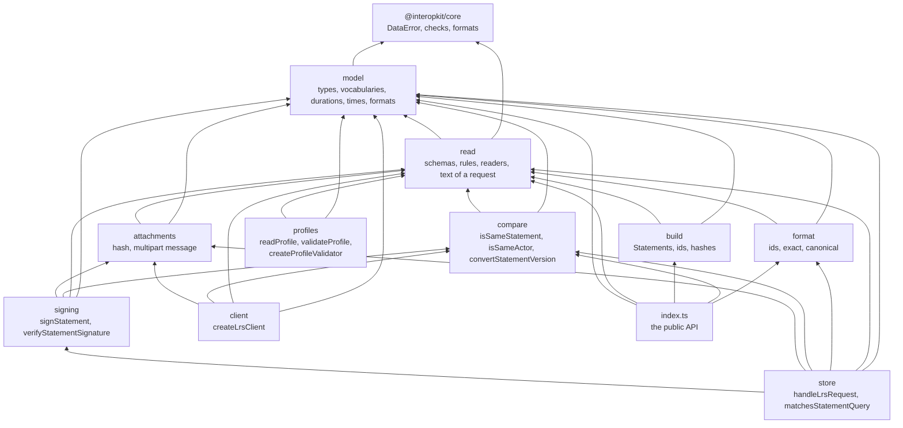
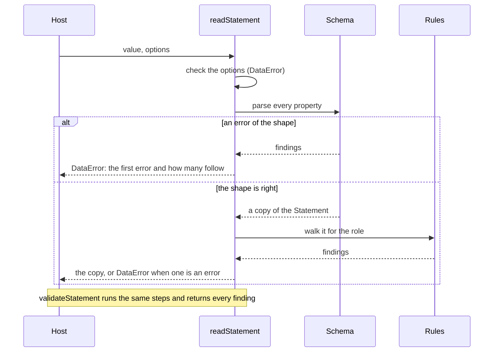

# Architecture of learning-records

`@interopkit/learning-records` has ten modules over one model. `read` turns untrusted data into the model and judges it;
`build`, `compare` and `format` make, compare and write Statements, each reading with `read` first, and never import one another.
`attachments`, `signing`, `client` and `store` are the layers above them, and `profiles` judges Statements against xAPI Profiles
with `read` alone.

| Module        | Files                                                                                                                 | Holds                                                                                                                                          |
| ------------- | --------------------------------------------------------------------------------------------------------------------- | ---------------------------------------------------------------------------------------------------------------------------------------------- |
| `model`       | `statement.ts`, `actor.ts`, `activity.ts`, `result.ts`, `context.ts`, `attachment.ts`                                 | The types of every table of the standard                                                                                                       |
|               | `terms.ts`, `language-map.ts`, `json.ts`                                                                              | The vocabularies as tuples with their types, `LanguageMap` and `Extensions`                                                                    |
|               | `duration.ts`, `timestamp.ts`, `formats.ts`                                                                           | The data types: the grammar of a duration, the form of a time, `mbox`, hashes and media types                                                  |
| `read`        | `schemas.ts`                                                                                                          | The valibot schema of a Statement and of what it holds: shape, types and forms                                                                 |
|               | `walk.ts`, `rules.ts`                                                                                                 | The walk over a Statement and the composition of the rules between properties                                                                  |
|               | `identifiers.ts`, `results.ts`, `relations.ts`, `interaction.ts`, `response-pattern.ts`                               | The rules, one concept to a file                                                                                                               |
|               | `provider.ts`                                                                                                         | What only a Learning Record Provider is held to                                                                                                |
|               | `identified.ts`, `statement-query.ts`                                                                                 | The Agents and Groups that a request may name, and the filters of a query                                                                      |
|               | `inspect.ts`, `read-statement.ts`, `options.ts`, `parse-statement-json.ts`                                            | The parse, the readers and validators, the check of the options, and the text of a request                                                     |
| `build`       | `build-statement.ts`, `build-voiding-statement.ts`                                                                    | The Statement of an event and the Statement that voids another                                                                                 |
|               | `derive-statement-id.ts`, `mbox-sha1sum.ts`                                                                           | The id of an event, as a UUID of version 5, and the hash of an address                                                                         |
| `compare`     | `is-same-statement.ts`, `canonical.ts`                                                                                | The comparison, and the canonical text that two Statements share when they are the same                                                        |
| `format`      | `format-statement.ts`, `options.ts`                                                                                   | `formatStatement` and the check of its format and options                                                                                      |
|               | `format-ids.ts`, `format-canonical.ts`, `language.ts`, `transform.ts`                                                 | The two formats that change a Statement, the choice of a language, and the copy that changes Agents, Activities and Verbs                      |
| `attachments` | `hash-attachment.ts`, `limits.ts`                                                                                     | The SHA-256 of the data and the hash of any length, and the limits of a message                                                                |
|               | `read-multipart.ts`, `write-multipart.ts`                                                                             | The `multipart/mixed` message of Statements and Attachments, read and written                                                                  |
| `signing`     | `constants.ts`, `sign-statement.ts`, `verify-statement-signature.ts`                                                  | The usage type, the algorithms, the signature of a Statement and its verification                                                              |
| `client`      | `config.ts`, `request.ts`, `options.ts`                                                                               | The checks of the configuration and the one place that makes a request                                                                         |
|               | `statements.ts`, `query.ts`, `documents.ts`, `resources.ts`, `client.ts`                                              | The Statement resource and its query, the three document resources, the Agents, Activities and About resources, and the client                 |
| `store`       | `router.ts`, `options.ts`, `ports.ts`, `status.ts`, `verdict.ts`, `parameters.ts`, `version.ts`, `basic.ts`           | The checks every request goes through, the options and the ports, the refusals, the parameters that resources share, and the Basic credentials |
|               | `statements/`                                                                                                         | The Statements resource: its parameters, body, preparation, storing, and answers                                                               |
|               | `documents/`                                                                                                          | The State and profile resources: parameters, ETags and preconditions, merge, the calls to the store, and the reads, writes and removals        |
|               | `agents.ts`, `activities.ts`, `about.ts`                                                                              | The Agents, Activities and About resources                                                                                                     |
|               | `query.ts`                                                                                                            | The filters of a query, with the Statement References                                                                                          |
| `profiles`    | `profile.ts`, `concepts.ts`, `templates.ts`, `patterns.ts`, `schemas.ts`                                              | The model of a profile, its vocabularies and constants, and its shape                                                                          |
|               | `document-rules.ts`, `profile-rules.ts`, `concept-rules.ts`, `template-rules.ts`, `pattern-rules.ts`, `references.ts` | The rules of Part Two, one concern to a file, over what the ids of the profile and of the others name                                          |
|               | `read-profile.ts`, `json-path.ts`                                                                                     | The reader and the validator, and the JSONPath of the rules                                                                                    |
|               | `template-match.ts`, `judge-statement.ts`                                                                             | The Statement Template algorithm: Determining Properties, rules, StatementRefs, extensions in their place                                      |
|               | `pattern-match.ts`, `registrations.ts`, `profile-validator.ts`                                                        | The Pattern algorithm, the series of each registration, and the validator                                                                      |

`@interopkit/core/checks` holds what other standards need as much: strict records, the formats of a time, a UUID, a URI and a
language tag, the copy of JSON within a depth limit, the check of the depth of a text, the conversion of the issues of a parse to
findings, and the sentence of a refusal.

Each module has an `index.ts`, its public API, and some have an `internal.ts` that the package and its tests share and the package
does not export. `pnpm check:standards` and Biome keep modules from importing by a deep path or against the layers.

## Reading

The schema is written once for both roles. The rules between properties run on the copy that the schema returns, and one walk
visits every Agent, Group, Activity, Result and SubStatement of it, so that a rule is written for one kind of part and applies
wherever the part is. The only rule that reads the input and not the copy is `single-activity`, because the copy already holds
a list where the input had one Activity.

## Boundaries

| The package owns                                                                                                                                                                                                                                                                                | The package does not own                                                        |
| ----------------------------------------------------------------------------------------------------------------------------------------------------------------------------------------------------------------------------------------------------------------------------------------------- | ------------------------------------------------------------------------------- |
| The model of a Statement of xAPI 2.0 and 1.0.3, its readers and validators, the text of a request, builders, comparison and formats, the message of Attachments, the signature of a Statement, the client of an LRS, the handler of its requests, xAPI Profiles with the matching of Statements | Storing Statements, a web server, obtaining credentials, cmi5 (`course-launch`) |

The package calls the network only through the `fetch` of the client, keeps nothing between calls, and reads the time only from
the `clock` of the handler; its runtimes are in [the README](../../packages/learning-records/README.md#architecture).
