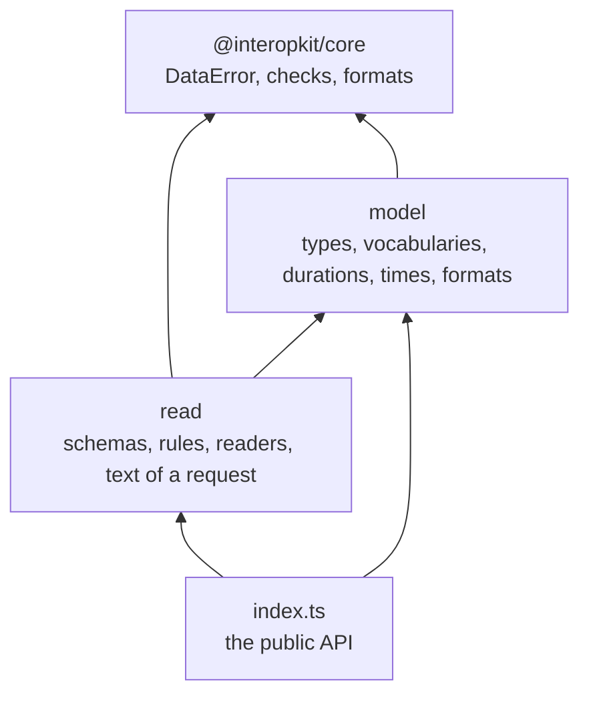
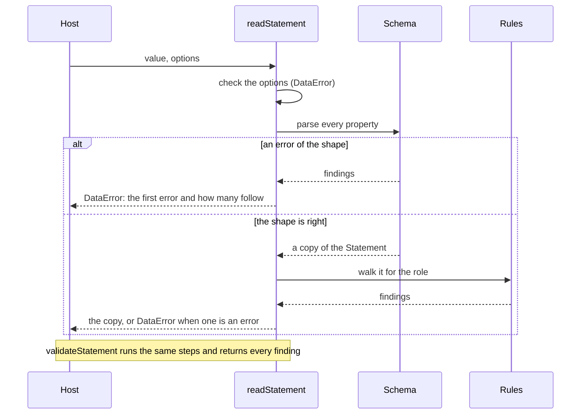

# Architecture of learning-records

`@interopkit/learning-records` has two modules so far that share one model. `model` holds the types, the vocabularies and the
data types. `read` turns untrusted data into the model and judges it. `model` imports nothing of the family, and `read` imports
only `model` and `@interopkit/core`.

| Module  | Files                                                                                   | Holds                                                                                         |
| ------- | --------------------------------------------------------------------------------------- | --------------------------------------------------------------------------------------------- |
| `model` | `statement.ts`, `actor.ts`, `activity.ts`, `result.ts`, `context.ts`, `attachment.ts`   | The types of every table of the standard                                                      |
|         | `terms.ts`, `language-map.ts`, `json.ts`, `issue.ts`                                    | The vocabularies as tuples with their types, `LanguageMap`, `Extensions` and `StatementIssue` |
|         | `duration.ts`, `timestamp.ts`, `formats.ts`                                             | The data types: the grammar of a duration, the form of a time, `mbox`, hashes and media types |
| `read`  | `schemas.ts`                                                                            | The valibot schema of a Statement and of what it holds: shape, types and forms                |
|         | `walk.ts`, `rules.ts`                                                                   | The walk over a Statement and the composition of the rules between properties                 |
|         | `identifiers.ts`, `results.ts`, `relations.ts`, `interaction.ts`, `response-pattern.ts` | The rules, one concept to a file                                                              |
|         | `provider.ts`                                                                           | What only a Learning Record Provider is held to                                               |
|         | `inspect.ts`, `read-statement.ts`, `options.ts`, `read-statement-json.ts`               | The parse, the readers and validators, the check of the options, and the text of a request    |

`@interopkit/core/checks` holds what other standards need as much: strict records, the formats of a time, a UUID, a URI and a
language tag, the copy of JSON within a depth limit, the check of the depth of a text, the conversion of the issues of a parse to
findings, and the sentence of a refusal.

Each module has an `index.ts`, its public API, and both have an `internal.ts` for what the package and its tests share and the
package does not export. `pnpm check:standards` and Biome keep modules from importing by a deep path or against the layers.

## Reading

The schema is written once for both roles. The rules between properties run on the copy that the schema returns, and one walk
visits every Agent, Group, Activity, Result and SubStatement of it, so that a rule is written for one kind of part and applies
wherever the part is. The only rule that reads the input and not the copy is `single-activity`, because the copy already holds
a list where the input had one Activity.

## Boundaries

| The package owns                                                                        | The package does not own                                                  |
| --------------------------------------------------------------------------------------- | ------------------------------------------------------------------------- |
| The model of a Statement of xAPI 2.0, its readers and validators, the text of a request | Storing Statements, serving requests, authentication, xAPI Profiles, cmi5 |

The package makes no request, keeps nothing between calls, reads no clock and no environment variable, and imports no other
family of interopkit. It uses no API outside web standards, so it runs in Node.js, browsers, Deno, Bun and Cloudflare Workers.
