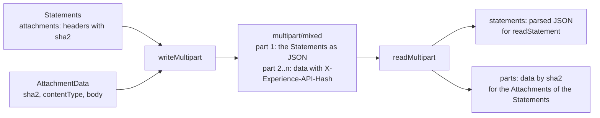

# Attachments of Statements

A Statement lists the headers of its Attachments, and the data travel apart from it: as a `fileUrl` that the data can be fetched
from, or as the parts of a `multipart/mixed` message (4.1.3). `@interopkit/learning-records/attachments` writes and reads that
message and computes the hash that names each part.



## Quick start

```ts
import { hashAttachment, readMultipart, writeMultipart } from "@interopkit/learning-records/attachments";

const body = new TextEncoder().encode("A certificate of completion");
const sha2 = hashAttachment(body);
const statement = {
  actor: { name: "Example Learner", mbox: "mailto:learner@example.org" },
  verb: { id: "http://adlnet.gov/expapi/verbs/completed", display: { "en-US": "completed" } },
  object: { id: "https://example.org/activities/course-1" },
  attachments: [
    {
      usageType: "https://example.org/attachments/certificate",
      display: { "en-US": "Certificate" },
      contentType: "text/plain",
      length: body.byteLength,
      sha2,
    },
  ],
};
const message = writeMultipart(statement, [{ sha2, contentType: "text/plain", body }]);
message.contentType.startsWith("multipart/mixed; boundary="); // => true
const read = readMultipart(message.contentType, message.body);
read.statements; // => statement
new TextDecoder().decode(read.parts.get(sha2)?.body); // => "A certificate of completion"
```

`writeMultipart` returns the `Content-Type` header, with the boundary, and the body. A client sends them as the header and the
body of the request; an LRS answers a query with `attachments=true` the same way.

## What is written and what is read

| Part             | Written                                                                                                     | Read                                                                                                           |
| ---------------- | ----------------------------------------------------------------------------------------------------------- | -------------------------------------------------------------------------------------------------------------- |
| First            | `Content-Type: application/json`, then one Statement (PUT), an array (POST) or a result with `more` (a GET) | `Content-Type` absent or `application/json` with any parameters; the JSON is read by `parseStatementJson`       |
| Others           | `Content-Type`, `Content-Transfer-Encoding: binary` and `X-Experience-API-Hash`, the hash in lower case     | The hash is required; the encoding is `binary` when absent; the type is `application/octet-stream` when absent |
| Boundary         | `interopkit-` and 32 hexadecimal digits of the hash of the first part and of the hashes of the other parts  | One to 70 characters, in the `boundary` parameter, quoted or not                                               |
| `Content-Length` | Not written                                                                                                 | Checked against the data when a part has it                                                                    |

A part is matched to the Attachment of a Statement by the hash and in no other way. `readMultipart` checks that the data of a
part have the hash that the part declares, with the length of the hash choosing SHA-224, SHA-256, SHA-384 or SHA-512, and returns
the data by the hash in lower case. It does not look at the Statements: the caller reads them with `readStatement` or
`validateStatements`, and looks up the `sha2` of each Attachment that has no `fileUrl` in `parts`. An LRS refuses a Statement
whose Attachment has neither a `fileUrl` nor a part.

`writeMultipart` writes a message that an LRS accepts, and refuses one that it would not: every Statement is read as an LRS reads
it, each part holds the data of its hash, no hash appears twice, every part belongs to an Attachment of the Statements, and every
Attachment without a `fileUrl` has its part. The boundary comes from the content, so the same input gives the same message, and
no part can hold the boundary, since it would have to hold its own hash.

## Options and limits

`readMultipart` takes the limits as its third argument. The parser stops at the first limit, before it holds more than the limit
in memory.

| Option          | Default    | Meaning                                                                                       |
| --------------- | ---------- | --------------------------------------------------------------------------------------------- |
| `maxParts`      | 100        | The most parts, the Statements included                                                       |
| `maxPartBytes`  | 10,485,760 | The most bytes of the content of one part, the Statements included                            |
| `maxTotalBytes` | 10,485,760 | The most bytes of the content of all parts together; the headers of the parts are not counted |
| `maxDepth`      | 64         | The deepest nesting of arrays and objects in the JSON of the first part; `[]` has depth 1     |
| `maxTokens`     | 1,000,000  | The most tokens of JSON in the first part, counted before it is parsed                        |

The headers of a part are at most 8,192 bytes, which the parser fixes. The first part is also read within the limits of
`parseStatementJson`: `maxPartBytes` bytes, `maxDepth` levels and `maxTokens` tokens.

## Errors

Every error is a `DataError`. A message over a limit is a `LimitError` of `@interopkit/core`, a `DataError` whose `limit` is
`maxParts`, `maxPartBytes`, `maxTotalBytes`, `maxHeaderBytes` (fixed at 8,192), or `maxDepth` or `maxTokens` of the first part,
with its value in `maximum`, so that a host answers 413 for it and 400 for a malformed message, whose `cause` is the error of the
parser.

| Error                                                                                              | When                                                            | What to do                                                         |
| -------------------------------------------------------------------------------------------------- | --------------------------------------------------------------- | ------------------------------------------------------------------ |
| `The content type must be multipart/mixed, found "<value>".`                                       | The header names another type                                   | Answer 400, or read the body as JSON when it is `application/json` |
| `The content type "<value>" has no boundary parameter.`                                            | The header has no `boundary`                                    | Answer 400                                                         |
| `The multipart message is not valid: <reason>.`                                                    | The message is cut off, malformed, or over a limit              | Answer 400, or 413 for a limit                                     |
| `The multipart message has no part, and its first part must hold the Statements.`                  | The message is empty                                            | Answer 400                                                         |
| `The first part must be application/json, found "<value>".`                                        | The first part names another type                               | Answer 400                                                         |
| `A part after the first has no X-Experience-API-Hash header, which names the Attachment it holds.` | A part has no hash                                              | Answer 400                                                         |
| `The part with the hash <hash> holds data that have another hash.`                                 | The data do not have the declared hash                          | Answer 400; the data changed on the way                            |
| `The Content-Transfer-Encoding of a part must be binary, found "<value>".`                         | A part is encoded                                               | Send the data as they are                                          |
| `The part <n> is invalid at <path>: <sentence>.`                                                   | `writeMultipart` was given a part with a bad hash, type or body | Pass `{ sha2, contentType, body }` with the hash of `body`         |
| `The part with the hash <hash> belongs to no Attachment of the Statements.`                        | `writeMultipart` was given data that no Statement names         | Drop the part, or add its Attachment to a Statement                |
| `The Attachment with the hash <hash> has no fileUrl, and no part holds its data.`                  | `writeMultipart` was given an Attachment with neither           | Add the part, or a `fileUrl`                                       |

## Not included

| Not included                                            | Why                                                                                              |
| ------------------------------------------------------- | ------------------------------------------------------------------------------------------------ |
| Streaming a message                                     | The message is in memory within the limits; a host that streams uses the parser's own stream API |
| Fetching the data at a `fileUrl`                        | A fetch is the host's: it knows which addresses a service may call                               |
| Matching the parts to the Statements in `readMultipart` | The Statements are not yet read there; the LRS and the client match after `readStatement`        |
| Other encodings than `binary`                           | The standard asks for `binary`                                                                   |

## Differences from the references

| Reference    | Difference                                                                                                                                                              |
| ------------ | ----------------------------------------------------------------------------------------------------------------------------------------------------------------------- |
| The standard | The first part "shall be" `application/json` when it names a type; a part with none is read as JSON anyway. A part with no `Content-Type` is `application/octet-stream` |
| The standard | "Should only include one copy" of the data of an Attachment that several Statements use: the writer refuses two parts with one hash, and the reader keeps the first     |
| The standard | An LRS "shall reject" a Statement whose Attachment has neither a `fileUrl` nor a matching part; the writer refuses the same, and also a part that no Attachment names   |
