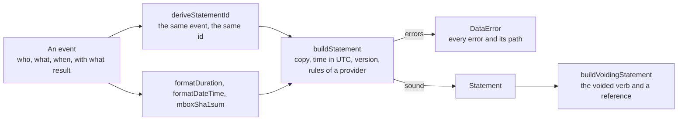

# Building Statements

A Learning Record Provider makes a Statement of an event with `buildStatement`, gives it an id that a resend repeats with
`deriveStatementId`, and voids it with `buildVoidingStatement`. `formatDuration`, and `formatDateTime` of `@interopkit/core/checks`,
write the two values that a provider is most often wrong about, and `mboxSha1sum` hides an email address behind its hash.



## Quick start

```ts
import { formatDateTime } from "@interopkit/core/checks";
import {
  buildStatement,
  buildVoidingStatement,
  deriveStatementId,
  formatDuration,
  mboxSha1sum,
} from "@interopkit/learning-records";

// A UUID that the host keeps for all time: it is part of every id it derives.
const NAMESPACE = "6ba7b810-9dad-11d1-80b4-00c04fd430c8";
deriveStatementId(NAMESPACE, "www.example.com"); // => "2ed6657d-e927-568b-95e1-2665a8aea6a2"

const id = deriveStatementId(NAMESPACE, "learner-1/course-1/attempt-1");
const statement = buildStatement({
  id,
  actor: { mbox_sha1sum: mboxSha1sum("mailto:learner@example.org") },
  verb: { id: "http://adlnet.gov/expapi/verbs/completed", display: { "en-US": "completed" } },
  object: { id: "https://example.org/activities/course-1" },
  result: { completion: true, duration: formatDuration(5_432_150) },
  timestamp: "2024-06-13T20:46:03.25+02:00",
});
statement.timestamp; // => "2024-06-13T18:46:03.250Z"
statement.result?.duration; // => "PT1H30M32.15S"
statement.version; // => "2.0.0"
statement.actor.mbox_sha1sum?.length; // => 40
formatDateTime(1_718_304_363_250); // => "2024-06-13T18:46:03.250Z"

const voiding = buildVoidingStatement(id, {
  id: deriveStatementId(NAMESPACE, "learner-1/course-1/attempt-1/void"),
  actor: { mbox: "mailto:admin@example.org" },
  timestamp: "2024-06-14T09:00:00Z",
});
voiding.object; // => { objectType: "StatementRef", id }
```

## Functions

| Function                                          | Does                                                                                                                                                                      | Throws                                                |
| ------------------------------------------------- | ------------------------------------------------------------------------------------------------------------------------------------------------------------------------- | ----------------------------------------------------- |
| `buildStatement(input, options?)`                 | Copies the input, writes `timestamp` in UTC with milliseconds and the `version`, and reads the result with the rules of a provider of that version. Returns the Statement | `DataError` that names every error with its path      |
| `buildVoidingStatement(target, input, options?)`  | Builds the Statement with the voided verb, whose Object is a Statement Reference to `target`. The target need not exist                                                   | `DataError` for the target, or as `buildStatement`    |
| `deriveStatementId(namespace, name)`              | Returns the UUID of version 5 of a name in a namespace, so that a resend of an event repeats the id and an LRS keeps the first copy                                       | `DataError` for a namespace or a name that is wrong   |
| `formatDuration(milliseconds)`                    | Writes a length of time as an ISO 8601 duration of hours, minutes and seconds, cut at 0.01 second: `PT1H30M32.15S`                                                        | `DataError` for anything but a whole number from 0    |
| `parseDuration(text)`                             | Reads a duration of ISO 8601 4.4.3.2 into years, months, days, hours, minutes and seconds                                                                                 | `DataError` for text that is not a duration           |
| `isDuration(text)`                                | Tells whether `parseDuration` reads the text                                                                                                                              | none                                                  |
| `formatDateTime(at)` of `@interopkit/core/checks` | Writes whole epoch milliseconds as a Timestamp in UTC with milliseconds; `buildStatement` writes a `timestamp` with any offset so                                         | `DataError` for a time outside the years 0000 to 9999 |
| `mboxSha1sum(mailto)`                             | Returns the SHA-1 of a `mailto` IRI as 40 hexadecimal digits, for `mbox_sha1sum`                                                                                          | `DataError` for text that is not a `mailto` IRI       |

## What `buildStatement` takes

| Property                           | Required | Meaning                                                                                                                        |
| ---------------------------------- | -------- | ------------------------------------------------------------------------------------------------------------------------------ |
| `id`                               | yes      | A UUID. A resend repeats it, so a builder does not make one up                                                                 |
| `actor`                            | yes      | An Agent or a Group                                                                                                            |
| `verb`                             | yes      | The action                                                                                                                     |
| `object`                           | yes      | An Activity, Agent, Group, Statement Reference or SubStatement                                                                 |
| `timestamp`                        | yes      | An RFC 3339 date and time with any offset; the result is in UTC. A SubStatement's own `timestamp` is checked and kept as it is |
| `result`, `context`, `attachments` | no       | As in the model                                                                                                                |

Any other property is refused: `stored`, `authority` and `version` are set by the LRS or by the builder. The `version` is
written although a provider should not send one, so that a system of xAPI 1.0.x does not read the Statement as 1.0.0; the provider
rules call it a warning, and a warning does not keep a Statement from being built.

| Option    | Of                                        | Default   | Meaning                                                                                                                               |
| --------- | ----------------------------------------- | --------- | ------------------------------------------------------------------------------------------------------------------------------------- |
| `version` | `buildStatement`, `buildVoidingStatement` | `"2.0.0"` | The provider rules that apply: `"2.0.0"`, or `"1.0.3"`, whose Statements carry `1.0.0` and have no `contextAgents` or `contextGroups` |

## Limits

None are set here. The functions take values that are in memory, and the host limits what it reads.

## Errors

| Error                                                                                        | When                                                         | What to do                                          |
| -------------------------------------------------------------------------------------------- | ------------------------------------------------------------ | --------------------------------------------------- |
| `The statement is invalid. At actor: <sentence> At verb.id: <sentence>`                      | The Statement breaks a rule of a provider                    | Fix each path that the message names                |
| `A statement input has the properties "id", "actor", ... and "attachments", found "stored".` | The input has a property that a Statement is not built from  | Leave it out: the LRS sets `stored` and `authority` |
| `A statement input must be an object, found null.`                                           | The input is not an object                                   | Pass an object                                      |
| `The target must be the id of the Statement to void, as a UUID, found "x".`                  | The target is not a UUID                                     | Pass the `id` of the Statement                      |
| `The duration must be an ISO 8601 duration such as PT1H30M, found "1H".`                     | The text given to `parseDuration` is not a duration          | Pass `PT1H30M`, or ask `isDuration` first           |
| `The namespace must be a UUID, found "x".`                                                   | `deriveStatementId` got a namespace that is not a UUID       | Make a UUID once and keep it                        |
| `The mailto IRI must be "mailto:" and one email address, found "x".`                         | `mboxSha1sum` got something else                             | Pass `mailto:` and the address                      |
| `The time must be whole epoch milliseconds in the years 0000 to 9999, found x.`              | `formatDateTime` got another value                           | Pass whole milliseconds                             |
| `The duration in milliseconds must be a non-negative integer, found x.`                      | `formatDuration` got a fraction, a negative or another value | Round the milliseconds first                        |

## Not included

| Not included           | Why                                                                                                         |
| ---------------------- | ----------------------------------------------------------------------------------------------------------- |
| Sending the Statement  | A client is another module; the builders make values                                                        |
| Making an id at random | A resend must repeat the id; a random id is the host's choice, and a UUID of version 4 from the host passes |
| A clock                | A builder takes the time of the event as an argument; the host reads its own clock                          |
| Signing                | Another module, over a signer that the host passes                                                          |

## Differences from the references

| Reference          | Difference                                                                                                                                 |
| ------------------ | ------------------------------------------------------------------------------------------------------------------------------------------ |
| `@xapi/xapi` 3.0.3 | A client for 1.0.x with no builder that checks a Statement, and no duration or id helper                                                   |
| The standard       | A provider "should" send an id and "should not" send a version. The builder requires the id, and writes the version, for the reasons above |
