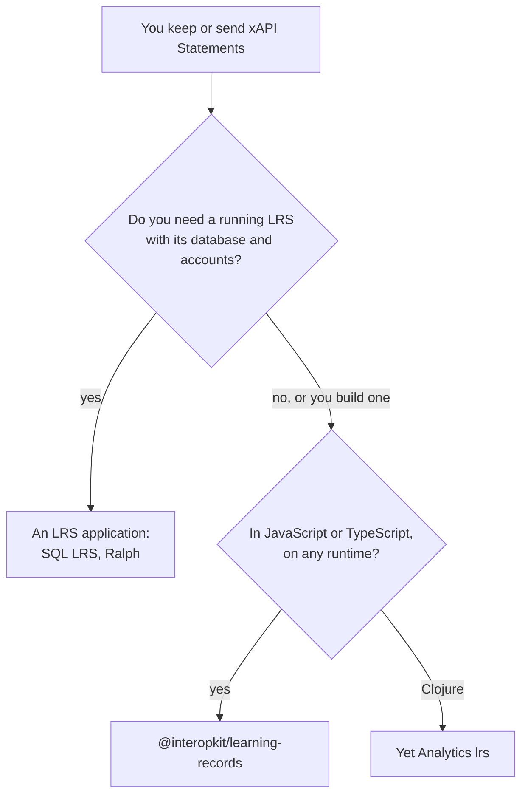

# Choosing learning-records

When `@interopkit/learning-records` fits a project that speaks xAPI, and when another library or LRS fits better. Each comparator
was read on 2026-11-02 at the version that [the comparators](comparators.md) give; that page maps all 71 of their capabilities,
of which the package has 46, has 3 in part and leaves 22 out with a reason.

| You need | Use |
| --- | --- |
| The model of a Statement of xAPI 2.0 and 1.0.3, read and judged by the rules of an LRS or of a provider | This package: `readStatement`, `validateStatement` |
| An LRS inside your own server, over your own storage | This package: `handleLrsRequest` over the store ports, as [the store guide](store.md) shows |
| A client of an LRS, signatures and Attachments | This package: `createLrsClient`, `/signing`, `/attachments` |
| Statements judged against an xAPI Profile | This package: `/profiles` |
| A finished LRS with storage, accounts and an admin interface | SQL LRS 0.9.11 or Ralph 5.1.0, applications that the package does not replace |

## What the others have that the package lacks

| Comparator, version | What it has | Here |
| --- | --- | --- |
| Learning Locker `xapi-service` `685c342` (unmaintained) | MongoDB, Redis and attachment storage in S3, Azure or Google; queues of statement processing; error tracking | Excluded: storage, scheduling and logging are the host's |
| SQL LRS 0.9.11 | OIDC login, an admin API and interface, SQLite, PostgreSQL, MySQL and MariaDB, reactions, TLS and CORS | Excluded: an application and its storage |
| Yet Analytics `lrs` 1.5.2 | Routes and interceptors of Pedestal, a CORS interceptor, an OpenAPI description | Excluded: the package is free of any web framework |
| Ralph 5.1.0 | Models of the video and virtual classroom profiles | In part: the model and its rules; a profile's models are the profile's |
| Ralph 5.1.0 | Converters from the events of edX, several storage backends, a command line | Excluded: one platform's mapping, storage, an application |
| `@xapi/xapi` 3.0.3 | Constants of the ADL verbs and attachment usages | In part: the two that the standard reserves |
| `@xapi/xapi` 3.0.3 | Launch data of TinCan and of xAPI Launch, `toBasicAuth` | Excluded: launch is cmi5's, in [`@interopkit/course-launch`](../course-launch/choosing.md) |
| TinCanJS 0.50.0 (unmaintained) | Several LRSs written at once, launch from the query string, versions 0.9 and 0.95 | Excluded: one client per LRS; versions before 1.0 |
| ADL xAPIWrapper 1.11.0 (unmaintained) | ADL verbs and activity types; `XDomainRequest` | In part, as `@xapi/xapi`; a browser that no runtime supports |
| Persephone, Pan, the Profile Server | A command line and a server for profiles, matching one Statement at a time with kept state, SPARQL | Excluded: applications; the package judges a series of Statements |

## Where the evidence is

[The evidence](evidence.md) gives the ADL suites, 1,442 tests of 2.0 and 1,365 of 1.0.3 at their pinned commits, and SQL LRS as
a counterparty; [performance](performance.md) times the readers against the validator of Learning Locker.
