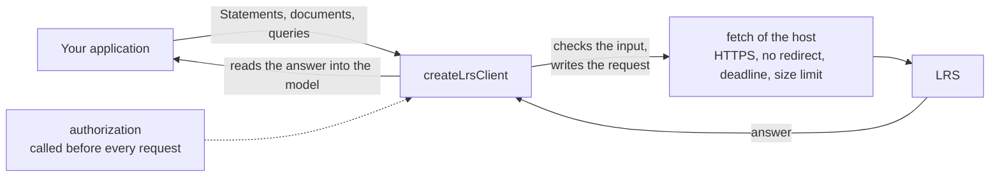

# The client of an LRS

`@interopkit/learning-records/client` speaks to a Learning Record Store over HTTPS: the seven resources of the standard, with the
preconditions that the version asks for, the pages of a query, and the data of Attachments. It makes its requests with the
`fetch` that the host passes, and keeps nothing between calls.



## Quick start

```ts
import { createLrsClient } from "@interopkit/learning-records/client";

const client = createLrsClient({
  endpoint: "https://lrs.example.org/xapi/",
  fetch: async (url, init) => new Response(JSON.stringify({ version: ["2.0.0", "1.0.3"] }), { status: 200 }),
  authorization: async () => "Bearer a-token-that-the-host-refreshes",
});
await client.about(); // => { version: ["2.0.0", "1.0.3"] }
```

A host passes the global `fetch`, or a function that checks where a request goes: the package does not (a host whose address comes
from a counterparty needs a `fetch` that refuses private addresses). The calls:

```ts
import { createLrsClient } from "@interopkit/learning-records/client";

const statement = {
  id: "6690e6c9-3ef0-4ed3-8b37-7f3964730bee",
  actor: { name: "Example Learner", mbox: "mailto:learner@example.org" },
  verb: { id: "http://adlnet.gov/expapi/verbs/completed", display: { "en-US": "completed" } },
  object: { id: "https://example.org/activities/course-1" },
};
const stored = createLrsClient({
  endpoint: "https://lrs.example.org/xapi/",
  fetch: async (url, init) => new Response(null, { status: 204 }),
});
await stored.sendStatement(statement); // => "stored"

const paged = createLrsClient({
  endpoint: "https://lrs.example.org/xapi/",
  fetch: async (url, init) =>
    new Response(JSON.stringify({ statements: [statement] }), {
      status: 200,
      headers: { "x-experience-api-consistent-through": "2026-01-15T10:30:00.000Z" },
    }),
});
const iterator = paged.queryStatements({ limit: 1 })[Symbol.asyncIterator]();
const page = await iterator.next();
page.value?.consistentThrough; // => "2026-01-15T10:30:00.000Z"
page.value?.statements.length; // => 1
```

## The calls

| Call                                      | Request                                               | Resolves with                                                                             | Other outcomes                          |
| ----------------------------------------- | ----------------------------------------------------- | ----------------------------------------------------------------------------------------- | --------------------------------------- |
| `sendStatement(statement, options?)`      | `PUT statements?statementId=`                         | `"stored"` for 204; `"conflict"` for 409                                                  | Any other status is a `ServiceError`    |
| `sendStatements(statements, options?)`    | `POST statements`                                     | The ids of the batch, in order, when every Statement has one; else the list of a 200      | Any other status is a `ServiceError`    |
| `getStatement(id, options?)`              | `GET statements?statementId=` or `voidedStatementId=` | The Statement; with `attachments: true`, `{ statement, attachments }`                     | `undefined` for 404                     |
| `queryStatements(query, options?)`        | `GET statements?` and then each `more`                | An iteration of `StatementPage`: Statements, Attachment data, `consistentThrough`, `more` | A page that fails rejects the iteration |
| `getDocument(target, options?)`           | `GET` of the resource of the target                   | `LrsDocument`: type, bytes, `etag`, `updated`                                             | `undefined` for 404                     |
| `putDocument(target, document, options?)` | `PUT`                                                 | `"written"` for 204; `"precondition-failed"` for 412; `"conflict"` for 409                | Any other status is a `ServiceError`    |
| `postDocument(target, json, options?)`    | `POST`, the JSON merged into the document             | As `putDocument`                                                                          | As `putDocument`                        |
| `deleteDocument(target, options?)`        | `DELETE`                                              | `"written"` for 204; `"precondition-failed"` for 412                                      | Any other status is a `ServiceError`    |
| `listDocumentIds(scope, options?)`        | `GET` of the resource, with no id                     | The ids, perhaps those after `since`                                                      |                                         |
| `deleteStates(scope, options?)`           | `DELETE activities/state` with no `stateId`           | Nothing                                                                                   |                                         |
| `getActivity(activityId, options?)`       | `GET activities?activityId=`                          | The `Activity`                                                                            |                                         |
| `getPerson(agent, options?)`              | `GET agents?agent=`                                   | The `Person`                                                                              |                                         |
| `about(options?)`                         | `GET about`                                           | `About`: the versions and the extensions                                                  |                                         |

A target names a document by its resource: `{ resource: "state", activityId, agent, stateId, registration? }`,
`{ resource: "agent-profile", agent, profileId }` or `{ resource: "activity-profile", activityId, profileId }`. A scope is a
target without the id. Every `agent` has exactly one identifier. Every call takes the `signal` of `CallOptions`.

Statements are read with the rules of an LRS, and a property given twice in an answer is refused. A Statement to send is
checked with the rules of a provider first. When `attachments` is passed to a send, even as an empty list, the request is a
multipart message written by `writeMultipart`; otherwise it is JSON, and each Attachment needs a `fileUrl`. A query that asks for
`attachments: true` is answered with a multipart message, and `StatementPage.attachments` holds the data by their hash. So does a
`getStatement` with `attachments: true`, which resolves with the Statement and the data.

## Concurrency

An LRS holds a document under an entity tag. A write says which version it changes: `{ ifMatch: etag }` for the version that has
that tag, `{ ifNoneMatch: "*" }` for a document that does not exist. The client refuses, before any request, a write that its
version requires a precondition for and has none.

| Write                          | xAPI 2.0.0 | xAPI 1.0.3 |
| ------------------------------ | ---------- | ---------- |
| `putDocument` to State         | Required   | Not needed |
| `putDocument` to a profile     | Required   | Required   |
| `postDocument`, any resource   | Required   | Not needed |
| `deleteDocument`, any resource | `ifMatch`  | Not needed |
| `deleteStates`                 | Not needed | Not needed |

A precondition that the version does not require is sent when the caller gives it. A write whose precondition fails resolves
`"precondition-failed"` (412); a PUT with none over a document that exists, or a merge that keeps losing a race, resolves
`"conflict"` (409). Read the document again with `getDocument` and write with its new `etag`.

## Options

| Option          | Of                              | Default    | Meaning                                                                                                |
| --------------- | ------------------------------- | ---------- | ------------------------------------------------------------------------------------------------------ |
| `endpoint`      | `LrsClientConfig`               | required   | The LRS before the resources, HTTPS, ending in a slash, with no credentials, query or fragment         |
| `fetch`         | `LrsClientConfig`               | required   | The `fetch` that makes the requests                                                                    |
| `version`       | `LrsClientConfig`               | `"2.0.0"`  | `"2.0.0"` or `"1.0.3"`: the `X-Experience-API-Version` header and the preconditions above              |
| `authorization` | `LrsClientConfig`               | none       | `(options) => Promise<string \| undefined>`: the `Authorization` header, asked for before each request |
| `timeoutMs`     | `LrsClientConfig`               | 10,000     | The most milliseconds of one request, from the request to the last byte                                |
| `maxBytes`      | `LrsClientConfig`               | 10,485,760 | The most bytes of one answer                                                                           |
| `maxTokens`     | `LrsClientConfig`               | 1,000,000  | The most tokens of JSON in one answer, counted before it is parsed                                     |
| `signal`        | `LrsClientConfig`               | none       | Ends every wait of the client                                                                          |
| `attachments`   | `SendOptions`                   | none       | The data of the Attachments, which makes the request a multipart message                               |
| `format`        | `GetStatementOptions`           | `"exact"`  | `ids`, `exact` or `canonical`                                                                          |
| `voided`        | `GetStatementOptions`           | false      | Fetch by `voidedStatementId`                                                                           |
| `attachments`   | `GetStatementOptions`           | false      | Fetch the data of the Attachments too: the answer is `{ statement, attachments }`                      |
| `precondition`  | `WriteOptions`, `DeleteOptions` | none       | `{ ifMatch }` or `{ ifNoneMatch: "*" }`; for a removal only `{ ifMatch }`                              |
| `since`         | `ListOptions`                   | none       | Only the ids stored or changed after this time, exclusive                                              |

The filters of `queryStatements` are the properties of `StatementQuery`: `agent`, `verb`, `activity`, `registration`,
`relatedActivities`, `relatedAgents`, `since`, `until`, `limit` (0 asks for the largest page), `format`, `attachments` and
`ascending`. A filter that is left out is not sent, so the LRS applies its own default.

## Limits

| Limit                                            | Value                                             | Refused with                   |
| ------------------------------------------------ | ------------------------------------------------- | ------------------------------ |
| Time of a request                                | `timeoutMs`, 10,000                               | `ServiceError` with status 0   |
| Bytes of an answer                               | `maxBytes`, 10,485,760                            | `ServiceError`                 |
| Redirects                                        | None followed                                     | `ServiceError` with the status |
| Pages of a query                                 | No limit; each is fetched when the iteration asks | The caller stops the iteration |
| Parts of a multipart answer                      | 10,000                                            | `DataError`                    |
| Bytes, depth and tokens of the JSON of an answer | `maxBytes`, 64 levels, `maxTokens` (1,000,000)    | `DataError`                    |

## Errors

| Error                                                                                              | When                                                                                  | What to do                                                                     |
| -------------------------------------------------------------------------------------------------- | ------------------------------------------------------------------------------------- | ------------------------------------------------------------------------------ |
| `ServiceError` with a status, headers and body                                                     | The LRS answered a status the call does not expect, or did not answer (status 0)      | Read `status`, `body` and `headers["retry-after"]`; the client retries nothing |
| `The LRS at <url> answered with data that is not valid xAPI: <reason>`                             | An answer breaks the standard                                                         | Report it to the LRS; the reason names the path                                |
| `The configuration of the client is invalid at <option>: <sentence>.`                              | A configuration option has the wrong type                                             | Pass the option as the table says                                              |
| `The option endpoint must be an https address that ends in a slash, ...`                           | The endpoint is not HTTPS, lacks the slash, or has credentials, a query or a fragment | Write `https://lrs.example.org/xapi/`                                          |
| `The option authorization must return a non-empty header value without line breaks, or undefined.` | The function returned text that could end the header                                  | Return the value of the header only                                            |
| `A <method> to the <resource> resource needs a precondition on xAPI <version>: pass ...`           | A write lacks the precondition its version requires                                   | Pass `precondition`                                                            |
| `The Statement needs an id to be stored with PUT: ...`                                             | `sendStatement` was given a Statement with no id                                      | Give it an id, or use `sendStatements`                                         |
| `The address of the next page, "<more>", is not on the origin of the LRS, ...`                     | `more` points to another origin                                                       | The client does not send its credential elsewhere; report the LRS              |
| `The LRS sent the address of a page that was fetched already: ...`                                 | `more` repeats an address                                                             | The LRS pages in a loop; report it                                             |
| `The answer has no X-Experience-API-Consistent-Through header, which the standard requires.`       | A page lacks the header                                                               | Report it to the LRS                                                           |

## Not included

| Not included                          | Why                                                                                                       |
| ------------------------------------- | --------------------------------------------------------------------------------------------------------- |
| Retries and backoff                   | A retry of a write needs the host's idea of what is safe to resend; `Retry-After` is in the error         |
| The rules of 1.0.3 for Statements     | `version: "1.0.3"` changes the header and the preconditions; Statements are checked with the rules of 2.0 |
| A language for `canonical` Statements | `Accept-Language` is not sent; the LRS chooses                                                            |
| `HEAD` requests                       | They return what GET does without a body, which a client has no use for                                   |
| The alternate request syntax          | Removed in 2.0; the client never sends it                                                                 |
| Getting a credential                  | `authorization` is the host's: Basic, bearer or OAuth 2.0 through `@interopkit/core/oauth`                |
| Fetching the data at a `fileUrl`      | A fetch is the host's: it knows which addresses may be called                                             |

## Differences from the references

| Reference    | Difference                                                                                                                                                                                                                                                |
| ------------ | --------------------------------------------------------------------------------------------------------------------------------------------------------------------------------------------------------------------------------------------------------- |
| The standard | The LRS "shall" answer a PUT with no precondition over an existing document with 409; the client requires a precondition on 2.0.0, so a write never replaces a document that the caller has not seen                                                      |
| The standard | A POST of a Statement that exists "shall" give 409 or 204 and not change it; the client takes 200 and 204 as success, and 409 as a `ServiceError`                                                                                                         |
| The standard | A POST answers 200 with the ids, and an LRS that holds the Statements already answers with none (SQL LRS) or with the new ones: where every Statement has an id the client resolves with the ids of the batch and refuses an answer that names another id |
| The standard | `more` is "an IRL"; the client follows an address that is relative or on the origin of the LRS, and refuses another                                                                                                                                       |
| The standard | `Last-Modified` is an HTTP date; `LrsDocument.updated` is the same time as ISO 8601                                                                                                                                                                       |
| `@xapi/xapi` | It reads no answer into a model, validates no Statement and takes no `AbortSignal`; this client checks every Statement, reads every answer into the model, takes the `signal` of `CallOptions`, and follows no redirect                                   |
