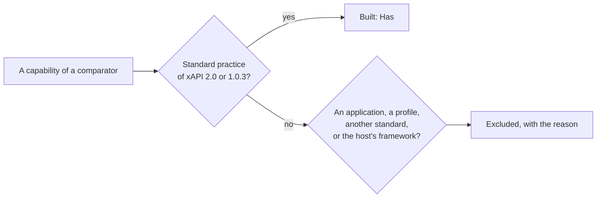

# Comparators

What the maintained and the widely used xAPI libraries and LRSs do, and where `@interopkit/learning-records` stands against each:
**Has** the capability, **Partly**, **Excluded** with the reason, or **Missing**. A capability of a comparator that the standard
treats as standard practice is built; what belongs to an application, a profile or another standard is excluded. Read on
2026-11-02 from the source of each comparator at the version in the table.

## Summary

| Comparator | Kind | Version, last change | License | Rows | Has | Partly | Excluded | Missing |
| --- | --- | --- | --- | ---: | ---: | ---: | ---: | ---: |
| Learning Locker `xapi-service` | LRS application, Node.js, MongoDB | `685c342`, 2023-08-15: unmaintained | MIT | 13 | 10 | 0 | 3 | 0 |
| SQL LRS | LRS application, Clojure, SQL | 0.9.11, 2026-10-26 | Apache-2.0 | 12 | 7 | 0 | 5 | 0 |
| Yet Analytics `lrs` | LRS library, Clojure and ClojureScript | 1.5.2, 2026-10-16 | Apache-2.0 | 11 | 8 | 0 | 3 | 0 |
| Ralph | LRS application, Python | 5.1.0, 2026-10-12 | MIT | 8 | 4 | 1 | 3 | 0 |
| `@xapi/xapi` | Client, TypeScript | 3.0.3, 2026-04-27 | MIT | 11 | 8 | 1 | 2 | 0 |
| TinCanJS | Client, JavaScript | 0.50.0, 2016: unmaintained | Apache-2.0 | 11 | 7 | 0 | 4 | 0 |
| ADL xAPIWrapper | Client, JavaScript | 1.11.0, 2022-05-24: unmaintained | Apache-2.0 | 6 | 3 | 1 | 2 | 0 |
| **All** | | | | **72** | **47** | **3** | **22** | **0** |

`@learninglocker/xapi-validation` and `@xapi/cmi5` are not rows: the first is the oracle of the rules of 1.0.3 ([evidence](evidence.md)),
and the second implements cmi5, a profile with a standard of its own.

## LRS applications and libraries

| Comparator | Capability | Here | How, or why not |
| --- | --- | --- | --- |
| Learning Locker | The seven resources, HEAD, ETags and preconditions | Has | `handleLrsRequest` |
| Learning Locker | The rules of 1.0.3, through `xapi-validation` | Has | `readStatement` with `version: "1.0.3"`, and a route of 1.0.3 |
| Learning Locker | Attachments in `multipart/mixed`, both ways | Has | `readMultipart`, `writeMultipart`, and the handler |
| Learning Locker | Signed Statements checked on the way in | Has | The handler with `verifyStatementSignature` |
| Learning Locker | Voiding, a target that arrives later included | Has | The store keeps the ids of `voids` |
| Learning Locker | Statement References in the filters of a query | Has | `matchesStatementQuery` |
| Learning Locker | The alternate request syntax | Has | On the route of 1.0.3 |
| Learning Locker | Scopes of a client, `statements/read/mine` included | Has | `access` gives the actions; `statements.read.mine` filters by `page.authority` |
| Learning Locker | Activity definitions joined into a canonical one | Has | `ActivityStore.observe` sees every definition with its authority; the host decides, as the example does |
| Learning Locker | Personas behind the Agents resource | Has | `AgentStore.person` |
| Learning Locker | MongoDB, Redis, attachment storage in S3, Azure or Google | Excluded | Storage is the host's, behind the store ports (design 3.2) |
| Learning Locker | Queues of statement processing and their priorities | Excluded | An application's scheduling; the handler answers one request |
| Learning Locker | Error tracking with New Relic and Sentry | Excluded | No side channels: the host logs |
| SQL LRS | The seven resources of 2.0 and 1.0.3 | Has | `handleLrsRequest` with `versions` |
| SQL LRS | A Statement of 2.0 answered on the route of 1.0.3 | Has | `toStatementVersion`, applied by the handler ([versions](versions.md)) |
| SQL LRS | Credentials with scopes, `statements/read/mine` included | Has | `access`, `readBasicAuthorization`, `statements.read.mine` |
| SQL LRS | A template that maps credentials to the authority | Has | `access` returns the `authority` |
| SQL LRS | Signed Statements | Has | As Learning Locker |
| SQL LRS | Attachments | Has | As Learning Locker |
| SQL LRS | Passes the ADL suites | Has | The example LRS passes both ([evidence](evidence.md)) |
| SQL LRS | OIDC login of clients and of administrators | Excluded | Authentication is the host's, through `access` (4.1.8) |
| SQL LRS | An admin API and UI, accounts, a status dashboard | Excluded | An application (design 3.2) |
| SQL LRS | SQLite, PostgreSQL, MySQL and MariaDB | Excluded | Storage is the host's, behind the store ports |
| SQL LRS | Reactions: Statements made by rules from other Statements | Excluded | Not in the standard; a host builds them on `accept` or after the store |
| SQL LRS | TLS, CORS and a proxy path | Excluded | The host's web server; the handler answers plain requests at `basePath` |
| Yet `lrs` | Ports for each resource and for authentication | Has | The store ports and `access`; each call is async and takes a `signal` |
| Yet `lrs` | The identity of a request handed to the stores | Has | `page.authority` for `statements.read.mine`, and the `authority` of `ActivityStore.observe`; other limits are decided in `access` |
| Yet `lrs` | Atomic preconditions of documents | Has | `DocumentStore.write` is a compare-and-set |
| Yet `lrs` | Validation of Statements against a schema | Has | `validateStatement` |
| Yet `lrs` | Languages of `canonical` from `Accept-Language` | Has | The handler with `formatStatement` |
| Yet `lrs` | An LRS in memory that passes the ADL suites | Has | `examples/learning-records` |
| Yet `lrs` | One code for the JVM, Node.js and the browser | Has | Web standards alone: Node.js, Deno, Bun and workerd |
| Yet `lrs` | Synchronous protocols beside the async ones | Has | Async only: a synchronous store resolves at once |
| Yet `lrs` | Routes and interceptors of Pedestal | Excluded | Framework-free: a host adapts its framework, as `serve.ts` does for `node:http` |
| Yet `lrs` | A CORS interceptor | Excluded | The host's web framework |
| Yet `lrs` | An OpenAPI description of the routes | Excluded | Not part of the standard, and no other comparator has one |
| Ralph | Statements: GET, PUT and POST | Has | `handleLrsRequest` |
| Ralph | Forwarding Statements to other LRSs | Has | `queryStatements` with `format: "exact"` and `attachments: true`, then a send with `role: "lrs"` ([client](client.md)) |
| Ralph | Basic and OIDC authentication | Has | `readBasicAuthorization`; a token through `access` |
| Ralph | Models and validation of Statements, with models of profiles (video, virtual classroom) | Partly | The model and its rules; the models of a profile are the profile's, and a validator of a profile reads the findings |
| Ralph | Converters from the events of edX | Excluded | One platform's events: the mapping of a host |
| Ralph | Elasticsearch, MongoDB, ClickHouse, S3 and other backends | Excluded | Storage is the host's |
| Ralph | A command line | Excluded | An application |

## Clients

| Comparator | Capability | Here | How, or why not |
| --- | --- | --- | --- |
| `@xapi/xapi` | A client of every resource | Has | `createLrsClient` |
| `@xapi/xapi` | Attachments in a multipart request and answer | Has | `attachments` of a send and of a read |
| `@xapi/xapi` | Going on from the `more` of a page | Has | `moreStatements` |
| `@xapi/xapi` | Voiding a Statement | Has | `voidingStatement`, then a send |
| `@xapi/xapi` | ISO 8601 durations from milliseconds | Has | `formatDuration`, and `parseDuration` back |
| `@xapi/xapi` | ETags and preconditions of documents | Has | `precondition` of a write, required where the version requires it |
| `@xapi/xapi` | A transport that the host chooses | Has | `fetch` of the configuration |
| `@xapi/xapi` | The versions 1.0.0 to 1.0.3 | Has | 1.0.3, which every 1.0.x LRS speaks, and 2.0 |
| `@xapi/xapi` | Constants of ADL verbs and attachment usages | Partly | `VERB_VOIDED` and `SIGNATURE_USAGE_TYPE`, the two the standard reserves; a vocabulary is a profile's data and changes apart from the standard |
| `@xapi/xapi` | Launch data of TinCan and of xAPI Launch | Excluded | Launch is cmi5's, a standard of its own, or a vendor's convention |
| `@xapi/xapi` | `toBasicAuth` | Excluded | One line of `btoa`, which the guides show; `authorization` takes any credential |
| TinCanJS | A client of every resource | Has | `createLrsClient` |
| TinCanJS | Classes of a Statement, an Agent and an Activity | Has | The types of the model, `buildStatement`, `readStatement` |
| TinCanJS | A value of a language map in the preferred language | Has | `formatStatement` with `canonical` and `languages` |
| TinCanJS | Durations both ways | Has | `formatDuration`, `parseDuration` |
| TinCanJS | Attachments | Has | As `@xapi/xapi` |
| TinCanJS | Hashes and UUIDs | Has | `mboxSha1sum`, `attachmentHash`, `deriveStatementId` |
| TinCanJS | Going on from `more` | Has | `moreStatements` |
| TinCanJS | Several LRSs written at once | Excluded | A host sends with several clients; nothing is shared between them |
| TinCanJS | Launch from the query string | Excluded | As `@xapi/xapi` |
| TinCanJS | The versions 0.9 and 0.95 | Excluded | They predate 1.0, and no LRS of the source list speaks them |
| TinCanJS | The alternate request syntax from the client | Excluded | Removed in 2.0, and meant for Internet Explorer 8 and 9; the LRS still answers it on the route of 1.0.3 |
| xAPIWrapper | A client of every resource | Has | `createLrsClient` |
| xAPIWrapper | A builder of Statements | Has | `buildStatement` |
| xAPIWrapper | Attachments in a multipart request | Has | As `@xapi/xapi` |
| xAPIWrapper | ADL verbs and activity types | Partly | As `@xapi/xapi` |
| xAPIWrapper | xAPI Launch | Excluded | As `@xapi/xapi` |
| xAPIWrapper | `XDomainRequest` of Internet Explorer | Excluded | A browser that no runtime of the package supports |

## What no comparator has

The rules of the provider role, a reader that refuses a property given twice, the immutability rules of 4.2 in `sameStatement`,
the formats `ids` and `canonical` as a function, `toStatementVersion`, signing through a `Signer` in a KMS, the trust of a chain
as a port, an `AbortSignal` on every call, and limits of bytes, tokens, depth, parts and findings on every reader of untrusted
input.
