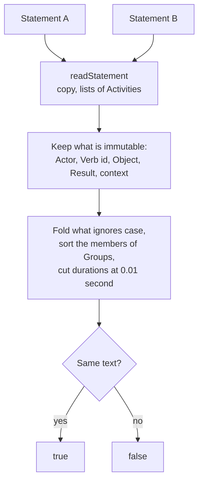

# Comparing Statements

`isSameStatement` tells whether two Statements are the same Statement by the rules of immutability. An LRS needs it when it meets
an id it holds already: the same Statement is a resend (204), another is a conflict (409). `convertStatementVersion` gives a Statement
in the form of 1.0.3, which the route of 1.0.3 answers and compares a resend with: [the versions guide](versions.md) says how.
`isSameActor` tells whether two Agents or Groups are the same Actor by their identifier, which an LRS needs for the authority of a
query and an LMS for the learner of a launch.



## Quick start

```ts
import { isSameStatement } from "@interopkit/learning-records";

const first = {
  id: "6690e6c9-3ef0-4ed3-8b37-7f3964730bee",
  actor: { name: "Example Learner", mbox: "mailto:learner@example.org" },
  verb: { id: "http://adlnet.gov/expapi/verbs/completed", display: { "en-US": "completed" } },
  object: { id: "https://example.org/activities/course-1", definition: { name: { en: "Course 1" } } },
  result: { duration: "PT1H30M" },
  timestamp: "2024-06-13T18:46:03.250Z",
};
const resend = {
  ...first,
  id: "00000000-0000-4000-8000-000000000001",
  actor: { name: "Example Learner", mbox: "mailto:Learner@Example.ORG" },
  verb: { id: "HTTP://adlnet.gov/expapi/verbs/completed" },
  object: { id: "https://example.org/activities/course-1" },
  result: { duration: "PT90M" },
  timestamp: "2030-01-01T00:00:00.000Z",
};
isSameStatement(first, resend); // => true
isSameStatement(first, { ...first, result: { duration: "PT1H30M0.01S" } }); // => false
```

## What counts

| Compared                                                                                                 | Not compared (4.2)                                                                                                      |
| -------------------------------------------------------------------------------------------------------- | ----------------------------------------------------------------------------------------------------------------------- |
| The Actor, with its name, and a Group's members as a set                                                 | The order of the members of a Group                                                                                     |
| The id of the Verb                                                                                       | The display of the Verb                                                                                                 |
| The Object: the id of an Activity, an Agent or a Group, a Statement Reference, a SubStatement as a whole | The definitions of Activities, in the Object and in the context                                                         |
| The Result, with its duration folded to 0.01 second                                                      | The id, `timestamp`, `stored`, `authority`, `version` and the Attachments                                               |
| The context, with its lists of Activities in order                                                       | Whether a single Activity was written as one or as a list; whether `objectType` was written for an Agent or an Activity |

The case of a value counts only where its type ignores case: the scheme and the host of an IRI (RFC 3987 5.3.2), an email address,
a hash, a UUID and a language tag. The path, the query and the fragment of an IRI, a name and a response keep theirs. A duration is
the same when its years, months and days are, and its time is the same to 0.01 second whatever units write it (`PT1H`, `PT60M`
and `PT3600.004S`); a day is not 24 hours.

## The same Actor

Two Agents or Groups are the same Actor when they have the same identifier (4.1.6.1): `mbox`, `mbox_sha1sum`, `openid` or
`account`, in this order of precedence. The case of an email address and of a hash is folded, and so is the case of the scheme and
the host of an `openid` or of the `homePage` of an account; the name of an account, and the `name` and `objectType` of an Actor,
are not compared. Two anonymous Groups are the same when their members are, in any order. An Agent and a Group of one identifier
are the same Actor.

## Errors

| Error                                                          | When                                                     | What to do                                                       |
| -------------------------------------------------------------- | -------------------------------------------------------- | ---------------------------------------------------------------- |
| `The statement is invalid at <path>: <sentence>.`              | Either Statement breaks a rule of an LRS                 | Read it first with `readStatement` and answer the sender         |
| `The first Actor` or `The second Actor` with `<path>: <sentence>` | `isSameActor` met a value that is not an Agent or a Group | Pass an Actor as `readStatement` reads it                        |

## Not included

| Not included                                                   | Why                                                                                                                 |
| -------------------------------------------------------------- | ------------------------------------------------------------------------------------------------------------------- |
| Normalizing percent-encoding, ports and dot segments of an IRI | The standard allows simple comparison or syntax-based normalization; the package folds the parts the standard names |
| Comparing with `isSameStatement` across versions                 | `convertStatementVersion` gives the form to compare; the rules of immutability are the same in both versions             |

## Differences from the references

| Reference    | Difference                                                                                                                                                                                                                 |
| ------------ | -------------------------------------------------------------------------------------------------------------------------------------------------------------------------------------------------------------------------- |
| The standard | It lists what is immutable and what is not, and does not say whether the Result and the context are compared. They are compared: "shall specifically not consider" the list and nothing else, and the gaps page records it |
