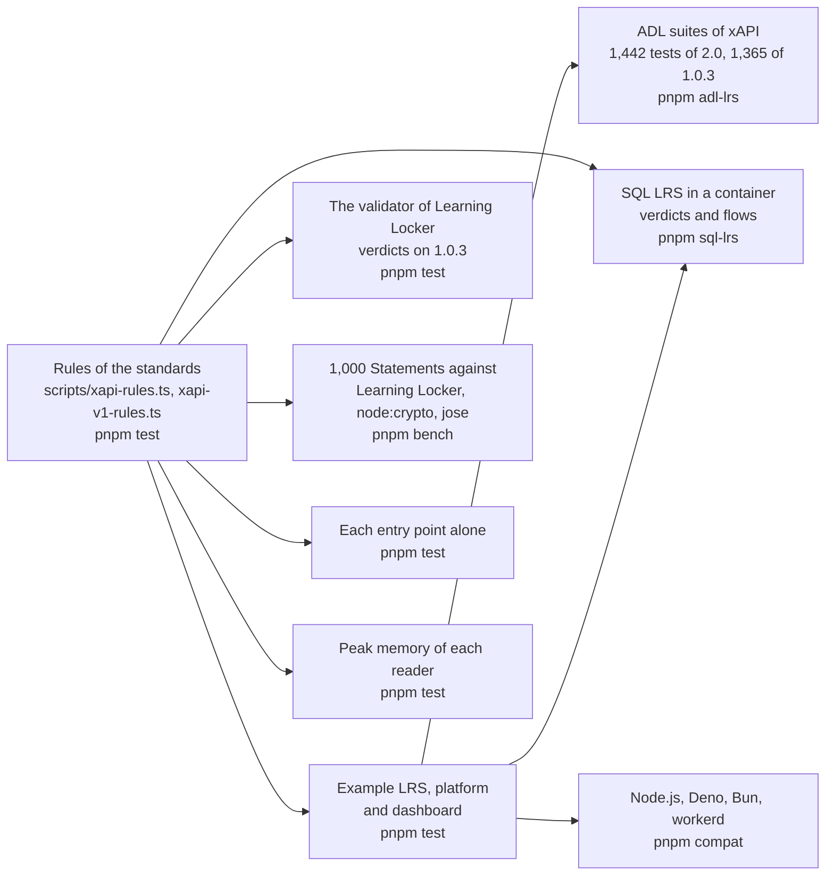

# Evidence for learning-records

What shows that the package does what it says: the rules of both versions, the conformance suites of ADL, SQL LRS and the
validator of Learning Locker as oracles, an example LRS with a platform and a dashboard, the speed of every hot path, the size of
each entry point, the peak memory of every reader, and four runtimes.
Each layer answers a question that the one before cannot.

| Layer        | Question                                                                          | Where                                                                   | Runs           |
| ------------ | --------------------------------------------------------------------------------- | ----------------------------------------------------------------------- | -------------- |
| Rules        | Does each sentence of the standard make the reader find what it says?             | `scripts/xapi-rules.ts`, `packages/learning-records/test/rules.test.ts`; `scripts/xapi-v1-rules.ts`, `packages/learning-records/test/v1-rules.test.ts` | `pnpm test`    |
| Example      | Does a host serve, send and read all seven resources with the package?            | `examples/learning-records/test/*.test.ts`                              | `pnpm test`    |
| Conformance  | Does an LRS built on the handler pass the suites that ADL publishes?              | `validation/adl-lrs/`                                                   | `pnpm adl-lrs` |
| Oracle       | Does another LRS take and refuse the same Statements as the reader?               | `examples/learning-records/test/sqllrs-verdicts.corpus.test.ts`         | `pnpm sql-lrs` |
| Oracle       | Does the validator of Learning Locker judge the Statements of 1.0.3 alike?        | `packages/learning-records/test/v1-rules.test.ts`                       | `pnpm test`    |
| Counterparty | Does the client work against another LRS, in both versions, with what it answers? | `examples/learning-records/test/sqllrs.corpus.test.ts`                  | `pnpm sql-lrs` |
| Speed        | How long does each hot path take, against Learning Locker, node:crypto and jose?  | `packages/learning-records/test/*.bench.ts`                             | `pnpm bench`   |
| Size         | Does each entry point hold only what it uses, within its budget?                  | `packages/learning-records/test/size.test.ts`                           | `pnpm test`    |
| Memory       | Does each reader of untrusted input stay under its budget on its worst input?     | `packages/learning-records/test/*-memory.test.ts`                       | `pnpm test`    |
| Runtimes     | Does the example give the same results everywhere?                                | `compat/`                                                               | `pnpm compat`  |

## The example

The campus LRS answers with `handleLrsRequest` over stores in memory, with HTTP Basic; its learning platform sends the work of two
learners, a voided mistake, a certificate signed with RS256 with its Attachment, and progress under ETags; its dashboard reads
them in pages. `serve.ts` puts the same LRS on a port with an adapter of `node:http`, which is what a host writes for its web
framework. The tests check the scenario, the stores against the contracts of their ports, and the LRS over HTTP.

| What the scenario shows                                                                             | Where                                |
| --------------------------------------------------------------------------------------------------- | ------------------------------------ |
| A request with no credential is 401 and a write by a reading credential is 403                      | `scenario.test.ts`                   |
| A batch sent twice stores nothing the second time; ids come from the event                          | `scenario.test.ts`                   |
| A voided Statement is not found by id and is found as voided                                        | `scenario.test.ts`                   |
| A query in pages of one follows `more` to the last page                                             | `scenario.test.ts`                   |
| A signed Statement with an Attachment is stored, returned with the data, and its signature verifies | `scenario.test.ts`                   |
| A stale tag and a second create are 412; a JSON write merges                                        | `scenario.test.ts`                   |
| The Activity has the languages of every Statement, and the Person has what the directory knows      | `scenario.test.ts`, `stores.test.ts` |

## The ADL suite

`pnpm adl-lrs` runs the 1,442 tests of the suite for xAPI 2.0 and the 1,365 tests of the suite for 1.0.3, each at a pinned commit
against a fresh example LRS; all pass. The first runs failed 116 and 2, and every failure was a rule that the handler did not
follow, fixed in the handler with a test of its own and a mutation rule. [The README of the folder](../../validation/adl-lrs/README.md)
lists the causes. The suite of 2.0 carries tests of 1.0.3 into 2.0 that the books do not state, and the handler follows it where
the books are silent; each such place is in [spec-gaps](spec-gaps.md).

## SQL LRS

SQL LRS 0.9.11 passes the ADL suite but for two tests. `pnpm sql-lrs` runs it in a container and posts the fixture of each of the
153 rules to it: the verdicts agree on 147, and the six others are pinned in the test and in [spec-gaps](spec-gaps.md) with the
text of the standard. The 179 fixtures of the rules of 1.0.3 go to its route of 1.0.3: the verdicts agree on 163, and the 16
others are pinned and recorded the same way. The flows of the example run against it too, with the client in both versions, and
pin what SQL LRS does as a server that the package must live with:

| What SQL LRS does                                                                                                          | What the package does                                                                                                                                              |
| -------------------------------------------------------------------------------------------------------------------------- | ------------------------------------------------------------------------------------------------------------------------------------------------------------------ |
| Answers a resend with 200 and `[]`                                                                                         | The client resolves with the ids of the batch, which it fixed after this flow found it                                                                             |
| Refuses a signed Statement that has another Attachment: it compares the payload with the Statement without its Attachments | The standard signs the complete Statement, and so does `signStatement`; a host that must reach SQL LRS signs a Statement with the signature as its only Attachment |
| Refuses a Statement with `version` 2.0.0 on the 1.0.3 route | The client of 1.0.3 refuses it before any request, and a builder of 1.0.3 writes `1.0.0` |
| Answers 409 to a second State write with no precondition on the 1.0.3 route | The client allows the write on 1.0.3, and SQL LRS applies the 2.0 rule; the handler replaces the document |
| Answers a Statement of 2.0 on the 1.0.3 route as it holds it, with `contextAgents` and `version` 2.0.0 | The client of 1.0.3 reads it into the form of 1.0.3; the handler answers that form |
| Compares a resend on the 1.0.3 route with the whole Statement of 2.0 | The form of 1.0.3 is a conflict there; the handler compares with the form |
| Answers 500 to the `contextGroups` of the full Statement of the tests                                                      | The fixtures leave them out                                                                                                                                        |

## The validator of Learning Locker

`@learninglocker/xapi-validation` 4.0.0 judges the 179 fixtures of the rules of 1.0.3 in `pnpm test`. The verdicts agree on 160,
and the 19 others are pinned in the test and in [spec-gaps](spec-gaps.md) with the text of 1.0.3: it reads a Statement by its own
schema and leaves out checks that the text asks for, and it refuses a single Activity in `contextActivities`, which the text
allows.

## Speed

`pnpm bench` times the build that ships on 1,000 Statements of 771 KB that xAPI 1.0.3 and 2.0 both take, against a reference in
the same run: the validator of Learning Locker for the work on each Statement, `JSON.parse` and `JSON.stringify` for a text,
node:crypto for a hash and jose for a signature. The ratios are the fastest samples of seven runs on a laptop at a load of 10 to
28, and the times of `validateStatement` and `readStatementJson` are those of the runners of CI.

| Benchmark | Reference | Ratio | Budget |
| --- | --- | ---: | ---: |
| `validateStatement` of the batch, 19 to 34 ms on CI | the validator of Learning Locker, 40 to 62 ms on CI | 0.41–0.52 | 1 |
| `readStatement` of the batch | the same | 0.48–0.55 | 1 |
| `validateStatements` of the batch | the same | 0.46–0.71 | 1 |
| `readStatementJson` of its text | `JSON.parse` of the text | 3.4–3.8 | 40 |
| `buildStatement` of the batch | the validator of Learning Locker | 0.76–0.79 | 4 |
| `toStatementVersion`, `formatStatement` | the same | 0.52–0.60 | 3 |
| `sameStatement` of each and its copy | the same | 2.3–3.4 | 20 |
| `matchesStatementQuery` over the batch | the same | 0.06–0.08 | 0.4 |
| `handleLrsRequest`, a POST of the batch | the same | 0.76–1.60 | 8 |
| `handleLrsRequest`, a GET of 100 | `JSON.stringify` of the page | 1.18–1.24 | 7 |
| `mboxSha1sum` of 1,000 addresses | the SHA-1 of node:crypto | 1.6–1.9 | 10 |
| `deriveStatementId` of 1,000 names | the same | 5.6–6.1 | 40 |
| `attachmentHash` of 1 MiB, 3.8 to 7.2 ms | the SHA-256 of node:crypto, 0.33 to 0.39 ms | 11–20 | 100 |
| `readMultipart` of 99 Statements with 6.2 MiB of data | the parser of the package and the SHA-256 of node:crypto | 8.7–11.5 | 60 |
| `writeMultipart` of the same | their JSON, the SHA-256 of node:crypto and a copy | 10.5–15.8 | 80 |
| `signStatement`, RSA of 2,048 bits | the `CompactSign` of jose | 1.07–1.17 | 6 |
| `verifyStatementSignature` | the `compactVerify` of jose | 2.9–3.3 | 20 |

A ratio of a reader to the validator of Learning Locker, which does the same work, is parity or better, as the design asks; another
ratio is five times the highest measured, rounded up to one significant digit. A time on CI is five times its fastest sample:

| Budget | Value | How it was set |
| --- | --- | --- |
| `validateStatement` of the batch, in milliseconds | 100 | Five times the fastest of five samples of the runners of CI, 18.84, rounded up to one significant digit |
| `readStatementJson` of the batch, in milliseconds | 500 | Five times the fastest of five samples of the runners of CI, 94.46, rounded up to one significant digit. The samples were taken before the scan, which reads about four times faster; the ratio is the budget that holds it |

`JSON.parse` judges the syntax first, so the search for a repeated name is a scan of the strings and the brackets that keeps the
names of the open objects and builds nothing else; a parser that builds a syntax tree took 16 to 18 times `JSON.parse`. A test
checks the scan against such a parser on 2,000 generated texts. The rules of a provider look for an empty object before they walk
a Statement to write the paths of its members, which takes 0.79 of the time of the build before, alternated in one process, with
the same findings for every rule of both tables in both roles and versions.

The gaps have causes outside the code of the package. The hashes are those of `@noble/hashes` in JavaScript, because
`attachmentHash`, `readMultipart` and `writeMultipart` answer at once and the digest of Web Crypto is asynchronous and has no
SHA-224; the hash is most of the time of a message. `deriveStatementId` is the name-based UUID of `uuid`. `sameStatement` reads both
Statements and writes their canonical text; a text written without `JSON.stringify` gained 5 percent and was not kept.

## Size

`size.test.ts` bundles each entry point alone with `scripts/entry-size.ts`: esbuild, minified, with every dependency inside. It
fails above the budget after gzip, or when an entry point holds a module that its budget does not list.

| Entry point | Bytes | Gzip | Budget | Holds, besides `@interopkit/core`, `model`, `read` and valibot |
| --- | ---: | ---: | ---: | --- |
| `@interopkit/learning-records` | 55,936 | 19,413 | 24,500 | `build`, `compare`, `format`, `@noble/hashes`, uuid |
| `@interopkit/learning-records/attachments` | 61,989 | 22,607 | 28,500 | `@noble/hashes`, the multipart parser of Remix |
| `@interopkit/learning-records/client` | 80,723 | 28,544 | 36,000 | `attachments`, `compare`, `@noble/hashes`, the multipart parser |
| `@interopkit/learning-records/signing` | 71,983 | 25,213 | 32,000 | `attachments`, `compare`, `@noble/hashes`, jose |
| `@interopkit/learning-records/store` | 134,125 | 45,073 | 56,500 | `attachments`, `compare`, `format`, `signing`, `@noble/hashes`, jose, the multipart parser |

No entry point holds the client or the store but its own, and the root holds no multipart parser and no jose.

## Memory

Each reader of untrusted input has a test of its peak memory on its worst input, in a file of its own because the peak of a
process only grows; the test reports the rise.

| Reader | Worst input | Peak rose by | Budget |
| --- | --- | ---: | ---: |
| `readStatementJson` | A million tokens of distinct names, the most that the search for a repeat keeps | 58–65 MiB | 128 MiB |
| `validateStatements` | A Statement whose context holds a million wrong Activities | 2 MiB | 64 MiB |
| `readMultipart` | The most parts and bytes that the limits take, 10 MiB | 6–10 MiB | 64 MiB |
| `handleLrsRequest`, a POST | 1,000 Statements of 1.9 MB near a million tokens | 34–37 MiB | 128 MiB |
| `readBasicAuthorization` | A header of 10 MiB | 35 MiB | 64 MiB |
| The alternate request syntax | A form of a million and a half names, and a form of 10 MiB of `+` | 0.2 and 46–50 MiB | 32 and 128 MiB |

## Runtimes

`pnpm compat` bundles the scenario with the packages as they ship and runs it on Node.js, Deno, Bun and workerd. The example uses
web standards alone, a constant-time comparison included, and the results are the same on each runtime that runs: Node.js, Deno
and workerd on the machine of this record, and Bun on CI.
