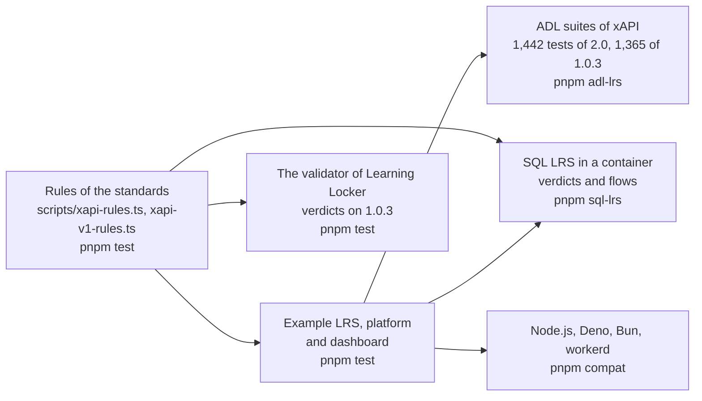

# Evidence for learning-records

What shows that the package does what it says: the rules of both versions, the conformance suites of ADL, SQL LRS and the
validator of Learning Locker as oracles, an example LRS with a platform and a dashboard, and four runtimes. Each layer answers a question that the one before cannot.
The speed, the size and the peak memory are in [performance](performance.md).

| Layer        | Question                                                                          | Where                                                                   | Runs           |
| ------------ | --------------------------------------------------------------------------------- | ----------------------------------------------------------------------- | -------------- |
| Rules        | Does each sentence of the standard make the reader find what it says?             | `scripts/xapi-rules.ts`, `packages/learning-records/test/rules.test.ts`; `scripts/xapi-v1-rules.ts`, `packages/learning-records/test/v1-rules.test.ts` | `pnpm test`    |
| Example      | Does a host serve, send and read all seven resources with the package?            | `examples/learning-records/test/*.test.ts`                              | `pnpm test`    |
| Conformance  | Does an LRS built on the handler pass the suites that ADL publishes?              | `validation/adl-lrs/`                                                   | `pnpm adl-lrs` |
| Oracle       | Does another LRS take and refuse the same Statements as the reader?               | `examples/learning-records/test/sqllrs-verdicts.corpus.test.ts`         | `pnpm sql-lrs` |
| Oracle       | Does the validator of Learning Locker judge the Statements of 1.0.3 alike?        | `packages/learning-records/test/v1-rules.test.ts`                       | `pnpm test`    |
| Counterparty | Does the client work against another LRS, in both versions, with what it answers? | `examples/learning-records/test/sqllrs.corpus.test.ts`                  | `pnpm sql-lrs` |
| Runtimes     | Does the example give the same results everywhere?                                | `compat/`                                                               | `pnpm compat`  |

## The example

The campus LRS answers with `handleLrsRequest` over stores in memory, with HTTP Basic; its learning platform sends the work of two
learners, a voided mistake, a certificate signed with RS256 with its Attachment, and progress under ETags; its dashboard reads
them in pages. `serve.ts` puts the same LRS on a port with an adapter of `node:http`, which is what a host writes for its web
framework. The tests check the scenario, the stores against the contracts of their ports, and the LRS over HTTP.

| What the scenario shows                                                                             | Where                                |
| --------------------------------------------------------------------------------------------------- | ------------------------------------ |
| A request with no credential is 401 and a write by a reading credential is 403                      | `scenario.test.ts`                   |
| A batch sent twice stores nothing the second time; ids come from the event                          | `scenario.test.ts`                   |
| A voided Statement is not found by id and is found as voided                                        | `scenario.test.ts`                   |
| A query in pages of one follows `more` to the last page                                             | `scenario.test.ts`                   |
| A signed Statement with an Attachment is stored, returned with the data, and its signature verifies | `scenario.test.ts`                   |
| A stale tag and a second create are 412; a JSON write merges                                        | `scenario.test.ts`                   |
| The Activity has the languages of every Statement, and the Person has what the directory knows      | `scenario.test.ts`, `stores.test.ts` |

## The ADL suite

`pnpm adl-lrs` runs the 1,442 tests of the suite for xAPI 2.0 and the 1,365 tests of the suite for 1.0.3, each at a pinned commit
against a fresh example LRS; all pass. The first runs failed 116 and 2, and every failure was a rule that the handler did not
follow, fixed in the handler with a test of its own and a mutation rule. [The README of the folder](../../validation/adl-lrs/README.md)
lists the causes. The suite of 2.0 carries tests of 1.0.3 into 2.0 that the books do not state, and the handler follows it where
the books are silent; each such place is in [spec-gaps](spec-gaps.md).

## SQL LRS

SQL LRS 0.9.11 passes the ADL suite but for two tests. `pnpm sql-lrs` runs it in a container and posts the fixture of each of the
153 rules to it: the verdicts agree on 147, and the six others are pinned in the test and in [spec-gaps](spec-gaps.md) with the
text of the standard. The 179 fixtures of the rules of 1.0.3 go to its route of 1.0.3: the verdicts agree on 163, and the 16
others are pinned and recorded the same way. The flows of the example run against it too, with the client in both versions, and
pin what SQL LRS does as a server that the package must live with:

| What SQL LRS does                                                                                                          | What the package does                                                                                                                                              |
| -------------------------------------------------------------------------------------------------------------------------- | ------------------------------------------------------------------------------------------------------------------------------------------------------------------ |
| Answers a resend with 200 and `[]`                                                                                         | The client resolves with the ids of the batch, which it fixed after this flow found it                                                                             |
| Refuses a signed Statement that has another Attachment: it compares the payload with the Statement without its Attachments | The standard signs the complete Statement, and so does `signStatement`; a host that must reach SQL LRS signs a Statement with the signature as its only Attachment |
| Refuses a Statement with `version` 2.0.0 on the 1.0.3 route | The client of 1.0.3 refuses it before any request, and a builder of 1.0.3 writes `1.0.0` |
| Answers 409 to a second State write with no precondition on the 1.0.3 route | The client allows the write on 1.0.3, and SQL LRS applies the 2.0 rule; the handler replaces the document |
| Answers a Statement of 2.0 on the 1.0.3 route as it holds it, with `contextAgents` and `version` 2.0.0 | The client of 1.0.3 reads it into the form of 1.0.3; the handler answers that form |
| Compares a resend on the 1.0.3 route with the whole Statement of 2.0 | The form of 1.0.3 is a conflict there; the handler compares with the form |
| Answers 500 to the `contextGroups` of the full Statement of the tests                                                      | The fixtures leave them out                                                                                                                                        |

## The validator of Learning Locker

`@learninglocker/xapi-validation` 4.0.0 judges the 179 fixtures of the rules of 1.0.3 in `pnpm test`. The verdicts agree on 160,
and the 19 others are pinned in the test and in [spec-gaps](spec-gaps.md) with the text of 1.0.3: it reads a Statement by its own
schema and leaves out checks that the text asks for, and it refuses a single Activity in `contextActivities`, which the text
allows.

## Runtimes

`pnpm compat` bundles the scenario with the packages as they ship and runs it on Node.js, Deno, Bun and workerd. The example uses
web standards alone, a constant-time comparison included, and the results are the same on each runtime that runs: Node.js, Deno
and workerd on the machine of this record, and Bun on CI.
