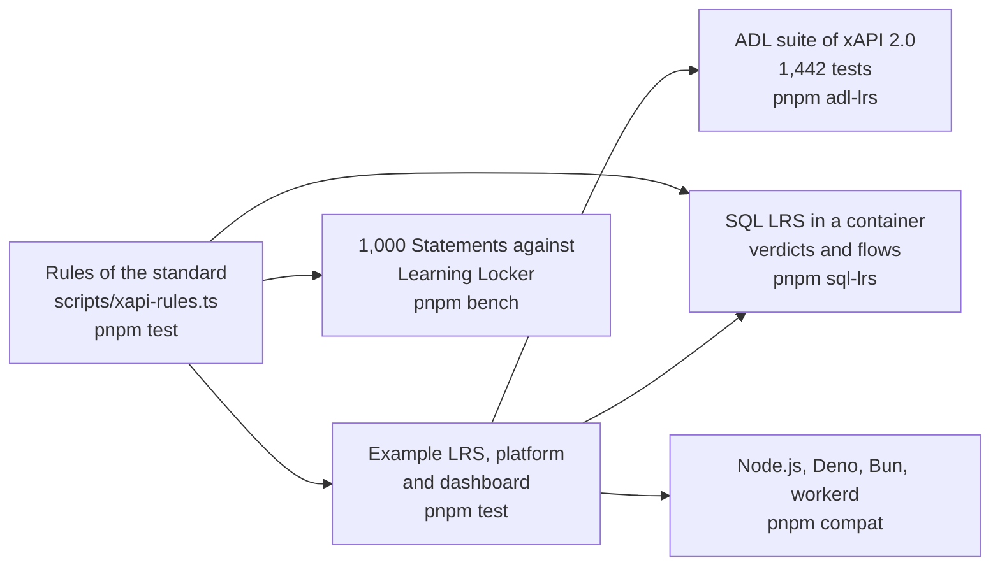

# Evidence for learning-records

What shows that the package does what it says: the rules of the standard, the conformance suite of ADL, SQL LRS as an oracle and
a counterparty, an example LRS with a platform and a dashboard, the speed of checking, and four runtimes. Each layer answers a
question that the one before cannot.

| Layer        | Question                                                                          | Where                                                                   | Runs           |
| ------------ | --------------------------------------------------------------------------------- | ----------------------------------------------------------------------- | -------------- |
| Rules        | Does each sentence of the standard make the reader find what it says?             | `scripts/xapi-rules.ts`, `packages/learning-records/test/rules.test.ts` | `pnpm test`    |
| Example      | Does a host serve, send and read all seven resources with the package?            | `examples/learning-records/test/*.test.ts`                              | `pnpm test`    |
| Conformance  | Does an LRS built on the handler pass the suite that ADL publishes?               | `validation/adl-lrs/`                                                   | `pnpm adl-lrs` |
| Oracle       | Does another LRS take and refuse the same Statements as the reader?               | `examples/learning-records/test/sqllrs-verdicts.corpus.test.ts`         | `pnpm sql-lrs` |
| Counterparty | Does the client work against another LRS, in both versions, with what it answers? | `examples/learning-records/test/sqllrs.corpus.test.ts`                  | `pnpm sql-lrs` |
| Speed        | How long does checking take, against the validator that Learning Locker ships?    | `packages/learning-records/test/validate.bench.ts`                      | `pnpm bench`   |
| Runtimes     | Does the example give the same results everywhere?                                | `compat/`                                                               | `pnpm compat`  |

## The example

The campus LRS answers with `handleLrsRequest` over stores in memory, with HTTP Basic; its learning platform sends the work of two
learners, a voided mistake, a certificate signed with RS256 with its Attachment, and progress under ETags; its dashboard reads
them in pages. `serve.ts` puts the same LRS on a port with an adapter of `node:http`, which is what a host writes for its web
framework. The tests check the scenario, the stores against the contracts of their ports, and the LRS over HTTP.

| What the scenario shows                                                                             | Where                                |
| --------------------------------------------------------------------------------------------------- | ------------------------------------ |
| A request with no credential is 401 and a write by a reading credential is 403                      | `scenario.test.ts`                   |
| A batch sent twice stores nothing the second time; ids come from the event                          | `scenario.test.ts`                   |
| A voided Statement is not found by id and is found as voided                                        | `scenario.test.ts`                   |
| A query in pages of one follows `more` to the last page                                             | `scenario.test.ts`                   |
| A signed Statement with an Attachment is stored, returned with the data, and its signature verifies | `scenario.test.ts`                   |
| A stale tag and a second create are 412; a JSON write merges                                        | `scenario.test.ts`                   |
| The Activity has the languages of every Statement, and the Person has what the directory knows      | `scenario.test.ts`, `stores.test.ts` |

## The ADL suite

`pnpm adl-lrs` runs the 1,442 tests of the suite for xAPI 2.0 at a pinned commit against the example LRS; all pass. The first
run failed 116, and every failure was a rule that the handler did not follow, fixed in the handler with a test of its own and a
mutation rule. [The README of the folder](../../validation/adl-lrs/README.md) lists the causes. The suite carries tests of
1.0.3 into 2.0 that the books do not state, and the handler follows it where the books are silent; each such place is in
[spec-gaps](spec-gaps.md).

## SQL LRS

SQL LRS 0.9.11 passes the ADL suite but for two tests. `pnpm sql-lrs` runs it in a container and posts the fixture of each of the
153 rules to it: the verdicts agree on 147, and the six others are pinned in the test and in [spec-gaps](spec-gaps.md) with the
text of the standard. The flows of the example run against it too, with the client in both versions, and pin what SQL LRS does
as a server that the package must live with:

| What SQL LRS does                                                                                                          | What the package does                                                                                                                                              |
| -------------------------------------------------------------------------------------------------------------------------- | ------------------------------------------------------------------------------------------------------------------------------------------------------------------ |
| Answers a resend with 200 and `[]`                                                                                         | The client resolves with the ids of the batch, which it fixed after this flow found it                                                                             |
| Refuses a signed Statement that has another Attachment: it compares the payload with the Statement without its Attachments | The standard signs the complete Statement, and so does `signStatement`; a host that must reach SQL LRS signs a Statement with the signature as its only Attachment |
| Refuses a Statement with `version` 2.0.0 on the 1.0.3 route                                                                | The builders write the version; the 1.0.3 rule set is a later unit                                                                                                 |
| Answers 409 to a second State write with no precondition on the 1.0.3 route                                                | The client allows the write on 1.0.3, and SQL LRS applies the 2.0 rule                                                                                             |
| Answers 500 to the `contextGroups` of the full Statement of the tests                                                      | The fixtures leave them out                                                                                                                                        |

## Speed

`validateStatement` checks 1,000 Statements of 771 KB in about 5 ms, and the validator of Learning Locker takes about 10 ms on
the same Statements, which both accept: a ratio of 0.5, where the design asks for parity or better. `readStatementJson`, which
also finds a property that occurs twice, takes 14 to 26 times what `JSON.parse` takes on the same text; the ratio moves with the load of the machine, since the two do different work.

| Budget                                                       | Value | How it was set                                                                                                   |
| ------------------------------------------------------------ | ----- | ---------------------------------------------------------------------------------------------------------------- |
| `validateStatement` against the validator of Learning Locker | 1     | Parity, as the design asks; measured 0.48 to 0.53 on a laptop, and the ratio holds on any machine                |
| `readStatementJson` against `JSON.parse`                     | 200   | Five times the highest ratio measured, 25.5, rounded up to one significant digit                                 |
| The time of each, in milliseconds                            | none  | Pending: a budget in time is five times the fastest sample of the runner of CI, and there is no sample of it yet |

## Runtimes

`pnpm compat` bundles the scenario with the packages as they ship and runs it on Node.js, Deno, Bun and workerd. The example uses
web standards alone, a constant-time comparison included, and the results are the same on each runtime that runs: Node.js, Deno
and workerd on the machine of this record, and Bun on CI.
