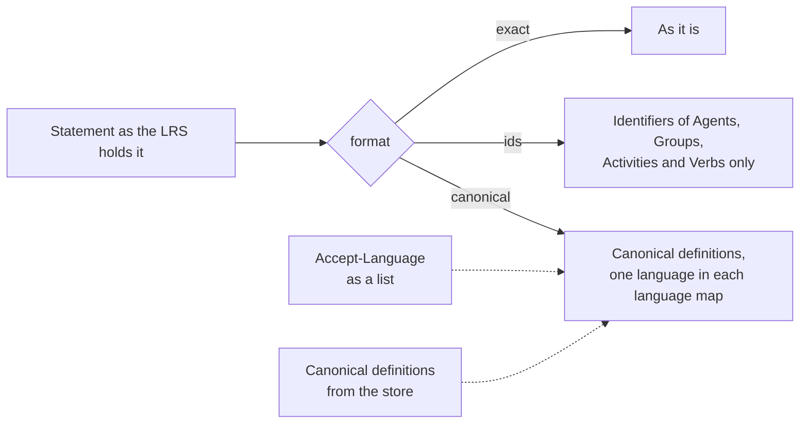

# Formats of Statements

`formatStatement` returns a Statement in the format that a query asked for: `exact`, `ids` or `canonical`.



## Quick start

```ts
import { formatStatement } from "@interopkit/learning-records";

const statement = {
  actor: { name: "Example Learner", mbox: "mailto:learner@example.org" },
  verb: { id: "http://adlnet.gov/expapi/verbs/completed", display: { "en-US": "completed", "fr-FR": "completed (fr)" } },
  object: { id: "https://example.org/activities/course-1", definition: { name: { en: "Course 1", fr: "Course 1 (fr)" } } },
};
formatStatement(statement, "ids"); // => { actor: { mbox: "mailto:learner@example.org" }, verb: { id: "http://adlnet.gov/expapi/verbs/completed" }, object: { id: "https://example.org/activities/course-1" } }

const canonical = formatStatement(statement, "canonical", {
  languages: ["fr-CA", "fr"],
  activities: new Map([["https://example.org/activities/course-1", { name: { en: "Course one", fr: "Course one (fr)" } }]]),
});
canonical.verb.display; // => { "fr-FR": "completed (fr)" }
canonical.object; // => { id: "https://example.org/activities/course-1", definition: { name: { fr: "Course one (fr)" } } }
```

## Formats

| Format      | Returns                                                                                                                                                                                     |
| ----------- | ------------------------------------------------------------------------------------------------------------------------------------------------------------------------------------------- |
| `exact`     | The Statement as it is. Agents, Activities, Verbs and Groups are as they were received                                                                                                      |
| `ids`       | Only what identifies each Agent (its identifier), Group (its identifier, or the identifiers of its members), Activity (its id) and Verb (its id). An Agent as the Object keeps `objectType` |
| `canonical` | Activities with the definition from `activities` when it has one, and every language map of an Activity and a Verb cut to one language. Agents and Groups as they are                       |

Everything else is the same in every format: the result, the context beyond its Agents, Groups and Activities, the times, the
authority and the Attachments.

## Options

| Option       | Default                           | Meaning                                                                                                                                                                                                                              |
| ------------ | --------------------------------- | ------------------------------------------------------------------------------------------------------------------------------------------------------------------------------------------------------------------------------------ |
| `activities` | none: definitions as stored       | A `Map` from an Activity id to its canonical definition. Each definition that is used is read with the checks of a Statement                                                                                                         |
| `languages`  | none: the first entry of each map | The language ranges of `Accept-Language` in the order of preference, without weights. A range matches a tag that equals it or begins with it and a hyphen. `*` takes the first entry. When none matches, the first entry is returned |

Both are for `canonical`; the other formats ignore them.

## Errors

| Error                                                                                                 | When                                  | What to do                                        |
| ----------------------------------------------------------------------------------------------------- | ------------------------------------- | ------------------------------------------------- |
| `The format is invalid: expected "ids", "exact" or "canonical", found "x".`                           | The format is not one of the three    | Pass the value of the `format` parameter, checked |
| `The options object is invalid at languages[0]: expected a language tag of RFC 5646 or *, found "x".` | A language range is not a tag         | Parse `Accept-Language` and pass the ranges       |
| `The definition of "<id>" in the option activities is invalid at object.definition.<path>: ...`       | A canonical definition breaks a rule  | Fix the definition in the store                   |
| `The statement is invalid at <path>: <sentence>.`                                                     | The Statement breaks a rule of an LRS | Read it first with `readStatement`                |

## Not included

| Not included                              | Why                                                                                                    |
| ----------------------------------------- | ------------------------------------------------------------------------------------------------------ |
| Parsing `Accept-Language`                 | The host's HTTP layer does it, with the weights; the package takes the list                            |
| A canonical display of a Verb             | The options hold definitions of Activities; a Verb keeps the display of the Statement, in one language |
| Canonical language maps inside extensions | The standard says an LRS may keep them; a host that does maps them itself                              |

## Differences from the references

| Reference    | Difference                                                                                                                                                                   |
| ------------ | ---------------------------------------------------------------------------------------------------------------------------------------------------------------------------- |
| The standard | `ids` drops `objectType` where it is optional and keeps it where the Statement would otherwise change meaning. `canonical` applies the language rule to Verbs and Activities |
