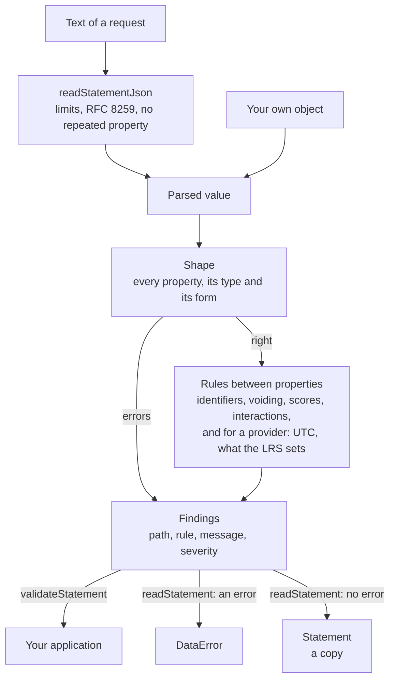

# Statements: the model and the readers

`readStatement` turns untrusted data into a `Statement`, and `validateStatement` lists what is wrong with it. Both apply the
rules of one role: an LRS, which lists what it shall reject, or a Learning Record Provider, which lists what it shall and
should do. `readStatementJson` reads the text of a request first, so that a property given twice does not pass unseen.



## Quick start

```ts
import { readStatement, readStatementJson, validateStatement, validateStatements } from "@interopkit/learning-records";

const text = JSON.stringify({
  id: "6690e6c9-3ef0-4ed3-8b37-7f3964730bee",
  actor: { name: "Example Learner", account: { homePage: "https://lms.example.org", name: "learner-1" } },
  verb: { id: "http://adlnet.gov/expapi/verbs/answered", display: { "en-US": "answered" } },
  object: {
    id: "https://example.org/activities/quiz-1/question-3",
    definition: {
      interactionType: "choice",
      correctResponsesPattern: ["golf[,]tetris"],
      choices: [{ id: "golf" }, { id: "tetris" }, { id: "facebook" }],
    },
  },
  result: { response: "golf[,]tetris", success: true, duration: "PT1M30.5S" },
  timestamp: "2024-06-13T18:46:03.250Z",
});
const statement = readStatement(readStatementJson(text));
statement.actor.account?.name; // => "learner-1"

validateStatement(statement, { role: "provider" }); // => []
validateStatements([statement, statement]).map((finding) => `${finding.rule} at ${finding.path}`); // => ["duplicate-id at [1].id"]
validateStatement({ ...statement, result: { score: { scaled: 2 } } }).map((finding) => `${finding.rule} at ${finding.path}`); // => ["out-of-range at result.score.scaled"]
```

## Reading

| Function                              | Does                                                                                                                                                 | Throws                                           |
| ------------------------------------- | ---------------------------------------------------------------------------------------------------------------------------------------------------- | ------------------------------------------------ |
| `readStatementJson(text, options?)`   | Parses the text as JSON and refuses an object that has a property twice. Returns the value, which `readStatement` or `validateStatements` then reads | `DataError` for the text, the limits or a repeat |
| `readStatement(value, options?)`      | Reads a value into a `Statement`: a copy that shares nothing with the input. A single Activity in `contextActivities` is returned as a list of one   | `DataError` when the value has an error          |
| `validateStatement(value, options?)`  | Lists the findings of a value, errors and warnings, in the order of the properties, at most `maxFindings` of them                                    | `DataError` for the options only                 |
| `validateStatements(value, options?)` | Judges each Statement of an array, and the batch: two Statements with one id are an error. The path of a finding starts with the index: `[1].actor`. `maxFindings` holds for the whole batch | `DataError` for the options only                 |

A value that is not a Statement gives findings and does not throw. While the shape is wrong, the findings are about the shape
alone; the rules between properties are judged once it is right. A warning never keeps `readStatement` from returning.

## Options

| Option                                                                  | Default    | Meaning                                                                                                                           |
| ----------------------------------------------------------------------- | ---------- | --------------------------------------------------------------------------------------------------------------------------------- |
| `role` of `readStatement`, `validateStatement` and `validateStatements` | `"lrs"`    | `"lrs"` applies what the standard says an LRS shall reject. `"provider"` adds what a Learning Record Provider shall and should do |
| `maxFindings` of `readStatement`, `validateStatement` and `validateStatements` | 1,000 | The most findings listed. The check stops at the first one beyond it and ends the list with a finding of the rule `findings-stopped`; `readStatement` counts errors alone |
| `maxBytes` of `readStatementJson`                                       | 10,485,760 | The most bytes of the text, counted as UTF-8                                                                                      |
| `maxDepth` of `readStatementJson`                                       | 64         | The deepest nesting of arrays and objects; `[]` has depth 1                                                                       |
| `maxTokens` of `readStatementJson`                                      | 1,000,000  | The most tokens of the text: each bracket, brace, colon and comma, each string, each number, and each `true`, `false` and `null` |

## The two roles

| Matter                                                                              | `lrs`                        | `provider`                                  |
| ----------------------------------------------------------------------------------- | ---------------------------- | ------------------------------------------- |
| Shape, formats, identifiers, voiding, scores                                        | Errors                       | The same errors                             |
| A time that is not in UTC                                                           | Accepted: an LRS converts it | Error `timestamp-not-utc`                   |
| A `version` that is not `2.0.0`                                                     | Accepted                     | Error `invalid-value`; `2.0.0` is a warning |
| `stored` and `authority`                                                            | Accepted                     | Warning `lrs-managed-property`              |
| A list of components the interaction type lacks                                     | Warning                      | Error                                       |
| No `id`, no millisecond, finer than 0.01 second, an empty object, a single Activity | Accepted                     | Warnings                                    |

## Findings and their rules

A finding is `{ path, rule, message, severity }`. The `path` is where the fault is, as code writes it: `result.score.scaled`,
`context.contextAgents[0].agent`. The `message` reads after the path and does not hold it. An `error` is what the role refuses;
a `warning` is a departure from a recommendation, or from what an LRS may reject.

| `rule`                       | Role       | Severity                                | When                                                                                                                                             |
| ---------------------------- | ---------- | --------------------------------------- | ------------------------------------------------------------------------------------------------------------------------------------------------ |
| `missing-property`           | both       | error                                   | A required property is absent, an anonymous Group has no `member`, or an interaction has no `interactionType`                                    |
| `unknown-property`           | both       | error                                   | A property that the tables do not have, anywhere but in an extensions map; a key of another case                                                 |
| `wrong-type`                 | both       | error                                   | A value of another JSON type, a `null` outside extensions, a number where a string is, a string where a number or a boolean is                   |
| `invalid-format`             | both       | error                                   | An IRI without a scheme, a UUID, time, duration, language tag, `mbox`, hash or media type of the wrong form, an extension key that is not an IRI |
| `invalid-value`              | both       | error                                   | A value outside a vocabulary: `objectType`, `interactionType`; a `version` other than `2.0.0` for a provider                                     |
| `too-few-entries`            | both       | error                                   | `relevantTypes` is an empty list                                                                                                                 |
| `identifier-count`           | both       | error                                   | An Agent or a Group has none, or more than one, of `mbox`, `mbox_sha1sum`, `openid` and `account`                                                |
| `voiding-target`             | both       | error                                   | The voided verb has an Object that is not a Statement Reference                                                                                  |
| `out-of-range`               | both       | error                                   | `scaled` outside -1 to 1, `raw` outside `min` to `max`, `min` not less than `max`                                                                |
| `duplicate-id`               | both       | error                                   | Two Statements of a batch have one id, whatever the case of its digits                                                                           |
| `response-pattern`           | both       | warning                                 | A `correctResponsesPattern` that does not have the form of its interaction type, or a parameter that is wrong                                    |
| `unsupported-component-list` | both       | warning for `lrs`, error for `provider` | A list of components that the interaction type does not have, such as `choices` on a `likert`                                                    |
| `component-id-whitespace`    | both       | warning                                 | The id of an interaction component has white space                                                                                               |
| `duplicate-component-id`     | both       | warning                                 | Two components of a list have one id                                                                                                             |
| `uuid-variant`               | both       | warning                                 | A UUID that is not of variant 2 of RFC 4122                                                                                                      |
| `timestamp-not-utc`          | `provider` | error                                   | `timestamp` or `stored` has a time zone other than UTC (2.0)                                                                                     |
| `timestamp-precision`        | `provider` | warning                                 | A time with less than millisecond precision                                                                                                      |
| `duration-precision`         | `provider` | warning                                 | A duration with seconds finer than 0.01                                                                                                          |
| `lrs-managed-property`       | `provider` | warning                                 | `stored`, `authority`, or a `version` of `2.0.0`, which the LRS sets                                                                             |
| `timestamp-not-rfc3339`      | `provider` | error                                   | `timestamp` or `stored` is ISO 8601 and not RFC 3339 (1.0.3)                                                |
| `empty-object`               | `provider` | warning                                 | A property whose value is `{}`, other than the values inside extensions; for both roles on 1.0.3                                                 |
| `single-activity`            | `provider` | warning                                 | A value of `contextActivities` that is one Activity and not a list                                                                               |

The warning `missing-property` for a provider names `id`: a provider should send one, so that a resend repeats it.

## Data types

| Type           | Accepted                                                                                                                                                                        |
| -------------- | ------------------------------------------------------------------------------------------------------------------------------------------------------------------------------- |
| IRI, IRL, URI  | A scheme, no white space, and a text that `URL` parses. A resolvable address and an opaque one (`urn:`, `tag:`) are alike; the standard asks for the form and not for the value |
| UUID           | 8-4-4-4-12 hexadecimal digits of either case                                                                                                                                    |
| Timestamp      | RFC 3339 with an offset, for a date that exists. An LRS converts it to UTC; a provider writes it in UTC                                                                         |
| Duration       | ISO 8601 4.4.3.2: `PnW` or `PnYnMnDTnHnMnS`, a fraction only on the smallest component. The alternative format `P0001-00-00T00:00:00` is refused                                |
| Language tag   | Well-formed by RFC 5646 2.1, as the key of a language map and as `context.language`. A subtag is not looked up in the registry                                                  |
| `mbox`         | `mailto:` and one address                                                                                                                                                       |
| `mbox_sha1sum` | 40 hexadecimal digits                                                                                                                                                           |
| `sha2`         | 56, 64, 96 or 128 hexadecimal digits, which are the SHA-2 hashes of 224, 256, 384 and 512 bits                                                                                  |
| `contentType`  | An Internet media type with its parameters                                                                                                                                      |
| Extensions     | A JSON object whose keys are IRIs; the values are any JSON and are copied, to at most 64 levels. A `null` is allowed here and nowhere else                                      |

## Interaction patterns

The form of `correctResponsesPattern` follows the interaction type. The delimiters are written as the standard writes them:
`[,]` between items, `[.]` inside a pair or a step, `[:]` between the ends of a range. A pattern of no items, the empty string,
is the response of a learner who gave none.

| `interactionType`         | Pattern                                                                     | Lists of components   |
| ------------------------- | --------------------------------------------------------------------------- | --------------------- |
| `true-false`              | `true` or `false`                                                           | none                  |
| `choice`, `sequencing`    | Item ids, `golf[,]tetris`; no id is empty                                   | `choices`             |
| `likert`                  | One item id                                                                 | `scale`               |
| `matching`                | Pairs `source[.]target` delimited by `[,]`                                  | `source` and `target` |
| `performance`             | Steps `step[.]response` delimited by `[,]`; the id of a step is not empty   | `steps`               |
| `fill-in`, `long-fill-in` | Responses delimited by `[,]`                                                | none                  |
| `numeric`                 | A number, or a range `min[:]max` that may leave out one end: `4[:]`, `[:]4` | none                  |
| `other`                   | Any text                                                                    | none                  |

Parameters are written `{name=value}` before a response: `case_matters` and `order_matters` (`true` or `false`) at the start of
the list, for `fill-in` and `long-fill-in` (`order_matters` also for `performance`), and `lang` (a language tag) at the start of
a response. An LRS does not validate patterns, so a problem is a warning.

## Limits

| Limit                                       | Value      | Applies to                                                                                        |
| ------------------------------------------- | ---------- | ------------------------------------------------------------------------------------------------- |
| `maxBytes` of `readStatementJson`           | 10,485,760 | The text of a request, counted as UTF-8                                                           |
| `maxDepth` of `readStatementJson`           | 64         | Arrays and objects nested in each other, checked before the text is parsed                        |
| `maxTokens` of `readStatementJson`          | 1,000,000  | The memory of the parse, up to 250 bytes for each token; checked before the text is parsed        |
| `maxFindings`                               | 1,000      | The findings of a call, which cost about a kilobyte each; the check stops looking at the first one beyond it |
| Levels that the value of an extension nests | 64         | `extensions` of an Activity Definition, a Result and a Context; a deeper value is `invalid-value` |

`readStatement` and `validateStatement` take a value that is in memory already, so the host's limit on the request applies
first. A batch has no limit here: the LRS sets the number of Statements.

`maxTokens` bounds the memory of `readStatementJson`, because the syntax tree grows with the tokens and not with the bytes: the
worst text, `[0,0,0,...]`, has one token for each byte. Peak memory above the process, measured on Node.js:

| Text                                                          | Result                         | Peak memory |
| ------------------------------------------------------------- | ------------------------------ | ----------- |
| 10 MiB of `[0,0,0,...]`, 10,485,000 tokens                    | Refused before the parse       | 19 MB       |
| 1,000,000 tokens of `{"":0,"":0,...}`, the most for the tree | Read, then refused as repeated | 229 MB      |
| 1,000,000 tokens of `[{},{},...]` through `validateStatements` | 1,001 findings                 | 141 MB      |

A host with less memory passes a smaller `maxTokens`: the parse takes up to 250 bytes for each token. The findings add no more
than `maxFindings` of about a kilobyte, whatever the size of the value: a Statement with a million wrong entries in a list gives
1,001 findings in 38 MB.

## Errors

| Error                                                                                                   | When                                                       | What to do                                                                              |
| ------------------------------------------------------------------------------------------------------- | ---------------------------------------------------------- | --------------------------------------------------------------------------------------- |
| `The statement is invalid at <path>: <sentence>. 2 more errors: validateStatement lists every finding.` | `readStatement` found an error                             | Call `validateStatement` for the whole list, and answer the sender with the paths       |
| `The statement is invalid at <path>: <sentence>. At least 2 more errors: the check stopped at its limit, ...` | `readStatement` counted `maxFindings` errors and stopped   | Call `validateStatement` with a higher `maxFindings`, or refuse the Statement as it is   |
| `The options object is invalid at role: expected "lrs" or "provider", found "x".`                       | The options are not an object with a known `role`          | Pass `{ role: "lrs" }` or `{ role: "provider" }`                                        |
| `The text is not valid JSON: <the parser's message>.`                                                   | `readStatementJson` could not parse the text               | Answer the sender that the body is malformed                                            |
| `The text has the property "id" twice in actor, at line 3 column 5. ...`                                | An object of the text names a property twice               | Refuse the request; an LRS shall reject a Statement that uses a property more than once |
| `The text has N bytes or more, above the limit of M bytes.`                                             | The text is longer than `maxBytes`                         | Answer with 413 as the standard asks, or raise the limit                                |
| `The text nests arrays and objects deeper than the limit of N levels.`                                  | The text is deeper than `maxDepth`                         | Refuse it, or raise the limit                                                           |
| `The text has more than N tokens, above the limit of the option maxTokens.`                             | The text has more tokens than `maxTokens`                  | Answer with 413, or raise the limit if the host can hold the memory                     |
| `The text nests deeper than the parser can read, and the limit of N levels is too high.`                | `maxDepth` is above what the stack of the runtime can hold | Lower `maxDepth`                                                                        |

## Not included

| Not included                                      | Why                                                                                                                                               |
| ------------------------------------------------- | ------------------------------------------------------------------------------------------------------------------------------------------------- |
| Rules of xAPI 1.0.3 not listed here               | `version: "1.0.3"` applies them: [the versions guide](versions.md) lists what differs                                                             |
| A timestamp later than the clock                  | It needs the clock and a margin that the standard leaves open; an LRS shall not reject it, and a provider compares `timestamp` with its own clock |
| Items of a pattern that are not ids of components | The standard defines the form of a pattern and not a reference; an LRS does not validate patterns                                                 |
| Subtags in the registry of IANA                   | The standard asks an LRS to validate the form of a language tag                                                                                   |
| The grammar of IRIs of RFC 3987                   | The standard asks for a scheme and leaves values to the host; an address that `URL` cannot parse is refused                                       |
| xAPI Profiles, cmi5                               | Standards of their own; a profile validator can read the findings and add its own                                                                 |
| Storing, routing and answering requests           | The package reads Statements; a store and its routes are the host's                                                                               |

## Differences from the references

| Reference                 | Difference                                                                                                                                                               |
| ------------------------- | ------------------------------------------------------------------------------------------------------------------------------------------------------------------------ |
| The standard's text       | "May" and "should" of an LRS are warnings and never errors. "May not reject" is read as "shall not reject" ([gaps](spec-gaps.md))                                        |
| The standard's examples   | Every Statement and batch the examples print is accepted by the rules of an LRS; a test reads them at a pinned hash. Some break rules of a provider, which the test pins |
| Other validators of 1.0.x | The validator of Learning Locker reads the fixtures of the rules of 1.0.3 in a test. Where a verdict differs from another implementation, [the gaps page](spec-gaps.md) records it with the sentence of the standard |
