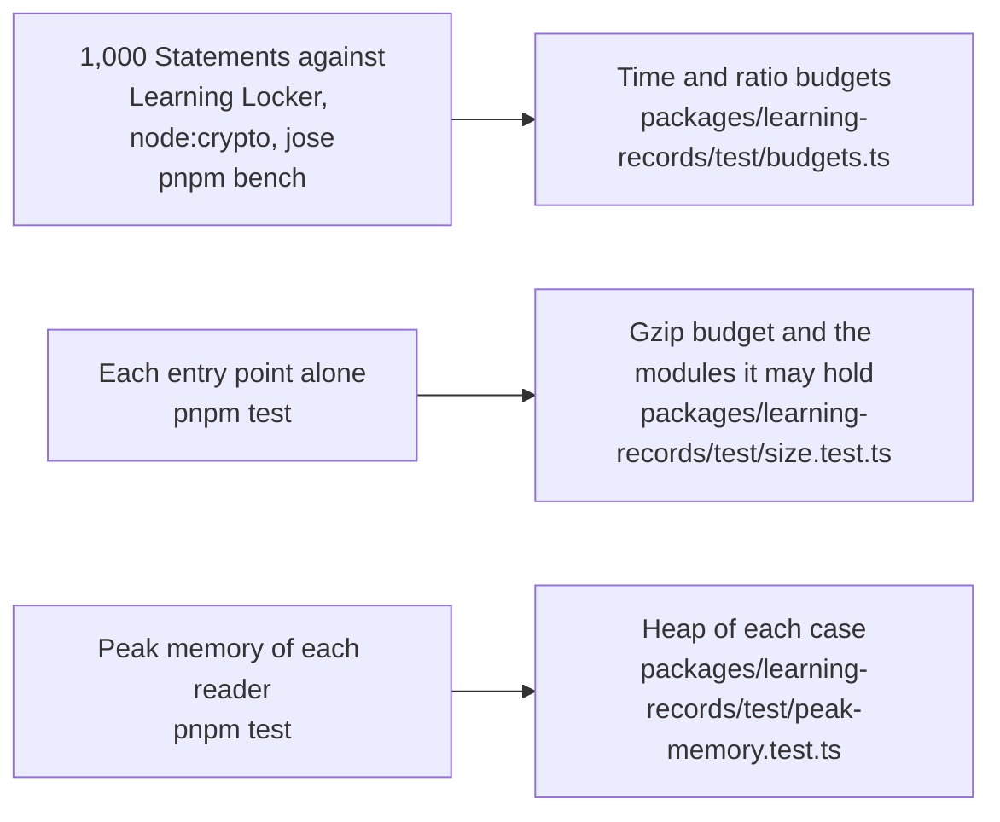

# Performance of learning-records

What the hot paths of `@interopkit/learning-records` cost, how much each entry point adds to a bundle, and the heap that each reader of untrusted input needs on its worst input. A budget holds each number and fails a gate of CI: `pnpm bench` for the time, `pnpm test` for the size and the heap. That the package does what it says is in [evidence](evidence.md).

## Speed

`pnpm bench` times the build that ships on 1,000 Statements of 771 KB that xAPI 1.0.3 and 2.0 both take, against a reference in
the same run: the validator of Learning Locker for the work on each Statement, `JSON.parse` and `JSON.stringify` for a text,
node:crypto for a hash and jose for a signature. The ratios are the fastest samples of seven runs on a laptop at a load of 10 to
28, and the times of `validateStatement` and `parseStatementJson` are those of the eight latest green runs of the runner of CI.

| Benchmark | Reference | Ratio | Budget |
| --- | --- | ---: | ---: |
| `validateStatement` of the batch, 20.6 to 38.3 ms on CI | the validator of Learning Locker, 43.6 to 67.3 ms on CI | 0.36–0.57 | 1 |
| `readStatement` of the batch | the same | 0.34–0.59 | 1 |
| `validateStatements` of the batch | the same | 0.36–0.57 | 1 |
| `parseStatementJson` of its text | `JSON.parse` of the text | 2.57–3.48 | 20  |
| `buildStatement` of the batch | the validator of Learning Locker | 0.51–0.80 | 4   |
| `convertStatementVersion`, `formatStatement` | the same | 0.38–0.69 | 4, 4 |
| `isSameStatement` of each and its copy | the same | 1.65–2.63 | 20 |
| `matchesStatementQuery` over the batch | the same | 0.05–0.10 | 0.5  |
| `handleLrsRequest`, a POST of the batch | the same | 0.78–1.27 | 7 |
| `handleLrsRequest`, a GET of 100 | `JSON.stringify` of the page | 1.17–1.49 | 8   |
| `mboxSha1sum` of 1,000 addresses | the SHA-1 of node:crypto | 1.42–2.23 | 20  |
| `deriveStatementId` of 1,000 names | the same | 4.44–7.79 | 40 |
| `hashAttachment` of 1 MiB, 3.8 to 7.2 ms | the SHA-256 of node:crypto, 0.33 to 0.39 ms | 10.2–14.4 | 80  |
| `readMultipart` of 99 Statements with 6.2 MiB of data | the parser of the package and the SHA-256 of node:crypto | 8.9–10.9 | 60 |
| `writeMultipart` of the same | their JSON, the SHA-256 of node:crypto and a copy | 6.7–12.5  | 70 |
| `signStatement`, RSA of 2,048 bits | the `CompactSign` of jose | 1.06–1.34 | 7   |
| `verifyStatementSignature` | the `compactVerify` of jose | 2.95–4.68 | 30  |
| `validateProfile` of a profile of 907 concepts, 237 KB | `JSON.parse` of its text | 8.2 on a laptop | 50 |
| `validateProfile` of a profile whose alternates name 40,000 Patterns and that revises 40,000 concepts of another | `JSON.parse` of the two texts | 7.7–9.6 on a laptop | 50 |
| `validateStatement` of a profile's validator on a relay of 1,000 Statements | `readStatement` of each | 1.15 on a laptop | 6 |
| `validateStatements` of the same, templates and Patterns | the same | 1.55 on a laptop | 8 |

A ratio of a reader to the validator of Learning Locker, which does the same work, is parity or better, as the design asks; another
ratio is five times the highest ratio measured on the runner of CI (the eight latest green runs) and on a laptop, rounded up to one significant digit. A time on CI is five times its fastest sample, rounded up to one significant digit:

| Budget | Value | How it was set |
| --- | --- | --- |
| `validateStatement` of the batch, in milliseconds | 200 | Five times the fastest of the eight latest samples of the runners of CI, 20.57, rounded up to one significant digit |
| `parseStatementJson` of the batch, in milliseconds | 70 | Five times the fastest of the eight latest samples of the runners of CI, 12.37, rounded up to one significant digit; the samples range from 12.4 to 18.9 ms |

`JSON.parse` judges the syntax first, so the search for a repeated name is a scan of the strings and the brackets that keeps the
names of the open objects and builds nothing else; a parser that builds a syntax tree took 16 to 18 times `JSON.parse`. A test
checks the scan against such a parser on 2,000 generated texts. The rules of a provider look for an empty object before they walk
a Statement to write the paths of its members, which takes 0.79 of the time of the build before, alternated in one process, with
the same findings for every rule of both tables in both roles and versions.

The gaps have causes outside the code of the package. The hashes are those of `@noble/hashes` in JavaScript, because
`hashAttachment`, `readMultipart` and `writeMultipart` answer at once and the digest of Web Crypto is asynchronous and has no
SHA-224; the hash is most of the time of a message. `deriveStatementId` is the name-based UUID of `uuid`. `isSameStatement` reads both
Statements and writes their canonical text; a text written without `JSON.stringify` gained 5 percent and was not kept.

## Size

`size.test.ts` bundles each entry point alone with `scripts/entry-size.ts`: esbuild, minified, with every dependency inside. It
fails above the budget after gzip, or when an entry point holds a module that its budget does not list.

Gzip is measured on Node.js 22; other versions of Node.js differ by up to 1 percent.

| Entry point | Bytes | Gzip | Budget | Holds, besides `@interopkit/core`, `model`, `read` and valibot |
| --- | ---: | ---: | ---: | --- |
| `@interopkit/learning-records` | 56,705 | 19,853 | 24,500 | `build`, `compare`, `format`, `@noble/hashes`, uuid |
| `@interopkit/learning-records/attachments` | 62,834 | 23,315 | 28,500 | `@noble/hashes`, the multipart parser of Remix |
| `@interopkit/learning-records/client` | 83,447 | 29,830 | 36,000 | `attachments`, `compare`, `@noble/hashes`, the multipart parser |
| `@interopkit/learning-records/profiles` | 72,129 | 23,659 | 30,000 | none |
| `@interopkit/learning-records/signing` | 73,533 | 26,263 | 32,000 | `attachments`, `compare`, `@noble/hashes`, jose |
| `@interopkit/learning-records/store` | 137,429 | 46,831 | 56,500 | `attachments`, `compare`, `format`, `signing`, `@noble/hashes`, jose, the multipart parser |

No entry point holds the client or the store but its own, and the root holds no multipart parser and no jose.

## Memory

Each reader of untrusted input runs on its worst input within its limits in a Node.js process of its own whose heap is
bounded (`test/peak-memory.test.ts`, with the readings in `test/peak-memory-readings.ts`): what the reading keeps alive at once
must fit, whenever V8 collects, so a regression fails and the load of a machine cannot. The heap of a case is twice the least in
which the reading ends on Node.js 22 and 24, rounded up to 16 MiB; `node scripts/peak-memory.ts learning-records` prints the least, in steps
of 8 MiB.

| Reader | Worst input | Least heap | Heap of the test |
| --- | --- | ---: | ---: |
| `parseStatementJson` | A million tokens of distinct names, the most that the search for a repeat keeps | 40 MiB | 80 MiB |
| `validateStatements` | A Statement whose context holds a million wrong Activities | 16 MiB | 32 MiB |
| `readMultipart` | The most parts and bytes that the limits take, 10 MiB | 8 MiB | 16 MiB |
| `handleLrsRequest`, a POST | 1,000 Statements of 1.9 MB near a million tokens | 24 MiB | 48 MiB |
| `verifyStatementSignature` | A JWS of 10 MiB whose payload is near a million tokens of distinct names | 88 MiB | 176 MiB |
| `readBasicAuthorization` | A header of 10 MiB | 16 MiB | 32 MiB |
| The alternate request syntax | A form of a million and a half names, and a form of 10 MiB of `+` | 8 and 32 MiB | 16 and 64 MiB |
| `validateProfile` | The text of a profile of 26,500 verbs near a million tokens, each narrower than the next | 40 MiB | 80 MiB |
| `validateStatements` of a profile's validator | 10,000 Statements of one registration against a primary Pattern that reaches 1,000 Patterns, each tried at every Statement | 32 MiB | 64 MiB |
