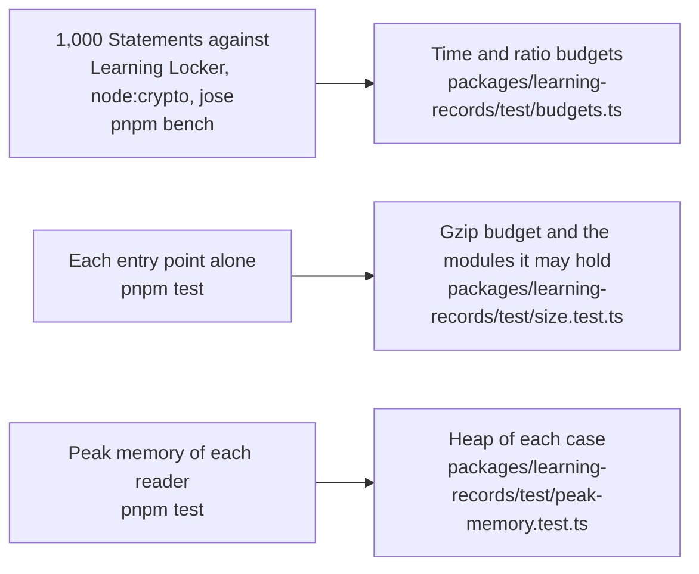

# Performance of learning-records

The time of the hot paths of `@interopkit/learning-records`, the size of each entry point, and the heap of each reader of
untrusted input at its worst input. A budget holds each number in CI: `pnpm bench` for the time, `pnpm test` for the size and
the heap.

## Speed

`pnpm bench` times the build that ships on 1,000 Statements of 771 KB that xAPI 1.0.3 and 2.0 both take, against a reference in
the same run: the validator of Learning Locker for the work on each Statement, `JSON.parse` and `JSON.stringify` for a text,
node:crypto for a hash and jose for a signature. The ratios are the range over 12 runs of the `bench` job on the runner of CI, on 2026-11-04 and 2026-11-05, and the times of `validateStatement` and `parseStatementJson`
are those of the eight latest green runs of the runner of CI.

| Benchmark                                                                                                        | Reference                                                |     Ratio | Budget |
| ---------------------------------------------------------------------------------------------------------------- | -------------------------------------------------------- | --------: | -----: |
| `validateStatement` of the batch, 20.6 to 38.3 ms on CI                                                          | the validator of Learning Locker, 43.6 to 67.3 ms on CI  | 0.45–0.56 |      2 |
| `readStatement` of the batch                                                                                     | the same                                                 | 0.44–0.54 |      2 |
| `validateStatements` of the batch                                                                                | the same                                                 | 0.47–0.55 |      2 |
| `parseStatementJson` of its text                                                                                 | `JSON.parse` of the text                                 | 2.44–3.03 |      7 |
| `buildStatement` of the batch                                                                                    | the validator of Learning Locker                         | 0.63–0.79 |      2 |
| `convertStatementVersion`, `formatStatement`                                                                     | the same                                                 | 0.48–0.62 |   2, 2 |
| `isSameStatement` of each and its copy                                                                           | the same                                                 | 1.97–2.49 |      5 |
| `matchesStatementQuery` over the batch                                                                           | the same                                                 | 0.05–0.09 |    0.2 |
| `handleLrsRequest`, a POST of the batch                                                                          | the same                                                 | 0.90–1.05 |      3 |
| `handleLrsRequest`, a GET of 100                                                                                 | `JSON.stringify` of the page                             | 1.16–1.31 |      3 |
| `mboxSha1sum` of 1,000 addresses                                                                                 | the SHA-1 of node:crypto                                 | 1.63–2.01 |      5 |
| `deriveStatementId` of 1,000 names                                                                               | the same                                                 | 4.34–5.35 |     20 |
| `hashAttachment` of 1 MiB, 3.8 to 7.2 ms                                                                         | the SHA-256 of node:crypto, 0.33 to 0.39 ms              | 7.52–8.64 |     20 |
| `readMultipart` of 99 Statements with 6.2 MiB of data                                                            | the parser of the package and the SHA-256 of node:crypto | 6.38–7.01 |     20 |
| `writeMultipart` of the same                                                                                     | their JSON, the SHA-256 of node:crypto and a copy        | 6.88–7.50 |     20 |
| `signStatement`, RSA of 2,048 bits                                                                               | the `CompactSign` of jose                                | 1.13–1.26 |      3 |
| `verifyStatementSignature`                                                                                       | the `compactVerify` of jose                              | 2.69–3.63 |      8 |
| `validateProfile` of a profile of 907 concepts, 237 KB                                                           | `JSON.parse` of its text                                 | 7.71–10.7 |     30 |
| `validateProfile` of a profile whose alternates name 40,000 Patterns and that revises 40,000 concepts of another | `JSON.parse` of the two texts                            | 8.72–10.7 |     30 |
| `validateStatement` of a profile's validator on a relay of 1,000 Statements                                      | `readStatement` of each                                  | 1.23–1.43 |      3 |
| `validateStatements` of the same, templates and Patterns                                                         | the same                                                 | 1.31–1.59 |      4 |

A ratio is twice the highest ratio measured on the runner of CI, rounded up to one significant digit, whether the reference does the
same work (the validator of Learning Locker) or not. A time on CI is five times its fastest sample, rounded up to one significant digit:

| Budget                                             | Value | How it was set                                                                                                                                              |
| -------------------------------------------------- | ----- | ----------------------------------------------------------------------------------------------------------------------------------------------------------- |
| `validateStatement` of the batch, in milliseconds  | 70    | Five times the fastest of the eight latest samples of the runners of CI, 12.33, rounded up to one significant digit; the samples range from 12.3 to 30.7 ms |
| `parseStatementJson` of the batch, in milliseconds | 40    | Five times the fastest of the eight latest samples of the runners of CI, 7.13, rounded up to one significant digit; the samples range from 7.1 to 16.4 ms   |

The budgets come from the runner and from nothing else. A laptop whose CPU hashes in hardware makes the SHA-256 of `node:crypto` faster against the hashes of `@noble/hashes`, so the ratios of `hashAttachment` and `writeMultipart` there are higher than on the runner (21.9 and 22.6 on a macOS laptop, against budgets of 20): `pnpm bench` on such a laptop can report them over their budget while the `bench` job passes.

| Choice                                                                                                                                                                                                                                                                     | Against the alternative                                                                                                                                  |
| -------------------------------------------------------------------------------------------------------------------------------------------------------------------------------------------------------------------------------------------------------------------------- | -------------------------------------------------------------------------------------------------------------------------------------------------------- |
| `parseStatementJson` searches for a repeated name with a scan of the strings and brackets after `JSON.parse` has judged the syntax, keeping only the names of the open objects; a test checks the scan against a parser that builds a syntax tree on 2,000 generated texts | A parser that builds a syntax tree takes 16 to 18 times `JSON.parse`                                                                                     |
| The rules of a provider look for an empty object before they walk a Statement to write the paths of its members                                                                                                                                                            | 0.79 of the time of a build that walks first, alternated in one process, with the same findings for every rule of both tables in both roles and versions |
| `isSameStatement` writes the canonical text with `JSON.stringify`                                                                                                                                                                                                          | A text written without it is 5 percent faster, which is not worth its code                                                                               |

The other gaps have causes outside the code of the package. The hashes are those of `@noble/hashes` in JavaScript, because
`hashAttachment`, `readMultipart` and `writeMultipart` answer at once and the digest of Web Crypto is asynchronous and has no
SHA-224; the hash is most of the time of a message. `deriveStatementId` is the name-based UUID of `uuid`.

## Size

`size.test.ts` bundles each entry point alone with `scripts/entry-size.ts`: esbuild, minified, with every dependency inside. It
fails above the budget after gzip, or when an entry point holds a module that its budget does not list. Gzip is measured on
Node.js 22; other versions differ by up to 1 percent.

| Entry point                                |   Bytes |   Gzip | Budget | Holds, besides `@interopkit/core`, `model`, `read` and valibot                             |
| ------------------------------------------ | ------: | -----: | -----: | ------------------------------------------------------------------------------------------ |
| `@interopkit/learning-records`             |  58,448 | 20,290 | 25,500 | `build`, `compare`, `format`, `@noble/hashes`, uuid                                        |
| `@interopkit/learning-records/attachments` |  63,210 | 23,331 | 29,500 | `@noble/hashes`, the multipart parser of Remix                                             |
| `@interopkit/learning-records/client`      |  83,878 | 29,897 | 37,500 | `attachments`, `compare`, `@noble/hashes`, the multipart parser                            |
| `@interopkit/learning-records/profiles`    |  73,033 | 24,179 | 30,500 | none                                                                                       |
| `@interopkit/learning-records/signing`     |  74,466 | 26,312 | 33,000 | `attachments`, `compare`, `@noble/hashes`, jose                                            |
| `@interopkit/learning-records/store`       | 137,576 | 46,567 | 58,500 | `attachments`, `compare`, `format`, `signing`, `@noble/hashes`, jose, the multipart parser |

No entry point holds the client or the store but its own, and the root holds no multipart parser and no jose.

## Memory

Each reader of untrusted input runs on its worst input within its limits in a Node.js process of its own whose heap is
bounded (`test/peak-memory.test.ts`, with the readings in `test/peak-memory-readings.ts`): what the reading keeps alive at once
must fit, whenever V8 collects, so a regression fails and the load of a machine cannot. The heap of a case is twice the least in
which the reading ends on Node.js 22 and 24, rounded up to 16 MiB; `node scripts/peak-memory.ts learning-records` prints the least, in steps
of 8 MiB.

| Reader                                        | Worst input                                                                                                                |   Least heap | Heap of the test |
| --------------------------------------------- | -------------------------------------------------------------------------------------------------------------------------- | -----------: | ---------------: |
| `parseStatementJson`                          | A million tokens of distinct names, the most that the search for a repeat keeps                                            |       40 MiB |           80 MiB |
| `validateStatements`                          | A Statement whose context holds a million wrong Activities                                                                 |       16 MiB |           32 MiB |
| `readMultipart`                               | The most parts and bytes that the limits take, 10 MiB                                                                      |        8 MiB |           16 MiB |
| `handleLrsRequest`, a POST                    | 1,000 Statements of 1.9 MB near a million tokens                                                                           |       24 MiB |           48 MiB |
| `verifyStatementSignature`                    | A JWS of 10 MiB whose payload is near a million tokens of distinct names                                                   |       88 MiB |          176 MiB |
| `readBasicAuthorization`                      | A header of 10 MiB                                                                                                         |       16 MiB |           32 MiB |
| The alternate request syntax                  | A form of a million and a half names, and a form of 10 MiB of `+`                                                          | 8 and 32 MiB |    16 and 64 MiB |
| `validateProfile`                             | The text of a profile of 5,451 verbs near the 1,300,000 bytes of `maxBytes`, each narrower than the next                   |       16 MiB |           32 MiB |
| `validateStatements` of a profile's validator | 10,000 Statements of one registration against a primary Pattern that reaches 1,000 Patterns, each tried at every Statement |       32 MiB |           64 MiB |
