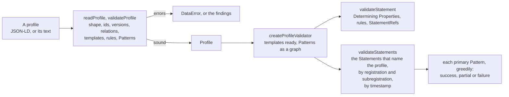

# xAPI Profiles

`@interopkit/learning-records/profiles` implements xAPI Profiles 1.0 of ADL: the model of a profile, `readProfile` and
`validateProfile` against the rules of Part Two, and `createProfileValidator`, which judges Statements against a profile's
Statement Templates and Patterns by the two algorithms of Part Three. A profile's author checks a profile before publishing it,
a Learning Record Provider checks its Statements against the profile it follows, and an LRS or a tool of reports checks the
Statements it holds.



## Quick start

```ts
import { createProfileValidator, readProfile, validateProfile } from "@interopkit/learning-records/profiles";

const QUIZ = "https://example.org/profiles/quiz";
const ANSWERED = "http://adlnet.gov/expapi/verbs/answered";
const COMPLETED = "http://adlnet.gov/expapi/verbs/completed";
const profile = {
  "@context": "https://w3id.org/xapi/profiles/context",
  id: QUIZ,
  type: "Profile",
  conformsTo: "https://w3id.org/xapi/profiles#1.0",
  prefLabel: { en: "Quiz" },
  definition: { en: "A quiz of questions, then its completion." },
  versions: [{ id: `${QUIZ}/v1`, generatedAtTime: "2024-06-13T00:00:00Z" }],
  author: { type: "Organization", name: "Example" },
  templates: [
    {
      id: `${QUIZ}/templates/answered`,
      type: "StatementTemplate",
      inScheme: `${QUIZ}/v1`,
      prefLabel: { en: "Answered" },
      definition: { en: "A learner answers a question." },
      verb: ANSWERED,
      rules: [{ location: "$.result.success", presence: "included" }],
    },
    {
      id: `${QUIZ}/templates/completed`,
      type: "StatementTemplate",
      inScheme: `${QUIZ}/v1`,
      prefLabel: { en: "Completed" },
      definition: { en: "A learner completes the quiz." },
      verb: COMPLETED,
    },
  ],
  patterns: [
    {
      id: `${QUIZ}/patterns/quiz`,
      type: "Pattern",
      primary: true,
      prefLabel: { en: "Quiz" },
      definition: { en: "Answers, then the completion." },
      sequence: [`${QUIZ}/patterns/answers`, `${QUIZ}/templates/completed`],
    },
    { id: `${QUIZ}/patterns/answers`, type: "Pattern", oneOrMore: `${QUIZ}/templates/answered` },
  ],
};

validateProfile(profile); // => []
readProfile(JSON.stringify(profile)).templates?.length; // => 2

const validator = createProfileValidator(profile);
validator.version; // => "https://example.org/profiles/quiz/v1"

const base = {
  actor: { mbox: "mailto:learner@example.org" },
  object: { id: "https://example.org/quizzes/1" },
  context: {
    registration: "ec231277-b27b-4c15-8291-d29225b2b8f7",
    contextActivities: { category: [{ id: `${QUIZ}/v1` }] },
  },
};
const answered = (second = 1, success = true) => ({
  ...base,
  verb: { id: ANSWERED },
  result: { success },
  timestamp: `2024-06-13T10:00:0${second}Z`,
});
const completed = { ...base, verb: { id: COMPLETED }, timestamp: "2024-06-13T10:00:03Z" };

validator.validateStatement(answered()).outcome; // => "success"
const { result, ...unanswered } = answered();
validator.validateStatement(unanswered).issues[0]?.rule; // => "rule-presence"

const verdict = validator.validateStatements([completed, answered(1), answered(2, false)]);
verdict.registrations[0]?.statements; // => [1, 2, 0]
verdict.registrations[0]?.patterns; // => [{ pattern: "https://example.org/profiles/quiz/patterns/quiz", outcome: "success", remaining: 0 }]
verdict.issues; // => []
```

## Functions

| Function                                    | Does                                                                                                                                                                                        | Throws                                                                                                                                 |
| ------------------------------------------- | ------------------------------------------------------------------------------------------------------------------------------------------------------------------------------------------- | -------------------------------------------------------------------------------------------------------------------------------------- |
| `readProfile(input, options?)`              | Reads a profile, or the text of its JSON, into the model and checks every rule of the table below; returns a copy                                                                           | `DataError` naming the first error and counting the others; `LimitError` for a text past `maxTokens` or 64 levels                      |
| `validateProfile(input, options?)`          | Lists the findings, errors and warnings, of the same rules; a value that is not a profile gives findings                                                                                    | `DataError` for a text that is not JSON; `LimitError` as `readProfile`                                                                 |
| `createProfileValidator(profile, options?)` | Reads a sound profile and readies its Statement Templates, those of other profiles that its Patterns name, and the Patterns that its primary Patterns reach                                 | `DataError` for a profile with an error or a primary Pattern that reaches an id no profile defines; `LimitError` past the limits below |
| `validator.validateStatement(statement)`    | The Statement Template algorithm: the outcome, the templates, and what the Statement breaks                                                                                                 | `DataError` for a value that is not a Statement of xAPI 2.0 or 1.0.3                                                                   |
| `validator.validateStatements(statements)`  | Judges the Statements that name `validator.version` in category: each against the templates, and those of each registration and subregistration, by timestamp, against the primary Patterns | `DataError` for a list that is not of Statements; `LimitError` past `maxStatements`                                                    |

| Option          | Of                               | Default   | Meaning                                                                                                                                                                                       |
| --------------- | -------------------------------- | --------- | --------------------------------------------------------------------------------------------------------------------------------------------------------------------------------------------- |
| `profiles`      | all three                        | none      | Other profiles, as values or text, read by their shape: those whose templates and Patterns the profile's Patterns reuse, whose concepts its relations name, whose extensions Statements carry |
| `maxFindings`   | all three                        | 1,000     | The most findings of a call; a last finding `findings-stopped` says the list stopped                                                                                                          |
| `maxTokens`     | `readProfile`, `validateProfile` | 1,000,000 | The most tokens of JSON of a profile given as text, counted before it is parsed                                                                                                               |
| `maxBytes`      | `readProfile`, `validateProfile` | 1,300,000 | The most bytes of a profile given as text, counted as UTF-8 before it is parsed                                                                                                               |
| `findStatement` | `createProfileValidator`         | none      | Returns the Statement, as JSON, that a StatementRef names, or `undefined`; `validateStatements` looks in its list first                                                                       |
| `maxStatements` | `createProfileValidator`         | 10,000    | The most Statements of one call of `validateStatements`                                                                                                                                       |

## Judging Statements

`validateStatement` gives the Statement Template algorithm's outcome. A template applies to a Statement that has all its
Determining Properties: its verb, the activity type of its object, the activity types of its `grouping`, `parent`, `other` and
`category` Activities (a superset suffices), and the usage types of its attachments.

| Outcome     | `templates`                         | Means                                                                     |
| ----------- | ----------------------------------- | ------------------------------------------------------------------------- |
| `success`   | The templates matched and followed  | One or more templates apply, and the Statement follows all of their rules |
| `invalid`   | The templates whose rules it breaks | A template applies, and the Statement breaks one of its rules             |
| `unmatched` | none                                | No template applies                                                       |

A rule finds its values with the JSONPath of `location`, then of `selector` in each of them, where a value in which the selector
finds nothing is unmatchable. `presence: "included"` asks a value and no unmatchable one, `excluded` asks no value but an
unmatchable one, and `recommended` asks the rest only of a location that has a value. `any` asks one of its values, `all` asks
only its values and no unmatchable one, `none` asks none of its values; values compare as JSON, so `{ "rank": 1 }` is one value.
A template with `objectStatementRefTemplate` or `contextStatementRefTemplate` asks a StatementRef there whose Statement, when the
checking system has it, matches one of the named templates.

`validateStatements` gives a `RegistrationVerdict` for the Statements of each registration, and of each subregistration of
the profile's version (`SUBREGISTRATION_EXTENSION`). They follow the profile when each one is `success` and one primary Pattern
matches them all, in the order of their timestamps and, at one time, of the list. A Pattern matches greedily: `optional`,
`zeroOrMore`, `oneOrMore` and `alternates` take as many Statements as they can before the next member, with no backtracking.

| Pattern outcome | `remaining` | Means                                                                  |
| --------------- | ----------- | ---------------------------------------------------------------------- |
| `success`       | 0           | The Pattern matches every Statement                                    |
| `success`       | more        | The Pattern matches the first Statements, and the rest are left        |
| `partial`       | 0           | The Statements end in the middle of the Pattern: so far they follow it |
| `partial`       | more        | It could be read as `success` with the rest left, or go on matching    |
| `failure`       | all         | The Pattern does not match                                             |

| JSONPath               | Example                                        | Finds                                                                         |
| ---------------------- | ---------------------------------------------- | ----------------------------------------------------------------------------- |
| A name in dot notation | `$.object.definition.name.en-US`               | A member of an object; a name holds no `.`, `[`, `]`, `\|`, quote, `*`, space |
| A quoted name          | `$.result.extensions['https://example.org/x']` | A member of an object, by any name; `\` escapes a quote                       |
| An index               | `$.context.contextActivities.grouping[0]`      | An element of an array                                                        |
| `*`                    | `$.context.contextActivities.*[*].id`          | Every member of an object or element of an array                              |
| A union                | `$.result.score['raw','max']`                  | Each member named, in order, each value once                                  |
| `..`                   | `$..type`                                      | The members at any depth                                                      |
| `\|`                   | `$.result.score.raw \| $.result.score.scaled`  | The values of each path, joined                                               |

## Rules of a profile

The findings name these rules besides those of the shape (`missing-property`, `wrong-type`, `invalid-format`,
`invalid-value`, which a member named `__proto__`, `constructor` or `prototype` is, anywhere but in the values that a rule compares, whose names are data). Section numbers are those of Part
Two.

| Rule                                              | Severity       | Means                                                                                                            | Section  |
| ------------------------------------------------- | -------------- | ---------------------------------------------------------------------------------------------------------------- | -------- |
| `empty-value`                                     | error          | A value is null, an empty string, an empty object or an empty array                                              | 4.0      |
| `unknown-property`                                | error          | A property that the specification does not describe, which is neither a JSON-LD keyword, `id`, `type` nor an IRI | 4.0      |
| `property-out-of-place`                           | warning        | A property that the specification describes for another object                                                   | 4.0      |
| `context`                                         | error, warning | An `@context` list without the context of the specification; another single context is a warning                 | 6.0, 7.4 |
| `conforms-to`                                     | warning        | `conformsTo` is not `https://w3id.org/xapi/profiles#1.0`                                                         | 6.0      |
| `id-repeated`                                     | error          | Two objects, or a version and the profile, have one id                                                           | 6.1      |
| `revision-missing`                                | error          | A version other than the earliest by `generatedAtTime` has no `wasRevisionOf`                                    | 6.1      |
| `in-scheme`                                       | error          | An `inScheme` that is no version of the profile                                                                  | 7.1      |
| `defined-elsewhere`                               | error          | A concept that another profile given defines, which no version of this one revises                               | 7.0      |
| `relation-target`                                 | error          | A relation that names the concept itself, another type, or a concept of the wrong profile or version             | 7.1, 7.2 |
| `related-deprecated`                              | error          | `related` on a concept that is not deprecated                                                                    | 7.1      |
| `recommended-activity-types`, `recommended-verbs` | error          | A recommendation on an extension of the wrong type                                                               | 7.2      |
| `schema-and-inline-schema`                        | error          | An extension or a document resource with both                                                                    | 7.2, 7.3 |
| `inline-schema`, `inline-schema-draft`            | error, warning | An inline schema that is not the text of a JSON Schema; one of a draft other than 07                             | 7.2      |
| `extension-context`                               | error          | An object in the extensions of an Activity concept without `@context`                                            | 7.4      |
| The rules of xAPI                                 | error          | An Activity Definition that xAPI 1.0.3 refuses, at its path                                                      | 7.4      |
| `object-type-and-reference`                       | error          | A template with `objectActivityType` and `objectStatementRefTemplate`                                            | 8.0      |
| `determining-property`                            | error          | A Determining Property that names a concept of another type                                                      | 8.0      |
| `statement-ref-template`                          | error          | A StatementRef template that is no template of this profile                                                      | 8.0      |
| `rule-requirement`                                | error          | A rule without `presence`, `any`, `all` or `none`                                                                | 8.1      |
| `json-path`                                       | error          | A `location` or `selector` that is not a JSONPath of a rule, or has more than `MAX_JSON_PATH_LENGTH` characters  | 8.1      |
| `pattern-kind`                                    | error          | A Pattern without exactly one of the five kinds                                                                  | 9.0      |
| `primary-description`                             | error          | A primary Pattern without `prefLabel` and `definition`                                                           | 9.0      |
| `alternates-members`, `sequence-members`          | error          | Fewer than two members, but a primary Pattern used nowhere else of one template                                  | 9.0      |
| `alternates-optional`                             | error          | An `optional` or `zeroOrMore` Pattern directly in `alternates`                                                   | 9.0      |
| `pattern-cycle`                                   | error          | A Pattern that holds itself at any depth                                                                         | 9.0      |
| `member-type`                                     | error          | A member that names a concept                                                                                    | 9.0      |
| `member-unresolved`                               | warning        | A member that neither the profile nor the profiles given define: it may be another profile's                     | 9.0      |

## Rules of Statements

| Rule                                                                              | Severity | Means                                                                                                                                                                   |
| --------------------------------------------------------------------------------- | -------- | ----------------------------------------------------------------------------------------------------------------------------------------------------------------------- |
| `rule-presence`, `rule-any`, `rule-all`, `rule-none`                              | error    | The Statement breaks a rule of a template that applies to it                                                                                                            |
| `statement-ref`                                                                   | error    | The object or `context.statement` is no StatementRef, or refers to a Statement that matches none of the named templates                                                 |
| `extension-place`                                                                 | error    | An extension of a profile in another place than its type: context, result, Activity Definition                                                                          |
| `profile-category`                                                                | warning  | A Statement that follows the templates does not name the profile's version in category                                                                                  |
| `template-unmatched`                                                              | error    | A Statement of the list that names the profile matches none of its templates                                                                                            |
| `registration-missing`                                                            | error    | A Statement that names a profile with a primary Pattern has no registration                                                                                             |
| `subregistration-registration`, `subregistration-form`, `subregistration-profile` | error    | The subregistration extension without a registration, not a non-empty list of `{ profile, subregistration }` with a variant 2 UUID, or naming a profile not in category |
| `timestamp-repeated`                                                              | warning  | Two Statements of a series at one time, which the order of the list then decides                                                                                        |
| `pattern`                                                                         | error    | The Statements of a registration follow no primary Pattern; the verdict gives each outcome                                                                              |

## The JSONPath of a rule

The `location` and `selector` of a rule are paths in the syntax of Goessner with `|` between paths (Part Two 8.1), and a rule
comes from a profile of anyone, so a filter or a script in it must be refused, never run. `json-path.ts` reads the syntax in 232
lines with no dependency. No library reads that syntax, as the releases below show when run on `$.a.b | $.c[0]`, `$.c[?(@ > 1)]`, `$.c[(@.length-1)]` and a filter that assigns a global
(2026-11-05):

| Library, release         | Released   | `\|` between paths              | Filters and scripts                      | Why it is not adopted                                                                        |
| ------------------------ | ---------- | ------------------------------- | ---------------------------------------- | -------------------------------------------------------------------------------------------- |
| `jsonpath-plus` 11.3.0   | 2026-11-03 | Read as one path: finds nothing | Evaluates `?()` filters and `()` scripts | Evaluates what a rule must refuse, and has no union                                          |
| `jsonpath` 1.3.0         | 2026-03-05 | Lexical error                   | Evaluates filters and scripts            | The same, and `underscore` 1.13.7 under it has an advisory (GHSA-qpx9-hpmf-5gmw) with no fix |
| `nimma` 0.7.2            | 2025-04-01 | Parse error                     | Evaluates filters and scripts            | The same, and no release in the last year                                                    |
| `json-p3` 3.0.2          | 2026-10-29 | Refused                         | Filters of RFC 9535; no script           | RFC 9535 has no `\|`; a rule would still need its own reader                                 |
| `jsonpath-js` 0.3.1      | 2026-03-04 | Refused                         | Filters of RFC 9535; no script           | The same                                                                                     |
| `jsonpath-rfc9535` 1.3.0 | 2025-04-04 | Refused                         | Filters of RFC 9535; no script           | The same, and no release in the last year                                                    |

Adopting one would leave the package to split the text on `|`, to scan it for `?` and `(` and to map every result to the path
that `selectJsonPath` returns, which is the reader that is written here.

## Limits

| Limit                    | Value          | Cost at the limit                                                                                                                                                                                                                                                                                                                                                     |
| ------------------------ | -------------- | --------------------------------------------------------------------------------------------------------------------------------------------------------------------------------------------------------------------------------------------------------------------------------------------------------------------------------------------------------------------- |
| `maxTokens`              | 1,000,000      | Counted before the text is parsed; `maxBytes` bounds a text of verbs first                                                                                                                                                                                                                                                                                            |
| `maxBytes`               | 1,300,000      | Five times the largest profile that ADL publishes; the heap at the limit is in [performance](performance.md#memory)                                                                                                                                                                                                                                                   |
| Depth of a text          | 64 levels      | Refused before it is parsed                                                                                                                                                                                                                                                                                                                                           |
| `MAX_JSON_PATH_LENGTH`   | 500 characters | Five times the longest JSONPath in ADL's profiles; a longer one is a `json-path` error                                                                                                                                                                                                                                                                                |
| `MAX_JSON_PATH_WALKS`    | 1,400 walks    | The walks of a Statement that the JSONPaths of all the rules of a profile make, each path joined by `\|` one: five times the 269 of the profile of ADL with the most; `LimitError` above it. At every limit, 1,400 rules of 166 steps `..*` judge a Statement nested 55 levels in 0.6 s with 100 values, 3.7 s with 1,000 and 38 s with 10,000, within 80 MiB of heap |
| `maxStatements`          | 10,000         | With the most Patterns below, under 32 MiB of heap and 0.5 s                                                                                                                                                                                                                                                                                                          |
| `MAX_MATCHED_PATTERNS`   | 1,000          | The Patterns that the primary Patterns reach; four bytes for each Pattern and Statement                                                                                                                                                                                                                                                                               |
| `MAX_MATCHED_MEMBERS`    | 10,000         | The members of those Patterns: the work at each Statement                                                                                                                                                                                                                                                                                                             |
| A chain of StatementRefs | 64             | A Statement further down is taken as not available                                                                                                                                                                                                                                                                                                                    |
| `maxFindings`            | 1,000          | The list ends with `findings-stopped`                                                                                                                                                                                                                                                                                                                                 |

Each node of a Pattern is matched once at each position of a series, so the matching takes time in proportion to the
Statements and the members, never more; a JSONPath with `..` walks each node of a Statement once for each step. What a JSONPath
finds holds each value once, an object or a list by its place and a string, a number, a boolean or null by its value, since a rule
asks whether values are there and which they are: a union or paths joined by `|` that name the same values again hold no more
than the nodes of the Statement.

## Errors

| Error                                                                                                                       | When                                                                    | What to do                                                |
| --------------------------------------------------------------------------------------------------------------------------- | ----------------------------------------------------------------------- | --------------------------------------------------------- |
| `The profile is invalid at <path>: <sentence> N more errors: validateProfile lists every finding.`                          | `readProfile` or `createProfileValidator` of a profile with an error    | List the findings with `validateProfile` and fix each     |
| `The profile has more than 1000000 tokens of JSON.` (`LimitError`, `maxTokens`)                                             | A text past the limit                                                   | Raise `maxTokens` for a profile that you trust            |
| `The profile is not JSON: <cause>.`                                                                                         | A text that is not JSON                                                 | Pass the JSON of the profile                              |
| `The Pattern "<id>" names "<member>", which neither the profile nor the option profiles define ...`                         | A primary Pattern reaches another profile's template or Pattern         | Pass that profile in `profiles`                           |
| `The primary Patterns of the profile reach more than 1000 Patterns.` (`LimitError`)                                         | A profile past `MAX_MATCHED_PATTERNS` or `MAX_MATCHED_MEMBERS`          | Split the profile; no published profile comes near        |
| `The profile has rules whose JSONPaths make more than 1400 walks of a Statement, ...` (`LimitError`, `MAX_JSON_PATH_WALKS`) | A profile, or one of `profiles`, whose rules pass `MAX_JSON_PATH_WALKS` | Split the profile; no published profile comes near        |
| `The Pattern "<id>", which a primary Pattern of the profile reaches, holds itself at some depth ...`                        | A Pattern of the option `profiles`, read by its shape, holds itself     | Fix that profile; `validateProfile` of it names the cycle |
| `The statement is invalid at <path>: ...`, `The statements are invalid at [i]: ...`                                         | A value that is not a Statement of xAPI                                 | Check it with `validateStatement` of the package root     |
| `The statements are more than 10000, found N: raise the option maxStatements.` (`LimitError`)                               | A list past `maxStatements`                                             | Judge a registration at a time, or raise the option       |
| `The Statement that findStatement returned for "<id>" is not one of xAPI.`                                                  | The host's lookup returns another value                                 | Return the Statement, or `undefined`                      |
| `The options object is invalid ...`                                                                                         | An option of another type, or one that the call does not take           | Pass the options of the table                             |

## Not included

| Not included                                                          | Why                                                                                                                                                                                                                                                                              |
| --------------------------------------------------------------------- | -------------------------------------------------------------------------------------------------------------------------------------------------------------------------------------------------------------------------------------------------------------------------------- |
| JSON-LD processing of a profile                                       | The specification needs none to consume a profile; whether an extension's `@context` makes its properties absolute IRIs, and whether the keys of objects in `any`, `all` and `none` are in a context, needs the contexts and a JSON-LD processor ([comparators](comparators.md)) |
| Validating the value of an extension or a document by its JSON Schema | The specification says a system "can" use the schema; a host runs a JSON Schema validator on the schema that the concept gives                                                                                                                                                   |
| The Profile Server and its SPARQL endpoint                            | A service, which a host builds on the model                                                                                                                                                                                                                                      |
| Comparing two versions of a profile                                   | Whether a template's or a Pattern's id changed with its content needs both documents; a host reads both and compares them                                                                                                                                                        |
| The requirements on document resources of an LRS client               | They bind a request to the State or a profile resource, which `@interopkit/learning-records/store` answers; the profile gives the `contentType` and the resource type to check                                                                                                   |
| Statements of an older version of a profile                           | A document describes its latest version; a Statement that names an older one is judged with that version's document                                                                                                                                                              |

## Differences from the references

| Reference                                     | Difference                                                                                                                                                                                                                                                                                                                                                      |
| --------------------------------------------- | --------------------------------------------------------------------------------------------------------------------------------------------------------------------------------------------------------------------------------------------------------------------------------------------------------------------------------------------------------------- |
| The specification's algorithms (Part Three)   | Followed as written, with the choices that [spec-gaps](spec-gaps.md#xapi-profiles) records                                                                                                                                                                                                                                                                      |
| ADL's matching (`libraries/test_matching.py`) | The same outcome and remaining Statements on every series of the reference ([evidence](evidence.md#xapi-profiles))                                                                                                                                                                                                                                              |
| Pan, Yet Analytics                            | Pan also asks that a Determining Property name a concept that a profile defines, and that a Pattern's members be defined, which the specification does not; it accepts a document with one id on several objects in its multi-version mode, which this reader refuses                                                                                           |
| Persephone, Yet Analytics                     | Persephone's default passes a Statement that follows any one template whose Determining Properties it has; the specification's algorithm finds it `invalid` when it breaks another such template. Persephone matches Patterns as a finite automaton, which can match where greedy matching does not, and groups Statements without a registration as one series |
| ADL's Profile Server                          | Its JSON Schemas of a profile refuse any property they do not list and an `@context` other than the profile context, where the specification allows IRIs and a list; it does not judge Statements                                                                                                                                                               |
