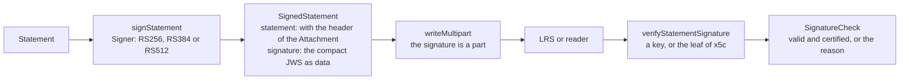

# Signing Statements

A Statement can carry a digital signature, a JSON web signature (JWS) in an Attachment, that proves who made it and that it has
not changed (4.2.6). `@interopkit/learning-records/signing` signs a Statement with a `Signer` of `@interopkit/core`, so that the
key can stay in a KMS or an HSM, and verifies the signature that an LRS or a reader receives.



## Quick start

```ts
import { createCryptoKeySigner } from "@interopkit/core";
import { signStatement, verifyStatementSignature } from "@interopkit/learning-records/signing";

const { privateKey, publicKey } = await crypto.subtle.generateKey(
  { name: "RSASSA-PKCS1-v1_5", modulusLength: 2048, publicExponent: new Uint8Array([1, 0, 1]), hash: "SHA-256" },
  false,
  ["sign", "verify"],
);
const signer = createCryptoKeySigner(privateKey, { algorithm: "RS256" });
const { statement, signature } = await signStatement(
  {
    actor: { name: "Example Learner", mbox: "mailto:learner@example.org" },
    verb: { id: "http://adlnet.gov/expapi/verbs/completed", display: { "en-US": "completed" } },
    object: { id: "https://example.org/activities/course-1" },
  },
  signer,
);
statement.attachments?.[0]?.usageType; // => "http://adlnet.gov/expapi/attachments/signature"
signature.contentType; // => "application/octet-stream"
await verifyStatementSignature(statement, signature.body, { key: publicKey }); // => { valid: true, certified: false }
```

`signStatement` returns the Statement with the header of the signature added to its `attachments`, and the signature as the data
of that Attachment. The host sends both, with `writeMultipart` of `@interopkit/learning-records/attachments`.

## How a signature is made and checked

| Step       | Signing                                                                                                                                | Verifying                                                                                                    |
| ---------- | -------------------------------------------------------------------------------------------------------------------------------------- | ------------------------------------------------------------------------------------------------------------ |
| Payload    | The JSON of the Statement as a provider reads it, before the signature is added                                                        | The JSON must be a Statement that an LRS reads, and the same Statement as the one received (`isSameStatement`) |
| Header     | `alg` of the signer, `kid` when the signer has a key id, `x5c` when the option gives a chain                                           | `alg` must be RS256, RS384 or RS512; `x5c`, when present, is a list of base64 certificates                   |
| Key        | The `Signer` signs; its algorithm is RS256, RS384 or RS512                                                                             | The leaf of `x5c` verifies; else `key`; a `jwk` in the header is never used                                  |
| Attachment | `usageType` `http://adlnet.gov/expapi/attachments/signature`, `contentType` `application/octet-stream`, `length` and `sha2` of the JWS | Not read: the caller gives the bytes of the part that holds the signature                                    |
| Trust      | Not decided                                                                                                                            | `trustCertificate` decides whether the chain is trusted; the result is `certified`                           |

The signature is RSA PKCS#1 v1.5, which is deterministic: the same Statement and key give the same signature. A Statement that has
a signature already is refused, since an LRS reads one signature.

## Options

| Option             | Of                                          | Default                                            | Meaning                                                                                         |
| ------------------ | ------------------------------------------- | -------------------------------------------------- | ----------------------------------------------------------------------------------------------- |
| `x5c`              | `signStatement`                             | none                                               | The certificate chain of the key, leaf first, each as the base64 of its DER encoding            |
| `signal`           | `signStatement`, `verifyStatementSignature` | none                                               | Ends the caller's wait; the signer and `trustCertificate` receive it                            |
| `version`          | `signStatement`, `verifyStatementSignature` | `"2.0.0"`                                          | The version of xAPI. `signStatement` reads the Statement by its provider rules. `verifyStatementSignature` reads the Statement by its rules, and on `"1.0.3"` compares it with the payload in the form of 1.0.3, since the route of 1.0.3 answers a Statement of 2.0 without what 1.0.3 does not have and the signature keeps them |
| `key`              | `verifyStatementSignature`                  | none: a JWS without `x5c` is `no-key`              | The public RSASSA-PKCS1-v1_5 key, made for the hash of the algorithm, when the JWS has no `x5c` |
| `trustCertificate` | `verifyStatementSignature`                  | none: the leaf is checked and trust is not claimed | `(chain, options) => Promise<boolean>`: whether the chain is trusted, leaf first                |

## The result of a verification

A signature that is not good is a value, so that an LRS can answer 400 with the reason. Input that is not valid throws.

| Result                                       | Meaning                                                                                                                          |
| -------------------------------------------- | -------------------------------------------------------------------------------------------------------------------------------- |
| `{ valid: true, certified: true }`           | The signature verifies and `trustCertificate` trusts the chain                                                                   |
| `{ valid: true, certified: false }`          | The signature verifies; there is no chain, no function, or the function does not trust the chain                                 |
| `{ valid: false, reason: "malformed" }`      | The bytes are no compact JWS, the `x5c` is no list of certificates or its leaf is no certificate, or the payload is no Statement |
| `{ valid: false, reason: "algorithm" }`      | The algorithm is not RS256, RS384 or RS512, or the key is made for another hash or has less than 2,048 bits                      |
| `{ valid: false, reason: "no-key" }`         | The JWS has no `x5c` and no `key` was given                                                                                      |
| `{ valid: false, reason: "signature" }`      | The key does not verify the signature: the payload, the header or the signature changed, or another key signed                   |
| `{ valid: false, reason: "not-equivalent" }` | The signature is good, and the payload is another Statement than the one received                                                |

The chain in the header is not validated: the signature is checked against its leaf, as the standard asks, and `trustCertificate`
decides about the rest, for example by checking the chain against the host's roots. Anyone can make a certificate, so a signature
that verifies against a chain nobody judged says that the Statement was not changed after it was signed, and not who signed it: to
know the signer, pass `key` or check that `certified` is true. The JWS JSON serialization is `malformed`: the
standard asks for the compact one.

## Limits

| Limit       | Value                                                                    | Applies to                                                                                                                           |
| ----------- | ------------------------------------------------------------------------ | ------------------------------------------------------------------------------------------------------------------------------------ |
| The payload | 10,485,760 bytes, 64 levels and 1,000,000 tokens, those of `parseStatementJson` | A payload over them is `malformed`. The handler of an LRS reads it within its own `maxBodyBytes`, `maxDepth` and `maxTokens` instead |

The worst payload within them, a JWS of 10 MiB near a million tokens of distinct names, ends within a heap of
176 MiB (88 MiB is the least, measured by `peak-memory.test.ts`). A host that verifies the signatures of many senders checks the size of the
bytes first, or verifies them through the handler with lower limits.

## Errors

| Error                                                                                                      | When                                                          | What to do                                    |
| ---------------------------------------------------------------------------------------------------------- | ------------------------------------------------------------- | --------------------------------------------- |
| `The statement is invalid at <path>: <sentence>.`                                                          | The Statement breaks a rule of a provider (signing) or an LRS | Fix the Statement                             |
| `The Statement has a signature already: a Statement is signed once.`                                       | `signStatement` was given a signed Statement                  | Sign the Statement before it has a signature  |
| `The signature of a Statement is RS256, RS384 or RS512, and the signer signs with "<algorithm>".`          | The signer uses another algorithm                             | Use an RSA key                                |
| `The options object is invalid at <path>: <sentence>.`                                                     | An option has the wrong type, or a certificate is no base64   | Pass the options as the table above says      |
| `The options object is invalid at key: expected a public RSASSA-PKCS1-v1_5 CryptoKey that can verify, ...` | The key is private, is not RSA, or cannot verify              | Import the public key with the `verify` usage |
| `The signature must be a Uint8Array, found <value>.`                                                       | `verifyStatementSignature` was given text                     | Pass the bytes of the Attachment              |

An error of the signer, of `trustCertificate`, and the `reason` of a `signal` pass through unchanged.

## Not included

| Not included                                  | Why                                                                                                   |
| --------------------------------------------- | ----------------------------------------------------------------------------------------------------- |
| Validating a certificate chain                | Roots, revocation and the time of validity are the host's trust decision; `trustCertificate` takes it |
| Signing with other algorithms                 | The standard names RS256, RS384 and RS512                                                             |
| The JWS JSON serialization                    | "Strongly discouraged" and unlikely to be interoperable                                               |
| Finding the signature Attachment in a request | The LRS reads the Statements and the parts first and then picks the Attachment by its usage type      |

## Differences from the references

| Reference    | Difference                                                                                                                                                                                                                |
| ------------ | ------------------------------------------------------------------------------------------------------------------------------------------------------------------------------------------------------------------------- |
| The standard | "Logically equivalent" is not defined for a signature; the package uses the equivalence of the immutability rules (`isSameStatement`) and, since that leaves them out, holds the `id`, the `timestamp` and the Attachments of the payload to the Statement; `stored`, `authority` and `version` are the LRS's to set |
| The standard | The Statement signed is "the complete Statement before the signature was added"; a Statement without an id is signed without one, and the LRS may give it one without breaking the signature                              |
| jwcrypto     | Signatures made by jwcrypto with RS256, RS384 and RS512 and an X.509 chain verify, and the cases in which they must not are refused with the reasons above (`validation/xapi_signatures.py`)                              |
