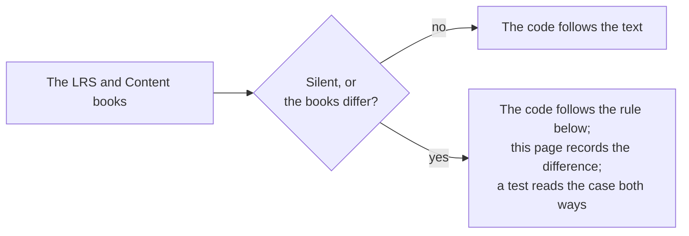

# Gaps in the specification

Where the LRS book, the Content book and the examples disagree, or say nothing, the package follows the rule below and a test
pins the choice. The examples are those that `pnpm spec-examples` downloads at pinned hashes.

| Where                                                         | What the standard says                                                                                                                                                    | What the package does                                                                                                                                                                            |
| ------------------------------------------------------------- | ------------------------------------------------------------------------------------------------------------------------------------------------------------------------- | ------------------------------------------------------------------------------------------------------------------------------------------------------------------------------------------------ |
| "may not reject" (4.2.4.1)                                    | "An LRS may not reject a Statement solely based on the order of properties"                                                                                               | Read as "shall not reject": the order of properties never matters                                                                                                                                |
| `stored`                                                      | "Not Recommended" in the LRS book and "Set by LRS" in the Content book                                                                                                    | An LRS reads it as a time; a provider gets the warning `lrs-managed-property`                                                                                                                    |
| `version`                                                     | An LRS "should not reject a Statement that is otherwise valid except the version"; a provider "shall set it to 2.0.0" if it sets it                                       | An LRS accepts any string; a provider gets an error for another value and a warning for `2.0.0`                                                                                                  |
| The examples print `version`                                  | The long example and the signed example carry `"1.0.0"`                                                                                                                   | An LRS accepts them; the provider role reports `invalid-value`, and a test pins it                                                                                                               |
| The first example                                             | The simple Statement has a string with line breaks, which JSON does not allow                                                                                             | It is not read; the pinned hash covers the examples that are JSON                                                                                                                                |
| Performance responses                                         | The table writes a range as `min[:]max`; the example writes `pong[.]1:[,]dg[.]:10[,]lunch[.]` with `:`                                                                    | A response of a step is free text, so both are accepted                                                                                                                                          |
| An anonymous Group with no members                            | `member` is required, and nothing says how many                                                                                                                           | The property must be present; an empty list is accepted                                                                                                                                          |
| Interaction components of another type                        | An LRS "may" validate the lists that an interaction type has; a provider "shall not" add properties                                                                       | A list that the type lacks is a warning for an LRS and an error for a provider                                                                                                                   |
| Response patterns                                             | The forms are in a table, and "characterstring parameters are not validated by the LRS"                                                                                   | A pattern of another form is a warning in both roles                                                                                                                                             |
| Timestamps                                                    | RFC 3339 for a provider, "ISO 8601" in the heading; an LRS "shall convert Timestamps to UTC"                                                                              | RFC 3339 with an offset for both roles: a time without an offset is refused                                                                                                                      |
| Case of a UUID                                                | "Standard string form" and variant 2 "should"                                                                                                                             | Digits of either case; another variant is the warning `uuid-variant`; two ids that differ in case are one id in a batch                                                                          |
| `authority`                                                   | "Agent or Group" in 2.0, with no rule for the pair of an OAuth consumer and a user                                                                                        | An Agent or a Group                                                                                                                                                                              |
| Case in immutability (4.2)                                    | "Case (upper vs. lower)" is not equivalence, and the standard does not say of what                                                                                        | Case counts only where the data type ignores it: the scheme and the host of an IRI, an email address, a hash, a UUID and a language tag                                                          |
| What is compared (4.2)                                        | It lists the properties that are immutable (Actor, Verb, Object, Duration) and those that are not. The Result other than the duration and the context are in neither list | They are compared: an LRS "shall specifically not consider" the second list for equivalence, which leaves everything else                                                                        |
| Durations in a comparison (4.2.7)                             | "Any precision beyond 0.01 second shall not be included in the comparison"                                                                                                | The time of a duration is cut at 0.01 second and counted in one unit, so `PT1H` and `PT60M` are one; years, months and days are not converted, so `P1D` and `PT24H` are two                      |
| The display of the voided verb (4.2.5)                        | The standard names the verb and gives no display                                                                                                                          | `voidingStatement` writes `{ "en-US": "voided" }`, as the display of a Verb is recommended (4.2.2.2)                                                                                             |
| `version` of a built Statement (5.2.4.1)                      | A provider "should not" send a version and "shall" make it 2.0.0 if it does                                                                                               | `buildStatement` writes `2.0.0`, so that a system of 1.0.x does not read the Statement as 1.0.0; the validator warns, and the build goes on                                                      |
| The format `ids` (4.1.6.1)                                    | "Only include minimum information necessary" to identify an Agent, Group, Activity or Verb                                                                                | An Agent as the Object keeps `objectType`, which it needs to be read as an Agent. Elsewhere `objectType` of an Agent goes, and a Group keeps its own                                             |
| The format `canonical` (4.1.6.1)                              | An LRS "may" keep a canonical display for any IRI and "shall" return one language in each map it returns canonical                                                        | The Activities take their definitions from the host's map; Verbs and the other maps keep what the Statement has, in one language                                                                 |
| `Accept-Language` (4.1.6.1)                                   | It cites RFC 2616, applied to each language map                                                                                                                           | A range matches a tag that equals it or begins with it and a hyphen (RFC 4647 3.3.1); the first range that matches wins; none matching gives the first entry                                     |
| Signature and equivalence (4.2.6)                             | The LRS "shall" validate that the original Statement is "logically equivalent" to the received one, and does not define the term for a signature                          | The equivalence of the immutability rules is used (`sameStatement`): the id, the time, `stored`, `authority`, `version` and the Attachments are not compared                                     |
| The signed payload (4.2.6)                                    | The payload is "a valid JSON serialization of the complete Statement before the signature was added"                                                                      | A Statement without an id is signed without one; the Statement as a provider reads it is the payload, and the header of the signature is added after                                             |
| The trust of a chain (4.2.6)                                  | The JWS "should" carry `x5c`, and the LRS validates the signature "against that certificate"; nothing says how a chain is trusted                                         | The signature is checked against the leaf; `trustCertificate` decides about the chain, and without it `certified` is `false`                                                                     |
| The first part of a message (4.1.3)                           | The first part "shall be" `application/json`, and a type in each part "should" be given                                                                                   | A first part with no `Content-Type` is read as JSON; one with another type is refused                                                                                                            |
| A part with no type or encoding (4.1.3)                       | `Content-Transfer-Encoding: binary` and `X-Experience-API-Hash` "shall" be in each part after the first; the LRS "should assume" binary                                   | The hash is required; an absent encoding is `binary` and another encoding is refused; an absent type is `application/octet-stream`                                                               |
| Two parts with one hash (4.1.3)                               | A message "should only include one copy" of the data that several Statements use                                                                                          | The reader keeps the first of two parts with one hash; the writer refuses two                                                                                                                    |
| `more` (4.1.6.1)                                              | "An IRL to retrieve" the next results; the books do not say whether it is relative, absolute or empty on the last page                                                    | A `more` that is absent or empty ends the iteration; one that is relative or absolute on the origin of the LRS is followed; another origin is refused, so that the credential stays with the LRS |
| A POST of a Statement that exists (4.1.6.1)                   | The LRS "shall not" change it, and answers "409 Conflict or 204 No Content"; the books list only 200 and the ids as the return                                            | 200 with the ids and 204 are success (204 gives the ids of the batch); 409 is a `ServiceError`                                                                                                   |
| A PUT of a Statement that exists (4.1.6.1)                    | The LRS answers 204 or 409                                                                                                                                                | 204 is `"stored"`, whether the Statement was new or a resend, and 409 is `"conflict"`                                                                                                            |
| `X-Experience-API-Consistent-Through` (4.1.6.1)               | The LRS "shall" include it on every answer of the Statement resource                                                                                                      | A page without it is refused: the time is how a Learning Record Provider knows what a query could miss                                                                                           |
| The time of a document (4.1.6.2, 4.1.6.5, 4.1.6.6)            | The LRS "shall" include `Last-Modified`, an HTTP date, while the other times of the standard are ISO 8601                                                                 | `LrsDocument.updated` is the same time as ISO 8601 in UTC; an ISO 8601 header is read too                                                                                                        |
| A DELETE of a document that is not there (4.1.6.2 to 4.1.6.6) | The books list 204 and do not say what an absent document answers                                                                                                         | 404 is a `ServiceError`, so that a caller sees that no document went                                                                                                                             |
| A DELETE of several State documents (4.1.4, 4.1.6.2)          | State is under the ETags, but a multiple DELETE has no single ETag                                                                                                        | `deleteStates` takes no precondition, on either version                                                                                                                                          |
| The parameter of a profile list (4.1.6.6)                     | The table of the multiple GET of the Activity Profile resource names `agent`                                                                                              | The client sends `activityId`, the parameter that names the Activity                                                                                                                             |
| A request with no version header (4.1.7)                      | The LRS "shall reject" a version before 2.0.0 or 2.1.0 and later, and "shall accept" 2.0 as 2.0.0; a request with none is not mentioned                                   | A request without the header is refused with 400, and so is any value but 2.0, 2.0.0 and 2.0.x                                                                                                   |
| The id of a Statement (4.1.6.1, 4.2.4.2)                      | A UUID is "in standard string form"; the LRS keeps serializations                                                                                                         | The id is stored in lower case, so that one UUID is one id; a lookup is case-insensitive                                                                                                         |
| A Statement that arrives after the one that voids it (4.2.5)  | A Statement is voided "if and only if" a voiding Statement refers to it                                                                                                   | The LRS looks for the target when the voiding Statement arrives: a target that arrives later is not voided                                                                                       |
| Statement References and several filters (4.1.6.1)            | A Statement that refers to another meets "the filter condition" if the other meets it, and "the filter conditions" at the end of a chain                                  | Each filter is judged by itself on the chain of references, so a Statement may meet one filter by itself and another through the Statement it refers to                                          |
| The address of the next page (4.1.6.1)                        | "An IRL" that the LRS may fill with "all necessary information"                                                                                                           | A relative address of the Statements resource that repeats the parameters of the request and adds `cursor`; the cursor is the store's, and a cursor it does not know is 400                      |
| Unreferenced parts (4.1.3)                                    | The LRS "shall reject" an Attachment with neither a `fileUrl` nor a part; it says nothing of a part that no Attachment names                                              | A part that no Attachment names is left out and not stored                                                                                                                                       |
| The type and length of a part (4.1.3)                         | Where a header of a part and a property of the Attachment both exist, "the values shall match"                                                                            | The `length` of the Attachment must be the length of its data; the type of the Attachment is the one that is stored, and the type of the part is not compared                                    |
| A signature without a key (4.2.6)                             | The LRS "shall" validate the signature "against that certificate" when the header has an `x5c`, and nothing else                                                          | A signature with no certificate is well formed or it is not: it is accepted when it is, because the LRS has no key to verify it with                                                             |
| A batch with a Statement that conflicts (4.1.5, 4.1.6.1)      | The LRS "shall reject a batch" if any Statement is rejected, and "shall not" change a Statement it holds                                                                  | The Statements of the batch that were new are stored before the conflict is found, and the answer is 409; a resend answers 204                                                                   |
| `X-Experience-API-Consistent-Through` on a refusal (4.1.6.1)  | The header is on "all responses to Statements Resource requests"                                                                                                          | It is on the successful answers; a refusal is written without asking the store                                                                                                                   |
| The format of an error (4.1.5)                                | The LRS "should" use content negotiation and "should" allow plain text, HTML and JSON                                                                                     | `Accept` chooses among JSON, plain text and HTML, and JSON is the answer when it prefers none                                                                                                    |
