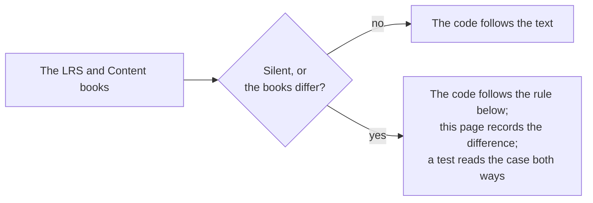

# Gaps in the specification

Where the LRS book, the Content book and the examples disagree, or say nothing, the package follows the rule below and a test
pins the choice. The examples are those that `pnpm spec-examples` downloads at pinned hashes.

| Where                                    | What the standard says                                                                                                                                                    | What the package does                                                                                                                                                       |
| ---------------------------------------- | ------------------------------------------------------------------------------------------------------------------------------------------------------------------------- | --------------------------------------------------------------------------------------------------------------------------------------------------------------------------- |
| "may not reject" (4.2.4.1)               | "An LRS may not reject a Statement solely based on the order of properties"                                                                                               | Read as "shall not reject": the order of properties never matters                                                                                                           |
| `stored`                                 | "Not Recommended" in the LRS book and "Set by LRS" in the Content book                                                                                                    | An LRS reads it as a time; a provider gets the warning `lrs-managed-property`                                                                                               |
| `version`                                | An LRS "should not reject a Statement that is otherwise valid except the version"; a provider "shall set it to 2.0.0" if it sets it                                       | An LRS accepts any string; a provider gets an error for another value and a warning for `2.0.0`                                                                             |
| The examples print `version`             | The long example and the signed example carry `"1.0.0"`                                                                                                                   | An LRS accepts them; the provider role reports `invalid-value`, and a test pins it                                                                                          |
| The first example                        | The simple Statement has a string with line breaks, which JSON does not allow                                                                                             | It is not read; the pinned hash covers the examples that are JSON                                                                                                           |
| Performance responses                    | The table writes a range as `min[:]max`; the example writes `pong[.]1:[,]dg[.]:10[,]lunch[.]` with `:`                                                                    | A response of a step is free text, so both are accepted                                                                                                                     |
| An anonymous Group with no members       | `member` is required, and nothing says how many                                                                                                                           | The property must be present; an empty list is accepted                                                                                                                     |
| Interaction components of another type   | An LRS "may" validate the lists that an interaction type has; a provider "shall not" add properties                                                                       | A list that the type lacks is a warning for an LRS and an error for a provider                                                                                              |
| Response patterns                        | The forms are in a table, and "characterstring parameters are not validated by the LRS"                                                                                   | A pattern of another form is a warning in both roles                                                                                                                        |
| Timestamps                               | RFC 3339 for a provider, "ISO 8601" in the heading; an LRS "shall convert Timestamps to UTC"                                                                              | RFC 3339 with an offset for both roles: a time without an offset is refused                                                                                                 |
| Case of a UUID                           | "Standard string form" and variant 2 "should"                                                                                                                             | Digits of either case; another variant is the warning `uuid-variant`; two ids that differ in case are one id in a batch                                                     |
| `authority`                              | "Agent or Group" in 2.0, with no rule for the pair of an OAuth consumer and a user                                                                                        | An Agent or a Group                                                                                                                                                         |
| Case in immutability (4.2)               | "Case (upper vs. lower)" is not equivalence, and the standard does not say of what                                                                                        | Case counts only where the data type ignores it: the scheme and the host of an IRI, an email address, a hash, a UUID and a language tag                                     |
| What is compared (4.2)                   | It lists the properties that are immutable (Actor, Verb, Object, Duration) and those that are not. The Result other than the duration and the context are in neither list | They are compared: an LRS "shall specifically not consider" the second list for equivalence, which leaves everything else                                                   |
| Durations in a comparison (4.2.7)        | "Any precision beyond 0.01 second shall not be included in the comparison"                                                                                                | The time of a duration is cut at 0.01 second and counted in one unit, so `PT1H` and `PT60M` are one; years, months and days are not converted, so `P1D` and `PT24H` are two |
| The display of the voided verb (4.2.5)   | The standard names the verb and gives no display                                                                                                                          | `voidingStatement` writes `{ "en-US": "voided" }`, as the display of a Verb is recommended (4.2.2.2)                                                                        |
| `version` of a built Statement (5.2.4.1) | A provider "should not" send a version and "shall" make it 2.0.0 if it does                                                                                               | `buildStatement` writes `2.0.0`, so that a system of 1.0.x does not read the Statement as 1.0.0; the validator warns, and the build goes on                                 |
| The format `ids` (4.1.6.1)               | "Only include minimum information necessary" to identify an Agent, Group, Activity or Verb                                                                                | An Agent as the Object keeps `objectType`, which it needs to be read as an Agent. Elsewhere `objectType` of an Agent goes, and a Group keeps its own                        |
| The format `canonical` (4.1.6.1)         | An LRS "may" keep a canonical display for any IRI and "shall" return one language in each map it returns canonical                                                        | The Activities take their definitions from the host's map; Verbs and the other maps keep what the Statement has, in one language                                            |
| `Accept-Language` (4.1.6.1)              | It cites RFC 2616, applied to each language map                                                                                                                           | A range matches a tag that equals it or begins with it and a hyphen (RFC 4647 3.3.1); the first range that matches wins; none matching gives the first entry                |
