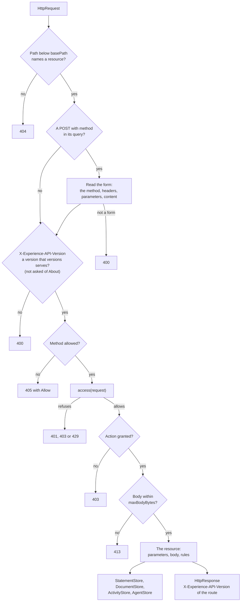
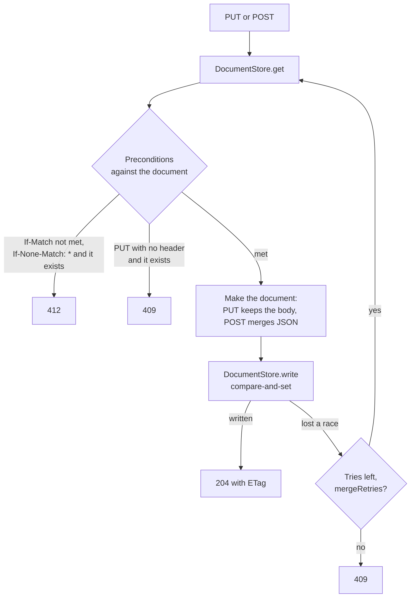

# The LRS handler

`@interopkit/learning-records/store` answers the requests that a Learning Record Provider and a consumer make to a Learning
Record Store. `handleLrsRequest` takes an `HttpRequest` and returns an `HttpResponse` of `@interopkit/core/http`, over the ports
of the host: the stores of Statements, documents and Activities, the decision about who may do what, and a clock. It keeps no
state, makes no request, and knows no database, server or account. It serves xAPI 2.0 and 1.0.3, each request by the version it
names: [the versions guide](versions.md) says what differs.



## Quick start

```ts
import { handleLrsRequest } from "@interopkit/learning-records/store";

const held = new Map();
const kept = new Map();
const headers = { "x-experience-api-version": "2.0.0", "content-type": "application/json" };
const statement = {
  id: "6690e6c9-3ef0-4ed3-8b37-7f3964730bee",
  actor: { name: "Example Learner", mbox: "mailto:learner@example.org" },
  verb: { id: "http://adlnet.gov/expapi/verbs/completed", display: { "en-US": "completed" } },
  object: { id: "https://example.org/activities/course-1" },
};
const bookmark = `https://lrs.example.org/xapi/activities/state?${new URLSearchParams({
  activityId: "https://example.org/activities/course-1",
  agent: JSON.stringify({ mbox: "mailto:learner@example.org" }),
  stateId: "bookmark",
})}`;
const requests = [
  {
    method: "POST",
    url: "https://lrs.example.org/xapi/statements",
    headers,
    body: new TextEncoder().encode(JSON.stringify(statement)),
  },
  {
    method: "PUT",
    url: bookmark,
    headers: { ...headers, "if-none-match": "*" },
    body: new TextEncoder().encode('{"page":3}'),
  },
  { method: "GET", url: bookmark, headers, body: new Uint8Array() },
];
const answers = [];
for (const request of requests)
  answers.push(
    await handleLrsRequest(request, {
      statements: {
        async insert(batch) {
          const existing = batch.filter((entry) => held.has(entry.statement.id));
          for (const entry of batch) if (!held.has(entry.statement.id)) held.set(entry.statement.id, entry);
          return { existing };
        },
        async get(id, options) {
          const entry = held.get(id);
          return entry?.voided === options.voided ? entry : undefined;
        },
        async query(query, page) {
          return { statements: [...held.values()].slice(0, page.limit) };
        },
        async consistentThrough() {
          return "2026-01-15T10:30:00.000Z";
        },
        async attachments() {
          return new Map();
        },
      },
      documents: {
        async get(key) {
          return kept.get(JSON.stringify(key))?.document;
        },
        async write(key, document, condition) {
          const id = JSON.stringify(key);
          const current = kept.get(id)?.document;
          if ("ifMatch" in condition ? current?.etag !== condition.ifMatch : current !== undefined) {
            return "none" in condition ? "exists" : "precondition-failed";
          }
          kept.set(id, { key, document });
          return "written";
        },
        async delete(key, condition) {
          const id = JSON.stringify(key);
          const current = kept.get(id)?.document;
          if (current === undefined) return "absent";
          if (current.etag !== condition.ifMatch) return "precondition-failed";
          kept.delete(id);
          return "deleted";
        },
        // A key is in a scope when the scope laid over it leaves it as it is.
        async list(scope, since) {
          return [...kept.values()]
            .filter(
              ({ key, document }) =>
                JSON.stringify({ ...key, ...scope }) === JSON.stringify(key) &&
                (since === undefined || document.updated > since),
            )
            .map(({ key }) => ("stateId" in key ? key.stateId : key.profileId));
        },
        async deleteAll(scope) {
          for (const [id, { key }] of kept) if (JSON.stringify({ ...key, ...scope }) === JSON.stringify(key)) kept.delete(id);
        },
      },
      activities: {
        async get() {
          return undefined;
        },
        async observe() {},
      },
      access: async () => ({
        allowed: true,
        authority: { account: { homePage: "https://lrs.example.org", name: "client" } },
        actions: ["statements.read", "statements.write", "state.read", "state.write"],
      }),
      clock: { now: () => Date.parse("2026-01-15T10:30:00.000Z") },
    }),
  );
answers.map((answer) => answer.status); // => [200, 204, 200]
held.get(statement.id).statement.authority.account.name; // => "client"
answers[2].headers["content-type"]; // => "application/json"
answers[2].headers.etag === answers[1].headers.etag; // => true
```

A host builds the `HttpRequest` from the request of its web framework, with header names in lower case and the body as bytes,
and sends the `HttpResponse`. The header `X-Experience-API-Version` is on every answer.

## The resources

| Path below `basePath` | Resource         | Methods                      | Actions                               | Section                          |
| --------------------- | ---------------- | ---------------------------- | ------------------------------------- | -------------------------------- |
| `statements`          | Statements       | GET, HEAD, PUT, POST         | `statements.read` or `statements.read.mine`, `statements.write` | [Statements](#statements)        |
| `activities/state`    | State            | GET, HEAD, PUT, POST, DELETE | `state.read`, `state.write`           | [Documents](#documents)          |
| `agents/profile`      | Agent Profile    | GET, HEAD, PUT, POST, DELETE | `profiles.read`, `profiles.write`     | [Documents](#documents)          |
| `activities/profile`  | Activity Profile | GET, HEAD, PUT, POST, DELETE | `profiles.read`, `profiles.write`     | [Documents](#documents)          |
| `agents`              | Agents           | GET, HEAD                    | `agents.read`                         | [Agents](#agents-and-activities) |
| `activities`          | Activities       | GET, HEAD                    | `activities.read`                     | [Agents](#agents-and-activities) |
| `about`               | About            | GET, HEAD                    | none                                  | [About](#about)                  |

## Statements

| Request                                               | Does                                                                                          | Answers                                                         |
| ----------------------------------------------------- | --------------------------------------------------------------------------------------------- | --------------------------------------------------------------- |
| `PUT statements?statementId=`                         | Stores one Statement under the id                                                             | 204; 409 when the LRS holds another Statement with the id       |
| `POST statements`                                     | Stores a Statement or a list of them                                                          | 200 with the ids in order; 204 when it held all of them already |
| `GET statements?statementId=` or `voidedStatementId=` | Returns one Statement; `attachments` and `format` are the only parameters that go with the id | 200; 404 when there is none of that kind                        |
| `GET statements?`                                     | Returns a page of the Statements that match the filters, newest first unless `ascending`      | 200 with `{ statements, more? }`                                |
| `HEAD statements`                                     | As GET, with no body                                                                          | The status and headers of GET                                   |

Every answer of the Statements resource names `X-Experience-API-Consistent-Through`, the time that `consistentThrough` of the store
gives, a 400 and a 404 included: the answers that come before the resource, a refusal of `access` or of the size of a body, do
not ask the store.

A stored Statement gets what the LRS sets (4.2.4.2): an `id` when it has none, in lower case; `stored`, always, from the
`clock`; `timestamp` from `stored` when it has none, and a `timestamp` that is not in UTC written in UTC, whatever form of ISO 8601 or RFC 3339 it has (the offset `-00:00` is refused); `authority` from `access`, unless `keepSubmittedAuthority` keeps the one it
brings; `version` `2.0.0` when it has none, or `1.0.0` on the route of 1.0.3. A Statement is read with the rules of an LRS of the route first, and a list is judged whole:
one Statement with an error refuses the request and stores nothing, and two with one id refuse it too. A `version` is `1.0`, `1.0.x`, `2.0` or `2.0.x`, or `1.0` and `1.0.x` alone on the route of 1.0.3, and a submitted `authority` that is a Group is an anonymous Group of two Agents, though the LRS replaces it; the `revision` and `platform` of a context go with an Activity.

A batch is stored whole or not at all (4.1.5). When the LRS holds an id of the batch, the store stores nothing and returns what it
holds: another Statement with that id refuses the request with 409 and changes nothing; the same Statement is a resend, and the
others of the batch are stored without it. A resend changes nothing, a voiding Statement included, and the store of Activities sees
the Statement as the LRS holds it.

A Statement with the voided Verb voids the Statement it refers to, whether the LRS holds it, the batch has it, or it arrives later,
unless it is a voiding Statement itself: the store keeps the ids of `voids` to do that (4.2.5). A voided Statement is returned only
to a request by `voidedStatementId`, and Statements that refer to it are still returned.

The query parameters are `agent`, `verb`, `activity`, `registration`, `related_activities`, `related_agents`, `since`, `until`,
`limit`, `format`, `attachments` and `ascending`, and `cursor`, which the LRS adds to the address of the next page. A parameter
of another name, or of the same name in another case, a value of the wrong form, or a Boolean that is not `true` or `false`
refuses the request with 400.

| Format      | Answers                                                                                                                |
| ----------- | ---------------------------------------------------------------------------------------------------------------------- |
| `exact`     | The Statements as they were stored                                                                                     |
| `ids`       | Agents, Groups, Activities and Verbs with only the properties that identify them                                       |
| `canonical` | The definitions of the Activities from `ActivityStore.get`, and one language in each language map by `Accept-Language` |

With `attachments=true` the answer is a `multipart/mixed` message with the data of the Attachments that the store holds, one
part for each hash. A Statement is stored with the data that come in a multipart request, and an Attachment needs either a
`fileUrl` or its part, and a part that no Attachment names refuses the request; the `length` of the Attachment is not compared to its data, which the hash binds. The signature of a Statement is checked (4.2.6): it must be a compact JWS of RS256, RS384 or RS512
whose payload is the same Statement, whether the LRS holds a key or not, and when its header has an `x5c` it must verify against
the leaf. Anyone can make a certificate: with `trustCertificate` a chain that it does not trust refuses the request with 400.
The payload of a signature is read within `maxDepth` and `maxTokens`, a signature that a Statement names twice is verified
once, and since many Statements may name one part, the bytes of the signatures, counted once for each Statement, are at most
`maxBodyBytes`, or the request is refused with 413 before any is read.

`accept`, when the options give it, judges a batch last, after its Attachments and signatures and before the store, for the
rules of a profile such as cmi5. It sees each Statement as the request sent it, so that a profile can refuse what the LRS would
complete or convert: without the `id`, `stored`, `authority` and `version` that the LRS sets, with the `statementId` of a PUT as
the `id`, and with each `timestamp`, a SubStatement's included, as written. It gets the access with its `principal`, and an
error among its findings refuses the request with `acceptStatus` and stores nothing.

## Documents

The State, Agent Profile and Activity Profile resources hold documents: any content with its Internet media type, named by an
id and by the context they belong to.



| Request                                    | Does                                                                                 | Answers                                                                  |
| ------------------------------------------ | ------------------------------------------------------------------------------------ | ------------------------------------------------------------------------ |
| `GET` with the id (`stateId`, `profileId`) | Returns the document with its `Content-Type`, `ETag` and `Last-Modified`             | 200; 404 when there is none                                              |
| `GET` without the id                       | Returns the ids of the documents of the context, each once, as a JSON array          | 200; `since` lists only the documents updated after that time            |
| `PUT` with the id                          | Stores the body as it came, with the `Content-Type` of the request, which it needs   | 204 with the new `ETag`                                                  |
| `POST` with the id                         | Merges the body into the document, or stores it where there is none                  | 204 with the new `ETag`; 400 when it cannot merge                        |
| `DELETE` with the id                       | Removes the document                                                                 | 204; also when there is none, unless `If-Match` asks for a version (412) |
| `DELETE` of State without `stateId`        | Removes every State of the Activity and Agent, of the registration when one is named | 204; no precondition, since the documents share no tag                   |
| `HEAD`                                     | As GET, with no body                                                                 | The status and headers of GET                                            |

The parameters are `activityId`, `agent` and `registration` (optional) with `stateId` for State; `agent` with `profileId` for
Agent Profile; `activityId` with `profileId` for Activity Profile; and `since` on a GET without the id. The `agent` is the JSON
of an Agent with one identifier, and the LRS keys on the identifier alone, so that a request that adds a `name` finds the same
documents. A `registration` is a UUID, kept in lower case. A parameter of another name, or one that goes with another method,
refuses the request with 400.

The ETag of a document is the SHA-1 of its body in hex, in quotes, so equal content has equal tags. The preconditions follow
RFC 9110 and the standard (4.1.4):

| Header on PUT or POST   | The document exists                                      | There is none |
| ----------------------- | -------------------------------------------------------- | ------------- |
| `If-Match: "tag"`       | Written if the tag is its tag; else 412                  | 412           |
| `If-Match: *` or a list | Written if `*` or a tag of the list is its tag; else 412 | 412           |
| `If-None-Match: *`      | 412                                                      | Written       |
| `If-None-Match: "tag"`  | 412 if the tag is its tag, else written                  | Written       |
| none, a PUT             | 409                                                      | Written       |
| none, a POST            | Merged into it                                           | Written       |

The route of 1.0.3 lets State go without concurrency headers and asks one of a PUT of a profile (1.0.3 Communication 3.1), so a
PUT with neither header differs there:

| A PUT with neither header, on 1.0.3 | The document exists | There is none  |
| ----------------------------------- | ------------------- | -------------- |
| State                               | Replaced            | Written        |
| Agent Profile, Activity Profile     | 409                 | 400            |

A `DELETE` takes `If-Match` and no other header: with a tag that is not the document's, or with no document, the answer is 412,
and without the header the document is removed, or is already not there and the answer is 204. A member of a header is compared
with the tag as it was written, so one that is no quoted entity tag, such as `1234`, names no tag of the document and the
answer is 412, not 400. A weak tag (`W/"..."`) never matches.

A POST merges when the document exists (4.1.6.2): both the body and the document must be `application/json` and a JSON object,
and the top-level properties of the body replace those of the document. Where no document exists, the body is stored as it came;
a body typed `application/json` must be a JSON object even then. A document over `limits.maxDocumentBytes`, a merged one
included, is refused with 413; the body of a PUT is checked before the store is called.

A write that loses a race to another writer, so that the store does not find the document as it was read, is made again on the
document that won, judged against the same headers: it goes through where they still hold, is refused with 412 or 409 where
they do not, and with 409 after `limits.mergeRetries` tries.

## Agents and Activities

`GET agents?agent=` returns the Person that the Agent is (4.1.6.3): a JSON object with each identifier as a list. Without an
`agents` store it holds the identifiers of the asked Agent only. `GET activities?activityId=` returns the Activity that
`ActivityStore.get` holds, with `objectType`, or an Activity with only its id where the store holds none (4.1.6.4). Both take
exactly one parameter; a Group, an Agent without an identifier, and an `activityId` that is not an IRI are refused with 400.

## About

`GET about` answers `{ "version": ["2.0.0", "1.0.3"] }`, the option `versions`, with the `aboutExtensions` of the options as
`extensions` (4.1.6.7). It is answered whatever version header the request has, so that a client can find the versions the LRS
serves. It asks `access` like
every request and needs no action: a host that lets anyone ask About answers `{ allowed: true, actions: [] }` with an
`authority` of its choice.

## Who may do what

`access` is asked about every request that names a resource and a method. It answers an `AccessDecision` of
`@interopkit/core/http`: `{ allowed: true, authority, actions }`, with an optional `principal` that names who the request is
from for `accept`, or `{ allowed: false, status }` with 401, 403 or 429. A
refusal's `reason` is the message of the answer (by default a sentence of its status), a 401 carries `challenge` as
`WWW-Authenticate`, and a 429 carries `retryAfterSeconds` as `Retry-After`. A request for an action that `actions` does not list is 403; the action of each
method is in the table of [the resources](#the-resources).

A credential with `statements.read.mine` and not `statements.read` reads only the Statements whose `authority` is the one that
`access` gives it, the scope `statements/read/mine` of 1.0.3 Communication 4.2: `StatementStore.query` gets that authority as
`page.authority`, which `matchesStatementQuery` takes as its option, and a Statement of another authority asked for by id is 404.
The other scopes of 1.0.3 map to the actions as follows; OAuth itself, and `define`, are the host's.

| Scope of 1.0.3 | Actions |
| --- | --- |
| `statements/write` | `statements.write` |
| `statements/read/mine` | `statements.read.mine` |
| `statements/read` | `statements.read` |
| `state` | `state.read`, `state.write` |
| `profile` | `profiles.read`, `profiles.write` |
| `all/read` | every action that reads |
| `all` | every action |
| `define` | None: `ActivityStore.observe` gets the `authority`, and the host decides what becomes canonical |

## Options

| Option                   | Of           | Default                               | Meaning                                                                                                        |
| ------------------------ | ------------ | ------------------------------------- | -------------------------------------------------------------------------------------------------------------- |
| `statements`             | `LrsOptions` | required                              | The `StatementStore`                                                                                           |
| `documents`              | `LrsOptions` | required                              | The `DocumentStore`                                                                                            |
| `activities`             | `LrsOptions` | required                              | The `ActivityStore`                                                                                            |
| `agents`                 | `LrsOptions` | a Person with the Agent's identifiers | The `AgentStore`                                                                                               |
| `access`                 | `LrsOptions` | required                              | Decides who asks and what they may do                                                                          |
| `clock`                  | `LrsOptions` | required                              | The time of the LRS; `stored` of a Statement and `updated` of a document are its `now`                         |
| `basePath`               | `LrsOptions` | `"/xapi"`                             | The path the LRS is mounted at: `""`, or a path that starts with `/` and does not end with one. It is compared percent-encoded, as `URL` writes the path of a request, so `/café` and `/caf%C3%A9` are one path; one whose dot segments leave `/` is refused |
| `versions`               | `LrsOptions` | `["2.0.0", "1.0.3"]`                  | The versions the LRS serves, the latest first; a request of another is 400, and About lists these              |
| `newId`                  | `LrsOptions` | `crypto.randomUUID`                   | Makes the id of a Statement that has none                                                                      |
| `accept`                 | `LrsOptions` | none                                  | A check after the standard's, the Attachments and the signatures, for the rules of a profile; it sees the Statements as sent ([Statements](#statements)) and the access with its `principal`, and an error among its findings refuses with `acceptStatus` |
| `acceptStatus`           | `LrsOptions` | 400                                   | The status of a refusal by `accept`: 400, or 403, which cmi5 asks for                                          |
| `trustCertificate`       | `LrsOptions` | none: anyone's certificate is taken   | Whether the chain of a signed Statement is trusted; a chain that it does not trust is 400; the signature is checked against the leaf whatever it says |
| `keepSubmittedAuthority` | `LrsOptions` | false                                 | Keeps the `authority` a Statement brings, which the standard allows only with a strong trust relationship      |
| `aboutExtensions`        | `LrsOptions` | none                                  | A JSON object that About gives as `extensions`                                                                 |
| `limits`                 | `LrsOptions` | the limits below                      | `LrsLimits`                                                                                                    |
| `signal`                 | `LrsOptions` | none                                  | Ends every wait of the handler and reaches every port                                                          |

## Limits

| Limit              | Default    | Refused with | Applies to                                                                         |
| ------------------ | ---------- | ------------ | ---------------------------------------------------------------------------------- |
| `maxBodyBytes`     | 10,485,760 | 413          | The body of a request, before the store is called; and the bytes of the signatures of its Statements, counted once for each Statement that names them |
| `maxBatch`         | 1,000      | 413          | The Statements of one request                                                      |
| `maxParts`         | 100        | 413          | The parts of a multipart request, the Statements included                          |
| `maxPartBytes`     | 10,485,760 | 413          | One part of a multipart request                                                    |
| `maxDocumentBytes` | 1,048,576  | 413          | A State or profile document, and the result of a merge                             |
| `maxDepth`         | 64         | 400          | The nesting of the JSON of a request, a document and an `agent` parameter included |
| `maxTokens`        | 1,000,000  | 413          | The tokens of the JSON of a request, a document and an `agent` parameter included; the payload of a signature over it is a malformed signature, 400 |
| `maxFindings`      | 1,000      | 400          | The errors counted in the Statements of a request                                  |
| 32 parameters      | fixed      | 400          | A form of the alternate request syntax, counted before it is read                  |
| `mergeRetries`     | 3          | 409          | The tries of a write or removal of a document that loses a race                    |
| `pageSize`         | 100        | Capped       | The Statements of a page when the request has no `limit`                           |
| `maxPageSize`      | 1,000      | Capped       | The largest page: a `limit` of 0 or above it is lowered to it                      |

The tokens of a body are counted before it is parsed, since the memory of a parse grows with the tokens and not with the bytes:
a text of 10 MiB can have ten million of them. The check of the Statements of a request stops at the first error beyond
`maxFindings` and refuses the request with a message that says that there may be more, so a batch that is wrong in a million
places costs the memory of the limit. Warnings do not count. The headers of a part of a multipart request are at most 8,192
bytes, which is 413.

## The ports

| Port             | Method              | Does                                                                                                                                     |
| ---------------- | ------------------- | ---------------------------------------------------------------------------------------------------------------------------------------- |
| `StatementStore` | `insert`            | Stores the batch and the data whole or not at all, marks `voids` voided, and returns the Statements it held already                      |
|                  | `get`               | Returns the Statement with an id that is voided or not, as `options.voided` says                                                         |
|                  | `query`             | Returns a page of the Statements that `matchesStatementQuery` accepts, never a voided one, and `undefined` for a cursor it does not know |
|                  | `consistentThrough` | Returns the time up to which every stored Statement is available                                                                         |
|                  | `attachments`       | Returns the data it holds for the hashes                                                                                                 |
| `DocumentStore`  | `get`               | Returns the document of a `DocumentTarget`, or `undefined`                                                                               |
|                  | `write`             | Stores a document if the `WriteCondition` holds against the one that exists, atomically: `written`, `precondition-failed` or `exists`    |
|                  | `delete`            | Removes the document if its tag is the one given, atomically: `deleted`, `precondition-failed` or `absent`                               |
|                  | `list`              | Returns the ids of the documents of a scope updated after `since`; no registration in the scope means every registration                 |
|                  | `deleteAll`         | Removes every document of a State scope                                                                                                  |
| `ActivityStore`  | `get`               | Returns the canonical description of an Activity                                                                                         |
|                  | `observe`           | Sees the Activities of the Statements that were stored; it is called again for a batch that is sent again                                |
| `AgentStore`     | `person`            | Returns the Person that an Agent is, with every identifier the host knows                                                                |

The `agent` of a `DocumentTarget` holds only `objectType` and its one identifier in a fixed order, and a `registration` is in
lower case, so the JSON of a target can be its key. A `WriteCondition` is `{ ifMatch }`, `{ ifNoneMatch: "*" }`,
`{ none: true }`, which writes only where no document exists, or `{ unconditional: true }`, which replaces whatever exists and
always answers `written`: a State PUT without a precondition on the route of 1.0.3.

`matchesStatementQuery(statement, query, target)` says whether a Statement meets the filters of a query, with the rules of the
Statement References of 4.1.6.1; a store that holds Statements in a database can mirror it in its own query and test the
mirror against it. `target` finds any Statement by its id in lower case, a voided one too.

| Port fails or is called again                            | The handler does                                                                                                                                                       |
| -------------------------------------------------------- | ---------------------------------------------------------------------------------------------------------------------------------------------------------------------- |
| A port rejects                                           | Answers 500 with a message that says nothing of the cause; what `insert` stored stays stored                                                                           |
| `insert` returns an id that it held                      | Answers 204 when the Statement is the same by `sameStatement`, 409 when it is another                                                                                  |
| `observe` rejects                                        | Answers 500 while the Statements stay stored; a resend answers 204 and observes again                                                                                  |
| `write` or `delete` does not do what the condition asked | Reads the document again, judges again, and tries again, up to `limits.mergeRetries` tries                                                                             |
| A port does not answer                                   | Waits for the `signal` of the options and rejects with its reason                                                                                                      |
| A port breaks its contract                               | Throws a `DataError`: more Statements than the limit, a voided Statement, a Statement of another authority for a credential that reads its own, a document without an ETag, an answer outside the set of outcomes, an Activity of another id |

## Errors

| Answer or error                                                                  | When                                                                                                                     | What to do                                                                 |
| -------------------------------------------------------------------------------- | ------------------------------------------------------------------------------------------------------------------------ | -------------------------------------------------------------------------- |
| 400 with a message                                                               | A parameter, a header, the body, a Statement or a signature is wrong                                                     | Show the message to the sender: it names the path                          |
| 401, 403, 429                                                                    | `access` refused the request, or the credentials lack the action                                                         | Send the credentials the host asks for                                     |
| 404                                                                              | The path names no resource, or the LRS holds no such Statement or document                                               | Check the id                                                               |
| 405 with `Allow`                                                                 | The resource has no such method                                                                                          | Use a method of `Allow`                                                    |
| 400 on the route of 1.0.3                                                        | A PUT of a profile has no precondition and no document exists                                                            | Send `If-None-Match: *`                                                    |
| 409                                                                              | The LRS holds another Statement with the id; a PUT has no precondition over a document that exists; writers kept winning | Send a new id, or `If-Match` with the ETag, or read the document and retry |
| 412                                                                              | `If-Match` or `If-None-Match` is not met                                                                                 | Read the document again                                                    |
| 413                                                                              | A body, a batch, a part, a number of parts or a document is over its limit                                               | Send less, or raise the limit                                              |
| 500                                                                              | A port rejected                                                                                                          | Look at the host's own log; the answer says nothing of the cause           |
| `DataError`: `The configuration of the LRS is invalid: <sentence>.`              | An option has the wrong type                                                                                             | Pass the option as the table says                                          |
| `DataError`: `The decision of access is invalid at <path>: <sentence>.`          | `access` answered with something that is no decision                                                                     | Answer `{ allowed, ... }` as `Access` says                                 |
| `DataError`: `The answer of DocumentStore.get is invalid at <path>: <sentence>.` | A store broke its contract                                                                                               | Fix the store                                                              |

A refusal is written as plain text, JSON `{ "message": "..." }` or HTML, as `Accept` prefers, and as plain text when it prefers none or prefers them alike.

## Not included

| Not included                                          | Why                                                                   |
| ----------------------------------------------------- | --------------------------------------------------------------------- |
| A conditional GET (`If-None-Match` answered with 304) | The standard asks only for the ETag on a GET                          |
| A database, an index, an account, a rate limit        | The host's: the ports and `access` are where they plug in             |
| Deleting a Statement                                  | The standard asks that Statements are not deleted; voiding is the way |
| A time later than the clock                           | The standard says an LRS shall not reject it                          |
| The versions 0.9 and 0.95                             | Earlier than 1.0.0, which 1.0.3 asks an LRS to refuse (Communication 3.3) |

## Differences from the references

| Reference    | Difference                                                                                                                                                                    |
| ------------ | ----------------------------------------------------------------------------------------------------------------------------------------------------------------------------- |
| RFC 9110     | A member of `If-Match` that is no entity tag names no tag and the answer is 412; a `DELETE` of a document that does not exist is 204                                          |
