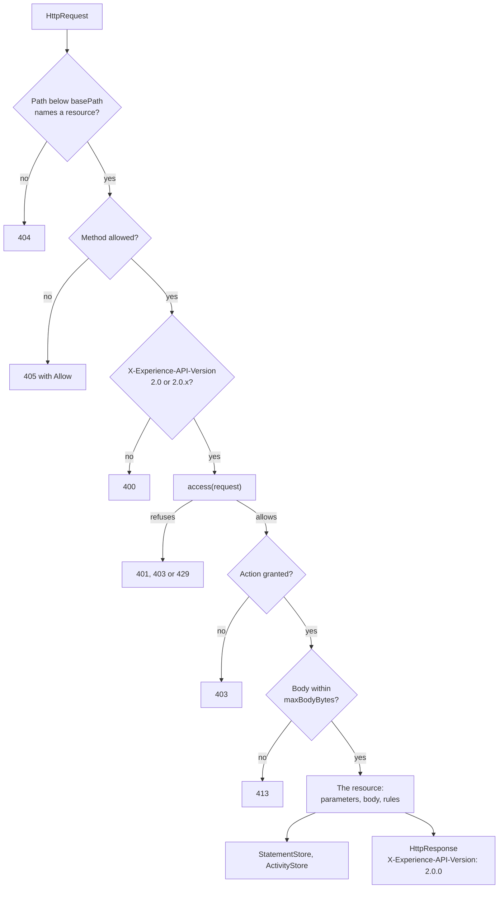

# The LRS handler

`@interopkit/learning-records/store` answers the requests that a Learning Record Provider and a consumer make to a Learning
Record Store. `handleLrsRequest` takes an `HttpRequest` and returns an `HttpResponse` of `@interopkit/core/http`, over the ports
of the host: the stores of Statements and Activities, the decision about who may do what, and a clock. It keeps no state, makes
no request, and knows no database, server or account.



## Quick start

```ts
import { handleLrsRequest } from "@interopkit/learning-records/store";

const held = new Map();
const statement = {
  id: "6690e6c9-3ef0-4ed3-8b37-7f3964730bee",
  actor: { name: "Example Learner", mbox: "mailto:learner@example.org" },
  verb: { id: "http://adlnet.gov/expapi/verbs/completed", display: { "en-US": "completed" } },
  object: { id: "https://example.org/activities/course-1" },
};
const stored = await handleLrsRequest(
  {
    method: "POST",
    url: "https://lrs.example.org/xapi/statements",
    headers: { "x-experience-api-version": "2.0.0", "content-type": "application/json" },
    body: new TextEncoder().encode(JSON.stringify(statement)),
  },
  {
    statements: {
      async insert(batch) {
        const existing = batch.filter((entry) => held.has(entry.statement.id));
        for (const entry of batch) if (!held.has(entry.statement.id)) held.set(entry.statement.id, entry);
        return { existing };
      },
      async get(id, options) {
        const entry = held.get(id);
        return entry?.voided === options.voided ? entry : undefined;
      },
      async query(query, page) {
        return { statements: [...held.values()].slice(0, page.limit) };
      },
      async consistentThrough() {
        return "2026-01-15T10:30:00.000Z";
      },
      async attachments() {
        return new Map();
      },
    },
    activities: {
      async get() {
        return undefined;
      },
      async observe() {},
    },
    access: async () => ({
      allowed: true,
      authority: { account: { homePage: "https://lrs.example.org", name: "client" } },
      actions: ["statements.read", "statements.write"],
    }),
    clock: { now: () => Date.parse("2026-01-15T10:30:00.000Z") },
  },
);
stored.status; // => 200
stored.body; // => '["6690e6c9-3ef0-4ed3-8b37-7f3964730bee"]'
held.get(statement.id).statement.authority.account.name; // => "client"
held.get(statement.id).stored; // => "2026-01-15T10:30:00.000Z"
```

A host builds the `HttpRequest` from the request of its web framework, with header names in lower case and the body as bytes,
and sends the `HttpResponse`. The header `X-Experience-API-Version` is on every answer.

## The Statements resource

| Request                                               | Does                                                                                          | Answers                                                         |
| ----------------------------------------------------- | --------------------------------------------------------------------------------------------- | --------------------------------------------------------------- |
| `PUT statements?statementId=`                         | Stores one Statement under the id                                                             | 204; 409 when the LRS holds another Statement with the id       |
| `POST statements`                                     | Stores a Statement or a list of them                                                          | 200 with the ids in order; 204 when it held all of them already |
| `GET statements?statementId=` or `voidedStatementId=` | Returns one Statement; `attachments` and `format` are the only parameters that go with the id | 200; 404 when there is none of that kind                        |
| `GET statements?`                                     | Returns a page of the Statements that match the filters, newest first unless `ascending`      | 200 with `{ statements, more? }`                                |
| `HEAD statements`                                     | As GET, with no body                                                                          | The status and headers of GET                                   |

A stored Statement gets what the LRS sets (4.2.4.2): an `id` when it has none, in lower case; `stored`, always, from the
`clock`; `timestamp` from `stored` when it has none; `authority` from `access`, unless `keepSubmittedAuthority` keeps the one it
brings; `version` `2.0.0` when it has none. A Statement is read with the rules of an LRS first, and a list is judged whole:
one Statement with an error refuses the request and stores nothing, and two with one id refuse it too.

A Statement with the voided Verb voids the Statement it refers to when the LRS holds it, or the batch has it, and it is not a
voiding Statement itself. A voided Statement is returned only to a request by `voidedStatementId`, and Statements that refer to
it are still returned.

The query parameters are `agent`, `verb`, `activity`, `registration`, `related_activities`, `related_agents`, `since`, `until`,
`limit`, `format`, `attachments` and `ascending`, and `cursor`, which the LRS adds to the address of the next page. A parameter
of another name, or of the same name in another case, a value of the wrong form, or a Boolean that is not `true` or `false`
refuses the request with 400.

| Format      | Answers                                                                                                                |
| ----------- | ---------------------------------------------------------------------------------------------------------------------- |
| `exact`     | The Statements as they were stored                                                                                     |
| `ids`       | Agents, Groups, Activities and Verbs with only the properties that identify them                                       |
| `canonical` | The definitions of the Activities from `ActivityStore.get`, and one language in each language map by `Accept-Language` |

With `attachments=true` the answer is a `multipart/mixed` message with the data of the Attachments that the store holds, one
part for each hash. A Statement is stored with the data that come in a multipart request, and an Attachment needs either a
`fileUrl` or its part. The signature of a Statement is checked (4.2.6): it must be a compact JWS of RS256, RS384 or RS512
whose payload is the same Statement, and when its header has an `x5c` it must verify against the leaf; `trustCertificate` is
asked about the chain and its answer does not refuse a request.

## Who may do what

`access` is asked about every request that names a resource and a method. It answers `{ allowed: false, status, reason }` with
401, 403 or 429, or `{ allowed: true, authority, actions }`. A 401 carries `challenge` as `WWW-Authenticate`, and a 429
carries `retryAfterSeconds` as `Retry-After`. A request for an action that `actions` does not list is 403.

| Request                  | Action             |
| ------------------------ | ------------------ |
| `GET`, `HEAD` statements | `statements.read`  |
| `PUT`, `POST` statements | `statements.write` |

The other actions of `LrsAction` are for the resources of documents, Agents and Activities.

## Options

| Option                   | Of           | Default             | Meaning                                                                                                        |
| ------------------------ | ------------ | ------------------- | -------------------------------------------------------------------------------------------------------------- |
| `statements`             | `LrsOptions` | required            | The `StatementStore`                                                                                           |
| `activities`             | `LrsOptions` | required            | The `ActivityStore`                                                                                            |
| `access`                 | `LrsOptions` | required            | Decides who asks and what they may do                                                                          |
| `clock`                  | `LrsOptions` | required            | The time of the LRS; `stored` is its `now`                                                                     |
| `basePath`               | `LrsOptions` | `"/xapi"`           | The path the LRS is mounted at: `""`, or a path that starts with `/` and does not end with one                 |
| `newId`                  | `LrsOptions` | `crypto.randomUUID` | Makes the id of a Statement that has none                                                                      |
| `accept`                 | `LrsOptions` | none                | A check after the standard's, for the rules of a profile; an error among its findings refuses with 400         |
| `trustCertificate`       | `LrsOptions` | none                | Whether the chain of a signed Statement is trusted; the signature is checked against the leaf whatever it says |
| `keepSubmittedAuthority` | `LrsOptions` | false               | Keeps the `authority` a Statement brings, which the standard allows only with a strong trust relationship      |
| `limits`                 | `LrsOptions` | the limits below    | `LrsLimits`                                                                                                    |
| `signal`                 | `LrsOptions` | none                | Ends every wait of the handler and reaches every port                                                          |

## Limits

| Limit          | Default    | Refused with | Applies to                                                    |
| -------------- | ---------- | ------------ | ------------------------------------------------------------- |
| `maxBodyBytes` | 10,485,760 | 413          | The body of a request, before the store is called             |
| `maxBatch`     | 1,000      | 413          | The Statements of one request                                 |
| `maxParts`     | 100        | 413          | The parts of a multipart request, the Statements included     |
| `maxPartBytes` | 10,485,760 | 413          | One part of a multipart request                               |
| `maxDepth`     | 64         | 400          | The nesting of the JSON of a request                          |
| `pageSize`     | 100        | Capped       | The Statements of a page when the request has no `limit`      |
| `maxPageSize`  | 1,000      | Capped       | The largest page: a `limit` of 0 or above it is lowered to it |

The JSON of a request is also read within the 1,000,000 tokens of `readStatementJson`, and a message over it is 400. The
headers of a part of a multipart request are at most 8,192 bytes, which is 413.

## The ports

| Port             | Method              | Does                                                                                                                                     |
| ---------------- | ------------------- | ---------------------------------------------------------------------------------------------------------------------------------------- |
| `StatementStore` | `insert`            | Stores the batch and the data whole or not at all, marks `voids` voided, and returns the Statements it held already                      |
|                  | `get`               | Returns the Statement with an id that is voided or not, as `options.voided` says                                                         |
|                  | `query`             | Returns a page of the Statements that `matchesStatementQuery` accepts, never a voided one, and `undefined` for a cursor it does not know |
|                  | `consistentThrough` | Returns the time up to which every stored Statement is available                                                                         |
|                  | `attachments`       | Returns the data it holds for the hashes                                                                                                 |
| `ActivityStore`  | `get`               | Returns the canonical description of an Activity                                                                                         |
|                  | `observe`           | Sees the Activities of the Statements that were stored; it is called again for a batch that is sent again                                |

`matchesStatementQuery(statement, query, target)` says whether a Statement meets the filters of a query, with the rules of the
Statement References of 4.1.6.1; a store that holds Statements in a database can mirror it in its own query and test the
mirror against it. `target` finds any Statement by its id in lower case, a voided one too.

| Port fails or is called again       | The handler does                                                                                 |
| ----------------------------------- | ------------------------------------------------------------------------------------------------ |
| A port rejects                      | Answers 500 with a message that says nothing of the cause; what `insert` stored stays stored     |
| `insert` returns an id that it held | Answers 204 when the Statement is the same by `sameStatement`, 409 when it is another            |
| `observe` rejects                   | Answers 500 while the Statements stay stored; a resend answers 204 and observes again            |
| A port does not answer              | Waits for the `signal` of the options and rejects with its reason                                |
| A port breaks its contract          | Throws a `DataError`: more Statements than the limit, a voided Statement, a time that is no text |

## Errors

| Answer or error                                                                      | When                                                             | What to do                                                       |
| ------------------------------------------------------------------------------------ | ---------------------------------------------------------------- | ---------------------------------------------------------------- |
| 400 with a message                                                                   | A parameter, the body, a Statement or a signature is wrong       | Show the message to the sender: it names the path                |
| 401, 403, 429                                                                        | `access` refused the request, or the credentials lack the action | Send the credentials the host asks for                           |
| 404                                                                                  | The path names no resource, or the LRS holds no such Statement   |                                                                  |
| 405 with `Allow`                                                                     | The resource has no such method                                  | Use a method of `Allow`                                          |
| 409                                                                                  | The LRS holds another Statement with the id                      | Send a new id: a Statement is not changed                        |
| 413                                                                                  | A body, a batch, a part or a number of parts is over its limit   | Send less, or raise the limit                                    |
| 500                                                                                  | A port rejected                                                  | Look at the host's own log; the answer says nothing of the cause |
| `DataError`: `The configuration of the LRS is invalid at <option>: <sentence>.`      | An option has the wrong type                                     | Pass the option as the table says                                |
| `DataError`: `The decision of access is invalid at <path>: <sentence>.`              | `access` answered with something that is no decision             | Answer `{ allowed, ... }` as `Access` says                       |
| `DataError`: `The answer of StatementStore.query must have at most N Statements ...` | A store broke its contract                                       | Fix the store                                                    |

A refusal is written as JSON `{ "message": "..." }`, plain text or HTML, as `Accept` prefers, and as JSON when it prefers none.

## Not included

| Not included                                          | Why                                                                   |
| ----------------------------------------------------- | --------------------------------------------------------------------- |
| The documents, Agents, Activities and About resources | Other parts of this module                                            |
| The version 1.0.3                                     | Its own rules and routes; a request that names it is refused with 400 |
| A database, an index, an account, a rate limit        | The host's: the ports and `access` are where they plug in             |
| Deleting a Statement                                  | The standard asks that Statements are not deleted; voiding is the way |
| A time later than the clock                           | The standard says an LRS shall not reject it                          |

## Differences from the references

| Reference    | Difference                                                                                                                                                                    |
| ------------ | ----------------------------------------------------------------------------------------------------------------------------------------------------------------------------- |
| The standard | A Statement that arrives after the Statement that voids it is not voided, since the LRS looks for the target when the voiding Statement arrives                               |
| The standard | `X-Experience-API-Consistent-Through` is on the successful answers of the Statements resource, and not on a refusal                                                           |
| The standard | A batch with a Statement that the LRS holds with other content is answered 409 after the new Statements were stored: the ports do not let the handler check all the ids first |
