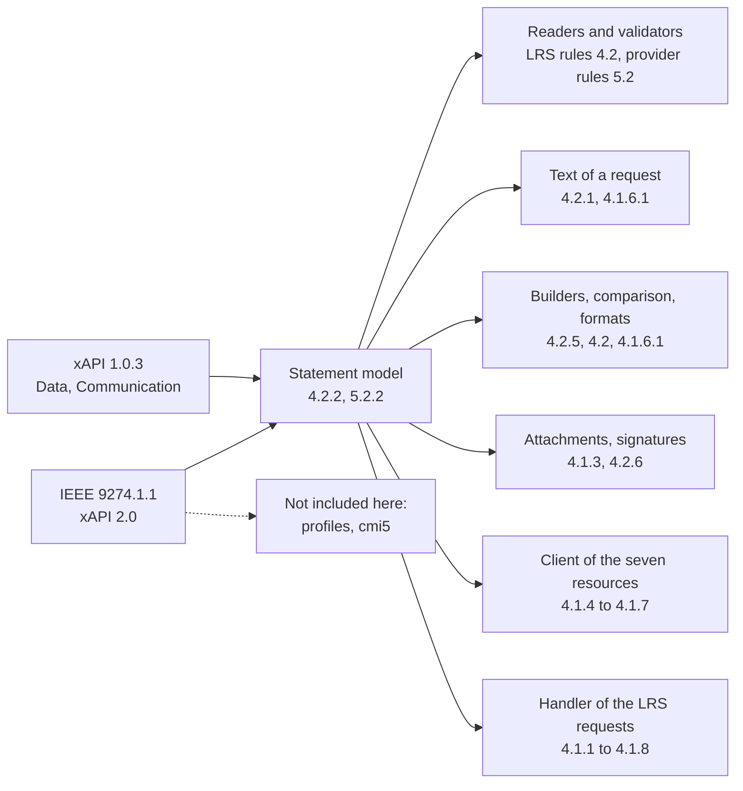

# Supported

What `@interopkit/learning-records` implements of xAPI 2.0 and 1.0.3. The package implements the standards and is not certified
or endorsed by IEEE or ADL. Section numbers are those of the LRS book (4.x) and the Content book (5.x) of IEEE 9274.1.1; 1.0.3 has
a row of its own.

| Area               | Specification                       | Included                                                                                                                                                                                                                                                                                                                                                                                               |
| ------------------ | ----------------------------------- | ------------------------------------------------------------------------------------------------------------------------------------------------------------------------------------------------------------------------------------------------------------------------------------------------------------------------------------------------------------------------------------------------------ |
| The Statement      | 4.2.2, 5.2.2                        | `id`, `actor`, `verb`, `object`, `result`, `context`, `timestamp`, `stored`, `authority`, `version`, `attachments`                                                                                                                                                                                                                                                                                     |
| Agents and Groups  | 4.2.2.1                             | The four identifiers and the rule of exactly one, anonymous and identified Groups, Accounts, no Group inside `member`                                                                                                                                                                                                                                                                                  |
| Verbs              | 4.2.2.2                             | `id` and `display`; the voided verb with its Statement Reference                                                                                                                                                                                                                                                                                                                                       |
| Objects            | 4.2.2.3                             | Activities with definitions, Agents, Groups, Statement References and SubStatements, with no SubStatement inside a SubStatement                                                                                                                                                                                                                                                                        |
| Interactions       | 4.2.2.3                             | The ten interaction types, their lists of components, the forms of their response patterns and the characterstring parameters                                                                                                                                                                                                                                                                          |
| Results and Scores | 4.2.2.4                             | Every property, the range of `scaled`, and `raw` between `min` and `max`                                                                                                                                                                                                                                                                                                                               |
| Contexts           | 4.2.2.5                             | Every property, `contextAgents` and `contextGroups` with `relevantTypes`, `contextActivities` returned as lists                                                                                                                                                                                                                                                                                        |
| Attachments        | 4.2.2.6                             | The header of an Attachment: usage, display, content type, length, hash, address                                                                                                                                                                                                                                                                                                                       |
| Rejection          | 4.2.1, 4.2.4.1, 4.2.4.2             | Missing properties, extra properties, nulls, wrong types, empty and ill-formed strings, keys and values of another case, IRIs without a scheme                                                                                                                                                                                                                                                         |
| Voiding            | 4.2.5, 5.2.5                        | The voided verb needs a Statement Reference with an id; the target need not exist                                                                                                                                                                                                                                                                                                                      |
| Data types         | 4.2.7, 5.2.7                        | IRIs, extensions, language maps, UUIDs, timestamps, durations at 0.01 second                                                                                                                                                                                                                                                                                                                           |
| Provider rules     | 5.2.1, 5.2.4.1, 5.2.7               | UTC times, millisecond precision, `version` 2.0.0, no `stored` and `authority`, an id, no empty objects, lists of Activities                                                                                                                                                                                                                                                                           |
| Batches            | 4.1.6.1                             | Two Statements with one id are refused                                                                                                                                                                                                                                                                                                                                                                 |
| Building           | 4.2.5, 4.2.7, 5.2.4.1, 5.2.5, 5.2.7 | A Statement of an event with the time in UTC, durations at 0.01 second, the voided verb with its reference, the hash of an address, an id that a resend repeats                                                                                                                                                                                                                                        |
| Immutability       | 4.2                                 | `isSameStatement`: what is compared, what is not, the case of what ignores case, durations folded to 0.01 second                                                                                                                                                                                                                                                                                         |
| Formats            | 4.1.6.1                             | `ids`, `exact` and `canonical`, with the choice of one language of each language map by `Accept-Language`                                                                                                                                                                                                                                                                                              |
| Text of a request  | 4.2.1, 4.1.5                        | RFC 8259 syntax, a property given twice refused, limits of size, depth and tokens                                                                                                                                                                                                                                                                                                                      |
| Attachment data    | 4.1.3, 4.2.2.6                      | `multipart/mixed` written and read: the Statements in the first part, the data in the others, named by `X-Experience-API-Hash` with SHA-224, 256, 384 or 512; limits                                                                                                                                                                                                                                   |
| Signed Statements  | 4.2.6                               | A compact JWS in an Attachment, RS256, RS384 and RS512, the `x5c` chain, the signing over a `Signer`, the check of the leaf and of the equivalence of the payload                                                                                                                                                                                                                                      |
| Client             | 4.1.1 to 4.1.7                      | The seven resources over `fetch`: Statements (PUT, POST, GET, the twelve filters, `more`), State, Agent Profile and Activity Profile with ETags and preconditions, Agents, Activities, About; the version header                                                                                                                                                                                       |
| LRS handler        | 4.1.1 to 4.1.8, 4.2.4, 4.2.5        | All seven resources with HEAD: the version header, errors by `Accept`, the limits with 413, Statements with the twelve filters, the rules of Statement References, pages with `more`, the three formats, voiding, Attachments in both directions and signatures; State and both profiles under ETags with merge, `If-Match`, `If-None-Match` and the retry of lost races; Agents, Activities and About |
| xAPI 1.0.3         | Data, Communication                 | The rules of each role with `version: "1.0.3"`, builders, signatures, the client, and a route of the LRS with the alternate request syntax, 1.0.3 preconditions and `convertStatementVersion` ([versions](versions.md)) |
| Examples           | The IEEE examples repository        | Every Statement and batch of the examples is read, at a pinned hash                                                                                                                                                                                                                                                                                                                                    |

## Not included

| Not included                  | Why                                                             |
| ----------------------------- | --------------------------------------------------------------- |
| xAPI Profiles, cmi5, launch   | Standards of their own                                          |
| The vocabularies of ADL: verbs, activity types, attachment usages | The data of profiles, which change apart from the standard; the package names `VERB_VOIDED` and `SIGNATURE_USAGE_TYPE`, which the standard reserves |
| Storage, accounts, an admin UI, queues | An application's: the handler works over the store ports and `access` |
| CORS, compression, TLS | The host's web server; the handler answers plain requests |

[The comparators](comparators.md) map what the LRSs and the clients of xAPI do against the package, with the reason for each
exclusion.
