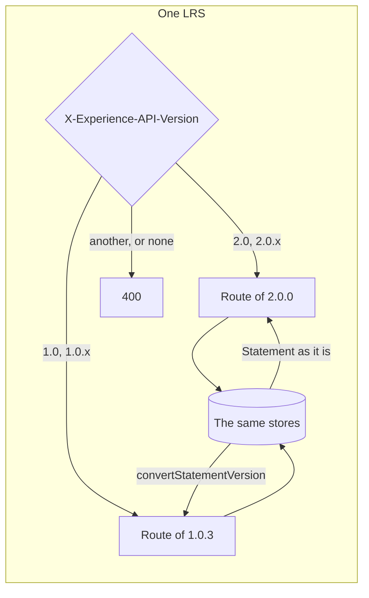
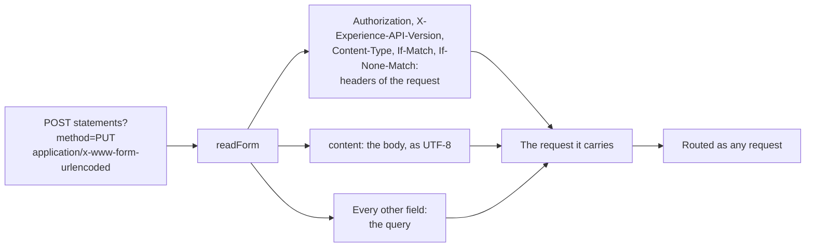

# Versions of xAPI

The package speaks xAPI 2.0 (IEEE 9274.1.1) and xAPI 1.0.3, in both roles. cmi5 requires 1.0.3, and most installed content and
stores speak it. The readers and builders take a `version`, the client speaks one version, and the LRS answers each request by
the version that it names.



## Quick start

```ts
import { buildStatement, convertStatementVersion, readStatement } from "@interopkit/learning-records";

const event = {
  id: "6690e6c9-3ef0-4ed3-8b37-7f3964730bee",
  actor: { mbox: "mailto:learner@example.org" },
  verb: { id: "http://adlnet.gov/expapi/verbs/completed" },
  object: { id: "https://example.org/activities/course-1" },
  timestamp: "2024-06-13T18:46:03.250Z",
};

const legacy = buildStatement(event, { version: "1.0.3" });
legacy.version; // => "1.0.0"

const current = buildStatement({
  ...event,
  context: {
    contextAgents: [{ objectType: "contextAgent", agent: { mbox: "mailto:proctor@example.org" } }],
    language: "en",
  },
});
const form = convertStatementVersion(current, "1.0.3");
form.context; // => { language: "en" }
form.version; // => "1.0.0"

readStatement(legacy, { version: "1.0.3" }).version; // => "1.0.0"
```

## What differs

| Of                        | xAPI 2.0                                               | xAPI 1.0.3                                                                        |
| ------------------------- | ------------------------------------------------------ | --------------------------------------------------------------------------------- |
| A Timestamp               | RFC 3339 with an offset                                | ISO 8601 with a time zone: extended or basic, seconds and minutes may be left out |
| The offset `-00:00`       | The reader takes it; the LRS refuses it                | Refused, with `-00` and `-0000`                                                   |
| A context                 | `contextAgents`, `contextGroups`                       | Neither: each is an `unknown-property`                                            |
| `version` for an LRS      | Any text for the reader; the LRS takes 1.0.x and 2.0.x | `1.0` or `1.0.x`, or an error                                                     |
| `version` for a provider  | 2.0.0, with a warning                                  | 1.0.0, with a warning                                                             |
| The time of a provider    | UTC, with a warning below milliseconds                 | RFC 3339; no rule on UTC or precision                                             |
| An empty object           | A warning for a provider                               | A warning for every Statement                                                     |
| A repeated component id   | A warning                                              | A warning for an LRS, an error for a provider                                     |
| Default `version`         | 2.0.0                                                  | 1.0.0                                                                             |
| A State PUT with no tag   | 409 over a document                                    | Replaces the document, with the `unconditional` write of `DocumentStore`          |
| A profile PUT with no tag | 409 over a document; written where there is none       | 409 over a document; 400 where there is none                                      |
| Alternate request syntax  | None: 400                                              | [Read from the form](#the-alternate-request-syntax)                               |
| Answers                   | `X-Experience-API-Version: 2.0.0`                      | `X-Experience-API-Version: 1.0.3`                                                 |

The ETag of a document is the quoted SHA-1 hex of its content on both routes: 1.0.3 asks for it, and 2.0 accepts any value, so
one stored document answers both alike.

## Reads and resends across routes

One LRS holds the Statements of both routes. `StoredStatement.version` says which route stored each.

| Statement stored through | Read on the route of 2.0                  | Read on the route of 1.0.3                                                        |
| ------------------------ | ----------------------------------------- | --------------------------------------------------------------------------------- |
| 2.0                      | As it is                                  | `convertStatementVersion`: no `contextAgents` or `contextGroups`, `version` 1.0.0 |
| 1.0.3                    | As it is, with the `version` it came with | As it is                                                                          |

A resend compares by the route: on 1.0.3 with `convertStatementVersion` of the Statement held, and on 2.0 with the whole Statement.
Equal is 204 and changes nothing, and different is 409. A client of 1.0.3 that read a Statement of 2.0 and sends it again is a
resend, not a conflict.

A signature keeps its whole payload, so `verifyStatementSignature` with `version: "1.0.3"` compares the Statement it is given
with `convertStatementVersion` of the payload. The default, 2.0.0, compares the whole Statement, so a Statement of 2.0 that lost its
`contextAgents` does not verify.

`convertStatementVersion` removes `contextAgents` and `contextGroups`, a SubStatement's too, leaves out a context that held nothing
else, writes a `version` that is not 1.0.x as 1.0.0, and writes a time that ISO 8601 does not take in UTC. A Statement in the
form comes back unchanged.

## The alternate request syntax

xAPI 1.0.3 lets a browser that cannot set headers or use every method send a POST with the method in the query and the rest in a
form (1.0.3 Communication 1.3). 2.0 removed it, and the client never sends it.



| Part                         | Rule                                                                                                  |
| ---------------------------- | ----------------------------------------------------------------------------------------------------- |
| The method                   | `GET`, `HEAD`, `PUT`, `POST` or `DELETE`, in the query, in upper case                                 |
| The query                    | `method` and nothing else                                                                             |
| The headers of the form      | Replace those of the request; their names match in any case                                           |
| `Content-Length` of the form | Ignored: the body has its own length                                                                  |
| `content`                    | The body, UTF-8 text; binary data and Attachments cannot be sent this way                             |
| The type of the content      | `Content-Type` of the form, or `application/json` when the form names none                            |
| The size                     | `limits.maxBodyBytes`, before the form is read: 413                                                   |
| The parameters               | 32 at most, counted before the form is read: 400                                                      |
| The version                  | From the form or the request; a version of 2.0 is 400, and an LRS whose `versions` lacks 1.0.3 is 400 |

The JSON of `content` and of a parameter such as `agent` is read as any request reads it, so `limits.maxTokens`, `maxDepth` and
`maxFindings` hold. `access` sees the request that the form carries, with its `Authorization`.

## Options

| Option     | Of                                                         | Default              | Meaning                                                          |
| ---------- | ---------------------------------------------------------- | -------------------- | ---------------------------------------------------------------- |
| `version`  | `readStatement`, `validateStatement`, `validateStatements` | `"2.0.0"`            | The rules that apply                                             |
| `version`  | `buildStatement`, `buildVoidingStatement`                  | `"2.0.0"`            | The provider rules, and the `version` that the Statement carries |
| `version`  | `signStatement`                                            | `"2.0.0"`            | The provider rules that the Statement is read with               |
| `version`  | `verifyStatementSignature`                                 | `"2.0.0"`            | The route the Statement came from; 1.0.3 compares in its form    |
| `version`  | `createLrsClient`                                          | `"2.0.0"`            | The header, the rules of Statements and of preconditions         |
| `versions` | `handleLrsRequest`                                         | `["2.0.0", "1.0.3"]` | The versions the LRS serves, the latest first                    |

The 1.0.3 rules take `maxFindings` as the 2.0 rules do.

A client of 1.0.3 checks what it sends by the provider rules of 1.0.3, and reads an answer of either version into the form of
1.0.3: it ignores what 1.0.0 does not define (1.0.3 Communication 3.3), so an LRS that answers a Statement of 2.0 as it holds it
does not break it.

## Errors

| Error                                                                                              | When                                                          | What to do                             |
| -------------------------------------------------------------------------------------------------- | ------------------------------------------------------------- | -------------------------------------- |
| 400: `The header X-Experience-API-Version must be 2.0 or 2.0.x, or 1.0 or 1.0.x, found ...`        | The request names no version that the LRS serves              | Name one that About lists              |
| 400: `The alternate request syntax is a part of xAPI 1.0.3, and xAPI 2.0.0 has no such syntax.`    | A POST with `method` in its query names 2.0                   | Send the request itself, or name 1.0.3 |
| 400: `A request in the alternate syntax has no query parameter but method, ...`                    | A parameter is in the query                                   | Put it in the form                     |
| 400: `The parameter method must be one of GET, HEAD, PUT, POST, DELETE, ...`                       | The method is another, or in lower case                       | Name one of these                      |
| 400: `A PUT of a profile needs a precondition on xAPI 1.0.3: ...`                                  | A PUT of a profile has neither header, and no document exists | Send `If-None-Match: *`                |
| `DataError`: `The version must be "1.0.3", the version whose form is returned, found ...`          | `convertStatementVersion` is asked for another version        | Pass `"1.0.3"`                         |
| `DataError`: `The answer of DocumentStore.write must be "written" for an unconditional write, ...` | A store judged an `unconditional` condition                   | Fix the store: it always writes        |

## Not included

| Not included                                            | Why                                                                                                                   |
| ------------------------------------------------------- | --------------------------------------------------------------------------------------------------------------------- |
| 0.9 and 0.95                                            | 1.0.3 asks an LRS to refuse a version before 1.0.0, and only an LRS that meets the rules of that version may serve it |
| Converting a Statement of 1.0.3 to 2.0                  | A Statement of 1.0.x is a Statement of 2.0 but for its `version` and the forms of a time, and is kept as it was       |
| OAuth 1.0 and Common Access Cards                       | The host's, through `access`; `readBasicAuthorization` reads the Basic of 1.0.3 Communication 4.0                     |
| `convertStatementVersion` to a version other than 1.0.3 | The package speaks two versions                                                                                       |

## Differences from the references

[The gaps page](spec-gaps.md#xapi-103) lists every place where the texts of 1.0.3 and 2.0 disagree or are silent, and each
difference from SQL LRS and from the validator of Learning Locker, with the text of the standard.
