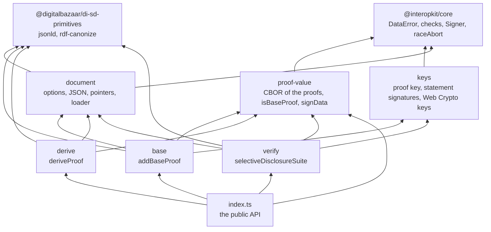
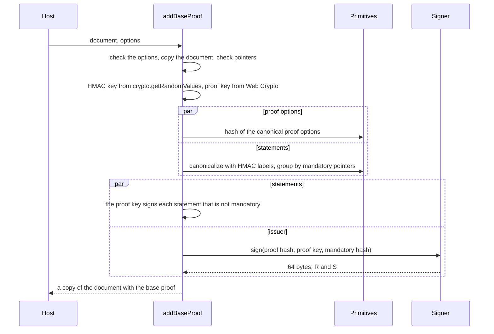
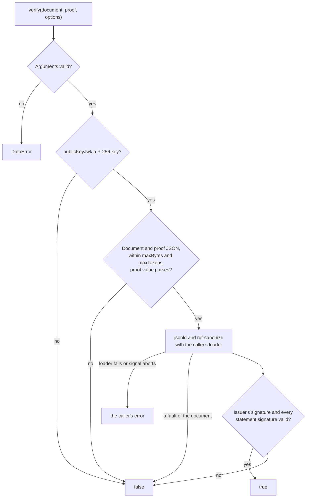

# Architecture of selective-disclosure

`@interopkit/selective-disclosure` has six modules in two layers. `proof-value`, `keys` and `document` do one kind of work each
and import nothing of the package; the three roles build on them and never import one another: `base` is the issuer's,
`derive` the holder's and `verify` the verifier's.

| Module        | Files                                                       | Holds                                                                                                                                   |
| ------------- | ----------------------------------------------------------- | --------------------------------------------------------------------------------------------------------------------------------------- |
| `proof-value` | `header.ts`, `cbor.ts`, `fields.ts`, `label-map.ts`         | The headers `0xd9 0x5d 0x00` and `0x01`, the CBOR reader and its options, the checks of each component                                  |
|               | `base.ts`, `derived.ts`, `is-base-proof.ts`, `sign-data.ts` | Writing and reading the two proof values, `isBaseProof`, and the bytes that the issuer's key signs                                      |
| `keys`        | `proof-key.ts`, `multikey.ts`, `statements.ts`              | The key of a proof, which Web Crypto makes and signs with, the multikey form of a public key, the check of the signatures of statements |
|               | `issuer-key.ts`, `algorithm.ts`                             | The import of the issuer's JWK, the check of the base signature, and ES256 in the words of Web Crypto                                   |
| `document`    | `options.ts`, `read-document.ts`, `pointers.ts`             | The checks every function makes of its options, the copy of a document as JSON, and JSON pointers                                       |
|               | `loader.ts`, `labels.ts`, `primitives.ts`                   | The loader of the caller as the loader of `jsonld`, the HMAC labels, and the typed functions of the primitives                          |
| `base`        | `add-base-proof.ts`, `secrets.ts`                           | `addBaseProof`, and the two secrets that make a base proof                                                                              |
| `derive`      | `derive-proof.ts`, `disclosure-data.ts`                     | `deriveProof`, and the statements, signatures and labels that a disclosure keeps                                                        |
| `verify`      | `suite.ts`, `verify-data.ts`                                | `selectiveDisclosureSuite`, and the data that its signatures are checked against                                                        |

`suite.ts` and `limits.ts` sit beside the modules: the names and sizes of the suite, and the limits.

Each module has an `index.ts`, its public API, and `proof-value`, `keys`, `document` and `base` have an `internal.ts` that the
tests share and the package does not export. `base/internal.ts` adds a base proof with secrets the caller supplies, for the
test vectors of the Recommendation; the public `addBaseProof` makes the HMAC key with `crypto.getRandomValues` and the key of the
proof with Web Crypto, and has no option to replace them, so a host cannot make them predictable.

## Creating a base proof

## Deriving and verifying

| Step | `deriveProof`                                                                                            | `verify`                                                                                                                                                                                                    |
| ---- | -------------------------------------------------------------------------------------------------------- | ----------------------------------------------------------------------------------------------------------------------------------------------------------------------------------------------------------- |
| 1    | Parses the base proof value                                                                              | Parses the derived proof value                                                                                                                                                                              |
| 2    | Canonicalizes the document with the HMAC labels of the proof                                             | Canonicalizes the revealed document with the label map of the proof                                                                                                                                         |
| 3    | Groups the statements as mandatory, selected and combined, and keeps the signatures of the selected ones | Splits the statements by the mandatory positions                                                                                                                                                            |
| 4    | Selects the revealed part of the document with the pointers                                              | Checks in parallel the issuer's signature over the hash of the proof options, the public key of the proof and the hash of the mandatory statements, and the proof key's signature over each other statement |
| 5    | Maps the canonical labels that a verifier will find to the labels that were signed                       |                                                                                                                                                                                                             |

