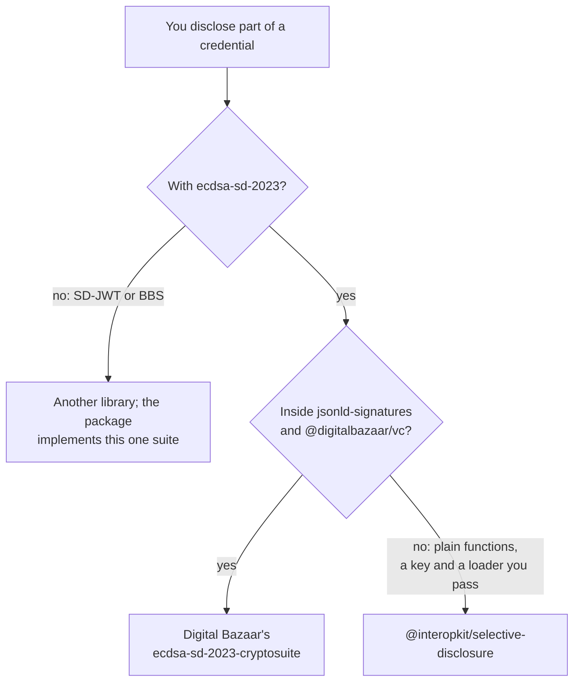

# Choosing selective-disclosure

When `@interopkit/selective-disclosure` fits a project that issues, holds or verifies credentials with the `ecdsa-sd-2023`
cryptosuite, and when another library fits better. Its counterparty is Digital Bazaar's suite 3.4.1, the version that
`packages/selective-disclosure/package.json` pins, which [the proofs guide](proofs.md#differences-from-the-references) compares
with it.

| You need | Use |
| --- | --- |
| A base proof, a derived proof and their verification as plain functions over plain data, on any runtime with Web Crypto | This package |
| Open Badges 3.0 or CLR 2.0 credentials with selective disclosure | [`@interopkit/achievement-credentials`](../achievement-credentials/choosing.md), which builds on this package |
| The suite as a cryptosuite of `jsonld-signatures`, beside the other suites of `@digitalbazaar/vc` | Digital Bazaar's `@digitalbazaar/ecdsa-sd-2023-cryptosuite` 3.4.1 |
| SD-JWT or BBS | Another library: the package implements `ecdsa-sd-2023` alone |

## What the others have that the package lacks

| Library | What it has | Here |
| --- | --- | --- |
| Digital Bazaar's suite 3.4.1 | A suite object that `jsonld-signatures` and `@digitalbazaar/vc` take, with a verification method resolved through the document loader | Excluded: `verify` takes a JWK, and the resolution and binding of keys are the caller's (or `achievement-credentials`') |

## Where the evidence is

[The evidence](evidence.md) gives the test vectors of the Recommendation, reproduced byte for byte, Digital Bazaar's suite
signing, deriving and verifying beside the package in every order, and the W3C suite of the ECDSA cryptosuites;
[performance](performance.md) times the three roles against Digital Bazaar's suite.
