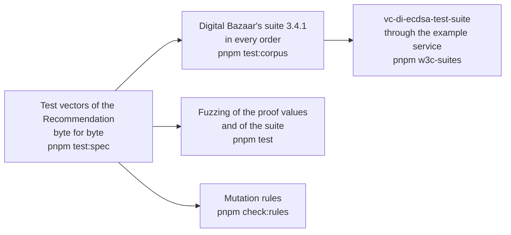

# Evidence for selective-disclosure

What shows that the package does what it says: the test vectors of the Recommendation, an implementation of other authors, the
W3C suite of the ECDSA cryptosuites through the example of `achievement-credentials`, fuzzing and mutation rules. The speed and
the size are in [performance](performance.md).

| Layer | Question | Where | Runs |
| --- | --- | --- | --- |
| Test vectors | Does a base proof from the fixed secrets of the Recommendation, and the derived proof from it, come out byte for byte? | `packages/selective-disclosure/test/vectors.spec.test.ts`, the vectors pinned in `scripts/schemas.lock.json` | `pnpm test:spec` |
| Counterparty | Does every combination of this package and Digital Bazaar's suite signing, deriving and verifying give a valid proof? | `packages/selective-disclosure/test/counterparty.corpus.test.ts` | `pnpm test:corpus` |
| W3C suite | Does a service that derives with the package pass the tests of `ecdsa-sd-2023`? | `validation/w3c-suites/`, through `examples/achievement-credentials` | `pnpm w3c-suites` |
| Fuzzing | Does a reader of a proof value or a document refuse every malformed input with a `DataError`? | `proof-value.fuzz.test.ts`, `suite.fuzz.test.ts` | `pnpm test` |
| Mutation rules | Does the test of each rule that keeps a proof from being forged fail without it? | `scripts/rules/selective-disclosure.ts` | `pnpm check:rules` |

## The W3C suite

`vc-di-ecdsa-test-suite` at `94dca21` covers `ecdsa-rdfc-2019` and `ecdsa-sd-2023` on P-256. In the run of 2026-11-04 that
[the README of the suites](../../validation/w3c-suites/README.md) records, 55 of its 59 tests pass, 1 is skipped by the suite,
and 3 are listed as not applying, each with its reason in `validation/w3c-suites/suites.lock.json`.

## Not included

| Not included | Why |
| --- | --- |
| A test suite of 1EdTech or W3C that certifies an implementation | None exists for the suite alone; the W3C suite reports results and grants nothing |
| Interoperability with libraries of other languages | No other implementation of `ecdsa-sd-2023` was found in the source list that runs beside the tests |

## Differences from the references

The differences from the Recommendation and from Digital Bazaar's suite are in
[the proofs guide](proofs.md#differences-from-the-references), each pinned by a test.
