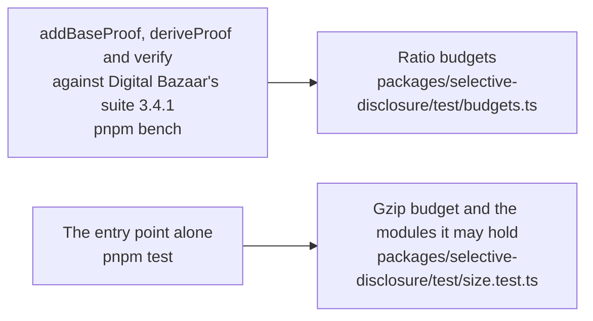

# Performance of selective-disclosure

What the three roles of `@interopkit/selective-disclosure` cost against Digital Bazaar's suite, and how much the entry point adds to a bundle. A budget holds each number and fails a gate of CI: `pnpm bench` for the time, `pnpm test` for the size. How the roles work is in [proofs](proofs.md).

## Speed

`pnpm bench` times the build that ships against Digital Bazaar's suite 3.4.1 in the same run, on a credential of
Verifiable Credentials 2.0 with 12 achievements, each a blank node, of which a disclosure reveals 8
(`packages/selective-disclosure/test/proofs.bench.ts`). A role takes at least 20 samples after a warm-up, and the gate is its
fastest sample as a multiple of the fastest sample of Digital Bazaar's suite: five times the highest ratio measured on the runner of CI (the eight latest green runs) and on a laptop, rounded up to one significant digit.
Both samples come from one run, so the ratio holds on any machine.

| Role           | Measured ratio | Budget | Where the time goes                                                                         |
| -------------- | -------------: | -----: | ------------------------------------------------------------------------------------------- |
| `addBaseProof` | 0.97–1.08      | 6      | Canonicalization in the primitives; Web Crypto signs the statements, as in Digital Bazaar's |
| `deriveProof`  | 1.06–1.21      | 7      | Canonicalization in the primitives, and the copy and the limits of the input                |
| `verify`       | 0.84–1.16      | 6      | Canonicalization in the primitives; Web Crypto checks the signatures at once                |

The measured ratios are the range over the eight latest green runs of the runner of CI and one run on a laptop.

## Size

`size.test.ts` bundles the entry point alone with `scripts/entry-size.ts`: esbuild, minified, with every dependency inside. It
fails above the budget after gzip, 1.25 times the size measured rounded up to the next 500 bytes, or on a module that its budget
does not list. The weight is the JSON-LD processing that the package does not own: `jsonld` and `rdf-canonize` come with the
primitives.

Gzip is measured on Node.js 22; other versions of Node.js differ by up to 1 percent.

| Entry point | Bytes | Gzip | Budget | Holds, besides `@interopkit/core` and valibot |
| --- | ---: | ---: | ---: | --- |
| `@interopkit/selective-disclosure` | 225,154 | 70,282 | 88,000 | `base`, `derive`, `document`, `keys`, `proof-value`, `suite`, `verify`; `@digitalbazaar/di-sd-primitives`, `jsonld`, `rdf-canonize` and their small dependencies; the curves and hashes of noble, `@scure/base`, cborg |
