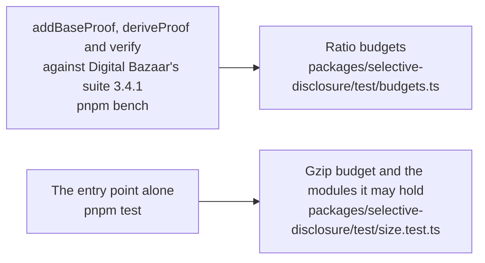

# Performance of selective-disclosure

The time of the three roles of `@interopkit/selective-disclosure` against Digital Bazaar's suite, and the size of the entry
point. A budget holds each number in CI: `pnpm bench` for the time, `pnpm test` for the size.

## Speed

`pnpm bench` times the build that ships against Digital Bazaar's suite 3.4.1 in the same run, on a credential of
Verifiable Credentials 2.0 with 12 achievements, each a blank node, of which a disclosure reveals 8
(`packages/selective-disclosure/test/proofs.bench.ts`). A role takes at least 20 samples after a warm-up. The budget is its
fastest sample as a multiple of the fastest of Digital Bazaar's suite in the same run, so it holds on any machine: five times the
highest ratio measured, rounded up to one significant digit. The measured ratios range over the eight latest green runs of the
runner of CI and one run on a laptop.

| Role           | Measured ratio | Budget | Where the time goes                                                                         |
| -------------- | -------------: | -----: | ------------------------------------------------------------------------------------------- |
| `addBaseProof` |      0.97–1.08 |      6 | Canonicalization in the primitives; Web Crypto signs the statements, as in Digital Bazaar's |
| `deriveProof`  |      1.06–1.21 |      7 | Canonicalization in the primitives, and the copy and the limits of the input                |
| `verify`       |      0.84–1.16 |      6 | Canonicalization in the primitives; Web Crypto checks the signatures at once                |

## Size

`size.test.ts` bundles the entry point alone with `scripts/entry-size.ts`: esbuild, minified, with every dependency inside. It
fails above the budget after gzip, 1.25 times the size measured rounded up to the next 500 bytes, or on a module that its budget
does not list. Gzip is measured on Node.js 22; other versions differ by up to 1 percent. Most of the weight is the JSON-LD
processing that comes with the primitives, `jsonld` and `rdf-canonize`.

| Entry point                        |   Bytes |   Gzip | Budget | Holds, besides `@interopkit/core` and valibot                                                                                                                                                                          |
| ---------------------------------- | ------: | -----: | -----: | ---------------------------------------------------------------------------------------------------------------------------------------------------------------------------------------------------------------------- |
| `@interopkit/selective-disclosure` | 225,154 | 70,282 | 88,000 | `base`, `derive`, `document`, `keys`, `proof-value`, `suite`, `verify`; `@digitalbazaar/di-sd-primitives`, `jsonld`, `rdf-canonize` and their small dependencies; the curves and hashes of noble, `@scure/base`, cborg |
