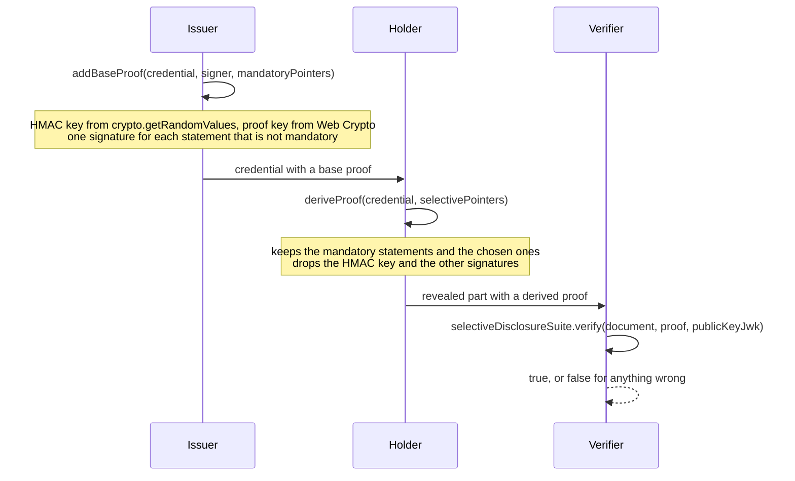
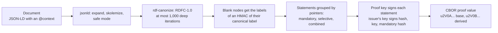

# Base proofs, derived proofs and their verification

`ecdsa-sd-2023` lets an issuer sign a credential once so that its holder can show a verifier only some of it. The issuer
signs every statement of the credential separately, with a key that is new to this credential, and signs that key. The holder
keeps the signatures of the statements they reveal and drops the others. The verifier checks the issuer's signature over the
key and the key's signature over each statement it sees.





## Quick start

```ts
import { createCryptoKeySigner } from "@interopkit/core";
import { addBaseProof, deriveProof } from "@interopkit/selective-disclosure";

const contexts = new Map([
  ["https://example.org/contexts/v1", { "@context": { "@vocab": "https://example.org/vocab#", id: "@id", type: "@type" } }],
]);
const credential = {
  "@context": ["https://example.org/contexts/v1"],
  type: ["VerifiableCredential"],
  issuer: "https://example.org/issuers/1",
  credentialSubject: { type: "Person", name: "Sam Taylor", birthDate: "2001-05-17" },
};
const pair = await crypto.subtle.generateKey({ name: "ECDSA", namedCurve: "P-256" }, true, ["sign", "verify"]);
const signer = createCryptoKeySigner(pair.privateKey, { algorithm: "ES256", keyId: "https://example.org/issuers/1#key-1" });

// The type of the subject is mandatory too, so that every disclosure says what it is about.
const base = await addBaseProof(credential, {
  signer,
  mandatoryPointers: ["/issuer", "/credentialSubject/type"],
  created: "2026-11-01T09:30:00Z",
  contexts: async (url) => contexts.get(url),
});

// One base proof gives as many disclosures as the holder needs.
const forName = await deriveProof(base, {
  selectivePointers: ["/credentialSubject/name"],
  contexts: async (url) => contexts.get(url),
});
const forBirthDate = await deriveProof(base, {
  selectivePointers: ["/credentialSubject/birthDate"],
  contexts: async (url) => contexts.get(url),
});
JSON.stringify(forName.credentialSubject); // => "{\"type\":\"Person\",\"name\":\"Sam Taylor\"}"
JSON.stringify(forBirthDate.credentialSubject); // => "{\"type\":\"Person\",\"birthDate\":\"2001-05-17\"}"

// The input is never changed, and a result shares nothing with it.
JSON.stringify(base.credentialSubject).includes("birthDate"); // => true
```

## The functions

| Function                               | Role     | Takes                                                    | Returns                                                                                         |
| -------------------------------------- | -------- | -------------------------------------------------------- | ----------------------------------------------------------------------------------------------- |
| `addBaseProof(document, options)`      | Issuer   | A document without a proof, and a `BaseProofOptions`     | A copy of the document with a base proof                                                        |
| `deriveProof(document, options)`       | Holder   | A document with a base proof, and a `DeriveProofOptions` | A new document with the mandatory and the chosen parts, and a derived proof                     |
| `selectiveDisclosureSuite.verify(...)` | Verifier | The document, its proof, and a `VerifyProofOptions`      | `true` when the proof is valid for the document under the key, and `false` for any fault        |
| `isBaseProof(proof)`                   | Any      | Any value                                                | Whether it is a proof of `ecdsa-sd-2023` whose value is the value of a base proof; never throws |

`selectiveDisclosureSuite` also names the cryptosuite, `"ecdsa-sd-2023"`. `verify` is the cryptosuite's step of verification,
Verify Derived Proof: the signatures over the document and the proof options as they are. The rest of the verification of
Data Integrity belongs to the code that reads the credential, which knows where keys live and what a proof is for: resolving
the verification method into the JWK that `verify` takes, binding that key to the issuer, and checking the `proofPurpose`, and
`created` and `expires` against its clock.

## Options

| Option              | Function       | Default   | Meaning                                                                                                                                    |
| ------------------- | -------------- | --------- | ------------------------------------------------------------------------------------------------------------------------------------------ |
| `signer`            | `addBaseProof` | required  | A `Signer` of `@interopkit/core` with `algorithm` `"ES256"`; its `keyId` is the `verificationMethod` of the proof                          |
| `created`           | `addBaseProof` | none      | The `created` of the proof, a date and time with an offset, such as `2026-11-01T09:30:00Z`. Without it, the proof has none; see [what a disclosure shows](#what-a-disclosure-shows) |
| `mandatoryPointers` | `addBaseProof` | none      | JSON pointers to what a holder can never hide. The empty pointer `""` makes the whole document mandatory                                   |
| `selectivePointers` | `deriveProof`  | required  | JSON pointers to what to reveal besides the mandatory parts. `[]` reveals the mandatory parts alone                                        |
| `publicKeyJwk`      | `verify`       | required  | The public key of the issuer's verification method, a P-256 key as a JWK. A JWK with `d` is a `DataError`                                  |
| `contexts`          | all three      | required  | `(url, { signal }) => Promise<unknown>`: the JSON-LD context behind a URL, as an object. The processors read no context from anywhere else |
| `maxBytes`          | all three      | 1,048,576 | The most bytes of the document with its proof, as JSON                                                                                     |
| `maxTokens`         | all three      | 20,000    | The most tokens of the document with its proof, as JSON: strings, numbers, literals and the six structural characters                      |
| `signal`            | all three      | none      | Ends the caller's wait with its `reason`. The loader and the signer receive it too                                                         |

The proof of a base proof has the `type` `DataIntegrityProof`, the `cryptosuite` `ecdsa-sd-2023` and the `proofPurpose`
`assertionMethod`. The last two are fixed: the suite is for credentials.

## JSON pointers

A pointer is a JSON pointer ([RFC 6901](https://www.rfc-editor.org/rfc/rfc6901)) into the document as written: `/issuer`,
`/credentialSubject/achievements/0/name`. A name that holds `/` or `~` is written `~1` and `~0`.

| Rule                                               | Why                                                                                                                                   |
| -------------------------------------------------- | ------------------------------------------------------------------------------------------------------------------------------------- |
| A pointer starts with `/`, or is the empty pointer | The primitives read any other text as the empty pointer, which selects the whole document: a mistyped pointer would reveal everything |
| A pointer points at something in the document      | A pointer that points at nothing is a `DataError` that names the pointer and the first step that fails                                |
| An array index is written without a sign or a zero | `01`, `+1` and `1.0` are not indexes                                                                                                  |
| A name that starts with digits is an index         | The primitives read `1abc` as the index 1, so a name of that kind is refused rather than select another member                        |
| A pointer to an object selects its type and its id | The primitives keep the `type` and a non-blank `id` of every object on the way, so a disclosure says what it is about                 |

The mandatory pointers of a base proof are written into it, and `deriveProof` checks them against the document too.

## What a disclosure shows

A disclosure holds the revealed parts of the document and a derived proof. The derived proof holds the issuer's signature,
the public key of the proof, the signatures of the revealed statements that are not mandatory, a map from the labels of the
blank nodes to the labels that were signed, and the positions of the mandatory statements. It does not hold the HMAC key.

Disclosures of one credential are **linkable**. They carry the same issuer signature and the same public key, so two verifiers,
or one verifier twice, can tell that they saw the same credential, whatever each disclosure hides ([section 5.1 of the
Recommendation](https://www.w3.org/TR/vc-di-ecdsa/#unlinkable-disclosure)). A holder who needs unlinkable disclosure needs another
suite, which this package does not implement. The **`created`** of a proof, like the other proof options, shows in every
disclosure: it is signed, so a holder cannot hide it, and every verifier reads when the credential was signed, whatever dates
the disclosure hides. Data Integrity leaves it optional, so an issuer to whom that matters leaves it out, and the dates that a
credential needs go in claims that a holder can hide. A **base proof** never goes to a verifier: it holds the HMAC key and the signature
of every statement, so whoever has it can see which statements exist. `verify` answers `false` for it, and `isBaseProof` lets
the caller say why.

## Limits

| Limit                                              | Value      | Applies to                                                                                                              |
| -------------------------------------------------- | ---------- | ----------------------------------------------------------------------------------------------------------------------- |
| `maxBytes`                                         | 1,048,576  | The document with its proof, as JSON, in bytes; a `LimitError`, and `false` from `verify`                               |
| `maxTokens`                                        | 20,000     | The document with its proof, as JSON, in tokens, counted before any processing; a `LimitError`, and `false` from `verify` |
| Levels that a document, a proof or a context nests | 64         | Checked before any processing; a `DataError`, and `false` from `verify`; not replaceable                                |
| Deep iterations of RDF canonicalization            | 1,000      | `maxDeepIterations` of `rdf-canonize`: blank nodes that take more runs of Hash N-Degree Quads to tell apart are refused with a `LimitError` (`maxDeepIterations`), and `false` from `verify`; not replaceable |
| Bytes of a signature, an HMAC key, a label         | 64, 32, 32 | Fixed by the Recommendation; a proof value with other lengths does not parse                                            |

The work of the JSON-LD processors grows faster than the size of a document, so bytes alone do not bound it. `jsonld` adds
each value of a property after a search of the values the property holds, so its time grows with the square of the values of
one property: 1 MiB of short numbers in one array takes minutes. `rdf-canonize` allows by default one deep iteration for each
blank node that looks like another, and each iteration copies the labels issued on its path, so a list of alike items takes
memory with the square of its length: a document of 40,000 tokens exhausts 2 GB. `maxTokens` bounds the first and the fixed
count of deep iterations the second. The examples of Open Badges 3.0 and CLR 2.0 have at most 2,053 tokens and need at most 16
deep iterations; a caller that trusts its source can raise `maxTokens`.

A proof value is CBOR. The reader refuses indefinite lengths, `undefined`, NaN, infinities, integers beyond 2^53, a map with a
key twice and every tag but 64, and it needs exactly one array of five items and no bytes after it.

## Errors

`addBaseProof` and `deriveProof` throw a `DataError` for a document or an option that is wrong. `verify` throws a `DataError`
for a call that is wrong and returns `false` for a document or a proof that is. The error of the caller's loader or signer
reaches the caller as it was.

| Error type of the Recommendation | Raised by                                                                                   | Here                                                                          |
| -------------------------------- | ------------------------------------------------------------------------------------------- | ----------------------------------------------------------------------------- |
| `PROOF_GENERATION_ERROR`         | 3.6.4: a `type` or `cryptosuite` of another suite, a `created` that is no date and time      | A `DataError` of `addBaseProof`, which writes the `type` and `cryptosuite` itself |
| `PROOF_VERIFICATION_ERROR`       | 3.5.3 and 3.5.8: a proof value without `u`, its header or its five components; 3.6.7: a count of signatures that differs from the statements | `false` from `verify`; a `DataError` of `deriveProof` for a base proof value  |

| Message begins                                                  | When                                                                      | What to do                                                                                     |
| --------------------------------------------------------------- | ------------------------------------------------------------------------- | ---------------------------------------------------------------------------------------------- |
| `The options of <function> must be an object`                   | The options are `null`, a string, an array                                | Pass an options object                                                                         |
| `The option contexts must be a function`                        | `contexts` is missing or is not a function                                | Pass a loader                                                                                  |
| `The option signal must be an AbortSignal`                      | `signal` is another kind of value                                         | Pass an `AbortSignal`, or leave it out                                                         |
| `The option maxBytes must be a positive integer`                | `maxBytes` is not one (also `maxTokens`)                                  | Pass a count of bytes, or of tokens                                                            |
| `The document must be an object`                                | The document, or a proof, is `null`, a string or an array                 | Pass the parsed JSON object                                                                    |
| `The document must be JSON, but ...`                            | A value is not JSON, or nests more than 64 levels                         | Pass data that `JSON.stringify` writes                                                         |
| `The document with its proof has ... bytes as JSON`             | The document is larger than `maxBytes`                                    | Reduce it, or raise `maxBytes` when the source is trusted                                      |
| `The document with its proof has more tokens of JSON`           | The document has more tokens than `maxTokens`                             | Reduce it, or raise `maxTokens` when the source is trusted                                     |
| `The document has no @context`                                  | The document has no `@context`                                            | Add the contexts that define its terms                                                         |
| `The document already has a proof`                              | `addBaseProof` got a document with a `proof`                              | Sign the document without it                                                                   |
| `The option signer must ...`, `The keyId of the option signer`  | The signer is not an ES256 signer with a `keyId`                          | Pass a `Signer` with `algorithm` `"ES256"` and the verification method as `keyId`              |
| `The option created must be a date and time with an offset`     | `created` is not one                                                      | Write it as `2026-11-01T09:30:00Z`                                                             |
| `The signer must return the signature as 64 bytes`              | The signer answered with DER, a string or another length                  | Return the 64 bytes of R and S; convert the DER of a KMS first                                 |
| `The option mandatoryPointers must hold JSON pointers`          | A pointer is not a JSON pointer (also `selectivePointers`)                | Write `/`, then the names and indexes                                                          |
| `... holds the pointer "...", which points at nothing`          | A pointer does not lead to a member of the document                       | Check the name, the index and the escapes `~0` and `~1`                                        |
| `The document must have one proof, as an object`                | `deriveProof` got a document without a proof, or with a proof set         | Pass the document that holds one base proof                                                    |
| `The proof must be a base proof of ecdsa-sd-2023`               | `deriveProof` got a derived proof or a proof of another suite             | Derive from the base proof the issuer gave; a disclosure cannot be derived again               |
| `The proofValue of a base proof ...`                            | The value does not parse: not base64url, not CBOR, wrong items or lengths | Ask the issuer for the proof again                                                             |
| `Nothing is selected to reveal`                                 | No mandatory pointers and no `selectivePointers`                          | Choose at least one pointer                                                                    |
| `The base proof has ... signatures`                             | The proof does not belong to the document: the statements do not match    | Derive from the document as the issuer signed it                                               |
| `The document cannot be processed as JSON-LD with its contexts` | A term no context defines, a context that does not parse, more than 1,000 deep iterations, which is a `LimitError`; the `cause` is the error of the processor | Define the term in a context, or correct the document; the sentence after the colon says which |
| `The context loader must return the context of ...`             | The loader answered with something other than a JSON object               | Return the parsed context document                                                             |
| `The option publicKeyJwk holds a private key (d)`               | `verify` got a private JWK                                                | Pass the public key                                                                            |

## Failure paths

| Port or call    | Fails                                                                  | Hangs                                             | Called again                                                                                                   | May call back  |
| --------------- | ---------------------------------------------------------------------- | ------------------------------------------------- | -------------------------------------------------------------------------------------------------------------- | -------------- |
| `contexts`      | The caller gets its error as it was, from every function, `verify` too | `signal` ends the caller's wait with its `reason` | Once for each URL a call needs, in each call; it may be asked for the same URL by two steps of one call        | Nothing        |
| `signer.sign`   | The caller gets its error as it was                                    | `signal` ends the wait                            | Once, with the hash of the proof options, the public key of the proof and the hash of the mandatory statements | Nothing        |
| `signal` aborts | The call rejects with the `reason`; the work that runs on is dropped   | Not applicable                                    | Not applicable                                                                                                 | Not applicable |

The work of the JSON-LD processors is CPU work and runs on after an abort; the result is dropped. Nothing is written
anywhere, so there is nothing to undo.

## Not included

| Not included                                                | Why                                                                                                            |
| ----------------------------------------------------------- | -------------------------------------------------------------------------------------------------------------- |
| SD-JWT, BBS and other suites                                | They are other standards with other trust and privacy properties; this package implements `ecdsa-sd-2023`      |
| `ecdsa-sd-2023` on P-384                                    | The Recommendation defines the suite on P-256 only                                                             |
| Resolving a verification method, binding a key to an issuer | The caller reads the credential and knows where keys live; `verify` takes the key it resolved                  |
| Fetching, pinning and caching JSON-LD contexts              | A loader is a port. It enforces pins and size limits, and decides whether a context may be fetched             |
| Proof sets and chains                                       | A document has one proof; `deriveProof` refuses a set, and `verify` takes one proof                            |
| `challenge`, `domain`, `expires` and `previousProof` in a base proof | A credential says how long it holds in `validFrom` and `validUntil`, which the proof signs; `challenge` and `domain` bind a presentation and `previousProof` a chain, and a base proof is neither. `verify` hashes any property a proof has |
| `proofPurpose` other than `assertionMethod`                 | A credential is an assertion by its issuer                                                                     |
| The data model of a credential                              | The package signs JSON-LD. Checking that a document is a valid credential is for the code that reads it        |
| Unlinkable disclosure                                       | The suite does not give it; see above                                                                          |

## Differences from the references

| Reference                                        | Difference                                                                                                                                                                                                |
| ------------------------------------------------ | --------------------------------------------------------------------------------------------------------------------------------------------------------------------------------------------------------- |
| The Recommendation                               | Places where it contradicts itself or is silent are in [spec-gaps](spec-gaps.md), each with the choice made and a test                                                                                    |
| Digital Bazaar `ecdsa-sd-2023-cryptosuite` 3.4.1 | Every combination of this package and that suite signing, deriving and verifying gives a valid proof (a test). This package is stricter where a proof is malleable or a pointer is loose                  |
| Digital Bazaar                                   | `verify` takes a JWK, not a verification method, and the three roles are plain functions over plain data, not suites of `jsonld-signatures`                                                               |
| Digital Bazaar                                   | Mandatory positions must ascend and name a statement; signatures, keys and labels are checked for their lengths; pointers are checked; `maxBytes`, `maxTokens` and a fixed count of deep iterations bound a call, where Digital Bazaar's suite has no limit of its own |
| Digital Bazaar and the primitives                | Statements are sorted by UTF-16 code unit, as `Array.prototype.sort` does, and not by code point: they differ only for a statement that compares a character outside the BMP with one in U+E000 to U+FFFF |

## Runtimes and dependencies

The package uses Web Crypto and no other platform API. It makes the HMAC labels of blank nodes itself (section 3.4.4 of the
Recommendation): the function of the primitives encodes them with a library that needs the `Buffer` of Node.js wherever a
bundler does not apply the `browser` field of that library, as esbuild does not. `@digitalbazaar/di-sd-primitives` imports
`node:crypto` for its hashes on Node.js and has a `browser` field that swaps in Web Crypto, which a bundler for browsers or
workers applies (esbuild with `--platform=browser`); the bundle needs no Node.js compatibility. CI runs the tests on Node.js 22
and 24 only. `jsonld` and `rdf-canonize` come with the primitives. Each runtime dependency, its version, its license and its
reason are in [SECURITY.md](../../SECURITY.md).
