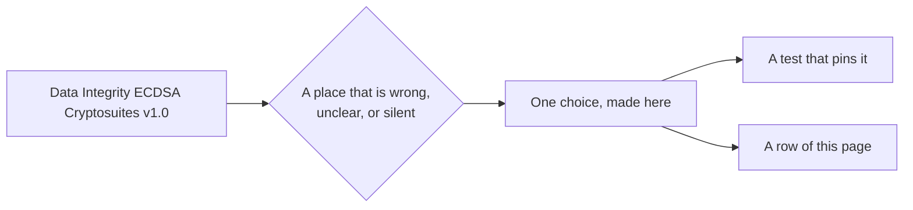

# Where the Recommendation contradicts itself or is silent

| Where                                    | The Recommendation                                                                                             | The choice                                                                                                                                                                                     | Test                                                                      |
| ---------------------------------------- | -------------------------------------------------------------------------------------------------------------- | ---------------------------------------------------------------------------------------------------------------------------------------------------------------------------------------------- | ------------------------------------------------------------------------- |
| 3.5.8 parseDerivedProofValue             | The public key is "a byte array of length 36"                                                                  | 35 bytes: the 2 bytes of the `p256-pub` header and the 33 of a compressed point, as 3.6.5 writes it, and as the vectors and Digital Bazaar's suite have it                                     | `proof-value.test.ts`, `vectors.spec.test.ts`                             |
| 3.6.7 Verify Derived Proof               | Checks the base signature "using the public key specified by publicKeyBytes", the public key of the proof      | Under the key of the issuer's verification method, which the caller passes as `publicKeyJwk`. The key of the proof is the holder's to make; checking under it would let a holder sign anything | `verify.test.ts`: statements re-signed with another proof key are refused |
| 3.6.7 Verify Derived Proof               | Says nothing of a base proof                                                                                   | `verify` answers `false`. A base proof holds the HMAC key and every signature, so a verifier must not take one                                                                                 | `verify.test.ts`                                                          |
| 3.5.8 parseDerivedProofValue             | Positions of mandatory statements are "an array of integers"                                                   | They must ascend and each must be the position of a statement of the revealed document. A producer that follows 3.5.4 always writes them so; other lists make a proof malleable                | `verify.test.ts`                                                          |
| 3.5.2 and 3.5.7                          | "CBOR tagging MUST NOT be used"                                                                                | None is written. Tag 64 (a typed array of bytes) is read as the byte string it wraps, because Digital Bazaar's suite reads it; any other tag is refused                                        | `proof-value.test.ts`                                                     |
| 3.6.4 Base Proof Configuration           | `proofConfig.@context` is the `@context` of the document                                                       | A `@context` that a proof carries is ignored when verifying, so the document's is always used. Digital Bazaar's primitives let the proof's win                                                 | `verify.test.ts`                                                          |
| 3.4.1 labelReplacementCanonicalizeNQuads | The statements are the canonical N-Quads of RDF Dataset Canonicalization, which sorts them in code point order | The primitives sort by UTF-16 code unit. The orders differ only when a statement compares a character beyond the BMP with one in U+E000 to U+FFFF. Inherited                                   | `counterparty.corpus.test.ts`: both suites agree                          |
| 3.4.10 jsonPointerToPaths                | A JSON pointer is RFC 6901                                                                                     | The primitives read text without a leading `/` as the empty pointer, which selects the whole document, and a name such as `1abc` as an index. Both are refused                                 | `derive.test.ts`                                                          |
| 3.6.4 Base Proof Configuration           | `created`, if set, "a valid XML Schema datetime"                                                               | `addBaseProof` leaves it out unless the caller gives one, and takes a date and time with an offset (RFC 3339), which XML Schema calls `dateTimeStamp` and Data Integrity requires              | `base.test.ts`                                                            |
| A.8 Additional example                   | Prints the credential without a proof, then the credential with its base proof                                 | The two differ in `description`; the proof signs the second. The test signs the credential as signed, and pins the difference                                                                  | `vectors.spec.test.ts`                                                    |
| 3.6.1 Create Base Proof                  | Does not say what a document with a `proof` already is                                                         | `addBaseProof` refuses it: a base proof signs a document without a proof, and `deriveProof` takes one proof                                                                                    | `base.test.ts`                                                            |

A test file with `.spec.` before `.test.ts` reads the examples that the Recommendation prints, which `pnpm spec-examples`
downloads at a pinned hash.
