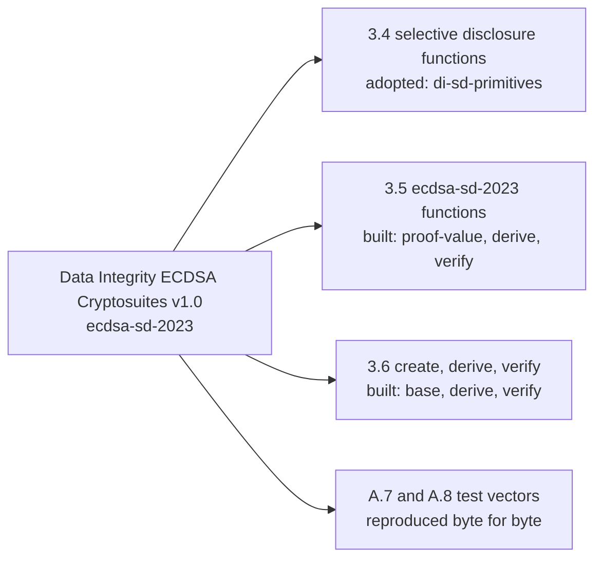

# What selective-disclosure supports

| Section of the Recommendation                                  | Where                             | Status                                                          |
| -------------------------------------------------------------- | --------------------------------- | --------------------------------------------------------------- |
| 3.4 Selective Disclosure Functions (3.4.1 to 3.4.17)           | `@digitalbazaar/di-sd-primitives` | Adopted; the package calls them with the options below          |
| 3.5.1 serializeSignData                                        | `proof-value/sign-data.ts`        | Supported                                                       |
| 3.5.2 serializeBaseProofValue, 3.5.3 parseBaseProofValue       | `proof-value/base.ts`             | Supported                                                       |
| 3.5.4 createDisclosureData                                     | `derive/disclosure-data.ts`       | Supported                                                       |
| 3.5.5 compressLabelMap, 3.5.6 decompressLabelMap               | `proof-value/label-map.ts`        | Supported                                                       |
| 3.5.7 serializeDerivedProofValue, 3.5.8 parseDerivedProofValue | `proof-value/derived.ts`          | Supported                                                       |
| 3.5.9 createVerifyData                                         | `verify/verify-data.ts`           | Supported                                                       |
| 3.6.1 to 3.6.5 Create Base Proof and its steps                 | `base/add-base-proof.ts`          | Supported on P-256                                              |
| 3.6.6 Add Derived Proof                                        | `derive/derive-proof.ts`          | Supported                                                       |
| 3.6.7 Verify Derived Proof                                     | `verify/suite.ts`                 | Supported; the base signature is checked under the issuer's key |
| 2.1.1 Multikey, for the public key of a proof                  | `keys/multikey.ts`                | The `p256-pub` form of the key of a proof                       |
| A.7 and A.8 test vectors                                       | `test/vectors.spec.test.ts`       | Reproduced: the base proof and the derived proof, byte for byte |

| Option of the primitives | Value                            | Why                                                                 |
| ------------------------ | -------------------------------- | ------------------------------------------------------------------- |
| `documentLoader`         | The caller's `contexts`, wrapped | The only way a context is read                                      |
| `safe`                   | `true` (the primitives' own)     | A term that no context defines is an error and is not dropped       |
| `algorithm`              | `RDFC-1.0` (the primitives' own) | The canonicalization of the Recommendation                          |
| `maxWorkFactor`          | `1`                              | Refuses a graph of blank nodes that takes more work to canonicalize |
| `signal`                 | The caller's                     | Stops the canonicalization at the next check                        |

A part of the Recommendation that is not here is listed under "Not included" in the [proofs guide](proofs.md), with its
reason.
