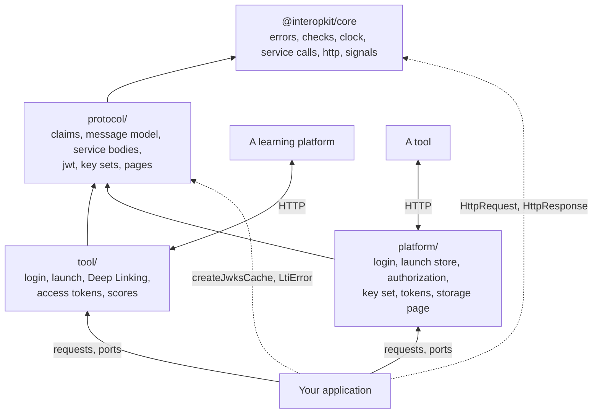

# Architecture

`@interopkit/tool-integration` implements LTI 1.3 as functions over plain data. A host passes in what it owns (stores,
registrations, `fetch`, the time) and receives plain results. The package has no server, no session and no database.

| Layer       | Holds                                                                                                                                                  | Imports                                      |
| ----------- | ------------------------------------------------------------------------------------------------------------------------------------------------------ | -------------------------------------------- |
| `errors.ts` | `LtiError`, with a `reason` of the union `LtiErrorReason` and an HTTP `status`                                                                                            | `@interopkit/core`                           |
| `protocol/` | What the roles share: the names and vocabularies of the claims, the model of the messages and of the bodies of the services with their readers and writers, the JWT check, the keys of a party, the key set cache of `@interopkit/core` exported again, the pages of the client-side login | `errors.ts`, `@interopkit/core`              |
| `tool/`     | The tool role                                                                                                                                          | `errors.ts`, `protocol/`, `@interopkit/core` |
| `platform/` | The platform role                                                                                                                                      | `errors.ts`, `protocol/`, `@interopkit/core` |

`tool/` and `platform/` never import each other, and `protocol/` imports neither. Biome enforces the rows. The tool role is the
subpath `@interopkit/tool-integration/tool`, and the platform role is `@interopkit/tool-integration/platform`.

## Principles

| Principle                    | Rule                                                                                                                                           |
| ---------------------------- | ---------------------------------------------------------------------------------------------------------------------------------------------- |
| Plain data in and out        | A request is an `HttpRequest` and an answer an `HttpResponse` of `@interopkit/core/http`: a host builds them from any web framework                                       |
| Ports for what the host owns | `LtiStore`, the registration lookup, `fetch`, `Clock`; each receives the `signal` of the call                                                  |
| Fail closed                  | A launch that fails any check is refused; a key set that cannot be fetched past its time to live fails the launch and never serves a stale key |
| Six algorithms               | Tokens are verified with RS256, RS384, RS512, ES256, ES384 and ES512 only; `none`, the HMAC algorithms and every other are refused before a key is fetched |
| One model of messages        | A message is read and written from one set of schemas ([messages](model.md)): what one role writes, the other reads                            |
| Web standards only           | Web Crypto, `fetch`, `URL`, `AbortSignal`; no `node:*` and no `process`. The `lib` is `ES2023` and `WebWorker`                                 |
| One schema library           | Claims and bodies are read with valibot; `parseWith` names the path of the first issue                                                         |
| No side channels             | No logging, no environment, no network except through the `fetch` the caller passes                                                            |

## Candidates compared

The generic parts use libraries: `jose` for the tokens and key sets, `valibot` for schemas. No library for the domain logic was
adopted. The candidates read were `ltijs`, `@lti-tool/core`, `lti-core`, `@atomicjolt/lti-server`, `@ltikit/core` and
`@longsightgroup/lti-tool`; none has the platform role, and none binds `state` to the browser in its core.

| Reason                       | Detail                                                                                                                                                |
| ---------------------------- | ----------------------------------------------------------------------------------------------------------------------------------------------------- |
| The platform role            | A QTI package with an LTI item needs a platform, and both roles share one model of claims                                                             |
| `state` bound to the browser | Security Framework 1.1 section 7.4.1: a launch without it invites login CSRF. Here a cookie, or the platform's storage with an origin check, binds it |
| Portability                  | `ltijs` needs `express`, `mongoose` and `ioredis`, and is CommonJS                                                                                    |
| Limits on service calls      | The candidates set no time, size or redirect limit on their calls                                                                                     |

The candidates stay useful as counterparties in tests.

## Not included

| Not included                                     | Why                      |
| ------------------------------------------------ | ------------------------ |
| A server, routes, sessions, a database           | The host's               |
| A UI for Deep Linking                            | The host's               |
| OAuth authorization code grant, token revocation | No LTI service uses them |
