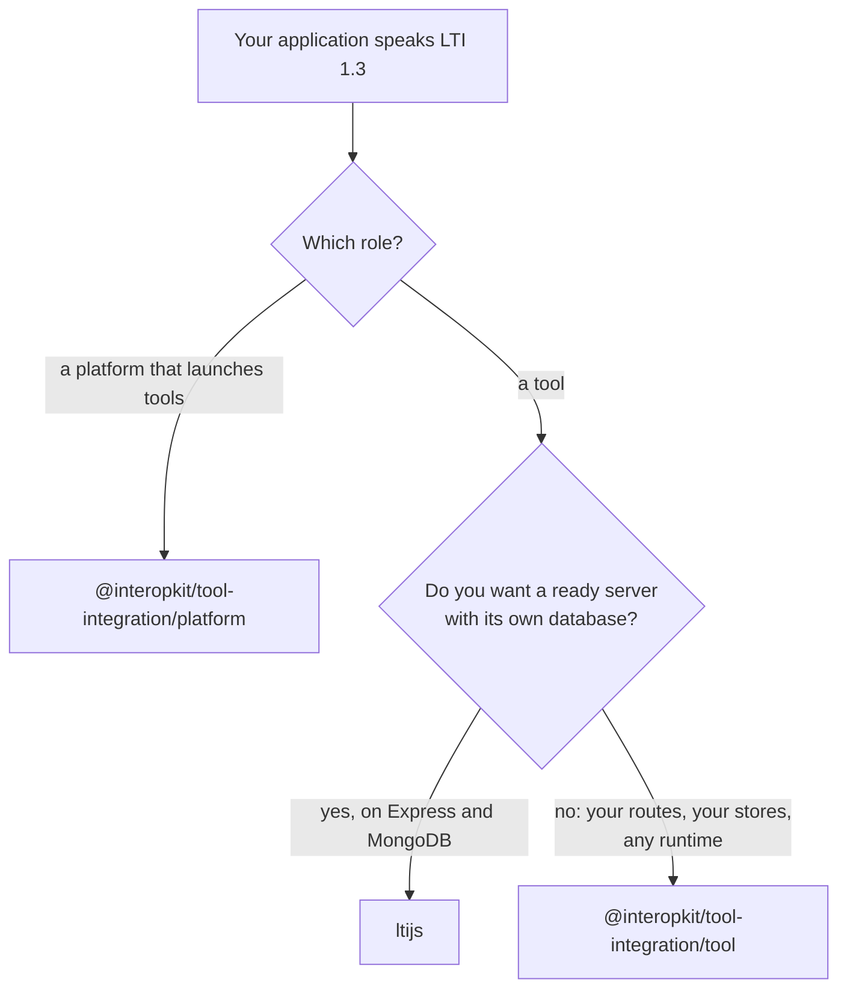

# Choosing tool-integration

When `@interopkit/tool-integration` fits a project that launches or is launched over LTI 1.3, and when another library fits
better. The candidates were read for [the architecture guide](architecture.md#candidates-compared) on 2026-11-01; the versions
of `@lti-tool/core` and `lti-core` are those that [the evidence](evidence.md) runs against the platform role, installed on
2026-11-02.

| You need                                                                                                          | Use                                                                              |
| ----------------------------------------------------------------------------------------------------------------- | -------------------------------------------------------------------------------- |
| The platform role: launches, the key set, tokens, the grade, roster and proctoring services, Dynamic Registration | This package: `/platform`, which none of the candidates has                      |
| The tool role over your own routes and stores, on Node.js, Deno, Bun, browsers or Workers                         | This package: `/tool`                                                            |
| A tool that runs as a ready Express server with MongoDB and Redis                                                 | `ltijs`, which needs `express`, `mongoose` and `ioredis` and is CommonJS         |
| A tool in Python                                                                                                  | PyLTI1p3 2.0.0, which [the evidence](evidence.md) runs against the platform role |

## What the others have that the package lacks

| Candidate                                                            | What it has                                                                                                                                                                        | Here                                                                                         |
| -------------------------------------------------------------------- | ---------------------------------------------------------------------------------------------------------------------------------------------------------------------------------- | -------------------------------------------------------------------------------------------- |
| `ltijs`                                                              | A server with routes, sessions and a database, ready to run                                                                                                                        | Excluded: the routes, the sessions and the stores are the host's, behind the package's ports |
| `@lti-tool/core` 1.2.2, `lti-core` 0.4.0                             | Nothing the tool role lacks that [the evidence](evidence.md) found; they are stricter than the specifications in places that it lists, such as a launch without a name or an email | The package follows the specifications, and a test pins what each library does               |
| `@atomicjolt/lti-server`, `@ltikit/core`, `@longsightgroup/lti-tool` | The tool role only                                                                                                                                                                 | The package has both roles over one model of the messages                                    |
| Every candidate                                                      | None binds `state` to the browser in its core, and none limits the time, size or redirects of its service calls                                                                    | The package does both ([the architecture guide](architecture.md#candidates-compared))        |

## Where the evidence is

[The evidence](evidence.md) gives the tables and examples of the specifications, tokens that PyJWT signs, `@lti-tool/core`,
`lti-core` and PyLTI1p3 launching from the platform role, and Moodle 5.3.0 in both roles; [performance](performance.md) times
the launch against `@lti-tool/core` and jose.
