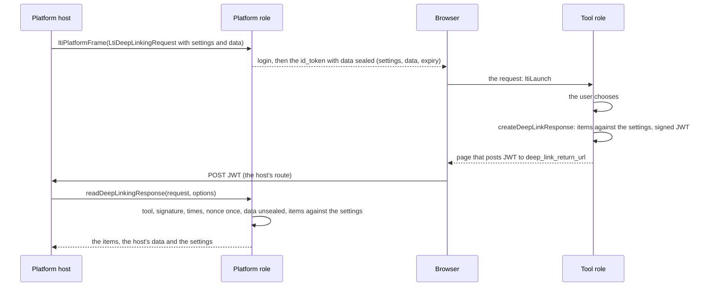

# LTI Deep Linking

LTI Deep Linking 2.0 in both roles. A platform asks a tool for content with an `LtiDeepLinkingRequest`; the user chooses in the
tool, and the tool answers with a signed `LtiDeepLinkingResponse` that lists content items. In the tool role,
`createDeepLinkResponse` checks the items against what the request accepts and returns the page that posts the signed response.
In the platform role, `readDeepLinkingResponse` reads that post, verifies it against the tool's registration and against the
settings that the platform sealed into the request, and returns the items. The five item types, their extensions and the types
that others define are the [service models](services.md) that both roles share.



| Role     | Function                                           | Does                                                                                                    |
| -------- | -------------------------------------------------- | ------------------------------------------------------------------------------------------------------- |
| Tool     | `createDeepLinkResponse(launch, response, options)` | Checks the items, signs the response and returns the page that posts it to the platform's return URL    |
| Platform | `readDeepLinkingResponse(request, options)`        | Reads the form the tool posted, verifies it and returns the response with its items and the host's data |

## Quick start

A tool answers a request with one item. The sample builds the request by hand where a tool gets it from `ltiLaunch`, and signs
with a key that it generates where a tool uses the key that the platform's administrator registered.

```ts
import { signerFromCryptoKey } from "@interopkit/core";
import { createDeepLinkResponse } from "@interopkit/tool-integration/tool";

const keys = await crypto.subtle.generateKey(
  { name: "RSASSA-PKCS1-v1_5", modulusLength: 2048, publicExponent: new Uint8Array([1, 0, 1]), hash: "SHA-256" },
  false,
  ["sign"],
);
const registration = {
  issuer: "https://lms.example.edu",
  clientId: "962fa4d8-bcbf-49a0-94b2-2de05ad274af",
  deploymentIds: ["07940580-b309-415e-a37c-914d387c1150"],
  authenticationUrl: "https://lms.example.edu/auth",
  jwksUrl: "https://lms.example.edu/jwks",
  accessTokenUrl: "https://lms.example.edu/token",
  redirectUri: "https://tool.example.com/lti/launch",
  signer: signerFromCryptoKey(keys.privateKey, { algorithm: "RS256", keyId: "tool-1" }),
};
const launch = {
  messageType: "LtiDeepLinkingRequest",
  issuer: registration.issuer,
  clientId: registration.clientId,
  deploymentId: registration.deploymentIds[0],
  settings: {
    returnUrl: "https://lms.example.edu/deep_links",
    acceptTypes: ["ltiResourceLink"],
    acceptPresentationDocumentTargets: ["iframe"],
    data: "opaque-data-of-the-platform",
  },
};
const page = await createDeepLinkResponse(
  launch,
  { items: [{ type: "ltiResourceLink", title: "Tryout 1", url: "https://tool.example.com/lti/tests/1" }] },
  { registration: async () => registration, clock: { now: () => 1_700_000_000_000 } },
);
page.status; // => 200
page.headers["content-security-policy"].endsWith("form-action https://lms.example.edu"); // => true
/<form id="form" method="post" action="https:\/\/lms\.example\.edu\/deep_links">/.test(page.body); // => true
/<input type="hidden" name="JWT" value="[\w-]+\.[\w-]+\.[\w-]+">/.test(page.body); // => true
```

A whole flow, a platform that asks and a tool that answers, runs in the [example](../../examples/tool-integration/README.md):
`src/tool.ts` answers a request with `createDeepLinkResponse`, and `src/platform.ts` has the route at the return URL that calls
`readDeepLinkingResponse`.

## The tool role

`createDeepLinkResponse(launch, response, options)` takes the `DeepLinkingRequestMessage` that `ltiLaunch` returned, what the tool
answers with, and the options of the tool role (`registration`, `clock`, `signal`). It answers also when the user chose nothing:
the platform closes its frame on the response (Deep Linking 2.0 section 2.3).

| Property of the response | Meaning                                                                                                            |
| ------------------------ | ------------------------------------------------------------------------------------------------------------------ |
| `items`                  | The content items, as `ContentItem` values: `link`, `ltiResourceLink`, `file`, `html`, `image`, or a type that another specification defines. An empty list places none |
| `message`, `log`         | A text for the user, and a text for the platform's log                                                             |
| `errorMessage`, `errorLog` | The same for an error                                                                                            |

The items are written as the specification has them and read back with `readContentItem`, so that an item breaks no rule of its
type: an address is `https`, a line item has a `scoreMaximum` above 0, an extension is named by a URL. Then the settings of the
request hold them:

| Setting                                | The tool refuses                                                                                                   |
| -------------------------------------- | ------------------------------------------------------------------------------------------------------------------ |
| `acceptMultiple`                       | Several items unless it is `true`                                                                                  |
| `acceptTypes`                          | An item whose `type` is not listed                                                                                 |
| `acceptMediaTypes`                     | A `file` whose `mediaType` no pattern matches (`image/png`, `image/*`, `*/*`); a file that names none passes       |
| `acceptLineItem`                       | A resource link with a `lineItem` when it is `false`; absent says nothing, and the line item is sent               |
| `acceptPresentationDocumentTargets`    | A `link` or `ltiResourceLink` that offers `window`, `iframe` or `embed` and no way that the platform supports. An item that offers none passes: the default is a new window. The tool should offer every way that applies (Deep Linking 2.0 section 3.1) |

The response carries `iss` (the client identifier), `aud` (the platform's issuer), `iat`, `exp` (300 seconds later), a `nonce`
that is new each time, the version, the deployment, the message type, the `data` of the request when it had one, and the
`content_items`. The registration's `signer` signs it, with its algorithm, and its header names the signer's `keyId` as `kid`. The
result is the page that posts the form parameter `JWT` to `launch.settings.returnUrl`: one script that its policy names by hash,
the form allowed to go to the origin of the return URL alone, not cached, no referrer. The host sends it as the answer to the
user's choice.

## The platform role

The host asks with a `LtiDeepLinkingRequest` message input: `settings` holds the `returnUrl` (a route of the host), what the platform
accepts, and `data`, an object of the host's own. The platform seals the settings and the data, with the tool, the deployment and
an expiry (`deepLinkingLifetimeSeconds`, 86,400), into the `data` claim of the request. The tool returns that claim as it is, so
`readDeepLinkingResponse` needs no store and no lookup of the request: the response may come to any process, and the settings it is
held to are those the platform sent.

The host's route at the return URL passes the request to `readDeepLinkingResponse(request, options)`. The options are the platform
(`config`, `clock`), the lookup of the tool (`client`), the cache of key sets (`jwks`), the single-use ledger (`once`) and the limits.

The checks, in order:

| Check                                    | Refused with, a reason of `LtiError`                                                                         |
| ---------------------------------------- | ------------------------------------------------------------------------------------------------------------ |
| A POST of a form with the parameter `JWT`, within `maxFormBytes` | `request-invalid`, `form-too-large`                                                         |
| The tool that `iss` names, looked up with `client` | `token-malformed`, `client-unknown`                                                                  |
| An algorithm of the tool's registration, a key of its key set, the signature | `algorithm-unsupported`, `key-unknown`, `signature-invalid`                       |
| `aud` as the platform's issuer alone; `azp`, when present, as the same | `audience-mismatch`, `audience-untrusted`, `authorized-party-mismatch`                       |
| `exp`, `iat` and `nonce` present; not expired; not issued in the future; expiring within an hour | `claim-missing`, `claim-invalid`, `token-expired`, `issued-in-future`, `assertion-lifetime`  |
| At most `maxContentItems` items, counted before one is read | `content-items-limit`                                                                  |
| The message type, the version and a deployment of the tool | `message-type-unsupported`, `version-unsupported`, `deployment-unknown`                              |
| The `nonce`, once: `once` records it until the message stops verifying | `nonce-replayed`                                                                         |
| The `data` claim: sealed by this platform (or by an earlier hint key), for this tool and deployment, not expired | `deep-linking-data-invalid`                                |
| Each item, read by its type with `readContentItem` | `content-item-refused`                                                                                     |
| The items against the sealed settings: the table above | `content-item-refused`                                                                                     |

The result is a `ReceivedDeepLinkingResponse`: the fields of the message (`issuer`, `clientId`, `deploymentId`, `version`,
`message`, `log`, `errorMessage`, `errorLog`, `claims`), the `items` as `ContentItem` values, the `settings` of the request, the
host's own `data` after verification (absent when the request had none), and the `subject` of the request (absent for an
anonymous one). The sealed data is the anti-CSRF token of the request (Appendix A's example names its `data` a `csrftoken`): the
host places the items only when its own session of the browser is of that `subject`, so that a response that another user's
browser is made to post places nothing. Whether the user confirms the items, what `autoCreate`
means, and how a `file` is fetched, an `html` item sanitized and a `link` shown, are the host's. A file's `url` is short-lived:
fetch it through the host's guarded `fetch` before its `expiresAt`. An `html` fragment, a `title` and a `text` are data, never
markup that the package renders.

| Option            | Default     | Meaning                                                                                        |
| ----------------- | ----------- | ---------------------------------------------------------------------------------------------- |
| `config`, `clock` | required    | The platform and the time                                                                      |
| `client`          | required    | Looks up a tool by its client identifier; `undefined` is `client-unknown`                      |
| `jwks`            | required    | The cache of the tools' key sets, from `createJwksCache`                                       |
| `once`            | required    | Records an identifier until a time; `false` when it was used. Atomic across processes          |
| `maxFormBytes`    | 1,048,576   | The most bytes of the form, measured before it is decoded                                      |
| `maxTokens`       | 1,000,000   | The most JSON tokens of the message, counted before it is parsed                               |
| `maxContentItems` | 100         | The most items of a response                                                                   |
| `signal`          | none        | Ends this caller's wait                                                                        |

## Limits

| Limit                                                     | Value               |
| --------------------------------------------------------- | ------------------- |
| The form of a response                                    | 1,048,576 bytes     |
| The JSON tokens of a response                             | 1,000,000           |
| The items of a response                                   | 100                 |
| A response of a tool, as signed                           | 300 seconds         |
| The longest lifetime accepted of a response              | 3,600 seconds       |
| The data of a request                                     | 86,400 seconds      |
| Clock skew                                                | 60 seconds          |

## Failure paths

| Port                  | Fails                                                                    | Hangs                 | Called again                                            |
| --------------------- | ------------------------------------------------------------------------ | --------------------- | ------------------------------------------------------- |
| `client`              | `readDeepLinkingResponse` rejects with its error; `undefined` is `client-unknown` | `signal`      | On every response; a host may cache                     |
| `once`                | Rejects with its error; the nonce is not spent. Not a boolean: `DataError` | `signal`            | `false` is `nonce-replayed`: the tool sends a new response |
| The tool's key set    | `ServiceError`; a failed fetch is not kept. A set that is not a JWK Set is `key-unknown` | The cache's deadline  | Shared by concurrent callers                            |
| The tool's `registration` | `createDeepLinkResponse` rejects; `undefined` is `platform-unknown`   | `signal`              | Pure; a host may cache                                  |
| The `signer`          | The call rejects with its error; nothing half-signed is posted           | `signal`              | Each response has a new nonce                           |

## Errors

| Error                                                              | When                                                                                       | What to do                                                       |
| ------------------------------------------------------------------ | ------------------------------------------------------------------------------------------ | ---------------------------------------------------------------- |
| `DataError` from `createDeepLinkResponse`                          | An argument has the wrong type, an item is not a content item, or the platform does not accept the items | Fix the caller; choose items the request accepts                 |
| `LtiError` `platform-unknown`, `deployment-unknown`                | The tool's registration is gone, or no longer lists the deployment                         | Register the platform or the deployment again                    |
| `LtiError` of `readDeepLinkingResponse`, 400                       | The sender broke the protocol: the form, the items, their number                          | Answer 400; the tool fixes its response                          |
| `LtiError` of `readDeepLinkingResponse`, 401                       | The token fails validation                                                                 | Answer 401                                                       |
| `LtiError` `nonce-replayed`, `deep-linking-data-invalid`, 403      | The response is a replay, or its data is not this platform's, this tool's or current        | Answer 403; the user starts the request again                    |
| `DataError` from `readDeepLinkingResponse`                         | The request or an option has the wrong type, or a port breaks its contract                 | Fix the host                                                     |

Each `LtiError` carries the HTTP `status` that the host answers with.

## Data flows

| Data                                  | Comes from                          | Goes to                                                   | Kept by the package |
| ------------------------------------- | ----------------------------------- | --------------------------------------------------------- | ------------------- |
| The host's `data`, the settings, the user's `sub` | The host's `MessageInput` | The tool, sealed (signed, not encrypted) in the request; back in the response | No      |
| The items                             | The tool's host                     | The platform's host, in a form posted by the browser      | No                  |
| The nonce of a response               | The tool                            | The host's `once`                                         | No                  |

The data is signed and not encrypted: the tool can read it, so it holds no secret and no personal data.

## Not included

| What                                                                 | Reason                                                                                  |
| -------------------------------------------------------------------- | --------------------------------------------------------------------------------------- |
| A picker, the page that frames the tool, the confirmation of items   | The host's                                                                              |
| Fetching the `url` of a file, sanitizing an `html` item              | The host's: it fetches through its guarded `fetch` and sanitizes with its own policy    |
| Creating the line item of a resource link                            | The host's: the response says what the tool expects, the gradebook is the host's        |

## Differences from the references

None of the references that were read has a platform role (see [architecture](architecture.md)), so the platform's reader is
checked against the specification, its examples and the tool role of this package. The settings are sealed into the request, which
the specification allows through the opaque `data`, so that the reader needs no store. The published examples do not agree with
each other on two points, which [spec-gaps](spec-gaps.md) lists.
