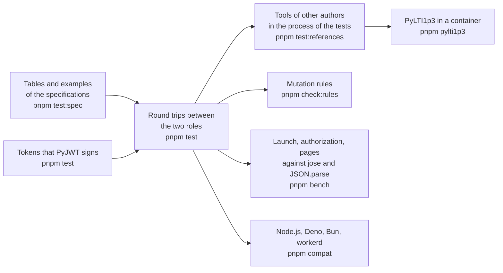

# Evidence for tool-integration

What shows that the package does what it says: the vocabularies and examples of the specifications, tokens that another library
signs, a round trip between the two roles, tools of other authors that launch from the platform role and use its services, the
speed of the hot paths, and four runtimes. Each layer answers a question that the one before cannot.

| Layer              | Question                                                                                              | Where                                                                                           | Runs                    |
| ------------------ | ----------------------------------------------------------------------------------------------------- | ----------------------------------------------------------------------------------------------- | ----------------------- |
| Specifications     | Does each vocabulary, variable, message and body that the specifications print read and write back?   | `scripts/lti-tables.ts`, `packages/tool-integration/test/*.spec.test.ts`                        | `pnpm test:spec`        |
| Tokens             | Does the tool verify, or refuse with its reason, what another library signs in each algorithm?        | `validation/lti_tokens.py`, `packages/tool-integration/test/tool-tokens.test.ts`                | `pnpm test`             |
| Round trips        | Does each role take what the other gives, for every message and every service?                        | `examples/tool-integration`, `packages/tool-integration/test/*.test.ts`                         | `pnpm test`             |
| In-process tools   | Do tools of other authors launch from the platform role and use its services and its registration?    | `packages/tool-integration/test/references*.test.ts`                                            | `pnpm test:references`  |
| PyLTI1p3           | Does a tool with its own HTTP stack, checks and cache launch from the platform over `https`?          | `validation/pylti1p3/`, `packages/tool-integration/test/pylti1p3.corpus.test.ts`                | `pnpm pylti1p3`         |
| Mutation rules     | Does the test of each rule that keeps a request from being forged, replayed or redirected fail without it? | `scripts/check-rules.ts`                                                                   | `pnpm check:rules`      |
| Speed              | How long do the launch, the authorization and the reading of a page take, against what they build on? | `packages/tool-integration/test/*.bench.ts`, `test/budgets.ts`                                  | `pnpm bench`            |
| Runtimes           | Does the example give the same results on each runtime?                                               | `compat/`                                                                                       | `pnpm compat`           |

## Tools in the process of the tests

Each library plays the tool, and the platform role is the platform of the references: it signs with RS256 or ES256, keeps the
messages in a store, issues tokens, and serves a gradebook, a roster and groups over stores in memory. The libraries call the
global `fetch`, so the test replaces it with a network that reaches the handler of each origin, and plays the browser between the
two. `pnpm test:references` runs the three files; `pnpm test` leaves them out.

| Library             | Version | Flows that pass                                                                                                                                                                                                                                                                                           |
| ------------------- | ------- | --------------------------------------------------------------------------------------------------------------------------------------------------------------------------------------------------------------------------------------------------------------------------------------------------------- |
| `@lti-tool/core`    | 1.2.2   | The launch of a platform that signs with RS256 and with ES256; the line item read, created, updated and deleted, the container with its filters, a score, the results, and the later of two scores kept; the members; a Deep Linking answer that the platform reads with its own data; Dynamic Registration from the initiation URL to the launch of the registered tool, with the single use of the registration token |
| `lti-core`          | 0.4.0   | The launch of a resource link, the single use of its `state`, and a Deep Linking answer that the platform reads with its own data                                                                                                                                                                          |

The versions are the newest that `minimumReleaseAge` of `pnpm-workspace.yaml` (14 days) installs on 2026-11-02. `@lti-tool/core`
1.3.0 was published without its build, and 1.3.1 to 1.3.3 are younger than 14 days. The fake platform of `lti-core/testing`
exists from 0.5.0, published 2026-10-29, so the tool role does not yet run against it.

## PyLTI1p3

[`validation/pylti1p3/`](../../validation/pylti1p3/README.md) starts a tool built on PyLTI1p3 2.0.0 in a container. The platform
serves `https` from the process of the tests with a certificate of its own authority, which the container trusts, so every call
of the tool to the key set, the token endpoint and the services is a real request. These flows pass, for each message and
signature:

| Flow                                                                                                                              | What it shows                                                                           |
| --------------------------------------------------------------------------------------------------------------------------------- | --------------------------------------------------------------------------------------- |
| The launch of a resource link, the platform signing with RS256 and with ES256                                                     | Checks the state, the nonce, the deployment, the signature and the message; reads the claims |
| A second authentication request of one login, and an `id_token` carried to a state that the tool did not issue                     | The platform refuses the first; PyLTI1p3 refuses the second                              |
| The line item of the launch, the container, a line item created and found again by its tag, a score, the results                    | `get_lineitem`, `get_lineitems`, `find_or_create_lineitem`, `put_grade`, `get_grades`    |
| The members and the context of the roster                                                                                         | `get_members`, `get_context`                                                            |
| The groups and the group sets of the context                                                                                      | `get_groups`, `get_sets`                                                                |
| A Submission Review request for a learner, and the line item that it names                                                        | `is_submission_review_launch`, `get_submission_review_user`                             |
| A Deep Linking request, answered with an item that the platform reads with its own data                                           | `DeepLink.get_response_jwt`                                                             |
| A login whose `target_link_uri` is another URL of the tool than its launch URL                                                    | Takes the target from the claim of the launch and sends its launch URL as the redirect URI |

## Differences from the references

The references are stricter than the specifications in these places. The platform does what the specification says, and a test
pins what the reference does with it.

| Reference        | What it does                                                                                                         | What the specification says                                                                                          | What a host does                                                                                                         |
| ---------------- | -------------------------------------------------------------------------------------------------------------------- | -------------------------------------------------------------------------------------------------------------------- | ------------------------------------------------------------------------------------------------------------------------ |
| `@lti-tool/core` | Refuses a launch whose user has no `given_name`, no `family_name` or no `email`, each in a test of its own            | LTI Core 5.3.6: `sub` is the only required claim of the user, and 5.3.6.1 lets a platform omit the others                 | Gives the names and the email in `user` for a tool that needs them                                                       |
| `@lti-tool/core` | Refuses a page of members in which a member has no `status` or no `name`                                             | NRPS 2.3: a membership without a status is `Active`; NRPS 2: a tool should never rely on additional member attributes | The platform writes what the store gives and applies no default, so the store gives `status` and `name` for such a tool   |
| `lti-core`       | Verifies RS256 alone                                                                                                 | Security Framework 7.2: an implementation should support all six approved algorithms, and uses one of them               | A platform that launches this tool signs with RS256                                                                      |

Proctoring Services and the AfA PNP Connector have no counterparty: their examples and round trips are the evidence.

## Speed

`pnpm bench` builds the package and times the hot paths of the build that ships, in `vitest bench`, against a reference in the
same run. A ratio holds on any machine, and the budget of a ratio is five times the largest that three runs measured, rounded up
to one significant digit. The budgets in time are pending: the design asks for them from the runner of CI, which has not run these
benchmarks yet, so each time below is the fastest sample of a laptop with an Apple chip, shown and not enforced.

| What is timed                                                                          | Reference in the same run                          | Ratio measured | Budget | Fastest sample |
| -------------------------------------------------------------------------------------- | -------------------------------------------------- | -------------- | ------ | -------------- |
| `ltiLaunch` with an RS256 `id_token`: login, signature, claims                         | `jwtVerify` of jose, same token                    | 2.72 to 2.93   | 20     | 0.095 ms       |
| `ltiLaunch` with an ES256 `id_token`                                                   | `jwtVerify` of jose, same token                    | 1.77 to 1.95   | 10     | 0.115 ms       |
| The authorization request that signs an RS256 `id_token` with every claim              | `SignJWT` of jose, same claims                     | 1.27 to 1.36   | 7      | 0.50 ms        |
| The same, ES256                                                                        | `SignJWT` of jose, same claims                     | 3.02 to 3.47   | 20     | 0.15 ms        |
| `members` of a page of 1,000 members (295 KB)                                          | `JSON.parse` of its text                           | 3.93 to 4.22   | 30     | 1.36 ms        |
| `results` of a page of 1,000 results (243 KB)                                          | `JSON.parse` of its text                           | 6.35 to 7.91   | 40     | 1.55 ms        |
| The authorization request that substitutes the 44 variables that the platform supports | The same request with the names written plainly | 0.99 to 1.00   | 5      | 0.52 ms        |

Substituting 44 variables costs what a request without them costs, since the signature takes the time.

## Runtimes

`pnpm compat` bundles the scenario of the example with the packages as they ship and runs it on Node.js, Deno, Bun and workerd.
The scenario launches a resource link, a Deep Linking request, a Start Proctoring message, a Submission Review request and an End
Assessment message; grades, reads the roster and the groups, pauses a proctored attempt, and registers a second tool through
Dynamic Registration. Web Crypto signs and verifies ES256 and RS256 and seals with HMAC alike on the four runtimes, and the
results equal those of Node.js.
