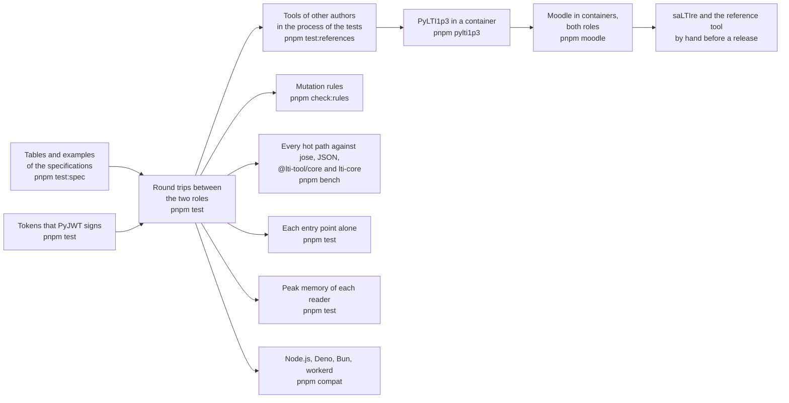

# Evidence for tool-integration

What shows that the package does what it says: the vocabularies and examples of the specifications, tokens that another library
signs, a round trip between the two roles, tools of other authors that launch from the platform role and use its services, Moodle
in both roles, the speed of every hot path, the size of each entry point, the peak memory of every reader, and four runtimes. Each layer answers a question that
the one before cannot.

| Layer              | Question                                                                                              | Where                                                                                           | Runs                    |
| ------------------ | ----------------------------------------------------------------------------------------------------- | ----------------------------------------------------------------------------------------------- | ----------------------- |
| Specifications     | Does each vocabulary, variable, message and body that the specifications print read and write back?   | `scripts/lti-tables.ts`, `packages/tool-integration/test/*.spec.test.ts`                        | `pnpm test:spec`        |
| Tokens             | Does the tool verify, or refuse with its reason, what another library signs in each algorithm?        | `validation/lti_tokens.py`, `packages/tool-integration/test/tool-tokens.test.ts`                | `pnpm test`             |
| Round trips        | Does each role take what the other gives, for every message and every service?                        | `examples/tool-integration`, `packages/tool-integration/test/*.test.ts`                         | `pnpm test`             |
| In-process tools   | Do tools of other authors launch from the platform role and use its services and its registration?    | `packages/tool-integration/test/references*.test.ts`                                            | `pnpm test:references`  |
| PyLTI1p3           | Does a tool with its own HTTP stack, checks and cache launch from the platform over `https`?          | `validation/pylti1p3/`, `packages/tool-integration/test/pylti1p3.corpus.test.ts`                | `pnpm pylti1p3`         |
| Moodle             | Does Moodle launch a tool built on the package, and does it use a platform built on the package, with registration, launch, services and Deep Linking? | `validation/moodle/`, `packages/tool-integration/test/moodle.corpus.test.ts` | `pnpm moodle` |
| Online testers     | Do the testers that 1EdTech and saLTIre host pass the platform and the tool?                           | The log below                                                                                   | By hand before a release |
| Mutation rules     | Does the test of each rule that keeps a request from being forged, replayed or redirected fail without it? | `scripts/check-rules.ts`                                                                   | `pnpm check:rules`      |
| Speed              | How long does each hot path take, against what it builds on and against the tools of other authors?  | `packages/tool-integration/test/*.bench.ts`, `test/budgets.ts`                                  | `pnpm bench`            |
| Size               | Does each entry point hold only what it uses, within its budget?                                       | `packages/tool-integration/test/size.test.ts`                                                    | `pnpm test`             |
| Memory             | Does each reader of untrusted input stay under its budget on its worst input?                         | `packages/tool-integration/test/*-memory.test.ts`, `packages/core/test/jwks-cache-memory.test.ts` | `pnpm test`             |
| Runtimes           | Does the example give the same results on each runtime?                                               | `compat/`                                                                                       | `pnpm compat`           |

## Tools in the process of the tests

Each library plays the tool, and the platform role is the platform of the references: it signs with RS256 or ES256, keeps the
messages in a store, issues tokens, and serves a gradebook, a roster and groups over stores in memory. The libraries call the
global `fetch`, so the test replaces it with a network that reaches the handler of each origin, and plays the browser between the
two. `pnpm test:references` runs the three files; `pnpm test` leaves them out.

| Library             | Version | Flows that pass                                                                                                                                                                                                                                                                                           |
| ------------------- | ------- | --------------------------------------------------------------------------------------------------------------------------------------------------------------------------------------------------------------------------------------------------------------------------------------------------------- |
| `@lti-tool/core`    | 1.2.2   | The launch of a platform that signs with RS256 and with ES256; the line item read, created, updated and deleted, the container with its filters, a score, the results, and the later of two scores kept; the members; a Deep Linking answer that the platform reads with its own data; Dynamic Registration from the initiation URL to the launch of the registered tool, with the single use of the registration token |
| `lti-core`          | 0.4.0   | The launch of a resource link, the single use of its `state`, and a Deep Linking answer that the platform reads with its own data                                                                                                                                                                          |

The versions are the newest that `minimumReleaseAge` of `pnpm-workspace.yaml` (14 days) installs on 2026-11-02. `@lti-tool/core`
1.3.0 was published without its build, and 1.3.1 to 1.3.3 are younger than 14 days. The fake platform of `lti-core/testing`
exists from 0.5.0, published 2026-10-29, so the tool role does not yet run against it.

## PyLTI1p3

[`validation/pylti1p3/`](../../validation/pylti1p3/README.md) starts a tool built on PyLTI1p3 2.0.0 in a container. The platform
serves `https` from the process of the tests with a certificate of its own authority, which the container trusts, so every call
of the tool to the key set, the token endpoint and the services is a real request. These flows pass, for each message and
signature:

| Flow                                                                                                                              | What it shows                                                                           |
| --------------------------------------------------------------------------------------------------------------------------------- | --------------------------------------------------------------------------------------- |
| The launch of a resource link, the platform signing with RS256 and with ES256                                                     | Checks the state, the nonce, the deployment, the signature and the message; reads the claims |
| A second authentication request of one login, and an `id_token` carried to a state that the tool did not issue                     | The platform refuses the first; PyLTI1p3 refuses the second                              |
| The line item of the launch, the container, a line item created and found again by its tag, a score, the results                    | `get_lineitem`, `get_lineitems`, `find_or_create_lineitem`, `put_grade`, `get_grades`    |
| The members and the context of the roster                                                                                         | `get_members`, `get_context`                                                            |
| The groups and the group sets of the context                                                                                      | `get_groups`, `get_sets`                                                                |
| A Submission Review request for a learner, and the line item that it names                                                        | `is_submission_review_launch`, `get_submission_review_user`                             |
| A Deep Linking request, answered with an item that the platform reads with its own data                                           | `DeepLink.get_response_jwt`                                                             |
| A login whose `target_link_uri` is another URL of the tool than its launch URL                                                    | Takes the target from the claim of the launch and sends its launch URL as the redirect URI |

## Differences from the references

The references are stricter than the specifications in these places. The platform does what the specification says, and a test
pins what the reference does with it.

| Reference        | What it does                                                                                                         | What the specification says                                                                                          | What a host does                                                                                                         |
| ---------------- | -------------------------------------------------------------------------------------------------------------------- | -------------------------------------------------------------------------------------------------------------------- | ------------------------------------------------------------------------------------------------------------------------ |
| `@lti-tool/core` | Refuses a launch whose user has no `given_name`, no `family_name` or no `email`, each in a test of its own            | LTI Core 5.3.6: `sub` is the only required claim of the user, and 5.3.6.1 lets a platform omit the others                 | Gives the names and the email in `user` for a tool that needs them                                                       |
| `@lti-tool/core` | Refuses a page of members in which a member has no `status` or no `name`                                             | NRPS 2.3: a membership without a status is `Active`; NRPS 2: a tool should never rely on additional member attributes | The platform writes what the store gives and applies no default, so the store gives `status` and `name` for such a tool   |
| `lti-core`       | Verifies RS256 alone                                                                                                 | Security Framework 7.2: an implementation should support all six approved algorithms, and uses one of them               | A platform that launches this tool signs with RS256                                                                      |

Proctoring Services and the AfA PNP Connector have no counterparty: their examples and round trips are the evidence.

## Moodle

[`validation/moodle/`](../../validation/moodle/README.md) starts Moodle 5.3.0 and its database in containers, and runs both roles of
the package against it, with the tool and the platform of the package in the process of the tests, over `https`, with a certificate
authority of the run that Moodle trusts. The flows go through the pages and endpoints that a browser and a tool use; the
preparation that a person does in the interface (users, a course, an activity, a grade) and the reading of the gradebook go
through a script of Moodle.

| Moodle is | Flows that pass                                                                                                                                                                                                                                                      |
| --------- | -------------------------------------------------------------------------------------------------------------------------------------------------------------------------------------------------------------------------------------------------------------------- |
| Platform  | Dynamic Registration from the administrator's page to the activation of the tool; the launch of an activity, the login and the launch compared on `target_link_uri`, also when it has a query of its own; the line item, the container, a created line item, a score that the gradebook shows, and the results read without a `limit`; the members of the course; a Deep Linking request answered with an item that Moodle verifies |
| Tool      | Dynamic Registration from "Register a platform" to the activation of the platform; the launch of a published course, which provisions and enrols the learner; the members that Moodle reads from the roster service; the grade that it posts to the line item                    |

The names of the machine are dotted (`moodle.test`, `tool.example.org`, `platform.example.org`), so that every address passes the
check of a public host; `serviceOrigins` is not needed.

### What Moodle does differently

| Moodle                                                                                                                  | The specification                                                                               | The package                                                                                                                                             |
| ----------------------------------------------------------------------------------------------------------------------- | ----------------------------------------------------------------------------------------------- | ------------------------------------------------------------------------------------------------------------------------------------------------------- |
| Answers a registration with `"logo_uri": ""`                                                                            | Dynamic Registration 2.2: the addresses are URLs when present                                    | **Fixed.** Both readers of a registration take an empty address as absent ([spec-gaps](spec-gaps.md))                                                  |
| Posts a score with `"timestamp": "2026-11-02T14:55:32+0000"`, the form of PHP's `DATE_ISO8601`                          | AGS 3.4.8: ISO 8601 with a time zone                                                             | **Fixed.** The readers take `+hhmm` as `+hh:mm` ([spec-gaps](spec-gaps.md))                                                                            |
| Answers a request for results that carries `limit` with 404 and an HTML page: its code for LTI 1.3 calls a method on `null` (`results.php`, line 238 of 5.3.0) | AGS 3.3: `limit` is optional                                                                    | **Fixed** in the client: a request for results carries a `limit` only when the caller names one, and the flow reads the results without it. A request with a `limit` still gets the 404, which the test pins |
| Names a context role in the roster by its simple name (`Instructor`), where its launch has the URI                      | NRPS 2 and LTI Core Appendix A: both forms exist                                                | Not changed. A member keeps the role as sent; `canonicalizeRole` gives the URI                                                                         |
| As a tool, ends a launch whose context has no `type` in an error page (`tool_launch_service.php`, line 132)             | LTI Core 5.4.1: `type` is optional                                                              | Not changed. The host of a platform that launches Moodle sends the type, and the test pins the error page                                              |

## Online testers, by hand

saLTIre and the reference tool of 1EdTech (`lti-ri.imsglobal.org`) run on the internet and call the platform and the tool back, so
a person runs them before a release with the example platform and the example tool on public addresses. The log has one row for
each run, with the date, the commit that was tested, the tester and the result.

| Date | Commit | Tester | Result |
| ---- | ------ | ------ | ------ |
|      |        |        | No run has been made yet |

What a run checks, beyond the flows that the counterparties above already pass:

| Role under test | Check | Why no automated run covers it |
| --- | --- | --- |
| Tool | A launch in a frame whose browser blocks third-party cookies, with `lti_storage_target`: the storage page, then the verification page's post accepted by its `Origin` | Moodle sends no `lti_storage_target`; the browser tests play the platform's storage in one origin |
| Tool | A launch with `lti_storage_target` in a new window or tab, which has an opener or none | The same |
| Tool | The token request, which carries `client_id` and `application/x-www-form-urlencoded;charset=UTF-8` as `oauth4webapi` writes it: legal under RFC 7521 section 4.2, absent from the example of Security Framework 4.1.1 | Only Moodle's token endpoint has taken it |
| Tool | A Deep Linking response and a Start Assessment message posted to a return URL that redirects: `form-action` allows the origin of the address alone | Moodle answers at the address |
| Tool | The line items, results with and without `limit`, scores, members and groups against a platform other than Moodle | The same |
| Platform | The launch, Deep Linking, the grade services and the roster as each tester's tool calls them | `@lti-tool/core`, `lti-core` and PyLTI1p3 are libraries, not the testers' tools |

## Speed

`pnpm bench` builds the package and times the hot paths of the build that ships against a reference in the same run, the two in
turns through `alternate` of `scripts/bench-rounds.ts`: three rounds that alternate which runs first, so that a machine that speeds
up or slows down weighs on both. A ratio of the fastest samples holds on any machine; its budget is five times the largest that
three runs on a laptop with an Apple chip measured, rounded up to one significant digit. The budgets in time wait for a sample of
the runners of CI.

| Benchmark | Reference in the same run | Ratio | Budget |
| --- | --- | ---: | ---: |
| `handleLaunch`, a message with every claim, 0.067 ms | `verifyLaunch` of `@lti-tool/core`, same message | 1.28–1.31 | 7 |
| The same | `validate` of `lti-core`, same message | 1.98–2.06 | 20 |
| `handleLaunch` with an RS256 `id_token` | `jwtVerify` of jose, same token | 2.35–2.40 | 20 |
| `handleLaunch` with an ES256 `id_token` | the same | 1.76–1.78 | 20 |
| The authorization request that signs an RS256 `id_token` with every claim | `SignJWT` of jose, same claims | 1.28 | 7 |
| The same, ES256 | the same | 1.99–2.98 | 20 |
| The same, substituting the 44 variables of the platform | the same request with the names written plainly | 0.99–1.02 | 5 |
| A key from a cached key set, 0.40 µs | `createRemoteJWKSet` of jose holding the set | 1.90–2.04 | 20 |
| The same | `createLocalJWKSet` of jose | 2.63–2.72 | 20 |
| `members`, a page of 1,000 (295 KB) | `JSON.parse` of its text | 3.84–4.12 | 30 |
| `results`, a page of 1,000 (243 KB) | the same | 6.47–6.49 | 40 |
| `lineItems`, a page of 1,000 (272 KB) | the same | 7.13–7.27 | 40 |
| `publishScore`, `control`, `registerTool` | `callService` of core, same request and answer | 2.49–4.72 | 20, 20, 30 |
| The token endpoint, 0.044 ms | `jwtVerify` of jose on its client assertion | 2.41–2.50 | 20 |
| The members of a context, a page of 1,000, 1.1 ms | `JSON.stringify` of the page | 6.14–6.24 | 40 |
| The results of a line item, a page of 1,000, 1.0 ms | the same | 7.65–8.06 | 50 |
| A score, a control request, a registration | `compactVerify` of jose on the token and `JSON.parse` of the body | 2.80–3.39 | 20 |
| `buildDeepLinkingResponse` with five items, `buildStartAssessmentPage` | `SignJWT` of jose, same claims | 1.06–1.14 | 6 |
| `readDeepLinkingResponse`, `readStartAssessment` | `jwtVerify` of jose on the JWT | 2.49–3.25 | 20 |

Substituting 44 variables costs what a request without them costs, since the signature takes the time. Four fixes changed no
output: on the tests, on 1,698 inputs given to the build before and the build after (pages with odd users and extensions, every
token of the fixtures with each last character, the handler of results on odd line items and broken stores), and on a property
test of the check of a token against jose's own round trip. Timed in turns against the build before:

| Fix | Paths, the fastest sample before and after |
| --- | --- |
| A writer drops its `undefined` members in a loop; `Object.fromEntries` took half of the page of members | The members of a context 2.2 to 1.1 ms; the results 2.2 to 1.0 ms with the next fix; a score posted 12 percent less |
| The address of each result is the address of the results, parsed once, with its user as the query; the platform reads what its store gives without the addresses it then checked again | The results of a line item |
| A part of a token is canonical base64url by its alphabet, its length and its spare bits, without decoding and encoding it | `handleLaunch` 0.078 to 0.064 ms; `readDeepLinkingResponse` and `readStartAssessment` 17 and 18 percent less; the token endpoint 15 |
| Extensions are found by the names of the members | `lineItems` 9 percent less |

The gaps that remain have named causes. `handleLaunch` reads the form and the cookie, checks the registration that the lookup returns,
counts the JSON tokens of the payload before it parses it, and reads every claim of the message with its schema; `lti-core` reads
fewer claims and verifies RS256 alone. The key set cache checks the URL of each call, 0.19 of its 0.40 µs, which jose checks once
when it makes a set; a launch spends 0.5 percent of its time there. A handler of a page reads each item of the store with the
schema of its class, as a reader does, and checks the addresses that it writes; a reader of line items checks two dates of each.

## Size

`size.test.ts` bundles each entry point alone with `scripts/entry-size.ts`: esbuild, minified, with every dependency inside. It
fails above the budget after gzip, or when an entry point holds a module that its budget does not list. The root of core, which every
entry point holds in part, holds jose for the key set cache.

| Entry point | Bytes | Gzip | Budget | Holds, besides `protocol`, `errors`, `@interopkit/core`, jose and valibot |
| --- | ---: | ---: | ---: | --- |
| `@interopkit/tool-integration` | 23,264 | 8,361 | 10,500 | Nothing more: the models, the vocabularies, `LtiError` and the key set cache |
| `@interopkit/tool-integration/platform` | 146,886 | 44,046 | 55,500 | Nothing more |
| `@interopkit/tool-integration/tool` | 141,215 | 42,974 | 54,000 | oauth4webapi, through the OAuth 2.0 client of core that obtains the access tokens |

The platform holds nothing of the tool, nor the tool of the platform. A host that imports one function of an entry point gets less:
the package has no side effects, so a bundler drops the rest.

## Memory

Each reader of untrusted input has a test of its peak memory on its worst input within its limits, in a file of its own because
the peak of a process only grows; the test reports the rise. The rises are those of Node.js 22 and 24.

| Reader | Worst input | Peak rose by | Budget |
| --- | --- | ---: | ---: |
| `handleLogin` | Forms and queries of 64 KiB of repeated and of distinct parameters, and a form of 64 MiB | 0.1–1.3 MiB | 32 MiB |
| `handleLaunch` | A form of 64 KiB whose token is one array of small objects, and a form of 64 MiB | 1.3–5.0 MiB | 32 MiB |
| The claims of a token before its signature | A payload of 3.6 million tokens, refused by their number | 1.2–2.2 MiB | 64 MiB |
| A key set, `createJwksCache` | 64 KiB of empty keys, refused above 100; 100 keys of 64 KiB; one nested 32,000 deep; 64 MiB | 12–15 MiB | 32 MiB |
| `lineItems` and the other pages | A page of a million tokens in an extension that the reader copies; 1 MiB of empty objects | 84–126 MiB | 256 MiB |
| `members` | The same | 36–50 MiB | 256 MiB |
| `control` | A status of a million tokens; 24 MiB | 86–94 MiB | 256 MiB |
| `preferences` | A record of a million tokens; 24 MiB | 134–171 MiB | 256 MiB |
| `discoverPlatform`, `registerTool` | An answer of an array just under 64 KiB, and one of 1 MiB | 12–20 MiB | 32 MiB |
| The authorization and token requests of the platform | Forms of 64 KiB of repeated and distinct parameters, and of 64 MiB | 2.2–9.9 MiB | 32 MiB |
| The grade services, the Assessment Control Service and the registration endpoint | Bodies of 64 KiB of nesting and of arrays | 0.5–1.1 MiB | 32 MiB |
| `readDeepLinkingResponse` | A form of under 1 MiB that lists 10,000 items, refused by their number | 11–13 MiB | 64 MiB |
| `readStartAssessment` | A form of 64 KiB whose token is one array of small objects | 7.4–16 MiB | 32 MiB |

A key set of 64 KiB of empty keys took some 20 MiB to read, since jose copies each key and keeps a note of it: the cache refuses a set
of more than 100 keys before jose sees it. A client of a service takes an answer of up to `maxBytes`, 1 MiB, and `maxTokens`, a
million, by default, so its worst answer is a million tokens; a host that reads small answers lowers both.

## Runtimes

`pnpm compat` bundles the scenario of the example with the packages as they ship and runs it on Node.js, Deno, Bun and workerd.
The scenario launches a resource link, a Deep Linking request, a Start Proctoring message, a Submission Review request and an End
Assessment message; grades, reads the roster and the groups, pauses a proctored attempt, and registers a second tool through
Dynamic Registration. Web Crypto signs and verifies ES256 and RS256 and seals with HMAC alike on the four runtimes, and the
results equal those of Node.js.
