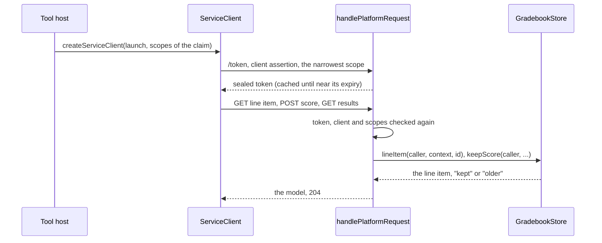
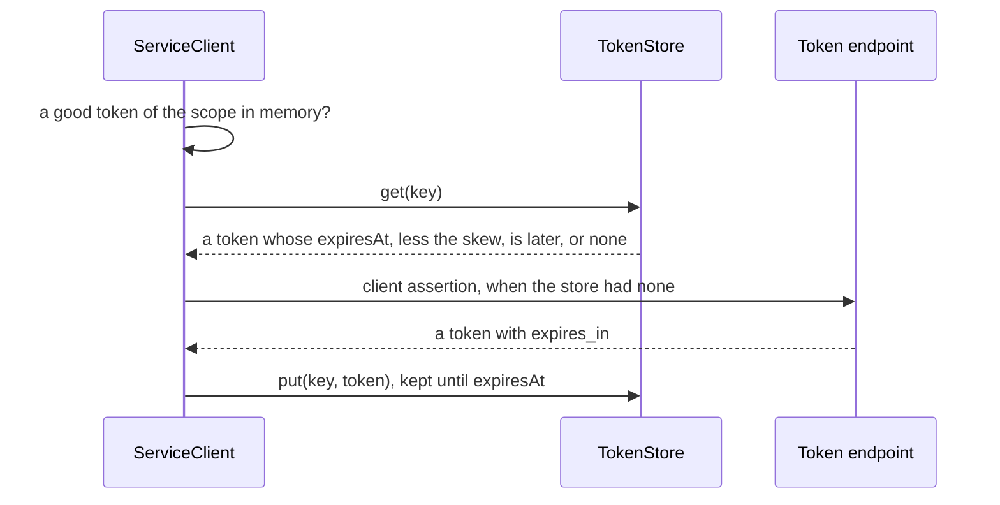

# LTI grade services

The Assignment and Grade Services (AGS 2.0) in both roles. In the tool role, `createServiceClient` reads and writes the line
items of a context, reads their results and publishes scores, reusing its access tokens. In the platform role,
`handlePlatformRequest` serves them over the host's `GradebookStore`, and offers them in a message only when the store is given.
Both roles share the [service bodies](services.md).



| Role     | Function                                   | Does                                                                                  |
| -------- | ------------------------------------------ | ------------------------------------------------------------------------------------- |
| Tool     | `createServiceClient(deployment, options)` | Returns the client of the services of a platform for one deployment                   |
| Tool     | `advanceScoreTimestamp(lastSent, nowMs)`   | Returns a timestamp strictly later than the last one sent, with millisecond precision |
| Platform | `handlePlatformRequest(request, options)`  | With `services.gradebook`, also serves the routes of the grade services               |

## Quick start

```ts
import { advanceScoreTimestamp } from "@interopkit/tool-integration/tool";

advanceScoreTimestamp(undefined, 1_700_000_000_000); // => "2023-11-14T22:13:20.000Z"
advanceScoreTimestamp("2023-11-14T22:13:20.000Z", 1_700_000_000_000); // => "2023-11-14T22:13:20.001Z"
advanceScoreTimestamp("2023-11-14T22:13:19.000+00", 1_700_000_000_000); // => "2023-11-14T22:13:20.000Z"
```

The [example](../../examples/tool-integration/README.md) runs the whole flow: `src/gradebook.ts` is a `GradebookStore` in memory,
and `src/tool.ts` grades a launch.

## The tool role

`createServiceClient(launch, options)` takes the deployment of a launch (`issuer`, `clientId`, `deploymentId`) and the scopes
the platform offered, `launch.services.grades.scopes`. Keep one client for each deployment, so its tokens are reused; a host of
several processes, or one that makes a client for each job, gives the clients a shared `TokenStore`.

| Method                                | AGS   | Scope asked for, the narrowest that was offered | Answers                                 |
| ------------------------------------- | ----- | ----------------------------------------------- | --------------------------------------- |
| `lineItems(url, query?)`              | 3.2.4 | `lineitem.readonly`, else `lineitem`            | A `Page<LineItem>`                      |
| `lineItem(url)`                       | 3.2.3 | `lineitem.readonly`, else `lineitem`            | The line item, or `undefined` for a 404 |
| `createLineItem(containerUrl, input)` | 3.2.5 | `lineitem`                                      | The line item as the platform keeps it  |
| `updateLineItem(url, input)`          | 3.2.6 | `lineitem`                                      | The line item as the platform keeps it  |
| `deleteLineItem(url)`                 | 3.2.7 | `lineitem`                                      | `true`, or `false` for a 404            |
| `results(lineItemUrl, query?)`        | 3.3   | `result.readonly`                               | A `Page<Result>`                        |
| `publishScore(lineItemUrl, score)`    | 3.4   | `score`                                         | Nothing; the platform answers 2xx       |

| Rule            | Value                                                                                                                                                                                                                                               |
| --------------- | --------------------------------------------------------------------------------------------------------------------------------------------------------------------------------------------------------------------------------------------------- |
| Signal          | Each method also takes `{ signal }`                                                                                                                                                                                                                 |
| What is sent    | A score or a line item that breaks AGS 3.4 or 3.2, such as a `scoreGiven` below 0 or a date without a time zone, is a `DataError` before anything is sent. A `LineItemQuery` or `ResultQuery` adds its filters                                      |
| `limit`         | A request for a container adds `pageLimit` when neither the query nor the URL names one; a request for results adds none, as AGS 3.3 makes it optional                                                                                              |
| The next page   | `Page.next`, when the answer links to one on the origin of the request; the same method takes it as its URL and sends it as it is (AGS 3.2.4). A `next` link to another origin ends the pages, so the token never leaves the platform that answered |
| Results, scores | Below the path of the line item, at `/results` and `/scores`, with its query kept (AGS 3.3 and 3.4)                                                                                                                                                 |

### Tokens

Each call asks for a token of the narrowest scope that allows it and that the platform offered (`scope-unavailable` when none),
with `requestClientCredentialsToken` of [`@interopkit/core/oauth`](../core/oauth.md) as [the tool role](tool.md#access-tokens-and-the-services)
describes; a token that does not hold the scope is `scope-denied`. `createTokenCache` keeps the token of a scope until
`refreshSkewSeconds` before its expiry, and callers that arrive together share one token request, which runs to its own deadline.
A 401 drops the token of the scope, and the next call asks for a new one. Nothing retries.

With `tokens`, a `TokenStore` of the host, the clients of several processes share their tokens:

| Rule      | Value                                                                                                                                                                      |
| --------- | -------------------------------------------------------------------------------------------------------------------------------------------------------------------------- |
| Key       | JSON text of the issuer, the client, the deployment and the scopes, so no two deployments or scopes share a token                                                          |
| `get`     | When the client has no good token of the scope in memory; the store's token is taken only while its `expiresAt`, less `refreshSkewSeconds`, is later than the clock's time |
| `put`     | Of each new token with `expires_in`; a token without it is never put, since no one knows how long it is good                                                               |
| `delete`  | After a 401                                                                                                                                                                |
| The store | Keeps a token until its `expiresAt` and not after, as a time to live does                                                                                                  |



### URLs

A URL comes from a launch or from an answer of the platform, so the token goes to it only when it lies on one of the
registration's `serviceOrigins`, or, without them, when `checkRemoteUrl` accepts it: no IP address, no single label such as
`localhost`, no name of a private network and no user information (`service-origin-refused`). The registration is looked up on
each call, so a removed registration or deployment stops the client at once (`platform-unknown`, `deployment-unknown`).

### Scores and their timestamps

The timestamps of the scores of one line item and user increase strictly, and a platform keeps a score unless a later one is
kept (AGS 3.4.9). `publishScore` is not idempotent: a resend, even of a score in doubt after a timeout, needs a later
`timestamp`. `advanceScoreTimestamp(lastSent, now)` gives the time to the millisecond, or one millisecond after the last
timestamp sent when the time is not later. Record the timestamp before sending, so a crash between the request and its record
cannot repeat one.

### Reading answers

Every answer is read within `maxBytes` (above it, a `ServiceError` that names the option) and `maxTokens` of JSON, counted before
parsing (a `LimitError`), then strictly into its model: a body that breaks it is a `DataError` that names the path of its first
invalid member. A failed call is a `ServiceError` with its `status`, `headers` (`Retry-After` among them) and body.

| Option               | Default        | Meaning                                                                                                                                          |
| -------------------- | -------------- | ------------------------------------------------------------------------------------------------------------------------------------------------ |
| `registration`       | required       | As every function of the tool role                                                                                                               |
| `clock`              | `SYSTEM_CLOCK` | As every function of the tool role                                                                                                               |
| `fetch`              | required       | The `fetch` that calls the token endpoint and the services                                                                                       |
| `scopes`             | required       | The scopes that the platform offered                                                                                                             |
| `timeoutMs`          | 10,000         | The most time of one call, in milliseconds                                                                                                       |
| `maxBytes`           | 1,048,576      | The most bytes of an answer                                                                                                                      |
| `maxTokens`          | 1,000,000      | The most JSON tokens of an answer                                                                                                                |
| `pageLimit`          | 100            | The `limit` of a request for a container when neither its query nor its URL names one; a request for results has none unless the caller names it |
| `refreshSkewSeconds` | 60             | The seconds before its expiry at which a token is replaced                                                                                       |
| `tokens`             | none           | A `TokenStore` that the clients of several processes share; without it each client keeps its tokens in its own memory                            |
| `signal`             | none           | Ends this caller's wait in the registration lookup                                                                                               |

## The platform role

With `services: { gradebook }`, `handlePlatformRequest` offers the grade services: the token endpoint grants their scopes when
the registration does, a message that asks for them carries their claim, and the routes below are served. Without the store,
none of the three exists.

A store has the methods its gradebook supports, at least one: a platform that only takes the scores of the line item of each
launch gives `keepScore` alone, as in the example of AGS 3.1.1.3. What a store lacks is not offered: the route of a missing
method answers 404, or 405 with the methods of the path that remain; a scope is listed in the OpenID configuration and granted
only with a method that needs it; and the claim names the container only with `lineItems`.

| Scope               | Offered with any of                                  |
| ------------------- | ---------------------------------------------------- |
| `lineitem.readonly` | `lineItems`, `lineItem`                              |
| `lineitem`          | `createLineItem`, `updateLineItem`, `deleteLineItem` |
| `result.readonly`   | `results`                                            |
| `score`             | `keepScore`                                          |

| Path under `origin`                                 | Methods     | Scopes, one of                  | Store                                    |
| --------------------------------------------------- | ----------- | ------------------------------- | ---------------------------------------- |
| `/contexts/{context}/line-items`                    | GET         | `lineitem.readonly`, `lineitem` | `lineItems(caller, context, query)`      |
| `/contexts/{context}/line-items`                    | POST        | `lineitem`                      | `createLineItem(caller, context, input)` |
| `/contexts/{context}/line-items/{lineItem}`         | GET         | `lineitem.readonly`, `lineitem` | `lineItem(caller, context, id)`          |
| `/contexts/{context}/line-items/{lineItem}`         | PUT, DELETE | `lineitem`                      | `updateLineItem`, `deleteLineItem`       |
| `/contexts/{context}/line-items/{lineItem}/results` | GET         | `result.readonly`               | `results(caller, context, id, query)`    |
| `/contexts/{context}/line-items/{lineItem}/scores`  | POST        | `score`                         | `keepScore(caller, context, id, score)`  |

### The claim

A message offers the grade services with `services: { grades: { lineItemId, container } }`, which needs its `context`. The claim
carries the scopes of the services that the registration grants and the store offers, `lineitems` when `container` is true and
the store has `lineItems`, and `lineitem` when the message names a line item; the platform builds the URLs from `config.origin` and the identifiers, encoded. The variables
`$LineItems.url` and `$LineItem.url` answer them, and `""` when the claim has none. A `LtiSubmissionReviewRequest` names its
line item this way, as Submission Review 1.0 section 2.5 asks.

### Access

A request to a route needs a bearer token of `/token`. The checks, in order:

| Check                                                                                                                                                    | Refusal                             |
| -------------------------------------------------------------------------------------------------------------------------------------------------------- | ----------------------------------- |
| The route                                                                                                                                                | 404                                 |
| The method                                                                                                                                               | 405 with `Allow`                    |
| A token that this platform sealed and that has not expired                                                                                               | 401 with `WWW-Authenticate: Bearer` |
| The tool and the deployment of the token, looked up with `registration` again, so a removed tool loses access at once                                    | 401                                 |
| One of the scopes of the method, among those of the token that the registration still grants, so a narrowed tool loses them within the hour of its token | 403 `insufficient_scope`            |

The store receives the caller (`clientId`, and `deploymentId` when the assertion named one) and the `signal`, and answers
`undefined` (or `false`) for what is not the caller's, which is 404, so existence does not leak.

### Bodies and answers

| Route                | Reads                                                                      | Answers                                                                                                  |
| -------------------- | -------------------------------------------------------------------------- | -------------------------------------------------------------------------------------------------------- |
| GET the line items   | `resource_id`, `resource_link_id`, `tag`, `activity_id`, `limit`, `cursor` | 200 `lineitemcontainer+json`, each `id` the URL of the line item, and a `Link` to the next page          |
| POST a line item     | `lineitem+json`, a `LineItemInput`                                         | 201 with the line item and `Location`; 404 for a context or an `activityId` that the store does not have |
| GET, PUT a line item | PUT: `lineitem+json`                                                       | 200 `lineitem+json`                                                                                      |
| DELETE a line item   |                                                                            | 204                                                                                                      |
| GET the results      | `user_id`, never empty, `limit`, `cursor`                                  | 200 `resultcontainer+json`, each `id` `{line item}/results?user_id=…` and `scoreOf` the line item        |
| POST a score         | `score+json`, a `Score`                                                    | 204, whether the store kept it or a later one                                                            |

A body is refused with 415 for another media type, 413 above `maxBodyBytes`, and 400 when it is not JSON or not its model. A page
holds `limit` items: `pageSize` when the request names none, and at most `maxPageSize` ([options](platform.md#options)). The store
gives an opaque `cursor` for the next page, which the platform puts in the `next` link with every filter of the request; a store
that gives more than `limit` items breaks its contract. A score reaches `keepScore` with `timestampMs`, the instant of its
`timestamp` to the millisecond; the store keeps it unless a strictly later one is kept, and an equal time replaces, so a retry
completes.

## Limits

The limits of the client are its options above; those of the platform (`maxBodyBytes`, `pageSize`, `maxPageSize`, the lifetime of
an access token) are in [the platform role](platform.md#options).

## Failure paths

| Port or call                      | Fails                                                                                                                                                                | Hangs                                  | Called again                                                                                                                                                            |
| --------------------------------- | -------------------------------------------------------------------------------------------------------------------------------------------------------------------- | -------------------------------------- | ----------------------------------------------------------------------------------------------------------------------------------------------------------------------- |
| `GradebookStore`                  | 500 with nothing of the cause; `undefined` or `false`: 404                                                                                                           | `signal`                               | GET is safe. A repeated POST of a line item makes a second one, so a tool queries by `resourceId` and `tag` first. `keepScore` is atomic, and `older` still answers 204 |
| `registration`, on a service call | 500; `undefined`: 401                                                                                                                                                | `signal`                               | On every call; a host may cache                                                                                                                                         |
| The client's `fetch`              | `ServiceError`; a 404 of a line item is `undefined` or `false`; a 401 drops the token                                                                                | `timeoutMs`                            | GETs are safe; a score needs a later timestamp                                                                                                                          |
| The token cache                   | A failed token request is not kept                                                                                                                                   | Its own deadline                       | Shared by concurrent callers of a scope                                                                                                                                 |
| `TokenStore`                      | The call rejects with its error; a token that it fails to put is not kept, and the next call asks again; a value that is not a token with an expiry is a `DataError` | A signal that aborts after `timeoutMs` | `get` and `put` once for each token a client obtains; `delete` after a 401, which may drop a newer token of another process at the cost of one token request            |

A store that answers with something other than its contract (a line item that is not one, a page larger than its limit, a
`keepScore` that is not `"kept"`, `"older"` or `undefined`) is a `DataError` that the handler throws.

## Errors

| Error                                               | When                                                                  | What to do                                                                 |
| --------------------------------------------------- | --------------------------------------------------------------------- | -------------------------------------------------------------------------- |
| `LtiError` `scope-unavailable`                      | The platform offered none of the scopes that the call needs           | Ask the platform's administrator for the scope                             |
| `LtiError` `scope-denied`                           | The platform did not grant the scope asked for                        | The same                                                                   |
| `LtiError` `service-origin-refused`                 | The URL may not receive the token                                     | Name the platform's origins in `serviceOrigins`                            |
| `LtiError` `platform-unknown`, `deployment-unknown` | The registration is gone, or no longer lists the deployment           | Register the platform or the deployment again                              |
| `ServiceError`                                      | The token endpoint or a service answered with an error, or not at all | Read its `status` and `Retry-After`; resend a score with a later timestamp |
| `DataError`                                         | An argument has the wrong type, or a body breaks its model            | Fix the caller                                                             |
| `LimitError`, a `DataError`                         | An answer is above `maxTokens`                                        | Raise `maxTokens` for a platform you trust                                 |

## Data flows

| Data              | Comes from                    | Goes to                                                                                                                                          | Kept by the package           |
| ----------------- | ----------------------------- | ------------------------------------------------------------------------------------------------------------------------------------------------ | ----------------------------- |
| An access token   | The platform's token endpoint | The services of the platform, in `Authorization`; the client's cache until near its expiry; the host's `TokenStore` when given, until its expiry | Only in memory, in the client |
| A score, a result | The tool's host               | The platform's `GradebookStore`, through the score service                                                                                       | No                            |
| Line items        | Either side                   | The other side                                                                                                                                   | No                            |

## Not included

| Not included                           | Why                                                                     |
| -------------------------------------- | ----------------------------------------------------------------------- |
| Automatic retries of a service call    | The host decides; `Retry-After` is in the `ServiceError`                |
| The ordering of scores at the platform | The store's: `keepScore` compares the timestamps in its own transaction |
| A gradebook, a database                | The host's, behind `GradebookStore`                                     |

## Differences from the references

The platform role is checked against `@lti-tool/core`, `lti-core` and PyLTI1p3, tools of other authors that use its grade
services, and both roles against Moodle ([evidence](evidence.md)). Where platforms differ, the package follows AGS.

| What                                                   | AGS                                                                             | Moodle 5.3.0 and Canvas                                                                                                                                                                                                          | The package                                                                                                                                                                         |
| ------------------------------------------------------ | ------------------------------------------------------------------------------- | -------------------------------------------------------------------------------------------------------------------------------------------------------------------------------------------------------------------------------- | ----------------------------------------------------------------------------------------------------------------------------------------------------------------------------------- |
| A score whose timestamp is not later than the kept one | 3.4.9: the platform must not update the result, and "may just ignore" the score | Moodle answers 409 for a timestamp earlier or equal (`mod/lti/service/gradebookservices/classes/local/resources/scores.php`, line 196); Canvas 400 for an earlier one (`lti/ims/scores_controller.rb`, `verify_valid_timestamp`) | The platform role answers 204 and keeps the later score; `publishScore` of the tool role throws the `ServiceError` of a 409 or 400, and the host sends again with a later timestamp |
