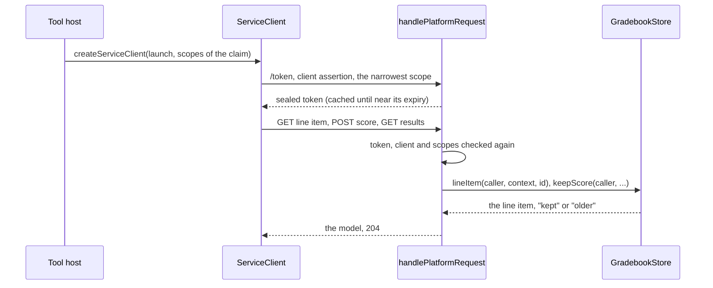

# LTI grade services

The Assignment and Grade Services (AGS 2.0) in both roles. In the tool role, `createServiceClient` reads and writes the line
items of a context, reads their results and publishes scores, with access tokens that it reuses. In the platform role,
`handlePlatformRequest` serves the same services over the host's `GradebookStore`, and offers them in the claims of a message
only when the store is given. The bodies are the [service models](services.md) that both roles share.



| Role     | Function                                              | Does                                                                                     |
| -------- | ----------------------------------------------------- | ---------------------------------------------------------------------------------------- |
| Tool     | `createServiceClient(deployment, options)`            | Returns the client of the services of a platform for one deployment                     |
| Tool     | `advanceScoreTimestamp(lastSent, nowMilliseconds)`    | Returns a timestamp strictly later than the last one sent, with millisecond precision   |
| Platform | `handlePlatformRequest(request, options)`             | With `services.gradebook`, also serves the routes of the grade services                  |

## Quick start

```ts
import { advanceScoreTimestamp } from "@interopkit/tool-integration/tool";

advanceScoreTimestamp(undefined, 1_700_000_000_000); // => "2023-11-14T22:13:20.000Z"
advanceScoreTimestamp("2023-11-14T22:13:20.000Z", 1_700_000_000_000); // => "2023-11-14T22:13:20.001Z"
advanceScoreTimestamp("2023-11-14T22:13:19.000+00", 1_700_000_000_000); // => "2023-11-14T22:13:20.000Z"
```

A whole flow, a platform that keeps a gradebook and a tool that publishes to it, runs in the
[example](../../examples/tool-integration/README.md): `src/gradebook.ts` is a `GradebookStore` in memory, and `src/tool.ts` grades
a launch.

## The tool role

`createServiceClient(launch, options)` takes the deployment of a launch (its `issuer`, `clientId` and `deploymentId`) and the
scopes that the platform offered in the claim, `launch.services.grades.scopes`. A host keeps one client for each deployment, so
that its tokens are reused.

| Method                                     | AGS   | Scope asked for, the narrowest that was offered | Answers                                       |
| ------------------------------------------ | ----- | ----------------------------------------------- | --------------------------------------------- |
| `lineItems(url, query?)`                   | 3.2.4 | `lineitem.readonly`, else `lineitem`            | A `Page<LineItem>`                            |
| `lineItem(url)`                            | 3.2.3 | `lineitem.readonly`, else `lineitem`            | The line item, or `undefined` for a 404       |
| `createLineItem(containerUrl, input)`      | 3.2.5 | `lineitem`                                      | The line item as the platform keeps it        |
| `updateLineItem(url, input)`               | 3.2.6 | `lineitem`                                      | The line item as the platform keeps it        |
| `deleteLineItem(url)`                      | 3.2.7 | `lineitem`                                      | `true`, or `false` for a 404                  |
| `results(lineItemUrl, query?)`             | 3.3   | `result.readonly`                               | A `Page<Result>`                              |
| `publishScore(lineItemUrl, score)`         | 3.4   | `score`                                         | Nothing; the platform answers 2xx             |

Each method also takes `{ signal }`. A query (`LineItemQuery`, `ResultQuery`) adds its filters, and a `limit` of `pageLimit` when
neither it nor the URL names one. A `Page` has its `items` and, when the answer links to one on the origin of the request, the
`next` page, which the same method takes as its URL and sends as it is (AGS 3.2.4: the tool does not apply the filters again). A
`next` link to another origin ends the pages, so that the token never leaves the platform that answered. The results are below the
path of the line item at `/results` and the scores at `/scores`, with the query of the line item kept (AGS 3.3 and 3.4).

### Tokens

Each call asks for a token of the narrowest scope that allows it and that the platform offered (`scope-unavailable` when none),
with `clientCredentialsToken` of [`@interopkit/core/oauth`](../core/oauth.md), `private_key_jwt` signed by the registration's
`signer`, and the deployment claim of LTI 1.3 Core section 6.2.1. A token that does not hold the scope is `scope-denied`. The
token of a scope is kept by `createTokenCache` until `refreshSkewSeconds` before its expiry: callers that arrive together share
one token request, which runs to its own deadline and takes no caller's signal. A 401 drops the token of the scope, and the next
call asks for a new one. Nothing retries.

### URLs

A URL comes from a launch or from an answer of the platform, so the token goes to it only when it lies on one of the
registration's `serviceOrigins`, or, without them, when `checkRemoteUrl` accepts it: no IP address, no single label such as
`localhost`, no name of a private network and no user information (`service-origin-refused`). The registration is looked up on
each call, so a removed registration or deployment stops the client at once (`platform-unknown`, `deployment-unknown`).

### Scores and their timestamps

AGS 3.4.9 says that the timestamps of the scores of one line item and user increase strictly, and that a platform keeps a score
unless a later one is kept. `publishScore` is not idempotent: a resend, even of a score in doubt after a timeout, needs a later
`timestamp`. `advanceScoreTimestamp(lastSent, now)` gives the time with millisecond precision, or one millisecond after the last
timestamp sent when the time is not later. A host records the timestamp before it sends, so that a crash between the request and
its record cannot repeat one.

### Reading answers

Every answer is read within `maxBytes` (a `ServiceError` that names the option above it) and `maxTokens` of JSON, counted before
it is parsed (a `DataError` that names the option), then strictly into its model: a body that breaks it is a `DataError` that
names the path of its first invalid member. A failed call is a `ServiceError` with its `status`, its `headers` (`Retry-After`
among them) and its body.

| Option               | Default   | Meaning                                                                                   |
| -------------------- | --------- | ----------------------------------------------------------------------------------------- |
| `registration`, `clock` | required | As every function of the tool role                                                     |
| `fetch`              | required  | The `fetch` that calls the token endpoint and the services                               |
| `scopes`             | required  | The scopes that the platform offered                                                     |
| `timeoutMs`          | 10,000    | The most time of one call, in milliseconds                                               |
| `maxBytes`           | 1,048,576 | The most bytes of an answer                                                              |
| `maxTokens`          | 1,000,000 | The most JSON tokens of an answer                                                        |
| `pageLimit`          | 100       | The `limit` of a request for a container when neither its query nor its URL names one    |
| `refreshSkewSeconds` | 60        | The seconds before its expiry at which a token is replaced                               |
| `signal`             | none      | Ends this caller's wait in the registration lookup                                       |

## The platform role

With `services: { gradebook }` in its options, `handlePlatformRequest` offers the grade services: the token endpoint grants their
scopes when the registration does, a message that asks for them carries their claim, and the routes below are served. Without the
store, none of the three exists.

| Path under `origin`                                 | Methods          | Scopes, one of                     | Store                                     |
| --------------------------------------------------- | ---------------- | ---------------------------------- | ----------------------------------------- |
| `/contexts/{context}/line-items`                    | GET              | `lineitem.readonly`, `lineitem`    | `lineItems(caller, context, query)`       |
| `/contexts/{context}/line-items`                    | POST             | `lineitem`                         | `createLineItem(caller, context, input)`  |
| `/contexts/{context}/line-items/{lineItem}`         | GET              | `lineitem.readonly`, `lineitem`    | `lineItem(caller, context, id)`           |
| `/contexts/{context}/line-items/{lineItem}`         | PUT, DELETE      | `lineitem`                         | `updateLineItem`, `deleteLineItem`        |
| `/contexts/{context}/line-items/{lineItem}/results` | GET              | `result.readonly`                  | `results(caller, context, id, query)`     |
| `/contexts/{context}/line-items/{lineItem}/scores`  | POST             | `score`                            | `keepScore(caller, context, id, score)`   |

### The claim

A message offers the grade services with `services: { grades: { lineItemId, container } }`, which needs its `context`. The claim
carries the scopes of the services that the registration grants, `lineitems` when `container` is true, and `lineitem` when the
message names a line item; the platform builds the URLs from `config.origin` and the identifiers, encoded. The variables
`$LineItems.url` and `$LineItem.url` answer them, and `""` when the claim has none. A `LtiSubmissionReviewRequest` names its
line item this way, as Submission Review 1.0 section 2.5 asks.

### Access

A request to a route needs a bearer token of `/token`. The checks, in order: the route (404) and the method (405 with `Allow`);
a token that this platform sealed and that has not expired (401 with `WWW-Authenticate: Bearer`); the tool and the deployment of
the token, looked up with `client` again, so that a removed tool loses access at once (401); and one of the scopes of the method,
among those of the token that the registration still grants, so that a narrowed tool loses them within the hour of its token (403
`insufficient_scope`). The store receives the caller (`clientId`, and `deploymentId` when the assertion named one) and the
`signal`, and answers `undefined` (or `false`) for what is not the caller's, which is 404, so that existence does not leak.

### Bodies and answers

| Route                     | Reads                                                                    | Answers                                                                                                   |
| ------------------------- | ------------------------------------------------------------------------ | --------------------------------------------------------------------------------------------------------- |
| GET the line items        | `resource_id`, `resource_link_id`, `tag`, `activity_id`, `limit`, `cursor` | 200 `lineitemcontainer+json`, each `id` the URL of the line item, and a `Link` to the next page          |
| POST a line item          | `lineitem+json`, a `LineItemInput`                                       | 201 with the line item and `Location`; 404 for a context or an `activityId` that the store does not have |
| GET, PUT a line item      | PUT: `lineitem+json`                                                     | 200 `lineitem+json`                                                                                       |
| DELETE a line item        |                                                                          | 204                                                                                                       |
| GET the results           | `user_id`, `limit`, `cursor`                                             | 200 `resultcontainer+json`, each `id` `{line item}/results?user_id=…` and `scoreOf` the line item       |
| POST a score              | `score+json`, a `Score`                                                  | 204, whether the store kept it or a later one                                                            |

A body is refused with 415 for another media type, 413 above `maxBodyBytes`, and 400 when it is not JSON or not its model. A page
holds `limit` items, `pageSize` (100) when the request names none and at most `maxPageSize` (1,000). The store gives an opaque
`cursor` for the next page, which the platform puts in the `next` link with every filter of the request; a store that gives more
than `limit` items breaks its contract. A score reaches `keepScore` with `timestampMs`, the instant of its `timestamp` to the
millisecond; the store keeps it unless a strictly later one is kept, and an equal time replaces, so that a retry completes.

## Limits

| Limit                                                        | Value       |
| ------------------------------------------------------------ | ----------- |
| An answer read by the client                                 | 1,048,576 bytes, 1,000,000 JSON tokens |
| The `limit` of a request of the client                       | 100         |
| A body of a line item or a score at the platform             | 65,536 bytes |
| A page of the platform                                       | 100 items, at most 1,000 |
| An access token of the platform                              | 3,600 seconds |

## Failure paths

| Port or call                    | Fails                                                                    | Hangs                          | Called again                                                                                    |
| ------------------------------- | ------------------------------------------------------------------------ | ------------------------------ | ----------------------------------------------------------------------------------------------- |
| `GradebookStore`                | 500 with nothing of the cause; `undefined` or `false`: 404               | `signal`                       | GET is safe. A repeated POST of a line item makes a second one, so a tool queries by `resourceId` and `tag` first. `keepScore` is atomic, and `older` still answers 204 |
| `client`, on a service call     | 500; `undefined`: 401                                                     | `signal`                       | On every call; a host may cache                                                                 |
| The client's `fetch`            | `ServiceError`; a 404 of a line item is `undefined` or `false`; a 401 drops the token | `timeoutMs`        | GETs are safe; a score needs a later timestamp                                                  |
| The token cache                 | A failed token request is not kept                                       | Its own deadline               | Shared by concurrent callers of a scope                                                         |

A store that answers with something other than its contract (a line item that is not one, a page larger than its limit, a
`keepScore` that is not `"kept"`, `"older"` or `undefined`) is a `DataError` that the handler throws.

## Errors

| Error                                                  | When                                                                                  | What to do                                                       |
| ------------------------------------------------------ | ------------------------------------------------------------------------------------- | ---------------------------------------------------------------- |
| `LtiError` `scope-unavailable`                         | The platform offered none of the scopes that the call needs                          | Ask the platform's administrator for the scope                   |
| `LtiError` `scope-denied`                              | The platform did not grant the scope asked for                                       | The same                                                         |
| `LtiError` `service-origin-refused`                    | The URL may not receive the token                                                    | Name the platform's origins in `serviceOrigins`                  |
| `LtiError` `platform-unknown`, `deployment-unknown`    | The registration is gone, or no longer lists the deployment                          | Register the platform or the deployment again                    |
| `ServiceError`                                         | The token endpoint or a service answered with an error, or not at all                | Read its `status` and `Retry-After`; resend a score with a later timestamp |
| `DataError`                                            | An argument has the wrong type, a body breaks its model, or an answer is above `maxTokens` | Fix the caller, or raise the limit                          |

## Data flows

| Data                          | Comes from                      | Goes to                                                     | Kept by the package |
| ----------------------------- | ------------------------------- | ----------------------------------------------------------- | ------------------- |
| An access token               | The platform's token endpoint   | The services of the platform, in `Authorization`; the client's cache until near its expiry | Only in memory, in the client |
| A score, a result             | The tool's host                 | The platform's `GradebookStore`, through the score service  | No                  |
| Line items                    | Either side                     | The other side                                              | No                  |

## Not included

| What                                                       | Reason                                                                                   |
| ---------------------------------------------------------- | ---------------------------------------------------------------------------------------- |
| Automatic retries of a service call                        | The host decides; `Retry-After` is in the `ServiceError`                                 |
| The ordering of scores at the platform                     | The store's: `keepScore` compares the timestamps in its own transaction                 |
| A gradebook, a database                                    | The host's, behind `GradebookStore`                                                     |
