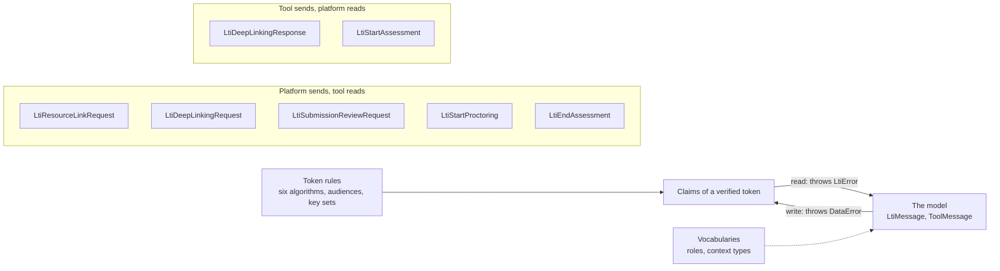

# Messages and vocabularies

`@interopkit/tool-integration` has one model of the messages of LTI 1.3: a platform sends five and a tool two, and each role
reads what the other writes from the same schemas. The root subpath exports the model, the vocabularies and the names of the
claims.



## Quick start

`handleLaunch` returns a message of the model. Compare roles by their URIs, which `canonicalizeRole` gives for the simple names
that LTI 1.3 deprecates:

```ts
import {
  APPROVED_ALGORITHMS,
  canonicalizeContextType,
  canonicalizeRole,
  MESSAGE_TYPES,
} from "@interopkit/tool-integration";

canonicalizeRole("Instructor"); // => "http://purl.imsglobal.org/vocab/lis/v2/membership#Instructor"
canonicalizeRole("http://purl.imsglobal.org/vocab/lis/v2/institution/person#Student"); // => "http://purl.imsglobal.org/vocab/lis/v2/institution/person#Student"
canonicalizeContextType("urn:lti:context-type:ims/lis/CourseOffering"); // => "http://purl.imsglobal.org/vocab/lis/v2/course#CourseOffering"
APPROVED_ALGORITHMS; // => ["RS256", "RS384", "RS512", "ES256", "ES384", "ES512"]
MESSAGE_TYPES.length; // => 7
```

## The messages

| Message type                 | Direction        | Specification       | Model                        | Adds to the base                                                                                                |
| ---------------------------- | ---------------- | ------------------- | ---------------------------- | --------------------------------------------------------------------------------------------------------------- |
| `LtiResourceLinkRequest`     | Platform to tool | Core 5              | `ResourceLinkMessage`        | `resourceLink`                                                                                                  |
| `LtiDeepLinkingRequest`      | Platform to tool | Deep Linking 4.4    | `DeepLinkingRequestMessage`  | `settings`: the ten settings of Deep Linking 4.4.1                                                              |
| `LtiSubmissionReviewRequest` | Platform to tool | Submission Review 2 | `SubmissionReviewMessage`    | `forUser`; `resourceLink` when the line item has one; the line item is required                                 |
| `LtiStartProctoring`         | Platform to tool | Proctoring 4.2      | `StartProctoringMessage`     | `resourceLink`, `attemptNumber`, `startAssessmentUrl`, `sessionData`, `assessmentControl`, `proctoringSettings` |
| `LtiEndAssessment`           | Platform to tool | Proctoring 4.4      | `EndAssessmentMessage`       | `attemptNumber`, `resourceLink`, `proctoringSettings`, `errorMessage`, `errorLog`                               |
| `LtiDeepLinkingResponse`     | Tool to platform | Deep Linking 4.5    | `DeepLinkingResponseMessage` | `data`, `items`, `message`, `log`, `errorMessage`, `errorLog`                                                   |
| `LtiStartAssessment`         | Tool to platform | Proctoring 4.3      | `StartAssessmentMessage`     | `sessionData`, `resourceLink`, `attemptNumber`, `endAssessmentReturn`, `verifiedUser`                           |

A message of another type is `message-type-unsupported`, unless the host names it in `otherMessageTypes`: it then comes back as
an `OtherMessage` with the base and nothing else, and `LtiMessage` takes the names as a type parameter, so a `switch` on
`messageType` narrows.

## The base of a message

Every message that a platform sends has the properties of `MessageBase`. The names are those of the specification in
camelCase.

| Property             | Claim                                                                                                     | Disposition and rule                                                                                  |
| -------------------- | --------------------------------------------------------------------------------------------------------- | ----------------------------------------------------------------------------------------------------- |
| `issuer`, `clientId` | `iss`, `aud`                                                                                              | From the registration that verified the token                                                         |
| `deploymentId`       | `deployment_id`                                                                                           | Required; one of the registration's, at most 255 characters                                           |
| `version`            | `version`                                                                                                 | Required; `1.3.0`                                                                                     |
| `targetLinkUri`      | `target_link_uri`                                                                                         | Required; an https address                                                                            |
| `user`               | `sub`, `name`, `given_name`, `family_name`, `middle_name`, `email`, `email_verified`, `picture`, `locale` | `subject` is absent in an anonymous launch                                                            |
| `actualUser`         | `actual_user`                                                                                             | The person acting when an administrator impersonates `user`: `id`, identity claims and `roles`        |
| `roles`              | `roles`                                                                                                   | Required, possibly empty, kept as sent                                                                |
| `roleScopeMentor`    | `role_scope_mentor`                                                                                       | Users a mentor may access                                                                             |
| `context`            | `context`                                                                                                 | `id` required; `label`, `title`, `type`                                                               |
| `organization`       | `organization`                                                                                            | `id` required; `type`, `name`, `description`, `url`                                                   |
| `platform`           | `tool_platform`                                                                                           | `guid` required; `contactEmail`, `description`, `name`, `url`, `productFamilyCode`, `version`         |
| `presentation`       | `launch_presentation`                                                                                     | `documentTarget` (`frame`, `iframe` or `window`), `height`, `width`, `returnUrl` (https), `locale`    |
| `lis`                | `lis`                                                                                                     | Strings by name; a `null` is absent                                                                   |
| `custom`             | `custom`                                                                                                  | Strings by name                                                                                       |
| `services`           | The claims of the services                                                                                | `grades` (AGS), `roster` (NRPS), `groups` (Context Groups), `preferences` (AfA PNP connector)         |
| `migration`          | `lti1p1`                                                                                                  | The LTI 1.1 identifiers; `verified` is true only when the signature matched the host's LTI 1.1 secret |
| `claims`             | Every claim                                                                                               | The verified token as JSON, vendor claims among them (Core 5.4.7)                                     |

The reader keeps the claims it does not understand in `claims` and does not refuse them, as a receiver does. It reads the
vocabularies as sent, since a platform may use a role or a context type of another vocabulary; Canvas sends the context type
`Account`.

## Vocabularies

| Export                    | Holds                                                                                         |
| ------------------------- | --------------------------------------------------------------------------------------------- |
| `SYSTEM_ROLES`            | The 7 system roles of LIS: `.../vocab/lis/v2/system/person#...`                               |
| `INSTITUTION_ROLES`       | The 14 institution roles: `.../vocab/lis/v2/institution/person#...`                           |
| `CONTEXT_ROLES`           | The 8 context roles: `.../vocab/lis/v2/membership#...`                                        |
| `CONTEXT_SUB_ROLES`       | The 51 sub-roles: `.../vocab/lis/v2/membership/{role}#{sub-role}`                             |
| `LTI_SYSTEM_ROLES`        | `TestUser`, the marker of a user the platform made to test with                               |
| `CONTEXT_TYPES`           | The 4 context types: `.../vocab/lis/v2/course#...`                                            |
| `canonicalizeRole`        | The URI of a context role named by its deprecated simple name; any other role as it is        |
| `canonicalizeContextType` | The URI of a context type named by its deprecated simple name or URN; any other type as it is |
| `SCOPES`                  | The scopes of the services of LTI                                                             |
| `MESSAGE_TYPES`           | The seven message types                                                                       |
| `APPROVED_ALGORITHMS`     | RS256, RS384, RS512, ES256, ES384, ES512 (Security Framework 7.2)                             |

The deprecated `.../vocab/lis/v2/person#...` URIs of system and institution roles are not mapped: the same name is in both
vocabularies, and the URI does not say which.

## Tokens

Both roles verify a token with the rules of [the tool role's launch checks](tool.md#what-handlelaunch-checks), from
`token-malformed` to `issued-in-future`, before they read a claim. A `KeySet` is the keys of one party: a `Signer` that signs
with an algorithm of `APPROVED_ALGORITHMS`, and the public keys the party publishes, each with a `kid` that no other key has;
[the tool role](tool.md#the-tools-key-set) shows how to rotate them.

## What a platform may write

The writer holds a platform to the rules that a receiver does not enforce, and throws `DataError` when a message breaks one:

| Rule                                                                                         | Source                 |
| -------------------------------------------------------------------------------------------- | ---------------------- |
| The version is `1.3.0`                                                                       | Core 5.3.2             |
| Identifiers are at most 255 characters                                                       | Core 5.3.3, 5.3.5, 5.4 |
| Addresses are https                                                                          | Core 3.5               |
| `roles` is empty or holds a role of the vocabularies, simple names of context roles included | Core 5.3.7             |
| `roleScopeMentor` is given only beside the Mentor role                                       | Core 5.4.3             |
| `context.type` is empty or holds a type of the vocabulary                                    | Core 5.4.1             |
| An extension claim is named by a fully qualified URL                                         | Core 5.4.7             |
| A submission review request names its line item                                              | Submission Review 2.5  |

## Errors

| Error                                 | Meaning and what to do                                                                                           |
| ------------------------------------- | ---------------------------------------------------------------------------------------------------------------- |
| `LtiError` `claim-missing`            | A required claim is absent: the platform sent a message that the specification does not allow; answer 400        |
| `LtiError` `claim-invalid`            | A claim has another shape than the specification gives; the message says which; answer 400                       |
| `LtiError` `message-type-unsupported` | The type is not one of the five; name it as another message type if the host handles it                          |
| `LtiError` `version-unsupported`      | The `version` is not `1.3.0`                                                                                     |
| `LtiError` `deployment-unknown`       | The registration does not list the deployment; add it to `deploymentIds` if the platform's administrator made it |
| `LtiError` `audience-untrusted`       | The token names an audience besides the tool; answer 401                                                         |
| `LtiError` `authorized-party-missing` | The token has several audiences and no `azp`; answer 401                                                         |
| `DataError`                           | A message that the host wrote breaks a rule of the sender                                                        |

## Not included

| Not included                                          | Why                                                                                               |
| ----------------------------------------------------- | ------------------------------------------------------------------------------------------------- |
| The role URNs of LTI 1.1 (`urn:lti:role:ims/lis/...`) | The open text of Core Appendix A prints URNs for context types only                               |
| The messages of the Asset Processor family and others | Their text is behind the 1EdTech sign-in; `otherMessageTypes` and `claims` let a host handle them |
| JSON schemas of the messages                          | The specification's schemas are older than its text; the model follows the text                   |

## Differences from the references

| Reference                                                                                                   | Difference                                                                                                  |
| ----------------------------------------------------------------------------------------------------------- | ----------------------------------------------------------------------------------------------------------- |
| `ltijs`, `@lti-tool/core`, `lti-core`, `@atomicjolt/lti-server`, `@ltikit/core`, `@longsightgroup/lti-tool` | They have the tool role only; here both roles share one model                                               |
| `@lti-tool/core`, `@ltikit/core`, `@longsightgroup/lti-tool`                                                | They have no allow-list of algorithms; here the six of Security Framework 7.2 are the only ones             |
| Canvas, which is not a reference but a platform that tools meet                                             | A `null` string is read as absent, a number in `custom` as its text, and the context type `Account` as sent |

The bodies of the services are in [Service bodies](services.md); [spec-gaps](spec-gaps.md) lists where the examples and the text
disagree.
