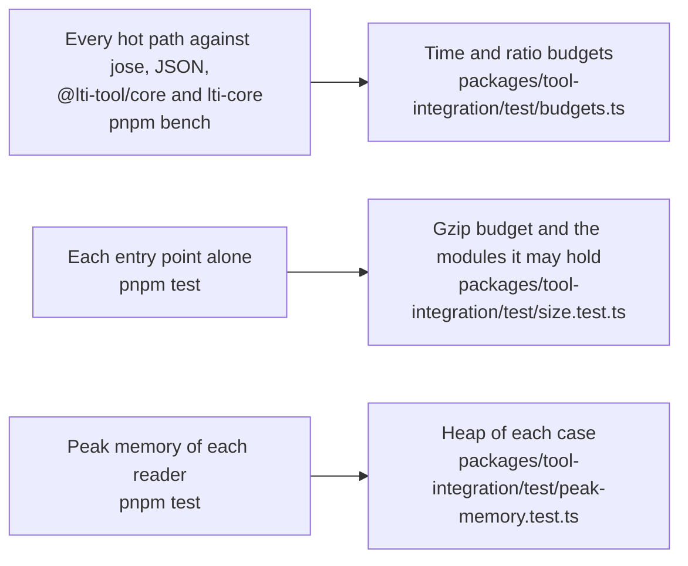

# Performance of tool-integration

What the benchmarks of `@interopkit/tool-integration` time against a reference and hold to a budget in CI (`pnpm bench`), the
size of each entry point, and the heap of each reader of untrusted input at its worst input (`pnpm test`). The docs publish
no measured time: it differs on every machine.

## Speed

`pnpm bench` times the build that ships against a reference in the same run, in three rounds that alternate which runs first
(`alternate` of `scripts/bench-rounds.ts`), so a machine that speeds up or slows down weighs on both. The budget is a ratio of the
fastest samples, which holds on any machine: twice the highest measured in 12 runs of the `bench` job on the runner of CI, on 2026-11-04 and 2026-11-05,
rounded up to one significant digit; no budget is in time.

| Benchmark                                                                 | Reference in the same run                                         |
| ------------------------------------------------------------------------- | ----------------------------------------------------------------- |
| `handleLaunch`, a message with every claim                                | `verifyLaunch` of `@lti-tool/core`, same message                  |
| The same                                                                  | `validate` of `lti-core`, same message                            |
| `handleLaunch` with an RS256 `id_token`                                   | `jwtVerify` of jose, same token                                   |
| `handleLaunch` with an ES256 `id_token`                                   | the same                                                          |
| The authorization request that signs an RS256 `id_token` with every claim | `SignJWT` of jose, same claims                                    |
| The same, ES256                                                           | the same                                                          |
| The same, substituting the 44 variables of the platform                   | the same request with the names written plainly                   |
| A key from a cached key set                                               | `createRemoteJWKSet` of jose holding the set                      |
| The same                                                                  | `createLocalJWKSet` of jose                                       |
| `members`, a page of 1,000 (295 KB)                                       | `JSON.parse` of its text                                          |
| `results`, a page of 1,000 (243 KB)                                       | the same                                                          |
| `lineItems`, a page of 1,000 (272 KB)                                     | the same                                                          |
| `publishScore`, `control`, `registerTool`                                 | `callService` of core, same request and answer                    |
| The token endpoint                                                        | `jwtVerify` of jose on its client assertion                       |
| The members of a context, a page of 1,000                                 | `JSON.stringify` of the page                                      |
| The results of a line item, a page of 1,000                               | the same                                                          |
| A score, a control request, a registration                                | `compactVerify` of jose on the token and `JSON.parse` of the body |
| `buildDeepLinkingResponse` with five items, `buildStartAssessmentPage`    | `SignJWT` of jose, same claims                                    |
| `readDeepLinkingResponse`, `readStartAssessment`                          | `jwtVerify` of jose on the JWT                                    |

Substituting 44 variables costs what a request without them costs, since the signature takes the time. These choices were timed
in turns against a build without them, which gave the same output on the tests, on 1,698 inputs (pages with odd users and
extensions, every token of the fixtures with each last character, the handler of results on odd line items and broken stores),
and on a property test of the token check against jose's own round trip:

| Choice                                                                                                                                                                     | Against the build without it                                                                                                                   |
| -------------------------------------------------------------------------------------------------------------------------------------------------------------------------- | ---------------------------------------------------------------------------------------------------------------------------------------------- |
| A writer drops its `undefined` members in a loop, not with `Object.fromEntries`, which takes half of a page of members                                                     | The members of a context take about twice as long; with the next choice, the results too; a score posted 12 percent less                       |
| The address of each result is the address of the results, parsed once, with its user as the query; the platform does not check again the addresses it reads from its store | The results of a line item                                                                                                                     |
| A part of a token is checked as canonical base64url by its alphabet, length and spare bits, without decoding and encoding it                                               | `handleLaunch` 18 percent less; `readDeepLinkingResponse` and `readStartAssessment` 17 and 18 percent less; the token endpoint 15 percent less |
| Extensions are found by the names of the members                                                                                                                           | `lineItems` 9 percent less                                                                                                                     |

The gaps to the references have named causes:

| Path                   | Work the reference does not do                                                                                                                                                                                                      |
| ---------------------- | ----------------------------------------------------------------------------------------------------------------------------------------------------------------------------------------------------------------------------------- |
| `handleLaunch`         | Reads the form and the cookie, checks the registration that the lookup returns, counts the JSON tokens of the payload before parsing, and reads every claim with its schema; `lti-core` reads fewer claims and verifies RS256 alone |
| The key set cache      | Checks the URL of each call, about half of the time of a lookup, which jose checks once when it makes a set; a launch spends 0.5 percent of its time there                                                                          |
| The handler of a page  | Reads each item of the store with the schema of its class, as a reader does, and checks the addresses it writes                                                                                                                     |
| A reader of line items | Checks two dates of each                                                                                                                                                                                                            |

## Size

`size.test.ts` bundles each entry point alone with `scripts/entry-size.ts`: esbuild, minified, with every dependency inside. It
fails above the budget after gzip, or when an entry point holds a module that its budget does not list. Gzip is measured on
Node.js 22; other versions differ by up to 1 percent. Every entry point holds part of the root of core, and jose for the key set
cache.

| Entry point                             |   Bytes |   Gzip | Budget | Holds, besides `protocol`, `errors`, `@interopkit/core`, jose and valibot         |
| --------------------------------------- | ------: | -----: | -----: | --------------------------------------------------------------------------------- |
| `@interopkit/tool-integration`          |  28,976 | 10,194 | 13,000 | Nothing more: the models, the vocabularies, `LtiError` and the key set cache      |
| `@interopkit/tool-integration/platform` | 150,087 | 45,411 | 57,000 | Nothing more                                                                      |
| `@interopkit/tool-integration/tool`     | 144,899 | 44,679 | 56,000 | oauth4webapi, through the OAuth 2.0 client of core that obtains the access tokens |

The platform holds nothing of the tool, nor the tool of the platform. A host that imports one function of an entry point gets less:
the package has no side effects, so a bundler drops the rest.

## Memory

Each reader of untrusted input runs on its worst input within its limits in a Node.js process of its own whose heap is
bounded (`test/peak-memory.test.ts`, with the readings in `test/peak-memory-readings.ts`): what the reading keeps alive at once
must fit, whenever V8 collects, so a regression fails and the load of a machine cannot. The heap of a case is twice the least in
which the reading ends on Node.js 22 and 24, rounded up to 16 MiB; `node scripts/peak-memory.ts tool-integration` (and `core`, for the key set) prints the least, in steps
of 8 MiB.

| Reader                                                                           | Worst input                                                                                 | Least heap | Heap of the test |
| -------------------------------------------------------------------------------- | ------------------------------------------------------------------------------------------- | ---------: | ---------------: |
| `handleLogin`                                                                    | Forms and queries of 64 KiB of repeated and of distinct parameters, and a form of 64 MiB    |      8 MiB |           16 MiB |
| `handleLaunch`                                                                   | A form of 64 KiB whose token is one array of small objects, and a form of 64 MiB            |      8 MiB |           16 MiB |
| The claims of a token before its signature                                       | A payload of 3.6 million tokens, refused by their number                                    |     16 MiB |           32 MiB |
| A key set, `createJwksCache`                                                     | 64 KiB of empty keys, refused above 100; 100 keys of 64 KiB; one nested 32,000 deep; 64 MiB |     16 MiB |           32 MiB |
| `lineItems` and the other pages                                                  | A page of a million tokens in an extension that the reader copies; 1 MiB of empty objects   |     48 MiB |           96 MiB |
| `members`                                                                        | The same                                                                                    |     32 MiB |           64 MiB |
| `control`                                                                        | A status of a million tokens; 24 MiB                                                        |     32 MiB |           64 MiB |
| `preferences`                                                                    | A record of a million tokens; 24 MiB                                                        |     48 MiB |           96 MiB |
| `discoverPlatform`, `registerTool`                                               | An answer of an array just under 64 KiB, and one of 1 MiB                                   |     16 MiB |           32 MiB |
| The authorization and token requests of the platform                             | Forms of 64 KiB of repeated and distinct parameters, and of 64 MiB                          |      8 MiB |           16 MiB |
| The grade services, the Assessment Control Service and the registration endpoint | Bodies of 64 KiB of nesting and of arrays                                                   |   8–16 MiB |        16–32 MiB |
| `readDeepLinkingResponse`                                                        | A form of under 1 MiB that lists 10,000 items, refused by their number                      |     16 MiB |           32 MiB |
| `readStartAssessment`                                                            | A form of 64 KiB whose token is one array of small objects                                  |     16 MiB |           32 MiB |

jose copies each key of a set and keeps a note of it, so 64 KiB of empty keys would take some 20 MiB: the cache refuses a set of
more than 100 keys before jose sees it. A client of a service takes an answer of up to `maxBytes`, 1 MiB, and `maxTokens`, a
million, by default; a host that reads small answers lowers both.
