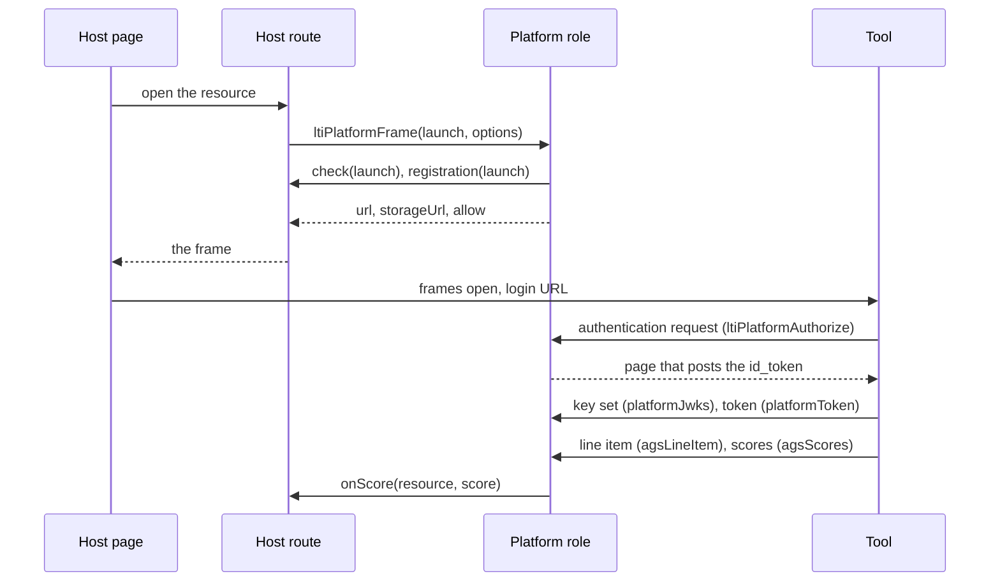

# LTI platform role

`@interopkit/tool-integration/platform` launches tools as an LTI 1.3 platform: it starts the login of a tool, answers its
authentication request with the `id_token`, publishes its key set, issues access tokens and serves the one line item of a
launch and the scores that a tool posts to it. It is generic: a launch is a `ToolLaunch` of plain data, and the host decides
what a `resource` means. It runs on a server or an edge runtime, with [jose](https://github.com/panva/jose) for the tokens.



| Function                                 | Does                                                                                                      |
| ---------------------------------------- | --------------------------------------------------------------------------------------------------------- |
| `ltiPlatformLogin(launch, options)`      | Prepares the launch of a tool and returns the URL of the tool's third-party initiated login               |
| `ltiPlatformFrame(launch, options)`      | Prepares the same launch and returns what the page needs: that URL, the storage page and the `allow` list |
| `ltiPlatformAuthorize(request, options)` | Answers the tool's authentication request with the page that posts the `id_token`                         |
| `platformJwks(options)`                  | Answers a request for the platform's key set                                                              |
| `platformToken(request, options)`        | Answers a token request with a bearer token for the tool                                                  |
| `agsLineItem(request, options)`          | Answers a request for the one line item of a launch                                                       |
| `agsScores(request, options)`            | Receives the scores that the tool posts to the line item                                                  |
| `platformStorage(options)`               | Serves the page that keeps the `state` and `nonce` of a tool's login (LTI Client Side OIDC 0.1)           |
| `platformEndpoints(config)`              | Returns the URLs of the endpoints, which the tool's administrator registers with the tool                 |
| `readAgsScore(body)`                     | Reads the body of a score into an `AgsScore`, or throws `DataError`                                       |

Handlers take an `HttpRequest` and return an `HttpResponse`. The host owns the routes and the sessions: `check` confirms that
a launch is the caller's, `once` records single-use identifiers, and `onScore` receives the scores.

## Quick start

```ts
import { ltiPlatformFrame, platformEndpoints } from "@interopkit/tool-integration/platform";

const keys = await crypto.subtle.generateKey(
  { name: "RSASSA-PKCS1-v1_5", modulusLength: 2048, publicExponent: new Uint8Array([1, 0, 1]), hash: "SHA-256" },
  true,
  ["sign", "verify"],
);
const hintKey = await crypto.subtle.generateKey({ name: "HMAC", hash: "SHA-256" }, false, ["sign", "verify"]);
const config = {
  issuer: "https://platform.example",
  origin: "https://lti.platform.example",
  frameOrigin: "https://app.platform.example",
  reservedOrigins: ["https://assets.platform.example"],
  keys,
  hintKey,
};
platformEndpoints(config).token; // => "https://lti.platform.example/token"

const tool = {
  clientId: "tool-1",
  deploymentId: "deployment-1",
  loginUrl: "https://tool.example/login",
  redirectUris: ["https://tool.example/launch"],
  jwksUrl: "https://tool.example/jwks",
};
const frame = await ltiPlatformFrame(
  {
    principal: "candidate-7",
    resource: "session-1/q1/1",
    target: "https://tool.example/launch",
    title: "Drawing tool",
    custom: {},
    scoreMaximum: 10,
  },
  { config, clock: { now: () => 1_700_000_000_000 }, registration: async () => tool, check: async () => undefined },
);
new URL(frame.url).searchParams.get("client_id"); // => "tool-1"
frame.storageUrl; // => "https://lti.platform.example/storage"
```

## Origins

The tool's frame is same-origin with any platform page on the origin of the page that frames it, so the platform keeps its
handlers on an origin of their own. `origin`, `frameOrigin` and every entry of `reservedOrigins` must all differ, and each is
an `https` origin without a path. A handler refuses a request for another origin than `origin` (`wrong-origin`), and a launch
refuses a tool whose `target`, login URL or redirect URIs are on any of these origins (`origin-refused`).

## Configuration

| Property          | Meaning                                                                                                                    |
| ----------------- | -------------------------------------------------------------------------------------------------------------------------- |
| `issuer`          | The `iss` of the platform: an `https` URL without query or fragment                                                        |
| `origin`          | The origin that serves the handlers                                                                                        |
| `frameOrigin`     | The origin of the page that frames the tool and the storage page                                                           |
| `reservedOrigins` | Other origins of the host from which a tool must never launch, such as the origin of its assets. An empty list is a choice |
| `keys`            | The RSA key pair (RS256) that signs the `id_token`s; the public key is extractable                                         |
| `hintKey`         | The HMAC key (SHA-256, usages `sign` and `verify`) that signs hints, line item identifiers and access tokens               |

| Endpoint              | Path under `origin`              | Handler                |
| --------------------- | -------------------------------- | ---------------------- |
| Authorization         | `/authorize`                     | `ltiPlatformAuthorize` |
| Key set               | `/jwks`                          | `platformJwks`         |
| Token                 | `/token`                         | `platformToken`        |
| Storage page          | `/storage`                       | `platformStorage`      |
| Line item             | `/ags/{line item}` (GET)         | `agsLineItem`          |
| Scores of a line item | `/ags/{line item}/scores` (POST) | `agsScores`            |

## The launch

A `ToolLaunch` holds the `principal` (the `sub`, at most 255 characters), the `resource` (what the launch is for, at most 1,024
characters, signed and not encrypted, so it holds no secret and no personal data; the same launch gives the same text), the
`target` (the `target_link_uri`, an `https` URL on none of the platform's origins), the `title`, the `custom` properties and
the `scoreMaximum` of the line item (above 0).

`ltiPlatformLogin` checks the launch, calls `options.check(launch)` (which must throw when the launch is not the caller's:
nothing is signed otherwise), looks up the tool with `options.registration(launch)`, refuses the platform's own origins, and
builds the tool's login URL with `iss`, `login_hint`, `lti_message_hint`, `target_link_uri`, `client_id`,
`lti_deployment_id` and `lti_storage_target`.

| Hint               | Holds                                                                                                                                                            |
| ------------------ | ---------------------------------------------------------------------------------------------------------------------------------------------------------------- |
| `lti_message_hint` | The resource, the principal, the client, the `target_link_uri`, the custom properties, the title, the highest score, a random `jti` and an expiry of 300 seconds |
| `login_hint`       | The principal                                                                                                                                                    |

Both are compact JWS with `alg: HS256`, signed with `hintKey`; the `typ` header names the use (`hint`, `login`, `line-item`,
`access`), and a token of one use is refused for another. They are signed and not encrypted. WebCrypto verifies the MAC,
which compares in constant time.

### What `ltiPlatformAuthorize` checks

In this order. An `LtiError` with status 403 means that the request is not bound to a launch that the platform made.

| Check                                                                              | Reason                                                                              |
| ---------------------------------------------------------------------------------- | ----------------------------------------------------------------------------------- |
| The request is for the platform's origin                                           | `wrong-origin` (403)                                                                |
| `scope=openid`, `response_type=id_token`, `response_mode=form_post`, `prompt=none` | `scope-invalid`, `response-type-invalid`, `response-mode-invalid`, `prompt-invalid` |
| `client_id` is a tool of the platform, and `redirect_uri` one of its redirect URIs | `client-unknown`, `redirect-uri-mismatch`                                           |
| `nonce` and `state` are present                                                    | `nonce-missing`, `state-missing`                                                    |
| `lti_message_hint` is present and sealed by this platform                          | `hint-missing`, `hint-invalid` (403)                                                |
| The hint has not expired                                                           | `hint-expired` (403)                                                                |
| The hint is for this tool                                                          | `client-mismatch` (403)                                                             |
| `login_hint` names the principal of the hint                                       | `principal-mismatch` (403)                                                          |
| `options.checkLaunch`, when given, accepts the principal and the resource          | The error it throws, such as `caller-mismatch` (403)                                |
| `options.once` has not seen the hint                                               | `hint-used` (403)                                                                   |

`checkLaunch` runs before `once`, so a refused check does not spend the hint. The hint is spent before the `id_token` is
signed, so a later failure costs a new login and never a second use.

### The `id_token`

Signed with RS256 and the `kid` of the key (its thumbprint, RFC 7638). `iss` is the issuer, `aud` the client, `sub` the
principal, and `exp` is 300 seconds after `iat`. The claims are the message type, the version, the deployment, the
`target_link_uri`, the resource link (`id`, the hash of the `resource`, and the `title`), the role of a learner, the custom
properties, and the AGS endpoint with the scopes `lineitem.readonly` and `score` and the one `lineitem` URL.

### The storage page

`platformStorage` serves the page that keeps `state` and `nonce` for the tool: `lti.put_data` and `lti.get_data` of LTI Client
Side OIDC 0.1, kept by the origin of the message, answered only to the frame named `toolFrame`, with the minimum limits of
4,096 bytes and 500 keys for an origin and `storage_exhaustion` beyond them. Its policy allows its one script by hash, and
only `frameOrigin` may frame it.

## The token endpoint

`platformToken` accepts the client-credentials grant with a JWT assertion (Security Framework 4.1.1). The assertion has `iss`
and `sub` equal to the client, `aud` equal to the token endpoint, and a `jti`. It is verified against the tool's key set (RS256
only) or its keys, must expire within 3,600 seconds, and its `jti` is remembered through `once` until its expiry. The scopes
asked must be among `lineitem.readonly` and `score`. The token is a sealed `access` token that lasts one hour. A refusal is an
OAuth error (`invalid_request`, `unsupported_grant_type`, `invalid_scope`, `invalid_client`) with status 400.

## The line item and the scores

The line item URL is `{origin}/ags/{id}`, where the identifier is a sealed `line-item` token that holds the resource, the client,
the user, the title and the maximum. `agsLineItem` answers a GET with `id`, `label`, `scoreMaximum` and `resourceLinkId`.
`agsScores` receives `POST {line item}/scores` with `application/vnd.ims.lis.v1.score+json`.

| Status | When                                                                                                                                             |
| ------ | ------------------------------------------------------------------------------------------------------------------------------------------------ |
| 204    | The score passed every check and `onScore` accepted it                                                                                           |
| 400    | The body is not JSON or not a score (`bad_request`)                                                                                              |
| 401    | The bearer token is missing, invalid or expired (`invalid_token`)                                                                                |
| 403    | The token lacks the scope (`insufficient_scope`), the line item is another tool's, or the score is for another user than the `sub` of the launch |
| 404    | The path names no line item of this platform                                                                                                     |
| 405    | A method other than GET (line item) or POST (scores); `Allow` names the method                                                                   |
| 415    | The media type is not the score type                                                                                                             |

`readAgsScore` reads `userId`, `timestamp` (ISO 8601 with a zone), `activityProgress`, `gradingProgress`, and `scoreGiven` (from
0, with a `scoreMaximum` above 0). `timestampMs` is the instant in milliseconds. **Ordering is the receiver's** (AGS 3.4.9): a
host that keeps scores keeps a score unless a later one is kept, and treats an equal time as a retry.

## Options

| Option                              | Default                               | Meaning                                                        |
| ----------------------------------- | ------------------------------------- | -------------------------------------------------------------- |
| `config`, `clock`                   | required                              | The platform and the time                                      |
| `registration(launch, options)`     | required for the login                | Looks up the tool of a launch                                  |
| `check(launch, options)`            | required for the login                | Confirms that the launch is the caller's, and throws otherwise |
| `storageTarget`                     | `"lti-storage"`                       | The frame that shows the storage page                          |
| `client(clientId, options)`         | required for authorization and tokens | Looks up a tool by its client                                  |
| `once(id, expiresAt, options)`      | required for authorization and tokens | Records an identifier until a time; atomic across processes    |
| `checkLaunch(launch, options)`      | none                                  | An extra check of the principal and the resource of a hint     |
| `jwks`                              | required for tokens                   | The cache of the tools' key sets                               |
| `onScore(resource, score, options)` | required for scores                   | Receives a score                                               |
| `toolFrame`                         | `"lti-tool"`                          | The frame of the tool that the storage page answers            |
| `signal`                            | none                                  | Ends this caller's wait                                        |

| Limit                                           | Value         |
| ----------------------------------------------- | ------------- |
| Lifetime of a hint and of an `id_token`         | 300 seconds   |
| Longest accepted lifetime of a client assertion | 3,600 seconds |
| Lifetime of an access token                     | 3,600 seconds |
| Most characters of `ToolLaunch.resource`        | 1,024         |
| Leeway for clock skew                           | 60 seconds    |

## Failure paths

| Port                    | Fails                                                                               | Hangs                                            | Called again                                                                        | May call back                         |
| ----------------------- | ----------------------------------------------------------------------------------- | ------------------------------------------------ | ----------------------------------------------------------------------------------- | ------------------------------------- |
| `registration`, `check` | Rejects: nothing is signed; the page shows that the tool is unavailable             | `signal` reaches it; it bounds itself            | Each login                                                                          | Read-only calls of the host's session |
| `client`                | Rejects the caller; `undefined` is `client-unknown`                                 | `signal` reaches it                              | Pure                                                                                | Nothing                               |
| `once`                  | Rejects: `ltiPlatformAuthorize` and `platformToken` reject, so they fail closed     | `signal` reaches it                              | `false` is `hint-used` or `assertion-replayed`; the hint is consumed before signing | Nothing                               |
| `checkLaunch`           | Refuses before `once`, so a refused check does not burn the hint                    | `signal` reaches it                              | Pure                                                                                | Read-only calls of the host's session |
| `onScore`               | `agsScores` rejects after every check, the host answers 5xx, and the tool may retry | The tool's POST stays open until its own timeout | Each retry passes every check again                                                 | The host's score intake               |

## Signals

| Point                                                                   | Effect of an aborted signal                                                                |
| ----------------------------------------------------------------------- | ------------------------------------------------------------------------------------------ |
| `ltiPlatformLogin` and `ltiPlatformFrame`, in `check` or `registration` | Rejects with `signal.reason`; nothing is signed                                            |
| `ltiPlatformAuthorize` and `platformToken`, before `once`               | Rejects with `signal.reason`; the hint or the assertion is unspent                         |
| `ltiPlatformAuthorize` and `platformToken`, after `once`                | Rejects with `signal.reason`; the hint or the assertion is spent, so the tool starts again |
| `agsScores`, in `onScore`                                               | The host's: `onScore` receives the signal                                                  |

## Errors

| Error                      | When                                                                       |
| -------------------------- | -------------------------------------------------------------------------- |
| `LtiError` with status 403 | The request is not bound to a launch of this platform                      |
| `LtiError` with status 400 | The tool broke the protocol                                                |
| `DataError`                | An argument, a request or an option has the wrong shape                    |
| The error of a port        | The host's `registration`, `check`, `client`, `once` or `onScore` rejected |

## Not included

| What                                                                                             | Reason                                                                      |
| ------------------------------------------------------------------------------------------------ | --------------------------------------------------------------------------- |
| Line item containers, creation, update, deletion, filters                                        | Only the one line item of a launch is served; see [supported](supported.md) |
| Names and Role Provisioning, Dynamic Registration, Proctoring, Submission Review, Context Groups | See [supported](supported.md)                                               |
| Anonymous launches, optional and identity claims, variable substitution                          | See [supported](supported.md)                                               |
| A store for scores, ordering by timestamp                                                        | The host's, behind `onScore`                                                |
| Sessions, routes, a database, the page that frames the tool                                      | The host's                                                                  |
