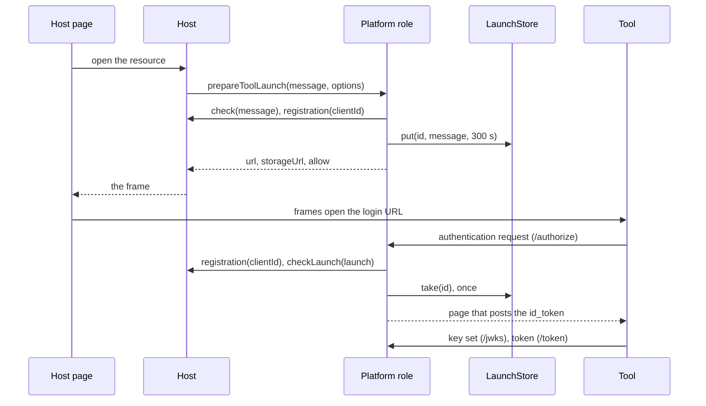

# LTI platform role

`@interopkit/tool-integration/platform` launches tools as an LTI 1.3 platform, on a server or an edge runtime. The host
describes what it launches as a `MessageInput` of plain data; `prepareToolLaunch` keeps it in the host's `LaunchStore` and
returns the URL of the tool's login, and one handler, `handlePlatformRequest`, answers every request to the platform's origin:
the authentication request with the `id_token`, the key set, the token requests, the storage page, and the services whose stores
the host gives ([grade services](grades.md), [roster services](roster.md), [proctoring](proctoring.md),
[registration](registration.md)). It signs with a [`Signer`](../core/signer.md) and verifies the tools' tokens with
[jose](https://github.com/panva/jose).



| Function                                    | Does                                                                                                                                                                              |
| ------------------------------------------- | --------------------------------------------------------------------------------------------------------------------------------------------------------------------------------- |
| `prepareToolLaunch(message, options)`       | Keeps a message for a tool and returns what the page needs: the URL of the tool's third-party initiated login, the storage page, the names of the two frames and the `allow` list |
| `handlePlatformRequest(request, options)`   | Answers every request to the platform's origin                                                                                                                                    |
| `buildPlatformEndpoints(config)`            | Returns the URLs of the endpoints, which the tool's administrator registers with the tool                                                                                         |
| `buildCapabilitiesScript()`                 | Returns the inline script, with its CSP hash, that answers `lti.capabilities` on the host's frame page                                                                            |
| `readDeepLinkingResponse(request, options)` | Reads and verifies the form that a tool posts to the return URL of a Deep Linking request ([Deep Linking](deep-linking.md))                                                       |
| `readStartAssessment(request, options)`     | Reads and verifies the form that a proctoring tool posts to the start assessment URL ([proctoring](proctoring.md))                                                                |
| `buildRegistrationInitiation(url, options)` | Returns the tool's initiation URL with the configuration and a single-use registration token ([registration](registration.md))                                                    |
| `buildToolRegistration(registered, grant)`  | Returns the `ToolRegistration` of a tool that registered itself, with what the administrator grants ([registration](registration.md))                                             |

Handlers take an `HttpRequest` and return an `HttpResponse` of [`@interopkit/core/http`](../core/http.md). The host owns the
routes, the sessions and the stores (see [options](#options)). The [example](../../examples/tool-integration/README.md) launches a
tool from a platform built on these functions.

## Quick start

```ts
import { createCryptoKeySigner } from "@interopkit/core";
import {
  buildPlatformEndpoints,
  handlePlatformRequest,
  prepareToolLaunch,
} from "@interopkit/tool-integration/platform";
import { createJwksCache } from "@interopkit/tool-integration";

const pair = await crypto.subtle.generateKey({ name: "ECDSA", namedCurve: "P-256" }, true, ["sign", "verify"]);
const publicKey = { ...(await crypto.subtle.exportKey("jwk", pair.publicKey)), kid: "platform-1", alg: "ES256" };
const config = {
  issuer: "https://platform.example",
  origin: "https://lti.platform.example",
  frameOrigin: "https://app.platform.example",
  reservedOrigins: ["https://assets.platform.example"],
  keys: {
    signer: createCryptoKeySigner(pair.privateKey, { algorithm: "ES256", keyId: "platform-1" }),
    publicKeys: [publicKey],
  },
  hintKey: await crypto.subtle.generateKey({ name: "HMAC", hash: "SHA-256" }, false, ["sign", "verify"]),
};
buildPlatformEndpoints(config).token; // => "https://lti.platform.example/token"

const tool = {
  clientId: "tool-1",
  deploymentIds: ["deployment-1"],
  loginUrl: "https://tool.example/login",
  redirectUris: ["https://tool.example/launch"],
  jwksUrl: "https://tool.example/jwks",
  scopes: [],
};
const kept = new Map();
const launches = {
  put: async (id, message) => void kept.set(id, message),
  take: async (id) => {
    const message = kept.get(id);
    kept.delete(id);
    return message;
  },
};
const clock = { now: () => 1_700_000_000_000 };
const frame = await prepareToolLaunch(
  {
    messageType: "LtiResourceLinkRequest",
    clientId: "tool-1",
    deploymentId: "deployment-1",
    targetLinkUri: "https://tool.example/launch",
    user: { subject: "candidate-7" },
    roles: ["http://purl.imsglobal.org/vocab/lis/v2/membership#Learner"],
    resourceLink: { id: "quiz-1", title: "Drawing tool" },
  },
  { config, clock, registration: async () => tool, check: async () => undefined, launches },
);
new URL(frame.url).searchParams.get("client_id"); // => "tool-1"
frame.storageUrl; // => "https://lti.platform.example/storage"
frame.storageTarget; // => "lti-storage"
frame.toolFrame; // => "lti-tool"
kept.size; // => 1

const options = {
  config,
  clock,
  registration: async () => tool,
  launches,
  once: async () => true,
  jwks: createJwksCache({ fetch, clock }),
};
const jwks = await handlePlatformRequest(
  { method: "GET", url: "https://lti.platform.example/jwks", headers: {}, body: new Uint8Array() },
  options,
);
JSON.parse(String(jwks.body)).keys[0].kid; // => "platform-1"
```

## Origins

The tool's frame is same-origin with every platform page on the origin of the page that frames it, so the handler has an origin
of its own. `origin`, `frameOrigin` and each entry of `reservedOrigins` are distinct `https` origins without a path.
`handlePlatformRequest` answers a request for another origin than `origin` with 403, and the login refuses a tool whose
`targetLinkUri`, login URL or redirect URIs are on any of them (`origin-refused`).

## Configuration

| Property           | Meaning                                                                                                                                                                                |
| ------------------ | -------------------------------------------------------------------------------------------------------------------------------------------------------------------------------------- |
| `issuer`           | Required. The `iss` of the platform: an `https` URL without query or fragment; it may have a path, such as one for each tenant                                                         |
| `origin`           | The origin that `handlePlatformRequest` serves                                                                                                                                         |
| `frameOrigin`      | The origin of the page that frames the tool and the storage page                                                                                                                       |
| `reservedOrigins`  | Other origins of the host from which a tool must never launch, such as the origin of its assets. An empty list is a choice                                                             |
| `keys`             | A `KeySet`: the `Signer` of the `id_token`s, with one of the six algorithms of Security Framework 7.2, and the public keys published at `/jwks`, the current one and any of a rotation |
| `hintKey`          | The HMAC key (SHA-256, at least 256 bits, usages `sign` and `verify`) that seals the hints, the access tokens, the session data and the Deep Linking data                              |
| `previousHintKeys` | Earlier hint keys, which still open what they sealed, so that a rotation of `hintKey` breaks nothing in flight. Default: none                                                          |
| `instance`         | The `tool_platform` claim of every message (Core 5.4.3), with a `guid` of 1 to 255 characters. Default: none                                                                           |

| Endpoint                   | Path under `origin`                                                                                                                  | Methods                                                                              |
| -------------------------- | ------------------------------------------------------------------------------------------------------------------------------------ | ------------------------------------------------------------------------------------ |
| Authorization              | `/authorize`                                                                                                                         | GET, POST                                                                            |
| Key set                    | `/jwks`                                                                                                                              | GET, HEAD                                                                            |
| Token                      | `/token`                                                                                                                             | POST                                                                                 |
| Storage page               | `/storage`                                                                                                                           | GET                                                                                  |
| Grade services             | `/contexts/{context}/line-items`, and below it                                                                                       | With `services.gradebook`: see [grade services](grades.md)                           |
| Roster services            | `/contexts/{context}/memberships`, `/groups`, `/group-sets`, and `/ims/afapnp/v1p0/users/{user}/activities/{activity}/afapnprecords` | With `services.roster`, `groups` and `preferences`: see [roster services](roster.md) |
| Assessment Control Service | `/assessment-control`                                                                                                                | POST, with `services.control`: see [proctoring](proctoring.md)                       |
| Dynamic Registration       | the issuer's path with `/.well-known/openid-configuration`, `/registration`, `/registration/{client}`                                | With `services.registrations`: see [registration](registration.md)                   |

A path that names nothing is 404, and a method that a route does not serve is 405 with `Allow`.

## Tools

A `ToolRegistration` is the host's record of one tool. The host's `registration` returns it by client identifier, on
every login, authentication request and token request, so that a removed or changed tool is followed at once.

| Property        | Meaning                                                                                     |
| --------------- | ------------------------------------------------------------------------------------------- |
| `clientId`      | The OAuth 2.0 client identifier of the tool                                                 |
| `deploymentIds` | The deployments of the tool, at least one, each of 1 to 255 characters                      |
| `loginUrl`      | The tool's login initiation URL                                                             |
| `redirectUris`  | The tool's launch URLs, at least one; the authentication request names one of them          |
| `jwksUrl`       | The tool's key set, fetched through the `jwks` cache. Exactly one of this and `keys`        |
| `keys`          | The tool's public keys by `kid`: RSA of at least 2,048 bits, or EC on P-256, P-384 or P-521 |
| `scopes`        | The service scopes granted to the tool                                                      |
| `algorithms`    | The algorithms accepted on the tool's tokens. Default: the six of Security Framework 7.2    |
| `custom`        | Custom properties of the tool, which every message carries under its own. Default: none     |
| `allow`         | The `allow` attribute of the tool's frame. Default: none                                    |

## The messages

A `MessageInput` is plain data that a store can keep and that holds no secret.

| Property                                                                                                 | Meaning                                                                                                                                                         |
| -------------------------------------------------------------------------------------------------------- | --------------------------------------------------------------------------------------------------------------------------------------------------------------- |
| `clientId`, `deploymentId`, `targetLinkUri`, `roles`                                                     | Required; the deployment is one of the tool's                                                                                                                   |
| `user`                                                                                                   | Required; without a `subject` the launch is anonymous                                                                                                           |
| `actualUser`, `roleScopeMentor`, `context`, `organization`, `presentation`, `lis`, `custom`, `migration` | Optional claims                                                                                                                                                 |
| `extensions`                                                                                             | Optional vendor claims, each named by a URL                                                                                                                     |
| `services`                                                                                               | Optional: the services the message offers the tool, which need its `context` and are offered only when the host gives their store ([grade services](grades.md)) |

| `messageType`                | Adds                                                                                                                                                                                                                                                                                                          |
| ---------------------------- | ------------------------------------------------------------------------------------------------------------------------------------------------------------------------------------------------------------------------------------------------------------------------------------------------------------- |
| `LtiResourceLinkRequest`     | `resourceLink`                                                                                                                                                                                                                                                                                                |
| `LtiSubmissionReviewRequest` | `forUser`, and `resourceLink` when the line item has one; `services.grades.lineItemId` names the line item of the review, which needs `services.gradebook`                                                                                                                                                    |
| `LtiDeepLinkingRequest`      | `settings`: the settings of DL 4.4.1, and the host's `data`, an object that the platform seals into the `data` claim with the client, deployment, user and settings for 86,400 seconds                                                                                                                        |
| `LtiStartProctoring`         | `resourceLink`, `attemptNumber`, `startAssessmentUrl`, `proctoringSettings`; the platform seals the client, deployment, resource link, attempt and user into `session_data` for 3,600 seconds. `services.control`, which no other message may carry, offers the Assessment Control Service with its `actions` |
| `LtiEndAssessment`           | `attemptNumber`, and `resourceLink`, `proctoringSettings`, `errorMessage`, `errorLog` when there are any                                                                                                                                                                                                      |

Before it keeps a message, the login checks its shape and the rules of the sender that a tool does not enforce: identifiers of
at most 255 characters, `https` URLs, roles and context types of the vocabularies of Core Appendix A, and `roleScopeMentor` only
with the Mentor role. A message that breaks one is a `DataError`, before `check` is called.

### Custom properties and variables

At authorization the custom properties of the tool and of the message (the message's win) are substituted (Core 5.4.6 and
Appendix B). A value that is `$` and the name of a variable becomes its value; any other value passes unchanged.

| Variables                                                                                          | Answered by                                                                                          |
| -------------------------------------------------------------------------------------------------- | ---------------------------------------------------------------------------------------------------- |
| `User.id`, `User.image`, `User.scope.mentor`, and `ActualUser.id`, `ActualUser.image`              | The message's `user`, `actualUser` and `roleScopeMentor`                                             |
| `Person.name.*` (full, family, given, middle), `Person.email.primary`, and `ActualPerson.*`        | The message's `user` and `actualUser`                                                                |
| `Person.sourcedId`, `CourseOffering.sourcedId`, `CourseSection.sourcedId`                          | The message's `lis`                                                                                  |
| `Context.id`, `Context.type`, `Context.label`, `Context.title`                                     | The message's `context`                                                                              |
| `ResourceLink.id`, `ResourceLink.title`, `ResourceLink.description`                                | The message's `resourceLink`                                                                         |
| `Message.returnUrl`, `Message.documentTarget`, `Message.height`, `Message.width`, `Message.locale` | The message's `presentation`                                                                         |
| `Organization.*`                                                                                   | The message's `organization`                                                                         |
| `ToolPlatform.*`, `ToolPlatformInstance.*`                                                         | `config.instance`                                                                                    |
| `LineItems.url`, `LineItem.url`                                                                    | The claim of the grade services                                                                      |
| Every other name that `substitution.names` lists                                                   | `substitution.resolve(name, message, tool)`                                                          |
| Every other name                                                                                   | Nothing: the value passes unchanged, as Appendix B asks for a variable the platform does not support |

A variable the message answers but has no value for becomes `""`, which Appendix B gives for a supported variable without a value.
`substitution.resolve` returns `undefined` to leave a variable unsubstituted, such as one the tool may not see.

### The migration claim

`migration` is the `lti1p1` claim of the Migration Guide without its signature. With `migrationSecret`, the platform asks for the
LTI 1.1 secret of the `oauthConsumerKey` at authorization, signs `oauth_consumer_key_sign` over the consumer key, the deployment,
the issuer, the client, and the `exp` and `nonce` of the `id_token`, and drops the secret. Without it, or when it returns
`undefined`, the claim goes unsigned. No secret is kept in a message or a store.

## The login

`prepareToolLaunch` checks the message, calls `check(message)` (which throws when the message is not the caller's), looks up the
tool with `registration(clientId)`, refuses a deployment that is not the tool's (`deployment-unknown`) and the platform's own
origins (`origin-refused`), and only then keeps the message with `launches.put(id, message, expiresAt)` for 300 seconds under a
random identifier of 160 bits. The URL of the tool's login carries `iss`, `login_hint`, `lti_message_hint`, `target_link_uri`,
`client_id`, `lti_deployment_id` and `lti_storage_target`.

| Hint               | Holds                                                                                                         |
| ------------------ | ------------------------------------------------------------------------------------------------------------- |
| `lti_message_hint` | The identifier of the kept message, the client, the deployment, the user's `sub` and an expiry of 300 seconds |
| `login_hint`       | The identifier of the kept message                                                                            |

Both are compact JWS with `alg: HS256`, signed with `hintKey` and not encrypted. The `typ` header names the use (`hint`, `login`,
`access`, `session-data`, `deep-linking-data`), and a token of one use is refused for another (RFC 8725 section 3.11). Web
Crypto verifies the MAC in constant time.

## The authentication request

`/authorize` takes a GET or a form POST. Until the tool and its redirect URI are known, a failure is answered to the browser:

| Failure                                                                                                      | Status |
| ------------------------------------------------------------------------------------------------------------ | ------ |
| Another method                                                                                               | 405    |
| A body over `maxBodyBytes`                                                                                   | 413    |
| A parameter given twice, a missing or unknown `client_id`, or a `redirect_uri` that is not one of the tool's | 400    |
| `registration` rejects                                                                                       | 500    |

After that, a refusal is the authentication error response of Security Framework 5.1.1.5: the page posts `error`,
`error_description` and `state` to the redirect URI, under the status of the refusal.

| Check, in order                                                                            | `error`                     | Status |
| ------------------------------------------------------------------------------------------ | --------------------------- | ------ |
| `scope=openid`                                                                             | `invalid_scope`             | 400    |
| `response_type=id_token`                                                                   | `unsupported_response_type` | 400    |
| `response_mode=form_post`, `prompt=none`, `nonce`, `state`, `lti_message_hint`             | `invalid_request`           | 400    |
| The hint is sealed by this platform with a hint key it holds, not expired, for this client | `login_required`            | 403    |
| `login_hint` names the message of the hint                                                 | `login_required`            | 403    |
| `checkLaunch`, when given, returns `true`                                                  | `access_denied`             | 403    |
| `launches.take(id)` gives the message: once, so a second request is refused                | `login_required`            | 403    |
| The deployment of the message is still one of the tool's                                   | `unauthorized_client`       | 400    |

`checkLaunch` runs before `take`, so a refused check leaves the message. Once the message is taken the launch is spent, and a
later failure costs a new login, never a second use.

### The `id_token`

Signed by `config.keys.signer`, with its algorithm and `kid`. `iss` is the issuer, `aud` the client, `sub` the user's subject
(absent in an anonymous launch), `exp` 300 seconds after `iat`, and `nonce` the request's. The claims are those of the message as
the [message model](model.md) writes them: what the tool role reads back into the same model, with the substituted custom
properties, the signed migration claim, the sealed data and the `tool_platform` of `config.instance`.

## The key set

`/jwks` answers GET with `{ "keys": publicKeys }` and `Cache-Control: public, max-age=3600`, and HEAD with the same headers.

| Rotate          | Steps                                                                                                                                                                                                     |
| --------------- | --------------------------------------------------------------------------------------------------------------------------------------------------------------------------------------------------------- |
| The signing key | Add the new public key; wait one `max-age`; switch the signer; keep the old public key until every `id_token` it signed has expired (300 seconds), plus one `max-age`; remove it (Security Framework 6.4) |
| The hint key    | Make the new key `hintKey` and keep the old one in `previousHintKeys` until the longest of what it sealed has expired (the Deep Linking data, 86,400 seconds by default); remove it                       |

## The token endpoint

`/token` accepts the client-credentials grant with a JWT assertion (Security Framework 4.1.1). A refusal is an OAuth error with
status 400 (RFC 6749 section 5.2), and 500 when `registration` or `once` rejects or the tool's key set cannot be fetched.

| Check, in order                                                                                                                                     | Refusal                  |
| --------------------------------------------------------------------------------------------------------------------------------------------------- | ------------------------ |
| The method is POST                                                                                                                                  | 405                      |
| The size of the body, the form, `client_assertion_type`, a `client_assertion` and a `scope`                                                         | `invalid_request`        |
| `grant_type` is `client_credentials`                                                                                                                | `unsupported_grant_type` |
| The tool named by `iss`, which a `client_id` of the request, when it has one, names too (RFC 7521 section 4.2)                                      | `invalid_client`         |
| An algorithm of the tool's `algorithms`; `none`, the HMAC algorithms and every other are refused before any key is fetched                          | `invalid_client`         |
| The signature by a key of the tool's key set, or of its `keys`; a key set that is not a JWK Set                                                     | `invalid_client`         |
| `sub` is the client; `aud` is the token URL, with no other member than the platform's issuer                                                        | `invalid_client`         |
| The times, with 60 seconds of leeway, and an expiry within 3,600 seconds                                                                            | `invalid_client`         |
| No `message_type` claim, so a message of the tool never passes as an assertion; the deployment claim of Core 6.2.1, when present, one of the tool's | `invalid_client`         |
| A non-empty `jti` that `once` has not seen, remembered until the expiry, rounded up to a whole second, plus the leeway                              | `invalid_client`         |
| Some scope remains of those the request asks for, the registration grants and a service offers (when the host gives its store)                      | `invalid_scope`          |

The token, sealed with the hint key, holds the client, the deployment of the assertion and the scopes, and lasts 3,600 seconds.

## The messages of tools

A tool posts two messages to the platform, to routes of the host. Both readers take the options `config`, `clock`,
`registration`, `jwks`, `once`, `maxFormBytes` and `maxTokens` (and `maxContentItems` for Deep Linking), and verify the tool's
token as `/token` does (the registration's algorithms, its key set, the times, an expiry within 3,600 seconds), with the
platform's issuer as the audience and as the authorized party when the token names one. They require an `iat` and a `nonce`,
which is the single-use identifier, recorded in `once` until the token stops verifying. The host acts only when its own session
is of the `subject` that the reader returns.

| Reader                                      | Message, posted to                                                      | The sealed data must be                                                                                                        | Guide                           |
| ------------------------------------------- | ----------------------------------------------------------------------- | ------------------------------------------------------------------------------------------------------------------------------ | ------------------------------- |
| `readDeepLinkingResponse(request, options)` | The Deep Linking response, to the `deep_link_return_url` of the request | The `data` claim the platform sealed into the request, for that tool and deployment, not expired                               | [Deep Linking](deep-linking.md) |
| `readStartAssessment(request, options)`     | The Start Assessment message, to the `start_assessment_url`             | The `session_data` sealed into the Start Proctoring message, for that tool, deployment, resource link and attempt, not expired | [Proctoring](proctoring.md)     |

## The frame page and the storage page

| Page                         | Rule                                                                                                                                                                                                                                                                                                                                                                  |
| ---------------------------- | --------------------------------------------------------------------------------------------------------------------------------------------------------------------------------------------------------------------------------------------------------------------------------------------------------------------------------------------------------------------- |
| The storage page, `/storage` | Keeps `state` and `nonce` for the tool with `lti.put_data` and `lti.get_data` of LTI Client Side OIDC 0.1, by the origin of the message, and answers only the frame named `toolFrame` of `prepareToolLaunch`. Its policy allows its one script by hash, and only `frameOrigin` may frame it                                                                           |
| Its limits                   | The minimum of the specification: 4,096 bytes and 500 keys for an origin, and `storage_exhaustion` beyond them                                                                                                                                                                                                                                                        |
| The host's frame page        | Names its two frames as `prepareToolLaunch` returns them, and answers the tool's `lti.capabilities` (Client Side postMessages 0.1 section 4.1) with the script of `buildCapabilitiesScript()`, at once, to the window and origin that asked; the script names the storage frame for `lti.put_data` and `lti.get_data`, and its `hash` goes in the page's `script-src` |

## Options

| Option                                  | Default                | Meaning                                                                                                                                                                                                                                |
| --------------------------------------- | ---------------------- | -------------------------------------------------------------------------------------------------------------------------------------------------------------------------------------------------------------------------------------- |
| `config`                                | required               | The platform                                                                                                                                                                                                                           |
| `clock`                                 | `SYSTEM_CLOCK`         | The time                                                                                                                                                                                                                               |
| `registration(clientId, options)`       | required               | Looks up a tool                                                                                                                                                                                                                        |
| `check(message, options)`               | required for the login | Confirms that the message is the caller's, and throws otherwise                                                                                                                                                                        |
| `launches`                              | required               | The `LaunchStore`: `put` and `take`, atomic across processes                                                                                                                                                                           |
| `once(id, expiresAt, options)`          | required for requests  | Records an identifier until a time; `false` when it was used. Atomic across processes                                                                                                                                                  |
| `jwks`                                  | required for requests  | The cache of the tools' key sets, from `createJwksCache`                                                                                                                                                                               |
| `checkLaunch(launch, options)`          | none                   | A last check of `{ clientId, deploymentId, principal, request }` before the message is taken: the cookies of `request` tell whose browser it is, so one set of options serves every request                                            |
| `substitution`                          | none                   | `names` and `resolve` of the variables the host resolves                                                                                                                                                                               |
| `migrationSecret(consumerKey, options)` | none                   | The LTI 1.1 secret that signs the migration claim                                                                                                                                                                                      |
| `services`                              | none                   | The stores of the services: `gradebook` ([grade services](grades.md)), `roster`, `groups` and `preferences` ([roster services](roster.md)), `control` ([proctoring](proctoring.md)), `registrations` ([registration](registration.md)) |
| `openRegistration`                      | `false`                | Accepts a registration without a registration token ([registration](registration.md))                                                                                                                                                  |
| `discovery`                             | the defaults of each   | What the OpenID configuration says of the messages, the claims and the kinds of subject ([registration](registration.md))                                                                                                              |
| `pageSize`                              | 100                    | The items of a page of a service when the request names no `limit`                                                                                                                                                                     |
| `maxPageSize`                           | 1,000                  | The most items of a page of a service                                                                                                                                                                                                  |
| `maxBodyBytes`                          | 65,536                 | The most bytes of a body, measured before it is parsed                                                                                                                                                                                 |
| `sessionDataLifetimeSeconds`            | 3,600                  | How long the session data of a Start Proctoring message is valid                                                                                                                                                                       |
| `deepLinkingLifetimeSeconds`            | 86,400                 | How long the data of a Deep Linking request is valid                                                                                                                                                                                   |
| `signal`                                | none                   | Ends this caller's wait                                                                                                                                                                                                                |

| Limit                                                       | Value          |
| ----------------------------------------------------------- | -------------- |
| A launch in `launches`, a hint, an `id_token`               | 300 seconds    |
| Longest accepted lifetime of a client assertion             | 3,600 seconds  |
| Lifetime of an access token                                 | 3,600 seconds  |
| Identifiers of deployments, contexts, resource links, users | 255 characters |
| Leeway for clock skew                                       | 60 seconds     |
| Cache lifetime of the published key set                     | 3,600 seconds  |

The handler measures a body that the host has already read, so the host caps the read before it builds the request.

## Calls to tools

The only call to a tool is the fetch of its key set from its `jwksUrl`, through `createJwksCache`: `https`, no redirect, a
deadline, at most 64 KiB and 100 keys; a tool registered with `keys` needs none. A platform whose tools are registered by people
it does not control passes a `fetch` that refuses private addresses, as [the tool role](tool.md#calls-to-the-platform) shows.

## Failure paths

| Port                                      | Fails                                                                                                                                                     | Hangs                                                                  | Called again                                                                                | May call back                         |
| ----------------------------------------- | --------------------------------------------------------------------------------------------------------------------------------------------------------- | ---------------------------------------------------------------------- | ------------------------------------------------------------------------------------------- | ------------------------------------- |
| `check`, `registration`                   | The login rejects; nothing is kept or signed                                                                                                              | `signal` reaches it                                                    | Each login                                                                                  | Read-only calls of the host's session |
| `launches.put`                            | The login rejects; no URL, nothing signed                                                                                                                 | `signal` reaches it                                                    | Each login has a new identifier                                                             | Nothing                               |
| `registration`                            | 500; `undefined`: 400 to the browser, `invalid_client` at `/token`; `readDeepLinkingResponse` rejects with its error, and `undefined` is `client-unknown` | `signal`                                                               | On every request; a host may cache                                                          | Nothing                               |
| `checkLaunch`                             | 500, the message stays; `false`: `access_denied`, the message stays                                                                                       | `signal`; the message stays                                            | Each authentication request                                                                 | Read-only calls                       |
| `launches.take`                           | 500; `undefined`: `login_required`                                                                                                                        | `signal`; after `take` an abort fails closed and the tool starts again | Atomic: of two, one gets the message                                                        | Nothing                               |
| `substitution.resolve`, `migrationSecret` | 500, nothing signed; the launch is spent                                                                                                                  | `signal`                                                               | Each launch                                                                                 | Read-only calls                       |
| `config.keys.signer`                      | 500, nothing half-signed                                                                                                                                  | `signal`                                                               | ECDSA signatures differ between calls; both verify                                          | Nothing                               |
| `once`                                    | 500, no token; `readDeepLinkingResponse` and `readStartAssessment` reject with its error                                                                  | `signal`                                                               | `false`: `invalid_client` for a replayed assertion, `nonce-replayed` for a replayed message | Nothing                               |

A port that answers with something other than its contract (a registration that is not one, a message of another launch, a
`checkLaunch` or `once` that does not give a boolean, a variable that is not a string) is a `DataError` that the handler throws.

## Signals

| Point                                          | Effect of an aborted signal                                                      |
| ---------------------------------------------- | -------------------------------------------------------------------------------- |
| `prepareToolLaunch`, before `put`              | Rejects with `signal.reason`; nothing is kept or signed                          |
| `/authorize`, before `take`                    | Rejects with `signal.reason`; the message stays                                  |
| `/authorize`, after `take`                     | Rejects with `signal.reason`; the launch is spent, so the tool starts again      |
| `/token`, before `once`                        | Rejects with `signal.reason`; the assertion is unspent                           |
| `/token`, after `once`                         | Rejects with `signal.reason`; the assertion is spent, so the tool asks again     |
| `readDeepLinkingResponse`, before `once`       | Rejects with `signal.reason`; the response is unspent                            |
| `readDeepLinkingResponse`, after `once`        | Rejects with `signal.reason`; the response is spent, so the tool sends a new one |
| `readStartAssessment`, before and after `once` | As `readDeepLinkingResponse`: a spent message is sent again with a new nonce     |

## Errors

| Error                                           | When                                                                                             | What to do                                                  |
| ----------------------------------------------- | ------------------------------------------------------------------------------------------------ | ----------------------------------------------------------- |
| `LtiError` `tool-unknown`, `deployment-unknown` | `prepareToolLaunch`: the tool or its deployment is not the platform's                            | Register the tool, or launch one of its deployments         |
| `LtiError` `origin-refused`                     | `prepareToolLaunch`: the target or the tool is on an origin of the platform                      | Move the tool, or the platform's handler, to another origin |
| `LtiError` of `readDeepLinkingResponse`         | A response fails a check: see [Deep Linking](deep-linking.md)                                    | Answer with its `status`                                    |
| `LtiError` of `readStartAssessment`             | A Start Assessment message fails a check: see [proctoring](proctoring.md)                        | Answer with its `status`                                    |
| `DataError`                                     | An argument, a message, a request or an option has the wrong shape, or a port broke its contract | Fix the caller or the port                                  |
| The error of a port                             | `check`, `registration` or `launches.put` rejected during the login                              | The host's                                                  |

`handlePlatformRequest` answers every refusal of a tool as its specification says and throws only `DataError` and the reason of the
signal.

## Data flows

| Data                                                         | Comes from                                                 | Goes to                                                                               | Kept by the package |
| ------------------------------------------------------------ | ---------------------------------------------------------- | ------------------------------------------------------------------------------------- | ------------------- |
| The message: names, email, roles, context, custom properties | The host's `MessageInput`                                  | The host's `LaunchStore` for at most 300 seconds, then the tool in the `id_token`     | No                  |
| The single-use identifiers of assertions                     | The tool's assertions                                      | The host's `once`                                                                     | No                  |
| The LTI 1.1 secret                                           | `migrationSecret`                                          | One HMAC, then dropped                                                                | No                  |
| The hints, access tokens, session data, Deep Linking data    | Sealed with the hint key                                   | The tool, which can read them; the host's `data` holds no secret and no personal data | No                  |
| The Deep Linking response: items, titles, texts, addresses   | The tool, in a form the browser posts                      | The host, from `readDeepLinkingResponse`                                              | No                  |
| The members of a context, their groups, the needs of a user  | The host's `RosterStore`, `GroupStore`, `PreferencesStore` | The tool, for the tool's token, as the store gives them                               | No                  |
| A control request: the candidate, the attempt, the incident  | The proctoring tool                                        | The host's `AssessmentControl`                                                        | No                  |
| The configuration of a tool that registers itself            | The tool                                                   | The host's `RegistrationStore`                                                        | No                  |
| The verified claims of a candidate                           | The proctoring tool, in a form the browser posts           | The host, from `readStartAssessment`                                                  | No                  |
| The nonce of a message of a tool                             | The tool                                                   | The host's `once`                                                                     | No                  |

## Differences from the references

None of the libraries read has a platform role (see [architecture](architecture.md)), so the platform is checked against the
specifications, their examples (the launch of Core Appendix E is issued claim for claim) and the tool role of this package;
[spec-gaps](spec-gaps.md) lists where a specification disagrees with an example.

## Not included

| Not included                                                                             | Why        |
| ---------------------------------------------------------------------------------------- | ---------- |
| Sessions, routes beyond the handler, a database, the page that frames the tool, a picker | The host's |
