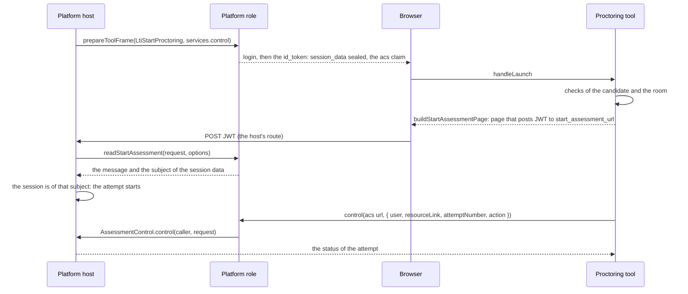

# LTI proctoring

Proctoring Services 1.0 in both roles. A platform that delivers an assessment sends the candidate to a proctoring tool with an
`LtiStartProctoring` message; the tool secures the session, then sends the candidate back with a signed `LtiStartAssessment`
message, and may control the attempt through the Assessment Control Service (ACS) while it runs and after it ends. In the tool
role, `buildStartAssessmentPage` signs the Start Assessment message and returns the page that posts it, and `control` of
`createServiceClient` calls the ACS. In the platform role, `readStartAssessment` reads the posted message against the session
data that the platform sealed into the Start Proctoring message, and `handlePlatformRequest` serves the ACS over the host's
`AssessmentControl`. The control request and status are the [service models](services.md) that both roles share.



| Role     | Function                                              | Does                                                                                                  |
| -------- | ----------------------------------------------------- | ----------------------------------------------------------------------------------------------------- |
| Tool     | `buildStartAssessmentPage(launch, input, options)`   | Signs the Start Assessment message and returns the page that posts it to the start assessment URL     |
| Tool     | `createServiceClient(deployment, options).control(url, request)` | Sends an action on an attempt and returns its status                                       |
| Platform | `readStartAssessment(request, options)`               | Reads the form the tool posted, verifies it and its session data, and returns the message             |
| Platform | `handlePlatformRequest(request, options)`             | With `services.control`, serves `/assessment-control` and offers the `acs` claim in a Start Proctoring message |

## Quick start

A proctoring tool sends the candidate back to start. The sample builds the launch by hand where a tool gets it from `handleLaunch`, and
signs with a key that it generates where a tool uses the key that the platform's administrator registered.

```ts
import { createCryptoKeySigner } from "@interopkit/core";
import { buildStartAssessmentPage } from "@interopkit/tool-integration/tool";

const keys = await crypto.subtle.generateKey(
  { name: "RSASSA-PKCS1-v1_5", modulusLength: 2048, publicExponent: new Uint8Array([1, 0, 1]), hash: "SHA-256" },
  false,
  ["sign"],
);
const registration = {
  issuer: "https://assessment.example",
  clientId: "proctor-1",
  deploymentIds: ["deployment-1"],
  authenticationUrl: "https://assessment.example/auth",
  jwksUrl: "https://assessment.example/jwks",
  accessTokenUrl: "https://assessment.example/token",
  redirectUri: "https://proctor.example.com/lti/launch",
  signer: createCryptoKeySigner(keys.privateKey, { algorithm: "RS256", keyId: "proctor-key-1" }),
};
const launch = {
  messageType: "LtiStartProctoring",
  issuer: registration.issuer,
  clientId: registration.clientId,
  deploymentId: "deployment-1",
  user: { subject: "2047534b3cc6d7086909", givenName: "Ana", familyName: "Candidate" },
  resourceLink: { id: "398" },
  attemptNumber: 1,
  startAssessmentUrl: "https://assessment.example/proctoring/start",
  sessionData: "opaque-session-data-of-the-platform",
};
const page = await buildStartAssessmentPage(
  launch,
  { verifiedUser: { givenName: "Ana", familyName: "Candidate" } },
  { registration: async () => registration, clock: { now: () => 1_700_000_000_000 } },
);
page.status; // => 200
page.headers["content-security-policy"].endsWith("form-action https://assessment.example"); // => true
/action="https:\/\/assessment\.example\/proctoring\/start"/.test(page.body); // => true
```

A whole flow, a platform that delivers an exam and a tool that proctors it, runs in the
[example](../../examples/tool-integration/README.md): `src/tool.ts` answers a Start Proctoring message with
`buildStartAssessmentPage` and pauses the attempt, `src/platform.ts` has the route at the start assessment URL that calls
`readStartAssessment`, and `src/proctoring.ts` holds the attempts behind the ACS.

## The tool role

`buildStartAssessmentPage(launch, input, options)` takes the `StartProctoringMessage` that `handleLaunch` returned, what the tool says,
and the options of the tool role (`registration`, `clock`, `signal`). The tool calls it only when the assessment may proceed;
otherwise it sends the browser to the `returnUrl` of the launch presentation with `lti_errormsg` (Proctoring Services 3.3).

| Property of the input   | Default | Meaning                                                                                                     |
| ----------------------- | ------- | ----------------------------------------------------------------------------------------------------------- |
| `verifiedUser`          | none    | The claims of identity that the tool verified: `name`, `givenName`, `familyName`, `middleName`, `email`, `emailVerified`, `locale`, each with the value of the launch, and `picture`, an `https` address of a picture that the tool took |
| `endAssessmentReturn`   | `false` | Asks the platform for the End Assessment message when the attempt ends                                      |

The message copies `session_data`, `resource_link` and `attempt_number` of the launch unchanged, and carries `iss` (the client
identifier), `aud` (the platform's issuer), `iat`, `exp` (300 seconds later) and a new `nonce`. The registration's `signer` signs
it, and the result is the page that posts the form parameter `JWT` to `launch.startAssessmentUrl`, under a policy that lets the
form go to that origin alone. The page must load in the browser of the launch: the platform binds its session data to that session.

`control(url, request, options)` of `createServiceClient` posts a `ControlRequest` with the media type
`application/vnd.ims.lti-ap.v1.control+json` and a token of `control.all` (`SCOPES.assessmentControl`), and returns the
`ControlStatus`. The URL is `launch.assessmentControl.url`; the request names the attempt as the launch did.

| Property of the request | Parameter          | Meaning                                                                                   |
| ----------------------- | ------------------ | ----------------------------------------------------------------------------------------- |
| `user`                  | `user`             | `{ issuer, subject }`: the `iss` and `sub` of the launch                                  |
| `resourceLink`          | `resource_link`    | The assessment; only `id` is required                                                     |
| `attemptNumber`         | `attempt_number`   | The attempt of the launch                                                                 |
| `action`                | `action`           | `pause`, `resume`, `terminate`, `update` (extra time, a message, or a poll) or `flag`      |
| `incidentTime`          | `incident_time`    | When the incident happened, with a time zone                                              |
| `extraTime`             | `extra_time`       | The total extra time in minutes                                                           |
| `incidentSeverity`      | `incident_severity` | From 0 to 1                                                                             |
| `reasonCode`, `reasonMessage` | `reason_code`, `reason_msg` | The tool's code and words for the reason                                     |

The request is read back against Proctoring Services 5.1 before anything is sent. The token, the URLs it may go to, the limits of an
answer and the options are those of every service: see the [grade services](grades.md). A 404 is a `ServiceError`: the platform
does not know the attempt, or it is not the tool's.

## The platform role

The host offers the ACS in a Start Proctoring message with `services: { control: { actions } }`, the actions that it supports for
the attempt, and gives `handlePlatformRequest` its `AssessmentControl` as `services.control`. Without the store the claim is not
written and the route does not exist; no message but a Start Proctoring message may offer the service. The token endpoint grants
`control.all` to a tool whose registration grants it.

The host's route at the `startAssessmentUrl` passes the request to `readStartAssessment(request, options)`. The options are those of
`readDeepLinkingResponse`: the platform (`config`, `clock`), the lookup of the tool (`client`), the cache of key sets (`jwks`), the
single-use ledger (`once`) and the limits.

| Check                                                                   | Refused with, a reason of `LtiError`                                      |
| ----------------------------------------------------------------------- | ------------------------------------------------------------------------- |
| A POST of a form with the parameter `JWT`, within `maxFormBytes`        | `request-invalid`; a `LimitError` (`maxFormBytes`) above the limit, which the host answers with 413 |
| The tool that `iss` names, its algorithm, key and signature             | `token-malformed`, `client-unknown`, `algorithm-unsupported`, `key-unknown`, `signature-invalid` |
| `aud` as the platform's issuer; `azp`, when present, as the same        | `audience-mismatch`, `audience-untrusted`, `authorized-party-mismatch`    |
| `exp`, `iat` and `nonce`; an expiry within an hour                      | `claim-missing`, `claim-invalid`, `token-expired`, `issued-in-future`, `assertion-lifetime` |
| The message type, the version, a deployment of the tool, the claims of 4.3.1 | `message-type-unsupported`, `version-unsupported`, `deployment-unknown`, `claim-missing`, `claim-invalid` |
| The `nonce`, once                                                       | `nonce-replayed`                                                          |
| The `session_data`: sealed by this platform (or an earlier hint key), for this tool and deployment, for the resource link and the attempt of the message, not expired | `session-data-invalid` |

The result is a `ReceivedStartAssessment`: the fields of the message (`sessionData`, `resourceLink`, `attemptNumber`,
`endAssessmentReturn`, `verifiedUser`, `claims`) and the `subject` that the session data binds. The session data is the anti-CSRF
token of the specification, and the host completes the check: it starts the attempt only when its own session of the browser is of
`subject`. Which verified claims it requires is its agreement with the tool.

The route `/assessment-control` takes a POST with a token of `control.all`:

| Request                                                            | Answer                                                         |
| ------------------------------------------------------------------ | -------------------------------------------------------------- |
| Another media type than `application/vnd.ims.lti-ap.v1.control+json` | 415                                                          |
| A body above `maxBodyBytes`                                        | 413                                                            |
| A body that is not JSON or breaks section 5.1                      | 400 `invalid_request`                                          |
| A user of another issuer than the platform's                       | 404, and the store is not asked                                |
| An attempt that the store does not give the caller                 | 404                                                            |
| An attempt of the caller                                           | 200, the status of the attempt in the media type of the service |

`AssessmentControl.control(caller, request, options)` receives the tool and the deployment of the token and the request as read.
An action that the state of the attempt does not allow, or that the platform does not support, leaves the attempt as it is and
answers its status (section 5.1.4); `update` changes the extra time and answers the status to a tool that polls; a `flag` may come
after the end. The host maps the actions to its delivery, such as the pause of a session's clock.

| Option                       | Default   | Meaning                                                                 |
| ---------------------------- | --------- | ----------------------------------------------------------------------- |
| `services.control`           | none      | The `AssessmentControl`; without it the ACS is neither offered nor routed |
| `sessionDataLifetimeSeconds` | 3,600     | How long the session data of a Start Proctoring message is valid        |
| `maxBodyBytes`               | 65,536    | The most bytes of a control request                                     |
| `maxFormBytes` of `readStartAssessment` | 65,536 | The most bytes of the form of a Start Assessment message        |
| `maxTokens` of `readStartAssessment`    | 1,000,000 | The most JSON tokens of the message                          |

## Limits

| Limit                                         | Value          |
| --------------------------------------------- | -------------- |
| The form of a Start Assessment message        | 65,536 bytes   |
| A control request                             | 65,536 bytes   |
| A Start Assessment message, as signed         | 300 seconds    |
| The longest lifetime accepted of the message  | 3,600 seconds  |
| The session data                              | 3,600 seconds  |
| An answer of the ACS that the client reads    | 1,048,576 bytes, 1,000,000 JSON tokens |

## Failure paths

| Port                  | Fails                                                              | Hangs                | Called again                                                        |
| --------------------- | ------------------------------------------------------------------ | -------------------- | ------------------------------------------------------------------- |
| `AssessmentControl`   | 500 with nothing of the cause; `undefined` is 404. An answer that is not a status is a `DataError` | `signal` | `update` polls; a repeated action answers the current status |
| `client`, `once`      | `readStartAssessment` rejects with the error; `once` that is not a boolean is a `DataError` | `signal` | `false` is `nonce-replayed`: the tool sends a new message |
| The tool's key set    | `ServiceError`; a failed fetch is not kept. A set that is not a JWK Set is `key-unknown` | The cache's deadline | Shared by concurrent callers                                        |
| The service `Fetch`   | `ServiceError` with the status, the headers and the body; nothing retries | `timeoutMs`   | An action in doubt is sent again, and the platform answers the status |
| The `signer`          | The call rejects with its error; nothing half-signed is posted      | `signal`             | Each message has a new nonce                                        |

## Errors

| Error                                                   | When                                                                                 | What to do                                                 |
| ------------------------------------------------------- | ------------------------------------------------------------------------------------ | ---------------------------------------------------------- |
| `DataError` from `buildStartAssessmentPage`            | An argument has the wrong type, a verified claim is not one that the launch carried with that value, or the picture is the platform's | Verify only what the platform sent; take the picture |
| `DataError` from `control`                              | The request breaks section 5.1, or the answer is not a status                        | Fix the request; the platform's answer is refused          |
| `LtiError` `scope-unavailable`, `service-origin-refused` | The platform offered no `control.all`, or the URL may not receive the token          | Pass the scope; name the platform's private origin in `serviceOrigins` |
| `LtiError` of `readStartAssessment`, 400 or 401         | The form or the token fails a check                                                   | Answer with its `status`                                   |
| `LimitError` from `readStartAssessment`                 | The form is over `maxFormBytes`                                                       | Answer 413                                                 |
| `LtiError` `nonce-replayed`, `session-data-invalid`, 403 | A replay, or session data that is not this platform's, this tool's, this attempt's or current | Answer 403; the candidate starts again from the platform |

## Data flows

| Data                                        | Comes from                     | Goes to                                                     | Kept by the package |
| ------------------------------------------- | ------------------------------ | ----------------------------------------------------------- | ------------------- |
| The session data                            | Sealed by the platform         | The tool, which returns it; signed, not encrypted           | No                  |
| The verified claims: names, email, a picture | The proctoring tool          | The platform's host, in a form the browser posts            | No                  |
| A control request: the incident, the reason | The proctoring tool            | The host's `AssessmentControl`                              | No                  |

## Not included

| What                                                                 | Reason                                                                                |
| -------------------------------------------------------------------- | ------------------------------------------------------------------------------------- |
| The checks of the candidate and the room, a live proctor             | The proctoring tool's                                                                 |
| The attempt, its clock and its delivery; the review of a flag        | The host's: the store maps each action to them                                        |
| The comparison of the session of the browser with `subject`          | The host's: the platform role has no sessions                                         |
| Sending the End Assessment message when the attempt ends             | The host launches it as a `MessageInput` of type `LtiEndAssessment`                   |

## Differences from the references

No reference implementation of Proctoring Services was found, so both roles are checked against the text, its examples and each
other, in process and in the [example](../../examples/tool-integration/README.md). The examples of section 6 are not JSON, and the
text disagrees with itself on the session data of a control request and on the name of the start assessment URL:
[spec-gaps](spec-gaps.md) lists the choices.
