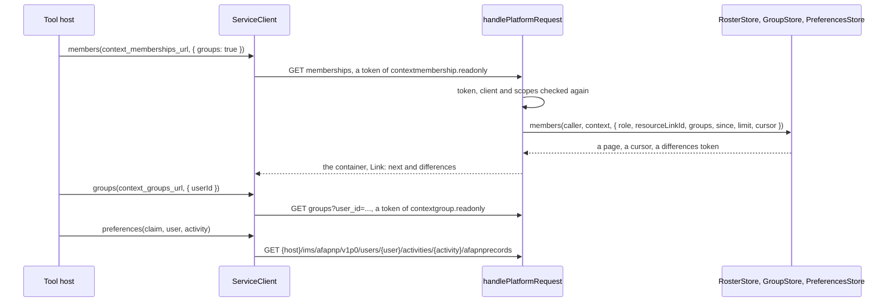

# LTI roster services

Names and Role Provisioning 2.0 (NRPS), Context Groups 1.0 and the AfA PNP Connector 1.0 in both roles. In the tool role,
`createServiceClient` reads the members of a context or a resource link, its groups and group sets, and a user's record of needs
and preferences for an activity. In the platform role, `handlePlatformRequest` serves them over the host's `RosterStore`,
`GroupStore` and `PreferencesStore`, and offers each in a message only when its store is given. Both roles share the
[service bodies](services.md).



| Role     | Function                                                       | Does                                                                                                            |
| -------- | -------------------------------------------------------------- | --------------------------------------------------------------------------------------------------------------- |
| Tool     | `createServiceClient(deployment, options).members(url, query)` | Returns a page of the members of a context or a resource link, with the context and the link to the differences |
| Tool     | `.groups(url, query)`, `.groupSets(url, query)`                | Return a page of the groups of a context, or of a user in it, and a page of its group sets                      |
| Tool     | `.preferences(claim, user, activity, query)`                   | Returns the record of a user for an activity as JSON, or `undefined`                                            |
| Platform | `handlePlatformRequest(request, options)`                      | With `services.roster`, `services.groups` and `services.preferences`, also serves their routes                  |

## Quick start

A tool reads the members of a context. The sample serves the platform's token endpoint and the membership service from a `fetch`
that it writes; a real tool passes the `fetch` of its host.

```ts
import { createCryptoKeySigner } from "@interopkit/core";
import { createServiceClient } from "@interopkit/tool-integration/tool";

const keys = await crypto.subtle.generateKey(
  { name: "RSASSA-PKCS1-v1_5", modulusLength: 2048, publicExponent: new Uint8Array([1, 0, 1]), hash: "SHA-256" },
  false,
  ["sign"],
);
const scope = "https://purl.imsglobal.org/spec/lti-nrps/scope/contextmembership.readonly";
const registration = {
  issuer: "https://lms.example.edu",
  clientId: "962fa4d8-bcbf-49a0-94b2-2de05ad274af",
  deploymentIds: ["07940580-b309-415e-a37c-914d387c1150"],
  authenticationUrl: "https://lms.example.edu/auth",
  jwksUrl: "https://lms.example.edu/jwks",
  accessTokenUrl: "https://lms.example.edu/token",
  redirectUri: "https://tool.example.com/lti/launch",
  signer: createCryptoKeySigner(keys.privateKey, { algorithm: "RS256", keyId: "tool-1" }),
};
const platform = async (url) =>
  url === registration.accessTokenUrl
    ? Response.json({ access_token: "token-1", token_type: "Bearer", expires_in: 3600, scope })
    : Response.json(
        {
          id: "https://lms.example.edu/sections/2923/memberships",
          context: { id: "2923-abc", label: "CPS 435" },
          members: [{ user_id: "0ae836b9", roles: ["http://purl.imsglobal.org/vocab/lis/v2/membership#Learner"] }],
        },
        { headers: { link: '</sections/2923/memberships?limit=100&p=2>; rel="next"' } },
      );
const client = createServiceClient(
  { issuer: registration.issuer, clientId: registration.clientId, deploymentId: registration.deploymentIds[0] },
  { registration: async () => registration, clock: { now: () => 1_700_000_000_000 }, fetch: platform, scopes: [scope] },
);
const page = await client.members("https://lms.example.edu/sections/2923/memberships");
page.items[0].userId; // => "0ae836b9"
page.context.label; // => "CPS 435"
page.next; // => "https://lms.example.edu/sections/2923/memberships?limit=100&p=2"
```

The [example](../../examples/tool-integration/README.md) runs the whole flow: `src/roster.ts` holds the three stores in memory,
and `readRoster` of `src/tool.ts` reads the members with their groups, the groups and sets, and the record of a user.

## The tool role

The client takes the URLs from the claims of the launch: `launch.services.roster.contextMembershipsUrl`,
`launch.services.groups.contextGroupsUrl` and `contextGroupSetsUrl`, and `launch.services.preferences`. Its scopes are the ones the
platform offered; the claim of NRPS has no list, and its one scope is `contextmembership.readonly`
(`SCOPES.contextMembershipReadonly`). The tokens, the URLs a token may go to, the reading of answers and the options are those of
[the grade services](grades.md#the-tool-role).

| Method                                       | Specification | Scope asked for              | Answers                                                   |
| -------------------------------------------- | ------------- | ---------------------------- | --------------------------------------------------------- |
| `members(url, query?)`                       | NRPS 2.0      | `contextmembership.readonly` | A `MemberPage`: `items`, `context`, `next`, `differences` |
| `groups(url, query?)`                        | Groups 2.5.1  | `contextgroup.readonly`      | A `Page<Group>`                                           |
| `groupSets(url, query?)`                     | Groups 2.5.2  | `contextgroup.readonly`      | A `Page<GroupSet>`                                        |
| `preferences(claim, user, activity, query?)` | PNP 1.0       | `afapnprecord.lti.readonly`  | The record as JSON, or `undefined` for a 404              |

Each method also takes `{ signal }`.

### Members

A `MemberQuery` has the filters of NRPS and of Context Groups 2.4:

| Property         | Parameter | Meaning                                                                                           |
| ---------------- | --------- | ------------------------------------------------------------------------------------------------- |
| `role`           | `role`    | Only the members with this role, by its URI or, for a context role, its simple name (`Learner`)   |
| `limit`          | `limit`   | The most members; the platform may return more or fewer. None is the option `pageLimit` (100)     |
| `resourceLinkId` | `rlid`    | The members who can reach this resource link, each with the `message` that its launch would carry |
| `groups`         | `groups`  | Adds the `groupEnrollments` of each member                                                        |
| `since`          | `since`   | The differences with an earlier read, when the tool has the token and not the link                |

| Part of a `MemberPage` | Holds                                                                                                                                                                                                                                                                                                 |
| ---------------------- | ----------------------------------------------------------------------------------------------------------------------------------------------------------------------------------------------------------------------------------------------------------------------------------------------------- |
| `items`                | `Member` values: `userId`, `roles`, `status`, the names, `email`, `lisPersonSourcedId`, `lti11LegacyUserId`, `message`, `groupEnrollments`. A platform shares only what it agreed to beyond `userId`, `roles` and the context (NRPS 2.0, sharing of personal data), so never rely on another property |
| `context`              | The context of the members                                                                                                                                                                                                                                                                            |
| `next`                 | The next page; the last page has none                                                                                                                                                                                                                                                                 |
| `differences`          | Reads the changes since this read: the members who joined or changed, in their current state, and those who left, with the status `Deleted` (NRPS 2.0, membership differences)                                                                                                                        |

Pass `next` or `differences` to `members` as it is. A link to another origin is dropped, so the token never leaves the platform
that answered. A 404 is a `ServiceError`: the resource link is not the tool's, or the cursor is gone, and the tool starts from the
first page.

### Groups

| Call                             | Returns                                                                                                                                                                               |
| -------------------------------- | ------------------------------------------------------------------------------------------------------------------------------------------------------------------------------------- |
| `groups(url, { userId, limit })` | The groups of a context, or those the user is enrolled in: `id`, `name`, `tag`, `hidden`, and the `setIds` of its sets (a group may belong to several, see [spec-gaps](spec-gaps.md)) |
| `groupSets(url, { limit })`      | The sets: `id`, `name`, `tag`, `hidden`                                                                                                                                               |
| `members(url, { groups: true })` | Each member's `groupEnrollments`, by `groupId`                                                                                                                                        |

### Preferences

`preferences(claim, userSourcedId, activityId, { fields })` takes `launch.services.preferences`, whose `hostUrl` is the host of
the service, and calls `{hostUrl}/ims/afapnp/v1p0/users/{user}/activities/{activity}/afapnprecords`, the one endpoint of the
connector that LTI makes available, with the user and the activity encoded. `fields` lists the members the answer holds, and no
others. The record passes through as JSON, for the host to map to its own model.

## The platform role

With `services: { roster, groups, preferences }`, `handlePlatformRequest` offers the services whose stores it has: the token
endpoint grants their scopes when the registration does, a message that asks for them carries their claims, and the routes below
are served. Without a store, none of the three exists. Access is checked as for [the grade services](grades.md#access); the store
receives the caller and the `signal`, and answers `undefined` for what is not the caller's, which is 404.

| Path under `origin`                                                 | Scope                        | Store                                                                                                        |
| ------------------------------------------------------------------- | ---------------------------- | ------------------------------------------------------------------------------------------------------------ |
| `/contexts/{context}/memberships`                                   | `contextmembership.readonly` | `roster.members(caller, context, query)`                                                                     |
| `/contexts/{context}/groups`                                        | `contextgroup.readonly`      | `groups.groups(caller, context, query)`                                                                      |
| `/contexts/{context}/group-sets`                                    | `contextgroup.readonly`      | `groups.groupSets(caller, context, query)`, when the store has group sets; without it the path names nothing |
| `/ims/afapnp/v1p0/users/{user}/activities/{activity}/afapnprecords` | `afapnprecord.lti.readonly`  | `preferences.record(caller, user, activity, fields)`                                                         |

### The claims

A message offers the services with `services: { roster: true, groups: { sets }, preferences: { activityIds } }`. The roster and
the groups need the `context` of the message, since their URLs lie below it; the connector needs none, since a record is below the
host. The claims:

| Service        | Claim                                          | Holds                                                                                                                                              |
| -------------- | ---------------------------------------------- | -------------------------------------------------------------------------------------------------------------------------------------------------- |
| NRPS           | `.../lti-nrps/claim/namesroleservice`          | `context_memberships_url`, `service_versions: ["2.0"]`                                                                                             |
| Context Groups | `.../lti-gs/claim/groupsservice`               | `context_groups_url`, `context_group_sets_url` when `sets` is true and the store has `groupSets`, the granted `scope`, `service_versions: ["1.0"]` |
| The connector  | `.../lti-afapnp/claim/afapnp-endpoint-service` | `afapnp_endpoint_hosturl` (the platform's origin), `afapnp_activity_ids`, the granted `scopes`                                                     |

The platform builds the URLs from `config.origin` and the identifiers, encoded. The connector's claim needs at least one scope, so
a tool whose registration grants none is not offered it.

### The members

| `roster.members`    | Value                                                                                                                                                                                           |
| ------------------- | ----------------------------------------------------------------------------------------------------------------------------------------------------------------------------------------------- |
| Gets                | `role` as a URI (`Learner` is already `.../membership#Learner`), `resourceLinkId`, `groups`, `since`, a `limit` (the request's, else `pageSize`, at most `maxPageSize`) and the opaque `cursor` |
| Answers             | `{ items, cursor?, differences?, context? }`: the members, where the next page starts, a token that a later request returns as `since`, and the `label` and `title` of the context              |
| The container       | Its `id` is the URL of the context's members, with `?rlid=` for a resource link (as NRPS 3 shows)                                                                                               |
| `Link: next`        | Built from the request with the `cursor`                                                                                                                                                        |
| `Link: differences` | Built from the request with `since` set to the token and no cursor, "complete and opaque" as NRPS asks                                                                                          |

The platform shares only what the request asked for: `groupEnrollments` only with `groups=true`, and `message` only with a
`rlid`; it drops the rest of what the store gave. A member with the status `Deleted` belongs to a read of the differences alone
(NRPS 2.0, membership status); outside one it breaks the store's contract. A store answers `undefined`, which is 404, for a
resource link it does not know or that is not the tool's or not in the context (NRPS 2.0, access restriction), and for a cursor
or token it has lost.

### The groups and the record

A request for groups with `user_id` reaches the store with `userId`, and the answer names the user and has the request's URL as its
`id` (Context Groups 2.1.2); an empty `user_id` names no user and is 400. The routes of groups and sets page like the members, with a `next` link that keeps the filter. The
record route reads `fields` and drops every member of the store's record that it does not name (the connector: "MUST ONLY be
returned"); the user and the activity of the path reach the store decoded, and the store decides whether the tool may read them.

## Limits

The limits of the client are the options of [the grade services](grades.md#reading-answers); those of the platform are in
[the platform role](platform.md#options).

## Failure paths

| Port or call                                    | Fails                                                                                                       | Hangs       | Called again    |
| ----------------------------------------------- | ----------------------------------------------------------------------------------------------------------- | ----------- | --------------- |
| `RosterStore`, `GroupStore`, `PreferencesStore` | 500 with nothing of the cause; `undefined`: 404, and a tool whose cursor is gone starts from the first page | `signal`    | Read-only: safe |
| The client's `fetch`                            | `ServiceError`; a 404 of a record is `undefined`; a 401 drops the token                                     | `timeoutMs` | GETs are safe   |

A store that answers with something other than its contract (a member without roles, a page larger than its limit, a `Deleted`
member outside the differences, a record that is not an object) is a `DataError` that the handler throws.

## Errors

| Error                                          | When                                                                                       | What to do                                         |
| ---------------------------------------------- | ------------------------------------------------------------------------------------------ | -------------------------------------------------- |
| `LtiError` `scope-unavailable`, `scope-denied` | The platform did not offer, or did not grant, the scope of the call                        | Ask the platform's administrator for the scope     |
| `LtiError` `service-origin-refused`            | The URL may not receive the token                                                          | Name the platform's origins in `serviceOrigins`    |
| `ServiceError`                                 | The platform answered with an error, among them 404 for a link that is gone                | Read its `status`; start again from the first page |
| `LimitError`, a `DataError`                    | An answer is above `maxTokens`                                                             | Raise `maxTokens` for a platform you trust         |
| `DataError`                                    | An argument has the wrong type, an answer breaks its model, or a store breaks its contract | Fix the caller or the store                        |

## Data flows

These services carry personal data: names, email addresses, roles and the needs of a user.

| Data                                | Comes from                    | Goes to                                                                    | Kept by the package           |
| ----------------------------------- | ----------------------------- | -------------------------------------------------------------------------- | ----------------------------- |
| The members: names, email, roles    | The host's `RosterStore`      | The tool, over HTTPS, for the tool's token                                 | No                            |
| The group enrollments, the message  | The host's `RosterStore`      | The tool, only when the request asked for them                             | No                            |
| The record of needs and preferences | The host's `PreferencesStore` | The tool, with the fields the request named                                | No                            |
| An access token                     | The platform's token endpoint | The services, in `Authorization`; the client's cache until near its expiry | Only in memory, in the client |

Beyond a user's identifier and roles, a platform shares only what it agreed with the tool (NRPS 2.0): the store decides what a
member carries.

## Not included

| Not included                                                    | Why                                                                                                      |
| --------------------------------------------------------------- | -------------------------------------------------------------------------------------------------------- |
| The other endpoints of the AfA PNP Connector and its data model | A standard of its own; only the endpoint that LTI makes available is here, and the record passes as JSON |
| The substitution variables of the groups (`CourseGroup.id`)     | The host's, through `substitution`                                                                       |
| The `message` of a resource link member from the library        | The store gives it: it holds the member's launch claims, which the platform's substitution knows         |
| A roster, a database                                            | The host's, behind the three stores                                                                      |

## Differences from the references

None of the libraries read has a platform role (see [architecture](architecture.md)), so the platform is checked against the
specifications and their examples, and the client against a platform written from them; [spec-gaps](spec-gaps.md) lists where the
texts disagree with their examples.
