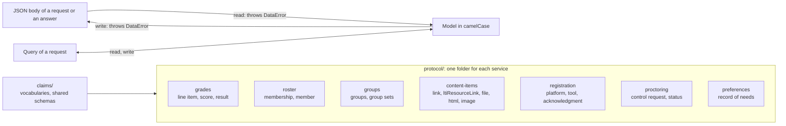

# Service bodies

`@interopkit/tool-integration` has one model of the bodies of the services of LTI Advantage and of Dynamic Registration. The tool
role writes what the platform role reads, and the platform role writes what the tool role reads, from the same schemas, so a
body that one role writes is a body that the other reads. The types and the vocabularies are exports of the root subpath; the
readers and writers are what the roles use, and they are not exported.



## Quick start

The vocabularies are exports. A score says how far a user is and how far grading is with these values:

```ts
import { ACTIVITY_PROGRESS, ATTEMPT_STATUSES, CONTROL_ACTIONS, GRADING_PROGRESS, MEMBER_STATUSES } from "@interopkit/tool-integration";

ACTIVITY_PROGRESS; // => ["Initialized", "Started", "InProgress", "Submitted", "Completed"]
GRADING_PROGRESS; // => ["FullyGraded", "Pending", "PendingManual", "Failed", "NotReady"]
MEMBER_STATUSES; // => ["Active", "Inactive", "Deleted"]
CONTROL_ACTIONS; // => ["pause", "resume", "terminate", "update", "flag"]
ATTEMPT_STATUSES; // => ["none", "running", "paused", "terminated", "complete"]
```

## The bodies

| Service                       | Body                                                      | Model                                             | Media type                                                |
| ----------------------------- | --------------------------------------------------------- | ------------------------------------------------- | --------------------------------------------------------- |
| AGS: line items               | A line item, a container of them                          | `LineItem`, `LineItemInput`                       | `application/vnd.ims.lis.v2.lineitem+json`, `...lineitemcontainer+json` |
| AGS: scores                   | A score                                                   | `Score`                                           | `application/vnd.ims.lis.v1.score+json`                   |
| AGS: results                  | A container of results                                    | `Result`                                          | `application/vnd.ims.lis.v2.resultcontainer+json`         |
| NRPS                          | The members of a context or a resource link               | `Membership`, `Member`                            | `application/vnd.ims.lti-nrps.v2.membershipcontainer+json` |
| Context Groups                | Groups and group sets                                     | `GroupContainer`, `GroupSetContainer`             | `application/vnd.ims.lti-gs.v1.contextgroupcontainer+json`, `...contextgroupsetcontainer+json` |
| Deep Linking                  | An item of a response                                     | `ContentItem`: `LinkItem`, `LtiResourceLinkItem`, `FileItem`, `HtmlItem`, `ImageItem`, `OtherContentItem` | A claim of a signed token |
| Dynamic Registration          | The configuration of a platform, a registration, its acknowledgment | `PlatformConfiguration`, `ToolConfiguration`, `ToolRegistrationResult` | `application/json`      |
| Assessment Control Service    | A control request and the status it answers with          | `ControlRequest`, `ControlStatus`                 | `application/vnd.ims.lti-ap.v1.control+json`              |
| AfA PNP Connector             | The record of a user's needs and preferences              | `PreferencesRecord`                               | `application/json`                                        |

Property names are those of the specifications in camelCase. A claim name that is a URL, such as the
`lti-tool-configuration` of a registration, is read into a property of its own.

## What a reader does

| Behavior                                                                                                     | Where                                         |
| ------------------------------------------------------------------------------------------------------------ | --------------------------------------------- |
| Throws `DataError` with the path of the first invalid member, such as `The line items is invalid at [1].label` | Every reader                                |
| Reads `null`, or a blank text, as absent where a platform may send it                                        | `resourceId`, `tag`, `activityId`, `startDateTime`, `endDateTime`, a comment, names of a member |
| Ignores a property that the model does not name                                                              | Every body                                    |
| Keeps a property named by a URL as an extension, copied as JSON                                              | Line item, score, result, content item, the LTI configurations |
| Keeps a name such as `__proto__` as data                                                                     | `custom` is a `Map`                           |
| Reads a date with `Z`, `+hh:mm` or `+hh`, and refuses one without a time zone designator                     | Every date                                    |
| Reads the translations `name#tag` into `localized`                                                           | Configurations of Dynamic Registration        |
| Does not apply defaults: `status` of a member, `resultMaximum` and `hidden` stay as sent                     | `Member`, `Result`, `Group`                   |

### Rules that a reader refuses a body for

| Body                | Refused when                                                                                                                                                  |
| ------------------- | ------------------------------------------------------------------------------------------------------------------------------------------------------------- |
| Line item           | No `id` that is an https address; `scoreMaximum` is not above 0; the `label` is blank; a date has no zone                                                     |
| Score               | `scoreGiven` has no `scoreMaximum` beside it, or is below 0; `submittedAt` is before `startedAt`; a progress is not one of the five values; no `timestamp`     |
| Result              | `scoreOf` is not an https address; `resultMaximum` is not above 0                                                                                             |
| Member              | No `user_id` or `roles`; a status that is not `Active`, `Inactive` or `Deleted`                                                                               |
| Membership          | No `id`, or no `context` with an `id`                                                                                                                         |
| Group, group set    | No `id` or `name`                                                                                                                                             |
| Content item        | No `type`; a known type without what its table requires; an address that is not https; a `scoreMaximum` of a line item that is not above 0                    |
| Platform            | A list without what LTI requires of it (`private_key_jwt`, `RS256`, `openid`, `id_token`); an issuer with a query or a fragment; an endpoint that is not https |
| Tool configuration  | Not `web`; grant types without `client_credentials` and `implicit`; response types without `id_token`; no redirect URI; a domain with a protocol              |
| Acknowledgment      | The rules of a tool configuration except those of the grant and response types, which the platform states and its example misspells                           |
| Control request     | No `user`, `resource_link` or `attempt_number` that is a whole number; an action that is not one of five; a severity outside 0 to 1                           |

A writer holds the sender to the same rules, and to the names of translations and extensions.

## Queries

| Request             | Parameter                                                       | Property of the query                                                |
| ------------------- | --------------------------------------------------------------- | -------------------------------------------------------------------- |
| Line items          | `resource_id`, `resource_link_id`, `tag`, `activity_id`, `limit` | `resourceId`, `resourceLinkId`, `tag`, `activityId`, `limit`         |
| Results             | `user_id`, `limit`                                              | `userId`, `limit`                                                    |
| Members             | `role`, `limit`, `rlid`, `groups`, `since`                      | `role`, `limit`, `resourceLinkId`, `groups`, `since`                 |
| Groups              | `user_id`, `limit`                                              | `userId`, `limit`                                                    |
| A preferences record | `fields`, comma-separated                                      | `fields`                                                             |

A parameter given twice, a `limit` that is not a positive integer, and a `groups` that is neither `true` nor `false` are
`DataError`. A parameter that the model does not name is ignored. Paging links (`rel="next"`, `differences`) are headers and not
part of a body.

## Limits

The readers take parsed JSON and set no limit of their own. The handlers that read a body from a request, and the client that
reads an answer, bound its bytes and its JSON tokens before they parse it.

## Errors

| Error       | Meaning and what to do                                                                                                                                  |
| ----------- | ------------------------------------------------------------------------------------------------------------------------------------------------------- |
| `DataError` | A body or a query does not have the shape of its specification, or a body that the host writes breaks a rule of the sender. The message names the path |

## Not included

| What                                                              | Reason                                                                                         |
| ----------------------------------------------------------------- | ---------------------------------------------------------------------------------------------- |
| The AfA PNP data model                                            | A standard of its own; the record passes as JSON, and a host maps it across families           |
| JSON schemas of the services as runtime checks                    | The readers are written from the text; the OpenAPI files are compared with them in the tests   |
| A set filter of Context Groups                                    | The text defines `user_id` and `limit` only                                                    |
| The `differences` link and the paging links of an answer          | They are headers; the service client and the handlers read them                                |

## Differences from the references

| Reference                                         | Difference                                                                                                         |
| ------------------------------------------------- | ------------------------------------------------------------------------------------------------------------------ |
| The OpenAPI file of AGS                           | The model has `activityId`, `gradesReleased`, `submissionReview`, `scoringUserId` and `submission`, which the file lacks |
| The OpenAPI file of the AfA PNP Connector         | The record is not mapped to its types; any record that the file allows passes through                              |
| The examples of the specifications                | Some are not JSON or misspell a value; [the gaps](spec-gaps.md) list them                                          |
