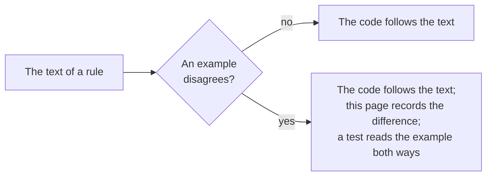

# Gaps in the specifications

Where the specifications disagree with each other, or an example disagrees with the text, the package follows the text of the
rule and a test pins the choice. The examples are those that `pnpm spec-examples` downloads at pinned hashes.

| Where                                                   | What the specifications say                                                                                                         | What the package does                                                                                                                                                                                                                                                                      |
| ------------------------------------------------------- | ----------------------------------------------------------------------------------------------------------------------------------- | ------------------------------------------------------------------------------------------------------------------------------------------------------------------------------------------------------------------------------------------------------------------------------------------ |
| The Deep Linking request of Deep Linking Appendix A     | The example has no `target_link_uri`; LTI Core section 5.3.4 says the claim is required in every message, and the tool routes by it | `ltiLaunch` refuses a Deep Linking request without it (`claim-missing`). The test reads the example with the claim added, and refuses it as it stands                                                                                                                                      |
| Security Framework version                              | LTI Core cites version 1.0; 1.1 is current and backwards compatible                                                                 | Follows 1.1. Login CSRF is section 7.4.1                                                                                                                                                                                                                                                   |
| The score of AGS section 3.4 with an extension property | The first example carries `https://www.toolexample.com/lti/score`, an extension | Both roles keep it: `publishScore` sends it in the `extensions` of the score, and the score route of the platform reads it into them (AGS 3.1 lets a vendor extend a body with properties named by URLs) |
| `resource_link.title` and `description` of a launch     | LTI Core section 5.3.5 has both as strings                                                                                          | Reads `null` as absent: Canvas sends `"title": null` and `"description": null`. The test reads a published Canvas launch                                                                                                                                                                   |
| A value of the `custom` claim                           | LTI Core section 5.4.6 has every value a string                                                                                     | Reads a boolean, or a number whose text is its value, as its text: Canvas sends `canvas_user_uuid` as a number. A whole number above 2^53 - 1 or below its negative, which JSON parsing has already rounded, a number that is not finite and any other value are refused (`claim-invalid`) |
| `expires_in` of a token response                        | RFC 6749 section 5.1 recommends it                                                                                                  | Optional: without it `expiresAt` is absent and the tool uses the token until a service refuses it                                                                                                                                                                                          |
| The audience of a client assertion                      | LTI Core section 6.2.1 has the token URL of the platform; some platforms name themselves                                            | The token URL, or the `audience` of the registration when a platform wants another value                                                                                                                                                                                                   |
| A line item URL that ends with a slash                  | AGS section 3.4 appends `/scores` to the line item URL and does not say how a trailing slash is handled                             | Removes one trailing slash first, so that the URL does not have `//scores`                                                                                                                                                                                                                 |
| The Deep Linking request of Deep Linking Appendix A: `tool_platform` | The example's `tool_platform` has no `guid`, which LTI Core section 5.4.3 requires | `ltiLaunch` refuses a platform instance without `guid` (`claim-missing`). The test adds the claim, as it adds the `target_link_uri` |
| The submission review requests of Submission Review section 3.4 | The examples have no `target_link_uri`, though Core requires one in every message, and their `return_url` is `http://example.org/returnToGradebook`, though Core 5.4.5 says a fully-qualified HTTPS URL | `ltiLaunch` refuses both (`claim-missing`, `claim-invalid`). The test adds the claim and corrects the scheme |
| `accept_media_types` of a Deep Linking request | The text and the example give a comma-separated string; the JSON schema of the specification gives an array of strings | Reads either into a list of media types. A platform sends the string |
| The portal's example of `accept_media_types` | The portal prints `image/:::asterisk:::,text/html` where `image/*,text/html` is meant | The reader keeps the text as printed; the test pins it |
| The claim names of Deep Linking 4.4 | The text names the platform and custom claims `http://purl.imsglobal.org/lti/claim/tool_platform` and `http://imsglobal.org/custom` | The names of LTI Core: `https://purl.imsglobal.org/spec/lti/claim/tool_platform` and `.../custom` |
| `azp` of the Deep Linking response of Appendix B | The example's `azp` is the client identifier of the tool; Security Framework 5.2.3 has a platform compare it with its own issuer URL | `readDeepLinkingResponse` compares a present `azp` with the platform's issuer (`authorized-party-mismatch`), so it refuses the example as printed; `createDeepLinkResponse` writes none |
| The response of Deep Linking Appendix B and the request of Appendix A | The response places a PDF and an item of the type `https://www.example.com/custom_type`; the request accepts the media types `image/*` and `text/html` and the types of the five items | `createDeepLinkResponse` refuses the example as printed, one reason at a time. The test adds the media type and the type to the request and then reads it back as printed |
| `accept_multiple` of a Deep Linking request | The text says what the platform allows when it is true and does not say what it is when absent | Absent is `false`: one item. A platform that takes several says so |
| `accept_lineitem` of a Deep Linking request | The text says `false` means the platform ignores line items, and absent means that nothing can be assumed | `false` makes `createDeepLinkResponse` refuse an item with a `lineItem`, since the tool would expect scores that go nowhere; absent sends it |
| The presentations of an item and `accept_presentation_document_targets` | The text asks a tool to offer every presentation that applies and the platform to pick, and does not say what a platform does with an item whose only presentations it does not support | An item that offers `window`, `iframe` or `embed` is refused when the platform supports none of them; an item that offers none passes, since the default is a new window |
| A `file` item and `accept_media_types` | The table of a file has no `mediaType` (see above), so a file may not say what it is | A file with no `mediaType` passes; one with a `mediaType` must match a pattern (`image/png`, `image/*` or `*/*`) |
| The claim of the AfA PNP Connector | The text makes `afapnp-endpoint-service` a claim of the message; the example prints it inside `custom`, whose values are strings | Reads it as a claim of the message. Inside `custom` it is `claim-invalid` |
| `service_versions` of the NRPS claim | The text of NRPS 4.1 says `service_version`; the example says `service_versions` | `service_versions`, optional |
| The Migration Guide's names | The table names `https://purlimsglobal.org/spec/lti/claim/role_scope_mentor` and `tool_platform#email` | The claims of LTI Core: `.../lti/claim/role_scope_mentor` and `contact_email` |
| The examples of Proctoring Services 6.1 and 6.2 | They are not JSON (a closing quote and a comma are missing), and `attempt_number` of the End Assessment example and `incident_severity` are strings, where the text says an integer and a number | `attempt_number` is a whole number; the tests build the messages from the text of sections 4.2 to 4.4 |
| Role and context type vocabularies | Core 5.3.7 and 5.4.1 say a list holds at least one entry of the vocabulary; Canvas sends the context type `Account` | The reader keeps what was sent. The writer holds a platform to the rule |
| URNs of Core Appendix A | The text says LTI 1.0 to 1.1.1 used URNs for roles and context types; it prints URNs only for context types | `canonicalizeContextType` maps the URNs; `canonicalizeRole` maps the simple names of context roles. The deprecated `person#` URIs of system and institution roles name no vocabulary, and stay as they are |
| `LtiResourceLinkRequest.json` of the specification | The address of the schema serves the schema of the Deep Linking request | The messages are not compared with the schemas of the specification, which are older than its text |
| The timestamps of AGS 3.4.8 | The text lists `2017-04-16T18:54:36.736+00` as valid; RFC 3339 and `parseDateTime` of core read an offset as `+hh:mm` | The readers of a body take `+hh` as `+hh:00` and `+hhmm` as `+hh:mm`, and write what they were given. PHP writes `DATE_ISO8601` with `+hhmm`, and Moodle posts its scores that way (`2026-11-02T14:55:32+0000`), so the platform would otherwise refuse every score of Moodle |
| An optional address of a registration that is empty | Dynamic Registration 1.0 section 2.2 has `logo_uri`, `client_uri`, `tos_uri` and `policy_uri` be URLs when they are present; Moodle answers a registration with `"logo_uri": ""` | Both readers of a registration (the tool's request and the platform's answer) take an empty address as absent, and the model has none; a value that is not empty must be an `https` URL |
| The container of line items of AGS 3.2 | The printed example has no comma after `endDateTime` of its first line item, so it is not JSON | The test reads it with the comma added |
| The OpenAPI file of AGS | It has no `activityId`, `gradesReleased`, `submissionReview`, `scoringUserId` or `submission`, which the portal's text defines, and it writes `exclusiveMinimum` as OpenAPI 3.0 does | The model follows the text; the test turns the file into JSON Schema before it validates the examples with it |
| `resultMaximum` of a result | The text says a platform that sends none means 1 | The reader leaves it absent and the type says what absent means |
| Context Groups: a group in several sets | Section 2.1 says a group may be part of at most one group set; `set_ids` is an array and the example puts a group in two sets | `setIds` is a list |
| The group sets of Context Groups 2.2.1.1 | The printed example has no comma before `"hidden"`, so it is not JSON | The test reads it with the comma added |
| The claim of NRPS and the scope of the call | The claim of NRPS 4.1 has no `scope`, and the scope of the service is fixed in 4.2 | The claim is offered whatever the registration grants, as the claim of the grade services is; the tool passes `SCOPES.contextMembershipReadonly` to its client |
| `scope` of the claim of Context Groups | The claim's `scope` must always hold the one scope of the service | Holds the scopes that the registration grants, none for a tool without it |
| The claim of the AfA PNP Connector and its scopes | The connector requires one or more `scopes` in the claim | A tool whose registration grants none of the connector's scope is not offered the claim, since the reader would refuse it |
| `limit` of a request for members, groups or sets | The platform "may use this as a guide" and "include more or less" | A page holds at most the `limit`, as the store must return; the tool follows `next` for the rest |
| The `message` section of a member | NRPS 3 adds it "when queried in the context of a Resource Link" | Shared only with `rlid`; a store's `message` is dropped without it |
| `group_enrollments` of a member | Context Groups 2.4 says the tool "must specify" `groups=true` to get them | Shared only with `groups=true`; a store's enrollments are dropped without it |
| A `Deleted` membership | NRPS says a normal request lists current memberships only, and a differences read may list a deleted one | A member with the status `Deleted` is accepted from the store only for a request with `since` |
| `fields` of the AfA PNP Connector | The connector says `fields` names the properties that "MUST ONLY be returned" | The platform drops every member of the store's record that `fields` does not name |
| The paths of the AfA PNP Connector and the host of its claim | The claim gives a host, and the paths below it begin with `/ims/afapnp/v1p0` | The platform serves them below its origin and names its origin as `afapnp_endpoint_hosturl`; the tool appends the path to the host of the claim, with or without a path of its own |
| A set filter of Context Groups | The roster design of this package lists user and set filters; the text defines `user_id` and `limit` only | `GroupQuery` has those two |
| The platform configuration of Dynamic Registration 2.1.3 | The example of `lti-platform-configuration` has no `version`, which the table does not mark optional | `version` is optional |
| The tool configuration of Dynamic Registration 2.2.5 | The printed example has no comma after the `roles` of its last message, so it is not JSON | It is not read; the tests build the configurations from the table |
| The acknowledgment of Dynamic Registration 2.3 | The example has the grant type `implict` | `readToolRegistrationResult` reads it; `readToolConfiguration`, which holds a request to section 2.2.1, refuses it |
| The `file` item of Deep Linking | The table has no `mediaType`; the example of Appendix B has one, and `accept_media_types` applies to files | `mediaType` is a property of `FileItem` |
| The severity of Proctoring Services 6.2 | `incident_severity` is a number from 0 to 1 in the text and `"0.1"` in the example | The reader takes a string that spells a number, and the writer writes a number |
| The response schemas of the AfA PNP Connector | The connector names two files of response schemas, and both answer 404 | The OpenAPI file of the service is pinned, and the record is compared with its schema |
| The count of variables in Core Appendix B | The portal prints 126 distinct names, one of them twice, 6 more than the public copy | `scripts/lti-tables.ts` lists them from the pinned page |
| The session data in a call of the Assessment Control Service | Proctoring Services 3.4 says that service calls include the session data of the Start Proctoring message; section 5.1 defines no such parameter and says the user, the resource link and the attempt number alone identify the attempt | The request is that of section 5.1. The store of the platform binds the attempt to the tool that calls, and the platform answers 404 for a user of another issuer |
| The `start_assessment_url` of Proctoring Services 3.3 | Section 3.3 names the URL `assessment_start_url`, a property of the proctoring settings claim; section 4.2.1.9 makes it the claim `start_assessment_url` | The claim of section 4.2.1.9 |
| The claims that a proctoring tool verified | Section 3.3 says an unverified claim must not be in the Start Assessment message, and section 4.3.2.1 that a verified claim matches the value of the platform; a `picture` is one that the tool took | `createStartAssessmentPage` refuses a verified claim that the Start Proctoring message did not carry or carried with another value, and a `picture` that is the platform's |
| The actions of the Assessment Control Service | Section 5.1.4 has the platform accept an action that the state of the attempt does not allow and answer the status; it does not say what a platform answers to an action that it does not list in the claim | The store answers the status unchanged for both, so a tool never meets a refusal for a valid request |
| The algorithm of an `id_token` in Dynamic Registration 2.1.1 | `id_token_signing_alg_values_supported` must contain RS256; Security Framework 7.2 approves six algorithms for signing | A platform that serves Dynamic Registration signs with RS256, which the options check, and the configuration names the signer's algorithm alone; `discoverPlatform` refuses a configuration without RS256 |
| The OpenID configuration and the origin of the platform | Section 3.4 has the configuration below the issuer; the platform role answers only at its origin | Dynamic Registration needs the issuer on the platform's origin, and the configuration lies at the issuer's path with `/.well-known/openid-configuration` appended |
| The registration token on the configuration request | Section 3.3 has the token go to the registration endpoint; Canvas requires it on the request for the configuration too | `discoverPlatform` sends it with the GET of the configuration, whose address it checks first |
| The origin of the registration endpoint | Section 2.1.1 does not fix it, and the token goes there | The origin of the issuer, or one that the tool's host names in `registrationOrigins`; so for `registration_client_uri` |
| A registration access token of the platform role | Section 3.6.1 lets a platform give one, and section 4.2 an access token of the `lti-reg` scopes instead | The platform role gives none; its client configuration endpoint takes an access token whose client is the one of the path. The tool role uses a registration access token when another platform gives one |
| The `client_id` of an update | Section 4.1 has an update be a registration request, which has no `client_id`; RFC 7592 section 2.2 requires it | The tool sends it; the platform reads an update without it and refuses one that names another client |
| The scopes of a registration | Section 3.2 says a platform accepts a registration and allows a subset of what it asks | The platform narrows the scopes to those it offers and answers the narrowed list; it refuses no registration for a scope |
| The spending of a registration token | Section 3.3 says a token allows one registration | The platform spends the token before it reads the body, so a refused configuration spends it too, and the tool starts again from the initiation |
