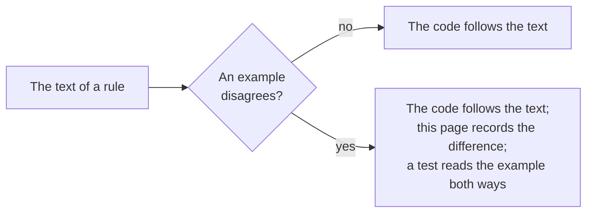

# Gaps in the specifications

Where the specifications disagree with each other, or an example disagrees with the text, the package follows the text of the
rule and a test pins the choice. The examples are those that `pnpm spec-examples` downloads at pinned hashes.

| Where                                                   | What the specifications say                                                                                                         | What the package does                                                                                                                                 |
| ------------------------------------------------------- | ----------------------------------------------------------------------------------------------------------------------------------- | ----------------------------------------------------------------------------------------------------------------------------------------------------- |
| The Deep Linking request of Deep Linking Appendix A     | The example has no `target_link_uri`; LTI Core section 5.3.4 says the claim is required in every message, and the tool routes by it | `ltiLaunch` refuses a Deep Linking request without it (`claim-missing`). The test reads the example with the claim added, and refuses it as it stands |
| Security Framework version                              | LTI Core cites version 1.0; 1.1 is current and backwards compatible                                                                 | Follows 1.1. Login CSRF is section 7.4.1                                                                                                              |
| The score of AGS section 3.4 with an extension property | The first example carries `https://www.toolexample.com/lti/score`, an extension                                                     | `publishAgsScore` refuses a property it does not know; extensions are not supported yet (see [supported](supported.md))                               |
| `resource_link.title` and `description` of a launch     | LTI Core section 5.3.5 has both as strings                                                                                          | Reads `null` as absent: Canvas sends `"title": null` and `"description": null`. The test reads a published Canvas launch                              |
| A value of the `custom` claim                           | LTI Core section 5.4.6 has every value a string                                                                                     | Reads a number or a boolean as its text: Canvas sends `canvas_user_uuid` as a number. Any other value is refused (`claim-invalid`)                    |
| `expires_in` of a token response                        | RFC 6749 section 5.1 recommends it                                                                                                  | Optional: without it `expiresAt` is absent and the tool uses the token until a service refuses it                                                     |
| The audience of a client assertion                      | LTI Core section 6.2.1 has the token URL of the platform; some platforms name themselves                                            | The token URL, or the `audience` of the registration when a platform wants another value                                                              |
| A line item URL that ends with a slash                  | AGS section 3.4 appends `/scores` to the line item URL and does not say how a trailing slash is handled                             | Removes one trailing slash first, so that the URL does not have `//scores`                                                                            |
