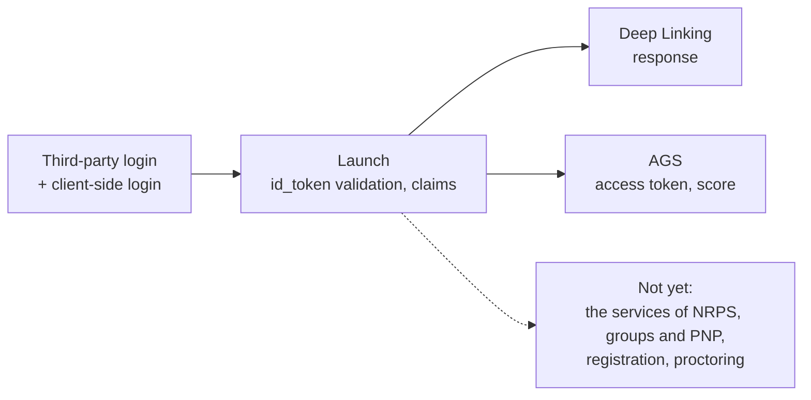
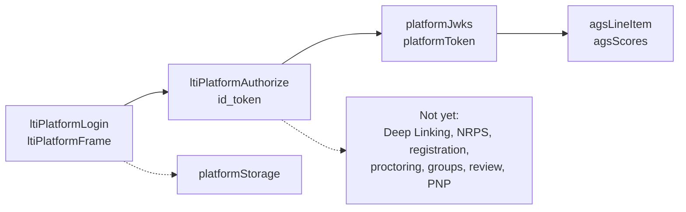

# Supported

What `@interopkit/tool-integration` implements of LTI 1.3: the tool role first, then the platform role. The package
implements these specifications and is not certified by 1EdTech. It claims no LTI Advantage conformance: the Names and Role
Provisioning Services are absent.

| Area                                | Specification              | Tool role                                                                 | Not yet                                                                                                                                                                                |
| ----------------------------------- | -------------------------- | ------------------------------------------------------------------------- | -------------------------------------------------------------------------------------------------------------------------------------------------------------------------------------- |
| Third-party login | Core 4.1, Security 5.1.1 | `ltiLogin`: GET and POST of at most 65,536 bytes, `lti_message_hint`, `client_id`; `lti_deployment_id` and `target_link_uri` kept for the launch |  |
| Authentication request and response | Security 5.1.1 | State cookie, or the platform's storage; the error response is refused as `platform-error` |  |
| Token validation | Security 5.1.3, 5.4 | Signature, `iss`, `aud` with the registration's `trustedAudiences`, `azp`, `exp`, `iat`, `nonce`, `kid` |  |
| Algorithms | Security 7.2 | RS256, RS384, RS512, ES256, ES384, ES512, or the registration's `algorithms`; the tool signs with any of the six through its `Signer` |  |
| Required claims                     | Core 5.3                   | `ltiLaunch`, with the message type, version and deployment                |                                                                                                                                                                                        |
| Message types | Core 5, DL 4.4, SR 2, Proctoring 4 | The five messages a platform sends, as `LtiMessage`; others by name with `otherMessageTypes`, and versions with `versions` |  |
| Anonymous launch                    | Core 5.3.6.1               | `user.subject` absent                                                     |                                                                                                                                                                                        |
| Optional claims                     | Core 5.4                   | `context`, `organization`, `tool_platform`, `role_scope_mentor`, `launch_presentation`, `lis` |                                                                                                                                                                  |
| User identity claims                | Core 5.3.6                 | Names, email, picture, locale; `actual_user` of an impersonation          |                                                                                                                                                                                        |
| Vendor claims                       | Core 5.4.7                 | Every claim of the token, as JSON, in `claims`                            |                                                                                                                                                                                        |
| `target_link_uri` | Core 5.3.4 | Equal to the login's, else `target-mismatch`; the deployment equal to the login's `lti_deployment_id`, else `deployment-mismatch` |  |
| Roles                               | Core Appendix A            | Passed through as sent; the vocabularies and `canonicalizeRole`           |                                                                                                                                                                                        |
| Migration claim | Migration Guide | `lti1p1`, read; `verified` when `legacySecret` gives the secret that signs the consumer key |  |
| Custom properties                   | Core 5.4.6                 | A map of strings                                                          |                                                                                                                                                                                        |
| Key sets | Security 6.3, 6.4 | Reads the platform's with `createJwksCache`; serves the tool's with `serveToolJwks`, every key of a rotation with `max-age` |  |
| Service tokens | Core 6.2, Security 4.1 | `clientCredentialsToken` of `core/oauth` with `private_key_jwt` and the deployment claim, inside `publishAgsScore`; a token is never reused | A token cache and a client of the services |
| Deep Linking request                | DL 4.4                     | The ten settings of DL 4.4.1                                              |                                                                                                                                                                                        |
| Deep Linking response               | DL 3, 4.5                  | `ltiResourceLink` with title, text, url, custom, `lineItem`               | `link`, `file`, `html`, `image`, `gradesReleased` of a line item, extensions, `icon`, `thumbnail`, `window`, `iframe`, `available`, `submission`, `msg`, `log`, `errormsg`, `errorlog` |
| AGS claim                           | AGS 3.1                    | `services.grades` of the launch                                           |                                                                                                                                                                                        |
| Line item service                   | AGS 3.2                    | One read for `scoreMaximum`                                               | Container, create, update, delete, filters, paging                                                                                                                                     |
| Result service                      | AGS 3.3                    |                                                                           | All                                                                                                                                                                                    |
| Score publish | AGS 3.4 | `publishAgsScore`: `Completed`; `FullyGraded`, `Pending`, `PendingManual`; the line item on the registration's `serviceOrigins`, else a public `https` host | `scoringUserId`, `submission`, extensions |
| Client-side login                   | OIDC with postMessages 0.1 | `lti.put_data` and `lti.get_data` pages                                   |                                                                                                                                                                                        |
| postMessage Storage                 | PM Storage 0.1             | The two pages                                                             |                                                                                                                                                                                        |
| Capabilities | postMessages 0.1 | Both pages ask `lti.capabilities` and use the frame that the answer names, else `lti_storage_target` |  |
| Names and Role Provisioning         | NRPS 2.0                   | `services.roster`, the claim                                              | The service                                                                                                                                                                            |
| Dynamic Registration                | DR 1.0                     |                                                                           | All                                                                                                                                                                                    |
| Submission Review                   | SR 1.0                     | The request, as `SubmissionReviewMessage`                                 | The line item property `submissionReview`                                                                                                                                              |
| Proctoring                          | Proctoring 1.0             | `LtiStartProctoring` and `LtiEndAssessment`, as messages                  | The Start Assessment message and the Assessment Control Service                                                                                                                        |
| Context Groups                      | Groups 1.0                 | `services.groups`, the claim                                              | The service                                                                                                                                                                            |
| AfA PNP connector                   | PNP Connector 1.0          | `services.preferences`, the claim                                         | The service                                                                                                                                                                            |

## Platform role

| Area                                | Specification              | Platform role                                             | Not yet                                                                         |
| ----------------------------------- | -------------------------- | --------------------------------------------------------- | ------------------------------------------------------------------------------- |
| Third-party login                   | Core 4.1, Security 5.1.1   | `ltiPlatformLogin`: all parameters, with two signed hints |                                                                                 |
| Authentication request and response | Security 5.1.1             | `ltiPlatformAuthorize`                                    | A refusal throws and never reaches the tool as an authentication error response |
| Client assertions                   | Security 5.1.3, 5.4        | Verified with RS256, against a key set or given keys      |                                                                                 |
| Algorithms                          | Security 7.2               | RS256                                                     | RS384, RS512, ES256, ES384, ES512                                               |
| Required claims                     | Core 5.3                   | `issueIdToken`, for a resource link launch                |                                                                                 |
| Anonymous launch                    | Core 5.3.6.1               |                                                           | `sub` is always the principal                                                   |
| Optional claims                     | Core 5.4                   |                                                           | `context`, `tool_platform`, `role_scope_mentor`, `launch_presentation`, `lis`   |
| User identity claims                | Core 5.3.6                 |                                                           | Name, email, picture, locale                                                    |
| Vendor claims                       | Core 5.4.7                 |                                                           | All                                                                             |
| `target_link_uri`                   | Core 5.3.4                 | The same value in the login and in the token              |                                                                                 |
| Roles                               | Core Appendix A            | The role of a learner                                     | The other 37 IRIs                                                               |
| Custom properties                   | Core 5.4.6                 | Copied from the launch                                    | Variable substitution: values pass unsubstituted                                |
| Key sets                            | Security 6.3, 6.4          | `platformJwks`: one key, with its thumbprint as `kid`     | A rotation overlap                                                              |
| Service tokens                      | Core 6.2, Security 4.1     | `platformToken`: two scopes, replay check of the `jti`    |                                                                                 |
| Deep Linking                        | DL 4.4, 4.5                |                                                           | Request and response                                                            |
| AGS claim                           | AGS 3.1                    | `lineitem`                                                | `lineitems`                                                                     |
| Line item service                   | AGS 3.2                    | `agsLineItem`: one line item, sealed in its own URL       | Container, create, update, delete, filters, paging                              |
| Result service                      | AGS 3.3                    |                                                           | All; the scope is not offered                                                   |
| Score publish                       | AGS 3.4                    | `agsScores`, `readAgsScore`: media type, user and values  | The order of timestamps is the receiver's                                       |
| Client-side login                   | OIDC with postMessages 0.1 | `platformStorage`                                         |                                                                                 |
| postMessage Storage                 | PM Storage 0.1             | The minimum limits, and `storage_exhaustion`              |                                                                                 |
| Capabilities                        | postMessages 0.1           |                                                           | `lti.capabilities` is answered by the host's page                               |
| Names and Role Provisioning         | NRPS 2.0                   |                                                           | All                                                                             |
| Dynamic Registration                | DR 1.0                     |                                                           | All                                                                             |
| Submission Review                   | SR 1.0                     |                                                           | All                                                                             |
| Proctoring                          | Proctoring 1.0             |                                                           | All                                                                             |
| Context Groups                      | Groups 1.0                 |                                                           | All                                                                             |
| AfA PNP connector                   | PNP Connector 1.0          |                                                           | All                                                                             |

Specifications whose text is behind a sign-in at 1EdTech (the Asset Processor family, EULA, Context Message, Data Privacy,
Rubric Service and others) are not assessed.

## Models of the service bodies

Both roles share the models of [the bodies of the services](services.md). The reader and the writer of each are built and
tested; the client of the tool role and the handler of the platform role that use them are not yet.

| Service                    | Specification     | Modeled                                                                                          | Not yet                    |
| -------------------------- | ----------------- | ------------------------------------------------------------------------------------------------ | -------------------------- |
| Line items                 | AGS 3.2           | Line item with `activityId`, `gradesReleased` and `submissionReview`, its container, its filters | Client, handler, paging    |
| Scores                     | AGS 3.4           | Score with `scoringUserId`, `submission` and extensions                                          | Client, handler            |
| Results                    | AGS 3.3           | Result and its container, its filters                                                            | Client, handler            |
| Memberships                | NRPS 2.0          | Container, member, message of a resource link, group enrollments, filters                        | Client, handler, differences |
| Groups                     | Groups 1.0        | Groups, group sets, filters                                                                      | Client, handler            |
| Content items              | DL 3              | The five types, their extensions and other types                                                 | The check against the request |
| Configurations             | DR 2              | Platform, tool, acknowledgment, translations, extensions                                         | Steps, routes              |
| Assessment Control Service | Proctoring 5      | Control request and status                                                                       | Client, handler            |
| Preferences                | PNP Connector 1.0 | The record as JSON, the `fields` filter                                                          | Client, handler            |
