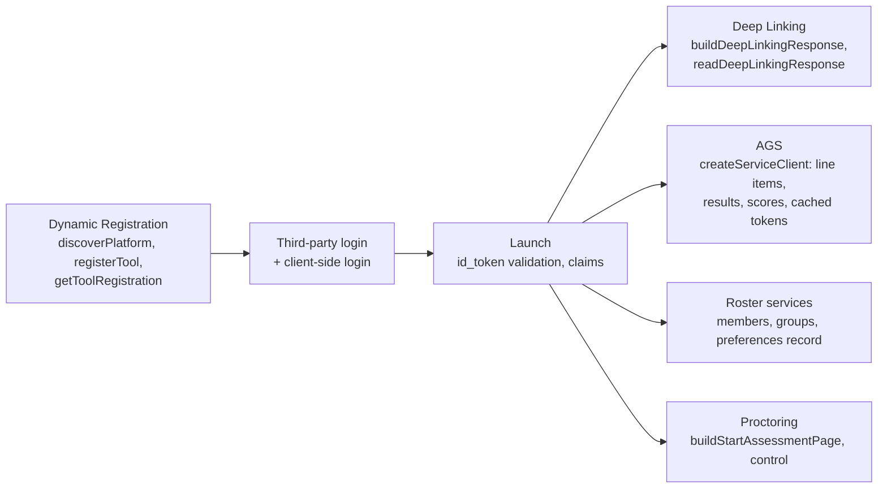
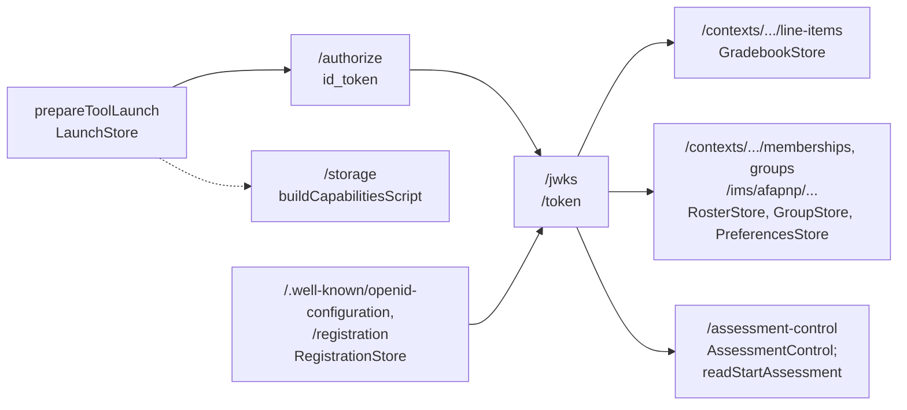

# What tool-integration supports

What `@interopkit/tool-integration` implements of LTI 1.3, the tool role first, then the platform role; [the evidence](evidence.md)
gives each check with its count and date.

| Area                                | Specification                      | Tool role                                                                                                                                                                                                                                                                                                                                                                                                                       |
| ----------------------------------- | ---------------------------------- | ------------------------------------------------------------------------------------------------------------------------------------------------------------------------------------------------------------------------------------------------------------------------------------------------------------------------------------------------------------------------------------------------------------------------------- |
| Third-party login                   | Core 4.1, Security 5.1.1           | `handleLogin`: GET and POST of at most 65,536 bytes, `lti_message_hint`, `client_id`; `lti_deployment_id` and `target_link_uri` kept for the launch                                                                                                                                                                                                                                                                             |
| Authentication request and response | Security 5.1.1                     | State cookie, or the platform's storage; the error response is refused as `platform-error`                                                                                                                                                                                                                                                                                                                                      |
| Token validation                    | Security 5.1.3, 5.4                | Signature, `iss`, `aud` with the registration's `trustedAudiences`, `azp`, `exp`, `iat`, `nonce`, `kid`                                                                                                                                                                                                                                                                                                                         |
| Algorithms                          | Security 7.2                       | RS256, RS384, RS512, ES256, ES384, ES512, or the registration's `algorithms`; the tool signs with any of the six through its `Signer`                                                                                                                                                                                                                                                                                           |
| Required claims                     | Core 5.3                           | `handleLaunch`, with the message type, version and deployment                                                                                                                                                                                                                                                                                                                                                                   |
| Message types                       | Core 5, DL 4.4, SR 2, Proctoring 4 | The five messages a platform sends, as `LtiMessage`; others by name with `otherMessageTypes`                                                                                                                                                                                                                                                                                                                                    |
| Anonymous launch                    | Core 5.3.6.1                       | `user.subject` absent                                                                                                                                                                                                                                                                                                                                                                                                           |
| Optional claims                     | Core 5.4                           | `context`, `organization`, `tool_platform`, `role_scope_mentor`, `launch_presentation`, `lis`                                                                                                                                                                                                                                                                                                                                   |
| User identity claims                | Core 5.3.6                         | Names, email, picture, locale; `actual_user` of an impersonation                                                                                                                                                                                                                                                                                                                                                                |
| Vendor claims                       | Core 5.4.7                         | Every claim of the token, as JSON, in `claims`                                                                                                                                                                                                                                                                                                                                                                                  |
| `target_link_uri`                   | Core 5.3.4                         | Equal to the login's, else `target-mismatch`; the deployment equal to the login's `lti_deployment_id`, else `deployment-mismatch`                                                                                                                                                                                                                                                                                               |
| Roles                               | Core Appendix A                    | Passed through as sent; the vocabularies and `canonicalizeRole`                                                                                                                                                                                                                                                                                                                                                                 |
| Migration claim                     | Migration Guide                    | `lti1p1`, read; `verified` when `migrationSecret` gives the secret that signs the consumer key                                                                                                                                                                                                                                                                                                                                  |
| Custom properties                   | Core 5.4.6                         | A map of strings                                                                                                                                                                                                                                                                                                                                                                                                                |
| Key sets                            | Security 6.3, 6.4                  | Reads the platform's with `createJwksCache`; serves the tool's with `serveToolJwks`, every key of a rotation with `max-age`                                                                                                                                                                                                                                                                                                     |
| Service tokens                      | Core 6.2, Security 4.1             | `requestClientCredentialsToken` of `core/oauth` with `private_key_jwt` and the deployment claim; one token for each scope, kept until it is about to expire, dropped on a 401                                                                                                                                                                                                                                                   |
| Deep Linking request                | DL 4.4                             | The ten settings of DL 4.4.1                                                                                                                                                                                                                                                                                                                                                                                                    |
| Deep Linking response               | DL 3, 4.5                          | `buildDeepLinkingResponse`: the five item types and the types that others define, with their extensions, `lineItem` with `gradesReleased`, `available`, `submission`, `msg`, `log`, `errormsg`, `errorlog`; the items held to the settings of the request                                                                                                                                                                       |
| AGS claim                           | AGS 3.1                            | `services.grades` of the launch                                                                                                                                                                                                                                                                                                                                                                                                 |
| Line item service                   | AGS 3.2                            | `createServiceClient`: container with filters and pages, read, create, update, delete                                                                                                                                                                                                                                                                                                                                           |
| Result service                      | AGS 3.3                            | `results`, by user, in pages                                                                                                                                                                                                                                                                                                                                                                                                    |
| Score publish                       | AGS 3.4                            | `publishScore`: every property of the score model, extensions included; `advanceScoreTimestamp` for AGS 3.4.9; the URLs on the registration's `serviceOrigins`, else a public `https` host                                                                                                                                                                                                                                      |
| Client-side login                   | OIDC with postMessages 0.1         | `lti.put_data` and `lti.get_data` pages                                                                                                                                                                                                                                                                                                                                                                                         |
| postMessage Storage                 | PM Storage 0.1                     | The two pages                                                                                                                                                                                                                                                                                                                                                                                                                   |
| Capabilities                        | postMessages 0.1                   | Both pages ask `lti.capabilities` and use the frame that the answer names, else `lti_storage_target`                                                                                                                                                                                                                                                                                                                            |
| Names and Role Provisioning         | NRPS 2.0                           | `services.roster`, the claim; `members`: role, limit, resource link with its message section, groups, differences, `next` and `differences` links                                                                                                                                                                                                                                                                               |
| Dynamic Registration                | DR 1.0                             | `readRegistrationInitiation`, `discoverPlatform` (the address checked before the fetch, the configuration below its issuer, every endpoint a public host), `registerTool` (the registration endpoint on the issuer's origin or `registrationOrigins`), `buildPlatformRegistration`, `buildRegistrationClosePage`; `getToolRegistration` and `updateToolRegistration` with the registration access token or a token of `lti-reg` |
| Submission Review                   | SR 1.0                             | The request, as `SubmissionReviewMessage`; `submissionReview` of a line item                                                                                                                                                                                                                                                                                                                                                    |
| Proctoring                          | Proctoring 1.0                     | `LtiStartProctoring` and `LtiEndAssessment`, as messages; `buildStartAssessmentPage`: the Start Assessment message with the session data, the resource link and the attempt copied, the verified claims held to the values that the platform sent; `control` of the Assessment Control Service                                                                                                                                  |
| Context Groups                      | Groups 1.0                         | `services.groups`, the claim; `groups` with the user filter, `groupSets`, paging                                                                                                                                                                                                                                                                                                                                                |
| AfA PNP connector                   | PNP Connector 1.0                  | `services.preferences`, the claim; `preferences`: the record of a user for an activity, the `fields` filter                                                                                                                                                                                                                                                                                                                     |

## Platform role

| Area                                | Specification                      | Platform role                                                                                                                                                                                                                                                                                                                                       |
| ----------------------------------- | ---------------------------------- | --------------------------------------------------------------------------------------------------------------------------------------------------------------------------------------------------------------------------------------------------------------------------------------------------------------------------------------------------- |
| Third-party login                   | Core 4.1, Security 5.1.1           | `prepareToolLaunch`: all parameters; the message kept in the `LaunchStore`, two sealed hints                                                                                                                                                                                                                                                        |
| Authentication request and response | Security 5.1.1                     | `/authorize`, GET and form POST; a refusal is the authentication error response of 5.1.1.5                                                                                                                                                                                                                                                          |
| Client assertions                   | Security 4.1.1, 5.1.3, 5.4         | The six algorithms of `APPROVED_ALGORITHMS`, or the registration's `algorithms`; audiences, `message_type`, deployment, `jti`                                                                                                                                                                                                                       |
| Algorithms                          | Security 7.2                       | Signs with the `Signer` of the key set, one of the six; verifies the six                                                                                                                                                                                                                                                                            |
| Message types                       | Core 5, DL 4.4, SR 2, Proctoring 4 | `LtiResourceLinkRequest`, `LtiDeepLinkingRequest`, `LtiSubmissionReviewRequest`, `LtiStartProctoring`, `LtiEndAssessment`                                                                                                                                                                                                                           |
| Required claims                     | Core 5.3                           | Every message, through the one model                                                                                                                                                                                                                                                                                                                |
| Anonymous launch                    | Core 5.3.6.1                       | A `user` without a `subject`: no `sub`                                                                                                                                                                                                                                                                                                              |
| Optional claims                     | Core 5.4                           | `context`, `organization`, `tool_platform`, `role_scope_mentor`, `launch_presentation`, `lis`                                                                                                                                                                                                                                                       |
| User identity claims                | Core 5.3.6                         | Names, email, picture, locale; `actual_user` of an impersonation                                                                                                                                                                                                                                                                                    |
| Vendor claims                       | Core 5.4.7                         | `extensions` by URL                                                                                                                                                                                                                                                                                                                                 |
| `target_link_uri`                   | Core 5.3.4                         | The same value in the login and in the token                                                                                                                                                                                                                                                                                                        |
| Roles                               | Core Appendix A                    | Any role of the vocabularies, held to the sender's rules                                                                                                                                                                                                                                                                                            |
| Custom properties and substitution  | Core 5.4.6, Appendix B             | The tool's and the message's; the variables of the message, and the host's through `substitution`                                                                                                                                                                                                                                                   |
| Migration claim                     | Migration Guide                    | `lti1p1`, its consumer key signed with the secret of `migrationSecret`                                                                                                                                                                                                                                                                              |
| Key sets                            | Security 6.3, 6.4                  | `/jwks`: every public key of the key set, `max-age` of an hour; `previousHintKeys` for the hint key                                                                                                                                                                                                                                                 |
| Service tokens                      | Core 6.2, Security 4.1             | `/token`: the scopes that the request asks for, the registration grants and a service offers; the deployment of the assertion; replay check of the `jti`                                                                                                                                                                                            |
| Deep Linking request                | DL 4.4                             | The ten settings; `data` seals the user, the settings and the host's data                                                                                                                                                                                                                                                                           |
| Deep Linking response               | DL 4.5                             | `readDeepLinkingResponse`: the tool, the signature, the `nonce` once, the sealed `data`, each item by its type, held to the settings of the request                                                                                                                                                                                                 |
| Proctoring                          | Proctoring 4, 5                    | `LtiStartProctoring` with sealed session data and the `acs` claim, `LtiEndAssessment`; `readStartAssessment`: the tool, the signature, the `nonce` once, the session data for this tool, deployment, resource link and attempt; the Assessment Control Service over an `AssessmentControl`                                                          |
| Client-side login                   | OIDC with postMessages 0.1         | `/storage`                                                                                                                                                                                                                                                                                                                                          |
| postMessage Storage                 | PM Storage 0.1                     | The minimum limits, and `storage_exhaustion`                                                                                                                                                                                                                                                                                                        |
| Capabilities                        | postMessages 0.1                   | `buildCapabilitiesScript` for the host's frame page                                                                                                                                                                                                                                                                                                 |
| AGS                                 | AGS 2.0                            | Over a `GradebookStore` of the methods it supports: the claim with `lineitems` and `lineitem`, line items with filters and pages, results, scores kept by AGS 3.4.9; the client and the scopes checked again on every call                                                                                                                          |
| Names and Role Provisioning         | NRPS 2.0                           | Over a `RosterStore`: the claim, `role`, `limit`, `rlid` with the message section, `groups`, the `differences` link and `since`, `next` links, `lti11_legacy_user_id`; only what the request asked for is shared                                                                                                                                    |
| Dynamic Registration                | DR 1.0                             | Over a `RegistrationStore`: `buildRegistrationInitiation` with a single-use token, the OpenID configuration below the issuer, `/registration` (the token spent before the body is read, every address a public host on no origin of the platform, the scopes narrowed), `/registration/{client}` with a token of `lti-reg`, `buildToolRegistration` |
| Submission Review                   | SR 1.0                             | The request, with the line item of its message                                                                                                                                                                                                                                                                                                      |
| Context Groups                      | Groups 1.0                         | Over a `GroupStore`: the claim with the sets URL on request when the store has them, groups and groups of a user, group sets, `next` links                                                                                                                                                                                                          |
| AfA PNP connector                   | PNP Connector 1.0                  | Over a `PreferencesStore`: the claim, the record of a user for an activity below `/ims/afapnp/v1p0`, held to the `fields` asked for                                                                                                                                                                                                                 |

Specifications whose text is behind a sign-in at 1EdTech (the Asset Processor family, EULA, Context Message, Data Privacy,
Rubric Service and others) are not assessed.

## Models of the service bodies

Both roles read and write [the bodies of the services](services.md) with these models.

| Service                    | Specification     | Modeled                                                                                          |
| -------------------------- | ----------------- | ------------------------------------------------------------------------------------------------ |
| Line items                 | AGS 3.2           | Line item with `activityId`, `gradesReleased` and `submissionReview`, its container, its filters |
| Scores                     | AGS 3.4           | Score with `scoringUserId`, `submission` and extensions                                          |
| Results                    | AGS 3.3           | Result and its container, its filters                                                            |
| Memberships                | NRPS 2.0          | Container, member, message of a resource link, group enrollments, filters                        |
| Groups                     | Groups 1.0        | Groups, group sets, filters                                                                      |
| Content items              | DL 3              | The five types, their extensions and other types; the check against the settings of the request  |
| Configurations             | DR 2              | Platform, tool, acknowledgment, translations, extensions                                         |
| Assessment Control Service | Proctoring 5      | Control request and status                                                                       |
| Preferences                | PNP Connector 1.0 | The record as JSON, the `fields` filter                                                          |
